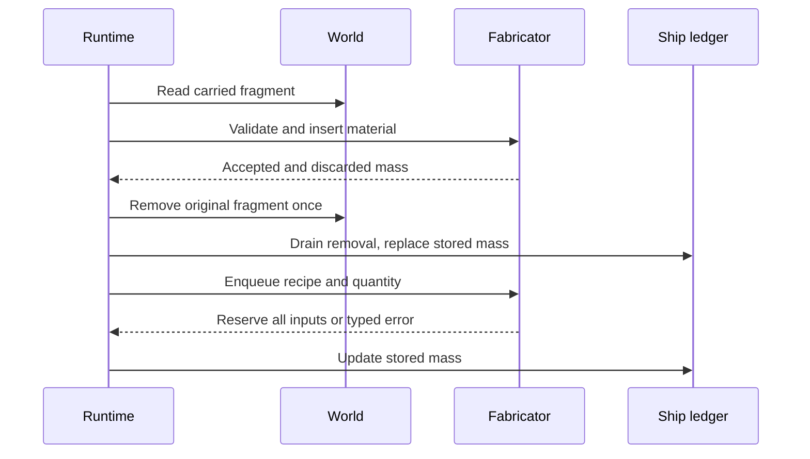

# Spaceship, Building & Survival

> **Approved future Scout/construction contract (2026-10-22):** [Scout art direction and modular construction](scout-and-modular-construction.md). Older entries below describe the **currently implemented** authored Scout where noted; they do not override the new target. This page is not evidence that modular building or the new cargo bay has shipped.

> Migrated from the Salimon project documents on 2026-09-29. For current task status and dependencies, use [GitHub issues](https://github.com/mr-exception/salimon/issues).

## Direction
The spaceship is the player's **primary home, vehicle, survival system, workshop, and progression platform**. Each player owns exactly one ship and develops it over a long period rather than collecting fleets.
## Interior and operation
- The player walks inside the ship in first person.
- Ship systems are physically located and manually operated.
- The cockpit/navigation module controls navigation and can only be operated by the ship owner.
- Other systems such as railguns, laser weapons, fabrication, charging, processing, maintenance, and life-support functions should exist at distinct physical locations.
- Other players aboard the ship may operate all modules except owner-only navigation.
- **Current implementation:** The authored Scout has a walkable cabin, cockpit and aft airlock; the old protruding port cargo module was removed. **Approved future starter:** Integrate a dedicated aft physical cargo bay inside a coherent hull, separated from the main cabin by a wide-door bulkhead, with compact bunk/galley/hygiene facilities. See [approved target](scout-and-modular-construction.md) and #538–#540.
- The cockpit has a shorter nose and shorter canopy glazing. One center console carries one wide multifunction monitor, with clear walking routes on both sides from the cabin past the console into the cockpit nose. Seated forward and downward visibility remains usable.
- **Current implementation:** Loose physical fragments can be dropped on the cabin deck; the existing authored asset has no designated cargo room. **Approved future starter:** An aft cargo bay with visible physical bins/racks and a closable internal door (not a second virtual inventory). This design question is resolved; see [the approved contract](scout-and-modular-construction.md).

## Construction

> **Updated approved flow:** Select an object/room/module, place its in-world placeholder, feed resources directly into it, then build automatically once fully funded (about 5–20 seconds for simple objects, up to 5 minutes for complex ones). Cancellation before completion returns `100% - progress%` of each physically contributed resource type; no separate worksite machine, Start button or staged salvage minigame. A multi-cell room may use one placeholder; construction remains a **future** feature. Instant direct-material **Energy Core upgrades** are exempt from timers, worksites, power costs and module shutdown. See [complete current approval](scout-and-modular-construction.md) and issues #541–#550.

- Ship expansion uses **modular rooms/hull sections**.
- Adding new structural rooms requires the ship to be landed or docked.
- Interior modules and objects can be built while the ship is in flight where physically reasonable.
- Construction changes both the exterior silhouette and the walkable interior.
- Every gameplay module must have a functional purpose and a physical location.
- Mass, balance, structural integrity, power requirements, heat, and relevant aerodynamic/flight effects should influence performance.
## Core ship systems
Planned simulation areas include:
- Energy Core / power generation and storage
- Propulsion and thrusters
- Oxygen generation/filtering and life support
- Internal atmosphere and pressure
- Hull and structural integrity
- Navigation
- Sensors and communication
- Cargo and physical storage
- Resource processing and fabrication
- Weapons
- Thermal behavior
- Environmental protection
- Damage and maintenance
The Energy Core is central to the ship's power and propulsion systems.
## Durability and maintenance
Ship hull sections, engines, and other modules have durability. Durability can fall due to:
- normal use;
- elapsed time;
- combat damage;
- environmental hazards;
- collisions or failures.
Players maintain modules using crafted **repair kits**. A repair kit restores a defined amount of durability; more advanced modules may require more kits or more expensive maintenance.
## Survival systems
Player survival needs include:
- Oxygen
- Food
- Water
- Temperature
- Sleep
- Health/injury
- Radiation
- Pressure
- Stamina
The ship itself must provide or support the resources and equipment needed to manage these needs.
## Death
Death is intentionally severe. If the player dies or suffers unrecoverable total loss, the run ends and the player starts the game fresh. This makes preparation, maintenance, navigation, and cooperation meaningful.
## Physical inventory and cargo
Inventory should avoid abstract chest/list behavior wherever possible.
- Resources exist as physical objects/fragments.
- Players can drop resources directly on the ship floor and create visible piles.
- **Current implementation:** The authored Scout can carry loose fragments on its cabin deck and has no dedicated cargo room. **Approved future starter:** a separated aft cargo bay with real physical bins and correct cargo mass, without abstract storage; see [approved future design](scout-and-modular-construction.md).
- Physical containers organize objects spatially; the player can see and retrieve the actual contents.
- Cargo mass and placement may affect the ship where simulation depth permits.
## Space EVA and airlock
- When the ship is in open space and is **not landed**, the player may open the airlock and leave the ship for EVA/free-flight.
- On exit, the player starts from the airlock's world-space position and **inherits the ship's current linear velocity**. EVA movement then adds player-relative motion on top of that inherited velocity instead of resetting the player to a stationary world frame.
- While in open-space EVA, the player can freely translate and orient around the ship. The motion model must remain consistent with the ship's current world-space motion so the player and ship continue travelling through space together unless the player deliberately changes relative velocity.
- This open-space EVA condition remains active until the player comes within **3,000,000 m** of a planet or other solid celestial body. Inside that distance, movement must transition to the nearby-body interaction/gravity regime rather than continuing indefinitely as deep-space free-flight.
- The 3,000,000 m threshold is the same nearby-body distance used elsewhere in the game and should be treated as one shared gameplay constant rather than duplicated values.
- Opening the airlock in space is intentionally allowed. Future pressure, oxygen, suit-safety, decompression, and death consequences may add risk, but they must not invalidate the core ability to perform EVA.
## Resource gathering
### Asteroids
A mining laser/tool detaches fragments from asteroids or breaks sufficiently small asteroids into multiple pieces. Fragments are physically collected into the ship, then processed by ship modules.
### Planetary resources
A handheld or equipment-based mining laser breaks resource objects into carriable physical fragments. For example, harvesting a tree can produce wood fragments and fruit objects.
### Processing
Raw materials can require processing before construction or crafting. Example: iron-bearing fragments can be refined/processed into steel for ship upgrades.
## Resource uses
Resources may be used for:
- food and survival supplies;
- repairs and maintenance;
- energy/fuel-related systems;
- trade;
- crafting;
- ship construction;
- upgrades;
- ammunition and weapons;
- research and technology progression.
## Technology progression
Research and technology unlocks should enable:
- faster/better thrusters;
- improved ship modules;
- better environmental protection;
- stronger weapons;
- improved tools and resource processing;
- the ability to safely travel farther from Earth toward Absenat.
## Confirmed ship destruction, salvage and access rules
- Other players may damage, destroy, salvage, and loot a ship whether or not its owner is alive.
- If the owner dies, the ship becomes orphaned and remains in the world as salvage/loot.
- If the ship is destroyed while the owner survives, the owner can still return and rebuild/repair from the **Core**, which is the irreducible recovery point of the ship.
- There are no lockable protected containers or general anti-loot protections planned; physical access means items can be taken.
## Confirmed personal inventory rules
The game should avoid conventional abstract inventory.
- **Core carrying rule:** the player can physically carry exactly **one carriable world object at a time**. This is a permanent rule for all current and future carriable world objects, including mined resource fragments; it is not a temporary limit that increases with progression.
- The player has no general backpack or pocket inventory for resources or other ordinary world objects.
- Equipped gear and dedicated equipment slots are separate from the one-object carrying mechanic and do not consume that carrying capacity.
- A player can equip one primary gun/tool and carry one extra in a toolbelt; these equipped/toolbelt items are separate from the one-object carrying mechanic.
- The accepted Fabricator wave specifies **3 food-ration slots** and **2 medkit slots**, one item each, separate from physical world-object carrying. See the accepted Fabricator contracts below.
- Future transport aids such as electrical carts may help move multiple physical items, without increasing the player's personal one-object carrying capacity.
- Every physical item has mass and volume and these properties affect carrying, storage, and ship mass.
- Loose objects inside the spaceship do not need to react to ship acceleration because the ship provides internal gravity; acceleration effects are intentionally abstracted away for interior object stability.
## Confirmed construction and damage model
- **Approved future construction:** a **ship-local 3 m × 3 m × 3 m structural grid on all three axes**, with face-based connection to the persistent Core, multi-deck expansion, optional finer data-driven attachment snapping, and one blueprint spanning many structural cells. The older Z-only snap plan is superseded by [this approved contract](scout-and-modular-construction.md).
- Rooms and modules can be individually detached or destroyed during combat and can physically separate from the ship.
- Structural integrity is primarily a numerical design constraint rather than a full bending/breaking simulation.
- Weapon damage should be localized to specific hull sections/modules and can cause decompression, disabled systems, and internal damage.

### Nearby-body EVA implementation (#36)

Nearby means an inclusive **surface distance** of 3,000,000 m measured from the
player, using the world-owned constant also re-exported by ship telemetry.
Only solid bodies apply EVA gravity. The nearest eligible surface wins;
exact ties follow catalog order. Entry preserves world position and inherited
velocity and adds the shared fixed 9.81 m/s² radial gravity. Airborne assisted
3D controls remain available, and the camera uses radial up. On body contact,
existing eye-height surface walking takes over. Exiting influence disables radial
gravity and preserves accumulated drift. Ship interior gravity overrides this
mode after re-entry. This does not add orbital physics to ship flight.

### Physical planet/ship transfer (#47)

E picks up an aimed fragment on the surface or while walking inside; E releases
the carried fragment from hand height. Gravity and contact let fragments settle
on the ground or pile against one another. Doorway
movement keeps the same carried world entity relative to the player's eye/up
basis. Releasing inside attaches that physical entity to a ship-local support
anchor: it moves with the ship while simulated against the cabin deck. Pickup detaches
it; releasing outside lets it fall onto radial ground.
Identity, material, mass, and source stay unchanged through repeated trips.
Current greybox cubes retain world-axis orientation with conservative clearance
for rotated decks. This adds no abstract inventory, container system, cargo
containers or backend persistence. Physical fragments now contribute to cached ship mass; see below.

## Implemented starter flight (#201)

The 100,000 kg dry hull now uses the #493 fictional funded-energy law: 1 J of
propulsion allocation gives 1 N·s impulse. At default 100/50 MW forward/reverse,
this yields 100/50 MN and 1000/500 m/s². World-space momentum persists independently
of orientation; zero throttle coasts. Acceleration uses configured watts, the
impulse coefficient and cached total mass. Steering remains
5°/s with its existing presentation ramp. There is no drag, speed cap or
planetary gravity in this flight wave. Core energy now gates free-flight force and cockpit/artificial-gravity power.

Up/Down select signed −100..+100% throttle, one percentage point on press and
one more per 100 ms held. Selection persists when leaving the cockpit. Only
a powered cockpit in free flight can change it; assists reject input. Landing
completion and contact reset selection to zero.

## Implemented contact response (#202)

Free flight sweeps solid bodies/terrain to prevent high-speed tunneling. Contact
zeros throttle and produces bounded, progressively damped normal rebounds, then
rests in `GroundedAfterCrash`. This is separate from a proper assisted landing;
L requests powered recovery from a settled crash through the same cockpit action.
Recovery reserves 12 seconds of power for lift, safe relocation and standard
landing; without sufficient energy the ship stays grounded. It does not count
as Landed until completion. No damage is applied. The current conservative
collider remains; exact hull/contact physics is future work.

## Implemented physical ship mass (#187)

Total mass includes the 100,000 kg dry hull and each positive-mass physical object
whose center is in the authored cabin/nose, including carried and loose cargo.
Installed equipment uses separate stable ledger identities when configured;
current authored fixtures have no separate equipment weight definition. Pickup,
release, growth, boundary crossings and despawn/consumption update the cache once
per identity. Mass changes affect force/mass acceleration and preserve velocity.
The lowered ramp outside the cabin is outside onboard containment. Session
streaming never removes physical cargo. This does not add abstract inventories.

## Implemented Energy Core (#188)

The configurable starter battery stores 60 GJ, initially 45 GJ (75%). Maximum
forward/reverse draw is 100 MW/50 MW scaled by signed throttle magnitude.
Artificial gravity and cockpit instruments independently draw configurable idle
watts (starter tuning: 100 kW and 10 kW). A full-capacity ten-minute forward-burn
estimate excludes idle loads; endurance is not a fixed gameplay invariant.

Zero energy stops thrust, cockpit controls/display and artificial cabin gravity,
preserving throttle selection and velocity. Inside gravity never falls back to
planetary gravity. Charge restoration resumes selected throttle automatically.
Core transactions can charge and discharge together; requested loads receive
incoming energy before surplus storage is capped. Fractional joules are retained
internally. Physical fragment intake/conversion and powered recovery are implemented.
Assist activation reserves forward watts × duration atomically (800 MJ landing,
600 MJ takeoff at starter tuning). Reserved energy is isolated from ordinary
consumers; bus blackout cannot cancel the path. Unused budget is refunded on
completion, clipped to capacity. Insufficient energy rejects activation.

`advance_with_core_input(delta, incoming_joules)` settles converted energy at a
step boundary with that step's normal idle/propulsion consumers before storage
clipping. It preserves exact powered-thrust duration. Conversion timing/rate is
owned by E03; no continuous charging source is assumed by this task.

## Physical Core fueling (#189)

Carry one fragment to the Core, aim at it within 3 m and press E. Mechanical
intake works without power, immediately consumes the fragment and removes its
cargo mass. One fragment processes at a time, automatically, wherever the player
is. Conversion defaults to 200 MJ/s with material-specific configurable yields
(iron 1 GJ/kg, rock 0.5 GJ/kg, ice 2 GJ/kg). Discharge continues during conversion;
excess energy above capacity is wasted and processing never pauses at full charge.

## Interior blackout movement (#191)

Without artificial gravity, indoor WASD and Space/Shift translate in three
dimensions. Releasing controls retains drift until contact. Power return restores
walking/deck gravity from the current position. Loose cargo becomes weightless,
retains velocity, contacts other fragments and stays bounded by cabin geometry.
Nearby planets do not pull crew/cargo while inside. Carrying and mechanical Core
intake remain available. Detailed acceleration-induced cabin forces are deferred.

## Cockpit blackout authority (#192)

An unpowered cockpit has no mechanical flight-control backup. Selected signed
throttle and heading survive outage; the ship coasts until conversion restores
power, then selected nonzero thrust automatically returns even without a seated
pilot. Steering stops at exhaustion and needs fresh powered input after outage.
Assisted sequences retain their reserved energy and cannot be overridden.

## Accepted propulsion and Core review (2026-10-14)

These numbered references reconcile the 15-round, 84-decision review with the
owning gameplay rules above. They supersede the original direct-speed/no-energy
Phase 0 baseline; historical evidence remains evidence of its original revision.
The [ship architecture](../client/ship/architecture.md) owns numerical contracts,
and [technical architecture](technical-architecture.md#flight-update-and-validation-decisions-197)
owns timing, validation and implementation boundaries.

- **1–8:** Velocity persists independently of orientation, with no speed cap.
  Ship-local forward/reverse force changes world velocity through total mass;
  turning alone does not redirect travel. Signed −100..+100% throttle persists
  after release/seat exit. Reverse is deliberately weaker.
- **9–13:** This wave has no planetary ship gravity or orbital simulation.
  Braking is manual reverse thrust; landing requires safe total speed; takeoff
  retains terminal velocity. Mass affects translation only, not steering inertia.
  Existing nearby-body EVA gravity remains a distinct character feature.
- **14–18:** Count dry hull, configured equipment and all physical cargo.
  Reverse force is 50% of forward; arrows change 1% and repeat while held.
  Propulsion consumes Core energy; no reaction-mass fuel tank is introduced.
- **19–24:** Every velocity component counts toward the starter 20 m/s landing
  limit. Future upgrades may increase it. Show vector/relative speed and braking
  distance/time. Empty energy prevents thrust/new assistance; watt draw scales
  with absolute throttle and forward/reverse capacity. Fuel with physical
  fragments using resource-specific energy ratios.
- **25–30:** Interact with the Core while carrying one fragment. Its yield is
  J/kg × material mass, converted at a configurable rate; over-capacity energy
  is discarded. Reserve assistance energy up front. Future upgrades may improve
  consumption; no progression/modifier system is implemented here.
- **31–36:** Loose, held and future stored onboard objects count once. Mass
  changes immediately affect acceleration without changing velocity or adding
  recoil. Keep existing physical cargo contacts and permanent one-object carry.
  Intake accepts one process at a time and keeps processing at full charge,
  wasting excess. EVA inherits velocity once at exit; later ship acceleration
  does not tow the player.
- **37–41, 43–48:** Starter hull is 100 tonnes. Historical 4/2 MN capacities are
  superseded by #493: 1 N·s/J from funded Core propulsion gives 100/50 MN and
  1000/500 m/s² dry. Watt demand and resource J/kg remain configuration. Forward draw is 100 MW and reverse 50 MW; battery capacity is 60 GJ,
  initially 75% (45 GJ). Ten minutes at full charge/max forward is a rough tuning
  estimate excluding idle, not guaranteed endurance. Thrusters, assistance,
  artificial gravity and cockpit consume power. Accepted fragments become energy
  and cease to exist physically. Fixed stepping (42) belongs to technical architecture.
- **49–54:** Accepted fragments disappear immediately; conversion transfers
  joules gradually and continues without a nearby/seated player. Gravity and
  cockpit have independent configurable idle loads. Depletion switches off
  powered systems while preserving heading, signed throttle and coasting.
  Restored power automatically resumes the selected nonzero throttle.
- **55–60:** Without cabin gravity the player floats using EVA-like controls,
  retaining momentum; loose fragments retain velocity and collide. Cockpit
  controls wait for power; throttle persists. Manual power management is deferred
  (58). Charging/discharging operate together on net available energy. A physical
  Core-local status display includes remaining-runtime information.
- **61–66:** The Core display blanks at depletion and restarts with power.
  Interior movement retains momentum; detailed acceleration-induced cabin
  forces are deferred. Contacts prevent penetration; ship contact response is
  refined by decisions 74/79 below, with no damage. There are no powerless
  alternative flight controls. Show velocity magnitude/vector and heading versus
  travel angle on the cockpit console.
- **67–71:** Landing/contact reset throttle to zero. Landing permits any heading
  at total relative speed ≤20 m/s. Normal engine thrust is disabled during
  assistance and stays zero afterward until changed. Braking estimates use the
  full vector, orientation, reverse force and cached total mass; misaligned
  reverse thrust cannot promise a stop. Sweep travel continuously against bodies
  and terrain to prevent high-speed tunneling.
- **73–77:** Endurance is an estimate, not a fixed core mechanic. A crash bounces
  and settles without damage; the pilot requests recovery to standardize the
  landed pose for takeoff. Proper landing finishes stationary, throttle zero.
  Float to the Core and insert the carried fragment through normal interaction.
  Cache mass from entry/exit/consumption events and reconcile explicitly for
  validation, rather than scanning every flight tick.
- **79–83 (final collision/recovery clarification):** Rebounds lose velocity until
  resting in GroundedAfterCrash, distinct from Landed. L requests powered lift,
  alignment and proper touchdown; the 20 m/s limit still applies. Insufficient
  energy leaves the ship grounded until refueled. Deduct the entire assistance
  budget atomically on activation, isolate it from other consumers, and refund
  unused joules if applicable. Mechanical intake works without electricity and
  can bootstrap the Core. These final clarifications supersede earlier shorthand
  about stopping immediately or calling crash contact a stable Landed state.

## Future upgrades and systems — OUT OF SCOPE for this wave

Future thruster upgrades may change force/efficiency; landing upgrades may raise
safe speed/range or reduce reserved cost. Future physical modules may add energy
loads. Full cabin acceleration/inertial forces, gravity/orbits, manual per-system
power management, damage, fuel reaction mass and survival consequences are not
implemented by this wave. Existing configuration seams do not constitute an
upgrade/progression system. Owner-only multiplayer navigation is a future rule;
current client-only authority means the powered occupied cockpit.

## Accepted spherical mining (2026-10-15)

Holding left mouse aimed at a valid deposit grows one sphere at the mining tool's
front-left, with a configurable per-tool **10 kg** initial cap. Release the sphere
immediately on mouse-up or loss of valid aim; automatically release at cap and
start another on continued hold. Depletion releases a smaller final sphere.
Unequip/interruption also releases. Phase 0 mining consumes no energy. Keep
single-object carrying and physical mechanical Core feeding. Portable lifecycle,
conservation, density/radius and sequencing are canonical in the
[resource contract](../client/world/resource-contracts.md#spherical-mining-lifecycle-230).

## Local takeoff and powered handoff (#295)

The old fixed-six-second takeoff targeted the edge of the 0.15R landing shell.
On Earth this moved roughly 900 km and handed about 450 km/s to flight; manual
throttle was intentionally locked during that captured path. Increasing engine
force cannot fix that scripted target or its retained momentum.

Takeoff lifts 10 m in 2 seconds, then rises another 40 m in 4 seconds using
smoothstep segments. It ends 50 m above the captured landed origin at rest,
with throttle zero and immediate powered manual control. The stages peak at
7.5 and 15 m/s respectively, each with acceleration magnitude at most 15 m/s²; position and velocity are
continuous at the join and handoff. This local clearance is independent of the
planetary landing-eligibility shell. There is no free-flight planetary gravity,
so zero-throttle flight remains stationary until thrust is selected.

This deliberately supersedes historical wording that takeoff must clear the
entire planetary landing volume. Landing range remains an activation rule,
unchanged at 0.15R and ≤20 m/s. The six-second uncancellable assist, orientation,
door interlock, cockpit-exit continuation and isolated energy reservation remain.
The cockpit explicitly says flight controls are locked while takeoff runs.

#493 supersedes the historical 4/2 MN free-flight tuning. At 100/50 MW and
1 N·s/J, 110,000 kg (1,000 × 10 kg cargo) gives about 909.09/454.55 m/s²;
doubled dry mass gives 500/250 m/s². The unchanged stationary assist handoff
avoids an automatic thrust jump; manual control must account for the higher
acceleration. Native handling review is #498; no Core capacity increase or
change to approved impulse math is silently introduced.
Core capacity/initial charge remain 60/45 GJ, full engine draws 100/50 MW,
and takeoff still reserves 600 MJ up front plus ordinary 110 kW idle demand
(600.66 MJ total over six seconds at starter tuning). Assisted paths remain
captured kinematics with a conservative watt-time budget, not a mass-dependent
physical-work solver. Free-flight force, mass, power and braking remain governed
by their existing physics/energy contracts.

The [#295 report](../reports/issue-295/README.md) contains before/after production
controller traces and exact portable validation. Native M1 flight/input/EVA
signoff remains [#312](https://github.com/mr-exception/salimon/issues/312).


## Accepted Fabricator contracts (2026-10-19, #336)

This section is the canonical gameplay contract for the five approved Fabricator
Q&A rounds. It authorizes crafting beyond the historical Phase 0 exclusions;
it does not authorize survival, disk persistence, upgrades or progression gameplay.
Implementation is staged through #336–#348; documentation is not playable delivery.

| Round | Approved behavior |
| --- | --- |
| 1 — Products and collection | Start with medkits and food rations. Basic blueprints are unlocked by default; future advanced blueprints have unlock requirements. Select a recipe and positive quantity, then collect finished output from the physical tray. Three food slots and two medical slots are separate from equipment and physical carrying. |
| 2 — Raw storage and reservation | One universal port accepts resource fragments. Store at most 20 kg of each material. Consume the entire inserted fragment, discard overflow, and provide no raw withdrawal. Deduct/reserve all ingredients for the requested quantity atomically at enqueue; reject insufficient materials without mutation. |
| 3 — Work scheduling | Fixed recipe durations and continuous Core watts, one operation at a time in strict FIFO order. Blackout pauses progress without losing it; power restoration resumes. Add/cancel jobs; cancellation never refunds inputs. The single occupied output tray blocks production, including the next unit of a multi-unit request. Work continues while the player is away whenever powered. |
| 4 — Physical interaction and UI | Wall-integrated module, universal insertion port, physical monitor and output tray. E opens its interface. Dedicated food/medical HUD slots remain separate from the five-slot equipment toolbar. Consumable selection is owned by the hold-Q wheel (#377); M/N consumption is retired. |
| 5 — Final scope | Exactly one item per slot. The Q wheel consumes a specific occupied slot even if a future health/hunger benefit is wasted. Implement item crafting/inventory only; no healing, hunger or health effects. Design persistence boundaries but keep state in memory until the game has persistence. Crafting continues during landing, takeoff and acceleration. Count stored raw resources and physical tray output in ship mass; exclude reserved inputs and carried consumable inventory. Add real raw material identities suitable for food/medicine. Blueprints are data-driven: ingredients, time, watts, output mass/category and unlock requirements. |

### Ownership, commands and snapshots

`salimon-world` owns raw material identity, generation, extraction, physical
fragments and the single carried world-object slot. The portable
`salimon-fabrication` crate (introduced by #338) owns validated blueprints, bounded
raw storage, reservation, queue/progress and its one-item output tray. It depends
only on world resource contracts and std; never renderer, native IO or ship.
Runtime owns proximity/aim/E gating, consuming a real world fragment exactly
once after storage acceptance, Core energy settlement, tray-to-inventory
transactions, Q-wheel input, and cached ship mass updates. Ship owns electricity and
its mass ledger. Renderer receives observation DTOs only. Dedicated consumable
inventory must not enlarge world carrying or equipment capacity.

Typed API (implemented in #338; [crate guide](../client/fabrication/architecture.md)): `RecipeId`, `JobId`, `Mass`,
`Ingredient`, validated `RecipeBook`, `Fabricator`, `FabricationCommand` and
`FabricatorSnapshot`. Commands insert material, enqueue recipe/quantity, cancel
by job identity and collect tray output. Errors are typed and transactional.
Snapshots expose stable IDs, raw balances, ordered pending quantities, active
progress/state, requested watts and tray item; reads never advance simulation.
Private authoritative state is mutated only through validated methods. A step
accepts exact elapsed `Duration` and an explicitly powered interval from the
runtime/Core adapter; no wall clock or cockpit/player dependency participates.
Power draw applies only while actual work advances. Empty queue, blocked tray
and blackout consume no crafting watts. Runtime splits at energy/job boundaries
rather than granting an entire powered frame on the basis of one charged joule.

Use integer mass quanta (milligrams) and `Duration` for the portable ledger;
convert positive finite world kilograms once at the insertion boundary with an
explicit rounding policy. Never repeatedly subtract floating-point recipe mass.
Queue limits are configurable technical bounds, not approved gameplay capacity;
reject a full queue atomically. Stable monotonic job IDs are never reused.

### Invariants and transactions

- Stored mass is bounded independently per stable world resource identity.
  Insertion consumes the original fragment and discards overflow only when space
  remains; a full bin rejects without consuming the carried object (#339).
- All units' ingredients leave storage together at enqueue. Reserved ingredients
  are committed costs, cannot be withdrawn and are never credited on cancellation.
- Only the FIFO head advances. Collecting output frees the tray; no elapsed time
  accumulated while blocked or unpowered may later be applied as free progress.
- Cancellation of an active job discards its partial work and remaining units;
  existing completed tray output survives. Cancelling a waiting job preserves
  survivors' order. Collection transfers exactly one output or changes nothing.
- Core interruption, player departure and flight state never reset queued work.
- Mass accounting intentionally makes an exception to universal physical mass:
  raw insertion replaces fragment mass with accepted storage mass (overflow lost);
  enqueue immediately removes all reserved ingredient mass; completion adds only
  finished tray mass; collection removes tray mass, with no consumable-inventory
  contribution. Cancellation adds no mass. This is a deliberate simplified rule,
  not conservation of ship mass or a reason to change other physical cargo.
  Integration must test every transition and avoid double-counting journal events.



```mermaid
sequenceDiagram
    participant R as Runtime
    participant S as Core
    participant F as Fabricator
    participant I as Consumable slots
    R->>F: Read next work boundary and watts
    R->>S: Settle powered interval
    R->>F: Advance funded time only
    F-->>R: Progress or one tray item
    R->>I: Validate free matching slot
    R->>F: Collect one item after validation
    R->>I: Place item; update tray mass
```

### Data, persistence and tuning boundary

Recipes identify materials by stable world keys and carry fixed quantities,
duration, watts, finished mass, category and unlock prerequisites. Ration and
medkit are initially unlocked. Categories/prerequisites permit future expansion;
no unlock acquisition, upgrade effects or research gameplay is authorized here.
Proposed starter tuning, **not user-specified or balanced**: ration uses 0.4 kg
organic biomass + 0.1 kg water ice, 10 seconds at 10 kW, output 0.3 kg; medkit uses
0.2 kg medicinal compounds + 0.1 kg water ice, 15 seconds at 20 kW, output 0.2 kg.
Catalog density, distribution, Core yields and technical queue bounds are also
proposed tunables. Food/medicine inputs must be real world resources, not fake
crafting-only counters.

Future persistence would version stable recipe/material/job IDs, balances,
ordered jobs including captured recipe parameters/progress, tray and consumable
slots. Validate unknown IDs, mass bounds and recipe-version compatibility before
restoring atomically. Snapshots are observations, not a shipped save format.
No filesystem/serialization or save/load integration is implemented in this wave.
Portable domain tests cover reservation, overflow, ordering, power, cancellation,
tray gates and arithmetic; later runtime tests cover physical intake, power
settlement, inventory and mass transitions. Native visuals/signoff are separate.

## Hold-Q consumable wheel (#377)

Exact-identity survival consumption, continuing world/vital clocks and pause/death/
focus/restore cancellation follow the [canonical wheel contract](../client/runtime/architecture.md#hold-q-consumable-wheel-377).

### Survival consumable effects (#370)

The later survival expansion now defines an atomic explicit-item recovery adapter
on top of the Fabricator inventory-only wave above. Recipe IDs map to validated
instant/timed recovery records in the
[canonical survival recovery contract](../client/survival/architecture.md#consumable-recovery-definitions-370).
Exact slot/job/unit selection replaces category-first input; M/N remain absent.
Basic ration restores 40 hunger; medkit's provisional +25 ordinary health over
10 active seconds is documented reviewable balancing, not an approved lore
constant. Full-save/clock activation is #371, native Q wheel #377 and advanced
food definitions/unlocks #378. No recipe resource, mass or power policy changes.

## Approved future travel: Core impulse and Spatial Jump Drive (2026-10-21)

**Documentation only; neither engine conversion nor Jump Drive is shipped.** The full authoritative [shared-time, engine conversion and Jump Drive design](jump-drive-and-interstellar-travel.md) supersedes future-design assumptions that ordinary FTL is prohibited, while leaving the implemented October 14 ship/energy and October 19 Fabricator values above untouched **until separately implemented**.

- **Implemented ordinary engines, issue #493:** fund thrust directly by Core impulse: 1 J actual propulsion draw = 1 N·s of impulse (baseline coefficient 1 N·s/J). Changed velocity = impulse/current physical ship mass, directed along current signed ship thrust axis. Continuous power gives force = watts * 1 N·s/J. This is an intentional fictional efficiency, **not** a physical equivalence between energy and force. Do not charge kinetic-energy difference on top of Core watts. Legacy independent 4/2 MN capacities are removed. B controls durable engine on/off; power-funded substeps, telemetry, all-body assist/handoff and collision regressions implement the reconciliation. Native handling remains #498.
- **Sub-light and offline voyages:** prepare reserves, accelerate with thrusters, coast for real-world weeks/months while offline (engines off), and log in optionally to service machinery, use the Fabricator, recover Archive records and check navigation. Braking is not supplied by a jump. The universe clock is shared 1:1 by all players; no time dilation. Whether continuous thrusters can deliberately move at or above light speed is still undecided.
- **Future physical Jump Drive:** no disposable 'wrap cells' or separate fuel pool. Fabricator-built permanent module uses ordinary Core joules to displace the ship along its current forward vector while preserving inertial velocity, orientation and onboard contents; initial virtual velocity-gap N is **20% per light-second** and upgrades may lower N. Owner-authorized control panel has six separate light-distance fields (years/months/days/hours/minutes/seconds), live joule/charge preview and a **hard engines-on rejection**, even at zero throttle. The player and ship share a quantum-themed loading environment before arrival; no simulated elapsed years or free braking.
- **Physical and lifecycle guards:** explicit engine-off state distinct from throttle; no active flight assist; validated safe destination and region readiness; atomic single-debit jump transaction; no spoiler/chart leakage; offline/restore and multiplayer passengers remain consistent. Departing from/arriving near planets is still a later owner decision.
- **Balance must be measured:** at 100 t and rest, N20% requires **5.99584916 TJ for just 1 light-second**, versus the existing 60 GJ starter Core. The long-term galaxy-travel goal requires separately approved future economics/capacity/upgrade balancing; do not reduce N silently or claim this setup already plays well.

### Implemented survival onboarding (#380)

New runs guide survival details, Q consumption, Fabricator inspection/crafting/
collection and pause-menu checkpoint status. T explicitly skips. Completed
actions count out of order and progress/skip persist per run; no free supplies,
auto-pause or timer immunity. See the [runtime contract](../client/runtime/architecture.md#persistent-survival-onboarding-380).
