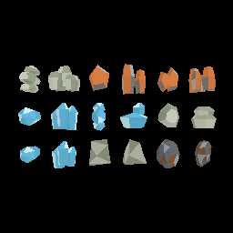

# Issue #158 — resident resource geometry and instancing

## Outcome

Implementation ready for review. All 18 authored fragment/deposit variants use
immutable indexed GPU geometry and grouped 32-byte camera-relative pose records.
WGSL applies quaternion rotation and uniform scale; opaque material roles/local
facet fill and reverse-Z are preserved. Conservative enclosing-sphere culling
runs before staging. CPU instance vectors, last-uploaded caches and GPU buffers
retain capacity; only changed visible variant batches upload. Camera translation
and ship movement refresh compact records, never mesh vertices. Unchanged visible
batches upload only the 64-byte camera uniform. Turning without changing the
visible set does not change pose records.

The deliberate tradeoff is **one draw per visible variant**, versus the former
one CPU-expanded resource batch: six for mixed fragment-only cargo, at most 18
with every fragment/deposit variant. Objects/triangles/draws count submitted work.
A fully changed visible cargo batch uploads 16,064 bytes at 500 or 32,064 at 1,000,
instead of 2,227,912 / 4,447,528 for this mixed fixture. Resident geometry is
uploaded only at renderer initialization. Scratch measurements now mean retained
instance staging plus last-uploaded byte capacity; they are not total allocations
or directly comparable to historical temporary vertex-capacity values.

No gameplay DTO/domain changes: stable variants, one-object carrying, picking,
physics, IDs, mass and session streaming are independent of culling. Existing
large-load/interaction/session/frame tests pass. No cargo cap or deletion is added.

**Native acceptance remains pending:** the Apple M1 iMac 1920×1080 AutoVsync/F3-off
reference matrix, verified settled versus actual active gameplay windows, native
near-plane/carried-item visual walkthroughs and hardware CPU/GPU budgets require
the reference desktop. This PR relates to #158 without closing it automatically.
#155 is closed as completed in GitHub, but its report's reference hardware and
loaded-route evidence are still absent; container measurements do not fill that gap.

## CPU preparation measurements

Linux 6.18.44 / Ubuntu 24.04 container, AMD EPYC 9V74, 9 visible CPUs, Rust 1.99.0;
source base `35d05d66f6aae2c8042c76462449c221544d943b` plus this branch's changes.
Measured 2026-10-13 UTC. This release microbenchmark compares the preserved
pre-instancing CPU expansion with production instance preparation/culling: six
mixed authored fragment variants, 50 warm-up and 200 measured iterations per case.
Active transforms vary positions/quaternions; fixed transforms are not a verified
settled physics pile. It excludes physics, queue enqueue/cache copying, GPU and
frame pacing. These are preparation savings, **not FPS or native performance**.

```sh
cargo test --release -p salimon-renderer resource_preparation_benchmark --locked -- --ignored --nocapture
```

Three runs are preserved in [machine-readable summary](preparation-summary.json)
and `preparation-run-{1,2,3}.txt`. Run 1 overlapped release compilation and has
noisy tails; runs 2/3 followed compilation. The table is run 3. Times are ms;
new upload is the maximum changed-frame amount, not an unchanged-frame transfer.

| Count | Transform state | Camera | Old median / p95 ms | New median / p95 ms | Old bytes/frame | Max new bytes/frame |
| ---: | --- | --- | ---: | ---: | ---: | ---: |
| 500 | settled-transforms | facing | 0.6164 / 0.9546 | 0.0133 / 0.0219 | 2,227,912 | 16,064 |
| 500 | settled-transforms | away | 0.6073 / 0.9870 | 0.0061 / 0.0072 | 2,227,912 | 64 |
| 500 | active-transforms | facing | 0.5974 / 1.0447 | 0.0132 / 0.0142 | 2,227,912 | 16,064 |
| 500 | active-transforms | away | 0.5897 / 0.9427 | 0.0061 / 0.0069 | 2,227,912 | 64 |
| 1000 | settled-transforms | facing | 1.3534 / 2.6093 | 0.0266 / 0.0451 | 4,447,528 | 32,064 |
| 1000 | settled-transforms | away | 1.3264 / 2.3438 | 0.0122 / 0.0182 | 4,447,528 | 64 |
| 1000 | active-transforms | facing | 1.3044 / 2.1148 | 0.0265 / 0.0292 | 4,447,528 | 32,064 |
| 1000 | active-transforms | away | 1.3302 / 2.7268 | 0.0122 / 0.0205 | 4,447,528 | 64 |

## GPU correctness and visual evidence

Both explicit GPU tests pass on Mesa 25.2.8 lavapipe (software Vulkan): pipeline
validation, indexed submission of 1,000 objects/all 18 variants, geometric buffer
growth, 64-byte unchanged/turned-camera uploads, translated-camera invalidation,
looking-away zero draws and returning-visible reuploads. The offscreen parity
test rasterizes all 18 variants with alternating rotations at a `1e12` m origin
against the old CPU-expanded reference. Result: **0 differing pixels / 65,536**,
9,522 colored pixels, ordinary reverse-Z attachment. Tests allow ≤32 differing
edge pixels across backend rounding; no timing threshold is asserted.

```sh
WGPU_BACKEND=vulkan VK_DRIVER_FILES=/path/to/lvp_icd.json cargo test -p salimon-renderer headless_resource --locked -- --ignored --nocapture
```

The local Mesa/LLVM packages were extracted under `/tmp/158-graphics`; the exact
local invocation additionally set
`LD_LIBRARY_PATH=/tmp/158-graphics/usr/lib/x86_64-linux-gnu` and used
`VK_DRIVER_FILES=/tmp/158-graphics/usr/share/vulkan/icd.d/lvp_icd.json`.
`SALIMON_RESOURCE_EVIDENCE_DIR` optionally writes PNGs (use an absolute directory;
Cargo runs tests from the crate directory). [GPU output](gpu-check.txt).
CI explicitly runs both GPU tests plus the CPU comparison on Linux before the
existing gameplay/resource evidence suites; no performance threshold on shared CI.



[CPU-expanded reference image](cpu-reference.png). This is an offscreen resource
contact sheet, not a native gameplay screenshot or reference hardware capture.

## Validation

Passed:

- `cargo fmt --all -- --check`
- `cargo clippy --workspace --all-targets --locked -- -D warnings`
- `cargo test --workspace --locked`: 320 tests passed; opt-in GPU/benchmark tests
  excluded. The final raster test addition was also checked by renderer tests,
  Clippy and the explicit software Vulkan invocation above.
- `cargo test -p salimon-renderer --locked`: 53 passed; three opt-in tests ignored.
- `python -m unittest discover -s scripts -p 'test_*.py'`: 44 tests passed.
- `cargo build --release --workspace --locked`
- CPU preparation matrix: 8/8 cases, three repeats.
- Explicit GPU tests: 2/2 passed.
- `git diff --check`

Failed before native event-loop/renderer initialization:

```sh
WGPU_BACKEND=vulkan VK_DRIVER_FILES=/path/to/lvp_icd.json xvfb-run -a -s '-screen 0 1280x800x24' python scripts/salimon-test suite --group resource-collection --evidence --summary --binary target/release/salimon-client --screenshot-command '["python", "scripts/capture_settled.py", "{path}"]'
```

The local command additionally used the extracted `/tmp/158-graphics/usr/bin`
PATH and library path above. All eight scenarios stopped at step zero with
`Failed to open connection to X server`; see [attempt results](graphical-attempt.json).
This container's display/socket boundary prevents native screenshots/gameplay
launch. No successful native E2E, packaged smoke, Metal/Windows rendering or M1
reference benchmark is claimed locally. PR CI runs the existing graphical suites.
No assets were edited, so Blender regeneration/model checks were not applicable.
