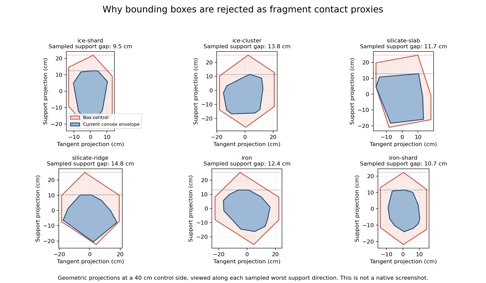

# Issue #160 — collision proxy and resource detail evaluation

## Decision

**Defer collision proxy replacement and visual resource LOD.** This is the
issue's permitted benchmark-backed evaluation/no-change outcome. Dependencies
#155–#159 are closed and present in baseline
`f538d4e6efcf6993001c280cfa8d1dd9572040ce`.

An eight-vertex local bounding box reduces raw SAT complexity, but adds
95–148 mm of sampled outward support discrepancy for a 0.4 m fragment side.
It fails the close-contact accuracy requirement. Active contacts can benefit
from simpler geometry, but this control does not establish an acceptable
authored replacement. No contact approximation/error budget is silently accepted.

Fragment visuals have just 14–96 triangles each; resident geometry, instancing,
compact uploads and conservative culling are already implemented (#158).
The inventory and software Vulkan probe do not establish a hardware geometry
bottleneck justifying LOD selection/hysteresis. Revisit projected-size LOD only
with resource-specific native GPU evidence. Close cargo must remain detailed;
invisible rendering must never suspend active physics.

The selected before/after gameplay geometry is identical. No generated asset,
shader, mass, identity, carrying, persistence, frame or render policy changes.
The production addition is immutable convex complexity instrumentation (one
stored face count and a read-only query). Experiments are opt-in ignored tests.

## All authored variants

Actual production GLB decode/indexing and `ConvexHull::new` results follow.
Stored positions are deduplicated input positions, including positions inside
an envelope; they do not count only extreme polytope vertices. Supporting faces
differ from unique parallel face axes. For two copies at arbitrary relative
orientations, the raw SAT axis upper bound is
`2 * face_axes + edge_axes²`, before deduplication, early separation and caching.
Only the first six hulls are runtime loose-fragment colliders. Deposit hulls are
hypothetical audits, not a new collision policy.

| Variant | GPU vertices | Triangles | Stored positions | Faces | Face axes | Edge axes | Raw pair-axis bound |
| --- | ---: | ---: | ---: | ---: | ---: | ---: | ---: |
| IceShard | 54 | 32 | 18 | 14 | 13 | 15 | 251 |
| IceCluster | 166 | 96 | 54 | 48 | 46 | 61 | 3813 |
| SilicateSlab | 29 | 14 | 9 | 14 | 14 | 21 | 469 |
| SilicateRidge | 35 | 16 | 10 | 16 | 16 | 24 | 608 |
| IronChunk | 175 | 80 | 42 | 74 | 74 | 111 | 12469 |
| IronShard | 179 | 80 | 42 | 74 | 74 | 111 | 12469 |
| IceDepositSpire | 56 | 32 | 18 | 17 | 13 | 12 | 170 |
| IceDepositCrown | 222 | 128 | 72 | 61 | 57 | 75 | 5739 |
| IceDepositRidge | 165 | 96 | 54 | 54 | 49 | 60 | 3698 |
| IceDepositShelf | 110 | 64 | 36 | 30 | 27 | 32 | 1078 |
| SilicateDepositBoulder | 62 | 38 | 21 | 38 | 38 | 57 | 3325 |
| SilicateDepositSlab | 128 | 76 | 42 | 52 | 52 | 78 | 6188 |
| SilicateDepositRidge | 183 | 114 | 63 | 76 | 76 | 114 | 13148 |
| SilicateDepositScree | 302 | 190 | 105 | 74 | 74 | 111 | 12469 |
| IronDepositNodule | 44 | 26 | 15 | 26 | 26 | 39 | 1573 |
| IronDepositVein | 89 | 52 | 30 | 44 | 44 | 66 | 4444 |
| IronDepositLedge | 89 | 52 | 30 | 42 | 42 | 63 | 4053 |
| IronDepositRubble | 229 | 130 | 75 | 72 | 72 | 108 | 11808 |

The diagnostic extent-derived box has eight vertices, six faces, three face
axes and three edge axes: raw pair bound 15. It is not an exported authored proxy.
See [render inventory](render-inventory.txt) and [structured geometry data](geometry-cpu.json).

## Contact comparison

The control retains authored local XYZ extents. A scan of 1,024 Fibonacci unit
directions compares its support plane with today's convex envelope. The largest
sampled discrepancy is a lower bound on worst error, not a certified Hausdorff
maximum. Multiply normalized error by actual fragment side; 0.4 m is a shared
experiment scale, not a new gameplay size rule. Floor/body normals can align with
these directions after rotation, leaving additional clearance around the visual.

| Fragment | Sampled support excess at 0.4 m side |
| --- | ---: |
| IceShard | 94.8 mm |
| IceCluster | 137.8 mm |
| SilicateSlab | 117.0 mm |
| SilicateRidge | 147.6 mm |
| IronChunk | 124.3 mm |
| IronShard | 106.8 mm |



This is a geometric diagnostic figure, not a native gameplay screenshot.
Regenerate with `python3 reports/issue-160/plot_support.py` (Matplotlib 3.10.8);
[figure source](plot_support.py) reads checked-in baked GLB positions. Today's
envelopes already bridge concavities, notably clustered ice; the box adds error
beyond that existing approximation. No sphere replacement is evaluated or selected.
No small authored replacement passed accuracy, so Blender regeneration/model
checks do not apply. Any future selected proxy/LOD must use the existing
`models/` source/export/validation workflow; never edit generated GLBs.

## CPU evidence

Linux container, AMD EPYC 9V74, nine visible CPUs, Rust 1.99.0. Collection ran
sequentially after builds/checks, without competing benchmark jobs. See
[environment and executable hashes](environment.json),
[raw samples/counters](geometry-cpu.json) and [completed probe log](cpu-probe.txt).

Six production shapes settle naturally, then their actual poses are tiled onto
an unbounded floor in separated 500/1,000 populations and observed through real
sleep dwell. Constant 2 kg mass and 0.4 m side isolate geometry; production
material-specific sizes, ship furniture and dense multi-layer cargo are outside
this experiment. IDs/order stay fixed. Settled replays require every body asleep
and exact unchanged poses. Active floor cases raise all bodies 2 mm, apply -1 m/s
vertical velocity and 0.2 rad/s spin. Active pair cases additionally place isolated
two-body stacks at supporting extents, exercising SAT/manifold response.

Each independent 16 ms production solver replay resets bodies/cache outside
its timer. Settled/floor rows have ten warm-up + 100 timed samples; expensive
pair rows have two warm-up + 20 timed samples with unreliable tails explicitly
flagged. Box/authored shapes naturally settle to different poses: this compares
workloads, not exact-pose parity or an accepted speedup. Contacts count repeated
solver responses, not unique pairs. This is CPU mechanism evidence, not native FPS.

| Count | State | Authored median / p95 ms | Box median / p95 ms | Authored / box pair contacts |
| ---: | --- | ---: | ---: | ---: |
| 500 | settled | 0.073 / 0.145 | 0.073 / 0.149 | 0 / 0 |
| 500 | active_floor | 26.766 / 33.382 | 27.405 / 34.301 | 0 / 0 |
| 500 | active_pairs (20 samples) | 1876.568 / 2025.600 | 314.473 / 358.520 | 8000 / 12000 |
| 1000 | settled | 0.154 / 0.212 | 0.155 / 0.205 | 0 / 0 |
| 1000 | active_floor | 58.808 / 68.076 | 55.617 / 64.985 | 0 / 0 |
| 1000 | active_pairs (20 samples) | 3772.384 / 4089.227 | 606.196 / 670.260 | 16000 / 24000 |

Both geometries eliminate settled narrow-phase work through sleeping. Active
floor controls offer no material savings; pair controls reduce cost substantially
but change contacts and fail geometric accuracy. A dense active pile remains
expensive with today's SAT/manifold law. No efficient active-cargo budget is claimed.

Two preliminary attempts were stopped: an initial deeply overlapping pair
fixture and a 100-replay pair collection. Their incomplete results are excluded.
The final supporting-extents fixture is bounded at 20 pair samples; its tail
percentiles are descriptive and cannot certify performance acceptance.

## GPU evidence

The offscreen resource-only pass uses 1920×1080 RGBA8 sRGB/reverse-Z, mixed
500/1,000 fragment instances at a `1e12` m origin, fixed or changing orientations,
0.1 m sides and a 4 m camera distance. Ten warm-up + 100 timestamped samples per
row. Exact retained object counts are asserted; looking away retains zero objects
and resource draws. Clear/depth cost is included. Uploads, physics, ship,
planets, UI, presentation and display pacing are excluded. Only the ignored test
drains submissions for sample attribution; native production readback stays nonblocking.

Adapter: Mesa 25.2.8 llvmpipe / LLVM 20.1.2, Vulkan, CPU software device.

| Count | Transforms | Camera | GPU median / p95 ms | Triangles | Draws |
| ---: | --- | --- | ---: | ---: | ---: |
| 500 | static | facing | 6.311 / 11.646 | 26522 | 6 |
| 500 | static | away | 0.881 / 1.659 | 0 | 0 |
| 500 | active | facing | 6.015 / 9.393 | 26522 | 6 |
| 500 | active | away | 0.941 / 1.820 | 0 | 0 |
| 1000 | static | facing | 12.340 / 19.723 | 52946 | 6 |
| 1000 | static | away | 0.988 / 1.889 | 0 | 0 |
| 1000 | active | facing | 11.365 / 19.736 | 52946 | 6 |
| 1000 | active | away | 0.840 / 1.844 | 0 | 0 |

See [timestamp samples](gpu-cost.txt) and [existing GPU parity/instancing checks](gpu-parity.txt).
**Software Vulkan establishes correctness and probe behavior, not native hardware
GPU budgets.** Static transforms do not establish gameplay sleep. No lower-detail
raster/LOD was selected, so no LOD speedup or visual-parity claim is made. The
existing all-18-variant raster test compares current indexed drawing with identical
CPU-expanded triangles at distant coordinates and alternating rotations.

Historical #156 native dense settled measurements provide context only: 500
facing whole-scene latest GPU medians about 2.309 ms, p95 5.68–5.76 ms; 1,000
medians 0.931–1.349 ms, p95 2.13–3.92 ms. These are asynchronous values on older
pre-#158/#159 builds, with different DPI/display conditions between populations.
They cannot attribute today's resource cost or constitute a current comparison.
See [historical 500 data](../issue-156/native-500-dense-settled-2026-10-12-summary.json)
and [1,000 data](../issue-156/native-1000-dense-settled-2026-10-12-summary.json).

## Checks, reproduction and limitations

The [benchmark guide](../../scripts/FRAGMENT_BENCHMARKS.md#resource-geometry-evaluation-160)
owns exact probe definitions. Commands from the repository root:

```sh
cargo fmt --all -- --check
CARGO_TARGET_DIR=/tmp/salimon-160-check cargo clippy --workspace --all-targets --locked -j 2 -- -D warnings
CARGO_TARGET_DIR=/tmp/salimon-160-check cargo test --workspace --locked -j 2
CARGO_TARGET_DIR=/tmp/salimon-160-check cargo build --workspace --locked -j 2
python3 -m unittest discover -s scripts -p 'test_*.py'
CARGO_TARGET_DIR=/tmp/salimon-160-target CARGO_PROFILE_RELEASE_CODEGEN_UNITS=1 cargo test --release -p salimon-client -p salimon-renderer --locked --no-run -j 2
SALIMON_GEOMETRY_EVIDENCE="$PWD/reports/issue-160/geometry-cpu.json" CARGO_TARGET_DIR=/tmp/salimon-160-target CARGO_PROFILE_RELEASE_CODEGEN_UNITS=1 cargo test --release -p salimon-client resource_geometry_evaluation --locked -- --ignored --nocapture
CARGO_TARGET_DIR=/tmp/salimon-160-target CARGO_PROFILE_RELEASE_CODEGEN_UNITS=1 cargo test --release -p salimon-renderer resource_geometry_inventory --locked -- --ignored --nocapture
WGPU_BACKEND=vulkan VK_DRIVER_FILES=/tmp/salimon-160-graphics/usr/share/vulkan/icd.d/lvp_icd.json LD_LIBRARY_PATH=/tmp/salimon-160-graphics/usr/lib/x86_64-linux-gnu CARGO_TARGET_DIR=/tmp/salimon-160-target CARGO_PROFILE_RELEASE_CODEGEN_UNITS=1 cargo test --release -p salimon-renderer resource_geometry_gpu_cost --locked -- --ignored --nocapture
WGPU_BACKEND=vulkan VK_DRIVER_FILES=/tmp/salimon-160-graphics/usr/share/vulkan/icd.d/lvp_icd.json LD_LIBRARY_PATH=/tmp/salimon-160-graphics/usr/lib/x86_64-linux-gnu CARGO_TARGET_DIR=/tmp/salimon-160-target CARGO_PROFILE_RELEASE_CODEGEN_UNITS=1 cargo test --release -p salimon-renderer headless_resource --locked -- --ignored --nocapture
git diff --check
```

Collection executed the corresponding built test binaries directly, keeping Cargo/
build activity outside timing windows. Passed: formatting, workspace Clippy/build,
**368 Rust tests**, **55 Python script tests**, authored inventory, all 12 CPU
control rows, eight software GPU timing rows and both GPU parity/instancing tests.
Ordinary workspace tests ignore the expensive/GPU probes; those run explicitly.

Initial release compilation failed with a zero-length compiler archive object.
A clean `/tmp` target and one release codegen unit passed. Package installation
was blocked by container filesystem/UID permissions; Mesa 25.2.8 packages were
downloaded/extracted into `/tmp/salimon-160-graphics` instead.

**Skipped at the user's explicit request:** MacBook M1 verification and native
M1 reference-matrix verification. No new Mac performance or visual claim.
Native game walkthroughs, staging/package smoke and Windows hardware checks
were not rerun: no gameplay, asset, shader or rendering-policy change is selected.
Existing production regressions cover pile settling/support removal, IDs/mass,
one-object carrying, streaming, frame precision and tick scheduling. The full
high-load native correctness/matrix follow-up remains tracked by #165.

Reopen geometry selection when an exported authored proxy meets a declared
contact error budget and demonstrates isolated active-load benefit, or native
resource GPU measurements justify LOD. Then add close/distant raster and
pile/contact acceptance. This evaluation does not waive those future asset gates.
