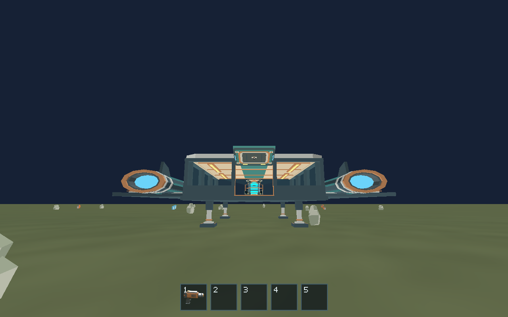
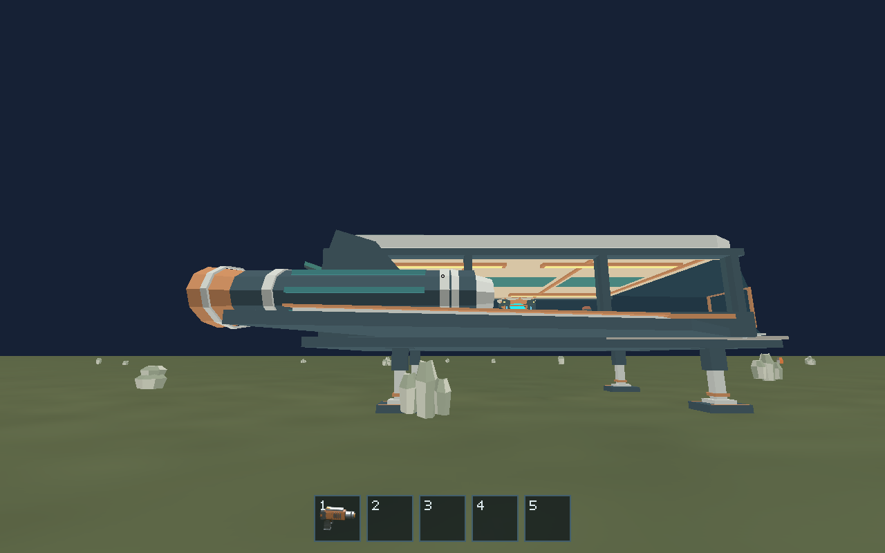

# Issue #168 — fixed scout landing supports

Implemented on 2026-10-13 from main `edacf0fcdec76d99ce8e159097239b03625f4af7`.

Four fixed deployed supports in the authoritative hull Blender component have
reinforced mounts, telescopic columns, copper collars and broad 1.35 × 1.10 m feet.
The exporter derives separate non-gear hull and foot Y minima, enforces the 2 m
clearance, and generates the ship landing constants plus eight character proxies.
Earth spawn and assisted landings share the foot-derived origin altitude. Existing
all-solid-body/multiple-normal tests verify foot contact within 1 mm, exact landed
pose at takeoff activation, phase timing and interlocks. Finite support boxes block
walking and sight/placement; under-hull space and the aft approach remain clear.

| Measurement | Previous | This change |
| --- | ---: | ---: |
| Nominal non-gear hull clearance | 0 m | 2 m (export quantization < 0.000001 m) |
| Landed origin altitude | 0.107527 m | 2.107527 m |
| Aft threshold top above ground | 0.382527 m | 2.382527 m |
| Triangles | 5,890 | 6,322 |
| GLB bytes | 484,796 | 526,104 |
| Materials / runtime ship draws | 13 / 2 | 13 / 2 |

Budgets are deliberately updated to 6,500 triangles, 124 primitives and 544 KiB.
No runtime generation or new per-frame geometry/draw is introduced. The fragment
transfer scenario's settled lateral coordinate is updated for the raised approach;
its ship-frame retention through flight assertions remain intact.

## Native evidence

The release executable completed assisted Earth touchdown, exited through the
existing gate and walked to these views using production input paths. The capture
waits two seconds before the standard settling helper because an earlier debug
capture caught an unpresented blue frame. These final images were inspected.

[Compact native checkpoint state](touchdown-state.json) records the ship pose,
altitude and character frame. Procedural deposits can intersect the static scout
footprint, as before; this task does not change resource spawning.

## Validation

Ubuntu 24.04, Rust 1.99.0, Python 3.12, Blender 4.5.3 LTS; native rendering used
Mesa lavapipe Vulkan and a dedicated Xvfb TCP display. Unix display sockets are
unavailable in this environment, so `DISPLAY=localhost:<display>` was used.

- PASS: `cargo fmt --all -- --check`.
- PASS: `cargo test --workspace --locked` — 369 passed, 7 existing opt-in tests ignored.
- PASS: `cargo clippy --workspace --all-targets --locked -- -D warnings`.
- PASS: `cargo build --workspace --locked`.
- PASS: `python scripts/build_game.py --profile release --output artifacts/build/release`.
  Initial parallel compiler attempts produced corrupt intermediate metadata; a
  clean rebuild with `CARGO_BUILD_JOBS=1` completed. No dependency/CI change needed.
- PASS: `python models/assets/ships/salimon-scout/export.py --blender <blender>`.
- PASS: `blender --background --python-exit-code 1 --python models/assets/ships/salimon-scout/verify_source.py`.
- PASS: `blender --background --python-exit-code 1 --python models/assets/ships/salimon-scout/verify_modular.py`.
- PASS: `python models/assets/ships/salimon-scout/validate.py`.
- PASS: `BLENDER=<absolute blender path> python -m unittest discover -s models/tests -v` — 55 tests including real Blender exports.
- PASS: `python -m unittest discover -s scripts -p 'test_*.py'` — 55 tests.
- PASS: `python scripts/salimon-test run scenarios/evidence/landing-gear.json --binary artifacts/build/release/salimon-client --screenshot-command '["python","-c","import time,subprocess,sys; time.sleep(2); subprocess.run([\"python\",\"scripts/capture_settled.py\",sys.argv[1]],check=True)","{path}"]'` — 58 steps plus two inspected screenshots.
- PASS: `python scripts/salimon-test suite --binary target/debug/salimon-client` — all 17 native baseline scenarios, including 500-fragment load, boarding, transfer and EVA.
- PASS: `python scripts/packaged_smoke.py --binary artifacts/build/release/salimon-client --timeout 90` — native launch/presentation and OS F2 input.

## Limitations and follow-up

Legs stay deployed during flight, explicitly allowed by #168. Nominal spherical
surfaces are supported; uneven terrain/foot articulation is future work. No Apple
M1/Metal or Windows hardware validation/performance claim is made.

#169 owns the bottom-hinged physical boarding ramp and continuous slope traversal.
The threshold is now **2.382527 m above ground**; supports remain outside its
centered corridor. Until that task replaces it, this change retains the legacy
250 ms gate gravity transition, including closed-door blocking. The current door
still opens upward. Screenshots are Linux software-rendered visual evidence,
not reference-machine performance measurements.
