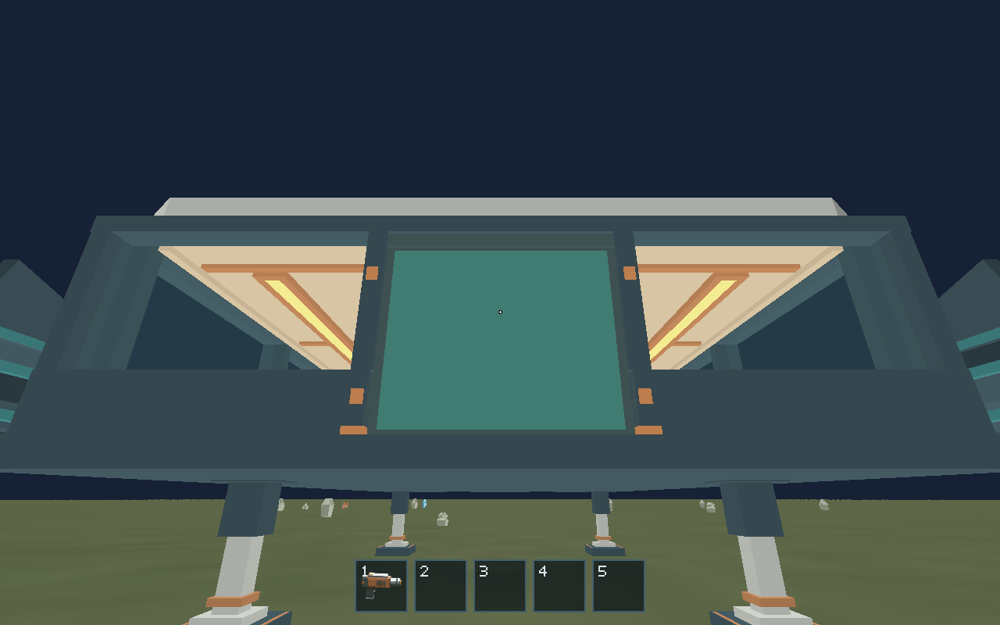
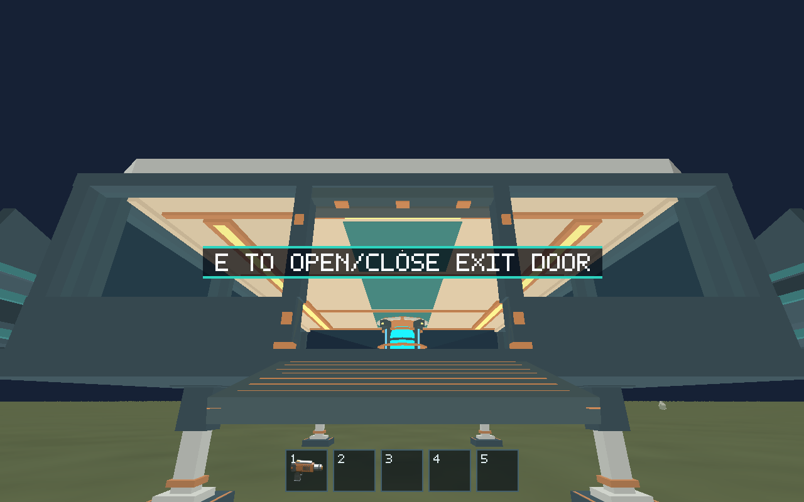
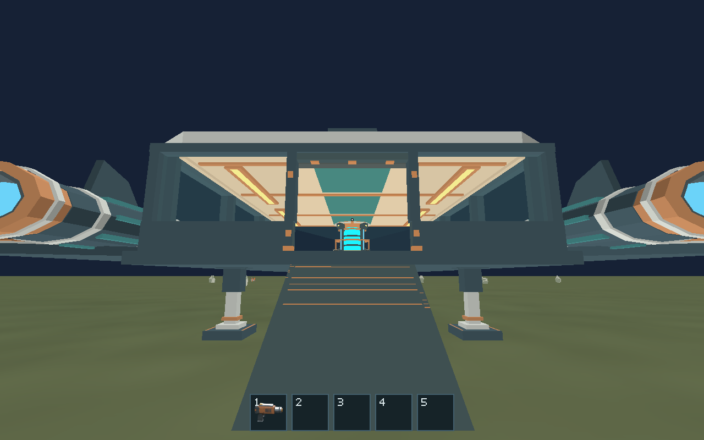

# #169 — bottom-hinged boarding ramp

Implemented against main `4076e74` (landing gear #168 merged), 2026-10-13.

The scout now opens its pressure leaf down/out about the bottom edge, then
extends a nested tray into a walkable boarding ramp. Closing retracts the tray
before lifting the leaf. A flush threshold connects the cabin deck to the hinge.
Character movement follows the physical slope continuously in both directions;
a stopped walker stays supported, with no timer-driven doorway drop or teleport.

## Geometry and ownership

- The Blender `exit-door` component owns the leaf, nested tip, flush threshold,
  frame, bottom hinge/latches, proxy and animation metadata. `author_ramp.py`
  records the reproducible authoring recipe.
- Bottom hinge: `[-7.68, 0.24731182796, 0]` m in ship axes. The 2.268817 m sealed
  leaf plus 2.131183 m extension travel produces a 4.4 m ramp, with 0.137635 m
  structural overlap. Width is 2.8 m. Full rotation is 122.36° (32.36° descending
  slope), ending at the #168 landing foot plane, Y = -2.10752688 m.
- Exported `boardingRamp` metadata generates matching character/renderer
  `ramp_geometry.rs` files. Validators check the pivot, flush threshold, leaf
  and tray face alignment, overlap and foot-plane contact. Checked-in Blender,
  GLB/glTF/bin, preservation contract and spatial layout are updated together.
- Character owns slope contact, normalized travel speed, body-clear side edges,
  inward entry across the tip and continuous radial surface contact. Camera up
  blends by distance along the ramp. Existing `DoorwayBlend`/blend-fraction
  protocol fields describe ramp location/progress for compatibility.
- Runtime requires 100% deployment for passage and rejects E if a player occupies
  the ramp/sweep. Surface walkers and 3D EVA movement reserve the deployment
  volume while the door moves. Ship owns the obstruction message and retains
  the closed/zero-fraction takeoff interlock. Open-space EVA has no ground ramp
  support and retains inherited drift and usable egress/re-entry.
- Renderer lowers the leaf during the first 60% of the reversible 700 ms pose
  and extends the tray during the last 40%, easing each phase. Both moving meshes
  remain in the opaque batch: **two ship draws**, 6,224 triangles, 118 primitives,
  13 materials, 523,876-byte GLB. This is smaller than the preceding gear export.

## Evidence

Native Linux software-Vulkan captures, using production controllers and E input:

| Closed | Moving | Deployed |
| --- | --- | --- |
|  |  |  |

[Closed cabin view](closed-interior.png) and [structured ramp checkpoints](ramp-states.json)
record interior/ground/ramp location, deployed support, the occupied-close
rejection and cabin return. Unit regressions also cover stopped contact, both
edges, side approaches, four viewing/input directions, a rotated frame at a
1e12 m anchor, swept 3D EVA collision and blocked takeoff. The resource transfer
route carries a fragment cabin → ground → cabin and verifies mass and stable
ship-local storage through flight/landing.

## Verification

Environment: Linux x86_64, Rust/Cargo 1.99.0, Python 3.12.14, Blender 4.5.3 LTS,
Mesa lavapipe, Xvfb 1280×800. Graphical runs used
`WGPU_BACKEND=vulkan VK_DRIVER_FILES=/usr/share/vulkan/icd.d/lvp_icd.json` and
`xvfb-run -a -l -s '-screen 0 1280x800x24 -listen tcp -ac'`, setting
`DISPLAY=localhost${DISPLAY}` in the child shell because this environment does
not expose X's Unix socket. Capture command:
`["python", "scripts/capture_settled.py", "{path}"]`.

| Command/check | Result |
| --- | --- |
| `cargo fmt --all -- --check`; `git diff --check` | Passed |
| `cargo clippy --workspace --all-targets --locked -- -D warnings` | Passed |
| `cargo test --workspace --locked` | Passed: 368 tests; 7 pre-existing ignored tests |
| `cargo build --workspace --locked`; `cargo build --release --locked` | Passed |
| `python models/assets/ships/salimon-scout/export.py --blender /workspace/scratch/3300ecf9fbfd/tools/blender-4.5.3-linux-x64/blender` | Passed; checked-in exports generated from linked source |
| `python models/assets/ships/salimon-scout/validate.py` | Passed |
| Blender `--background --python-exit-code 1 --python models/assets/ships/salimon-scout/verify_source.py` and `verify_modular.py` | Passed; source/export agreement and edit propagation |
| `BLENDER=… python -m unittest discover -s models/tests -v` | Passed: 55 tests, including real Blender checks |
| `python -m unittest discover -s scripts -p 'test_*.py'` | Passed: 55 tests |
| `python scripts/salimon-test suite --binary target/release/salimon-client --summary` | 17/18 passed; stale cargo-coordinate assertion corrected and the affected scenario rerun separately |
| `python scripts/salimon-test run scenarios/fragment-transfer.json --binary target/release/salimon-client --summary` | Passed on rerun |
| `python scripts/salimon-test run scenarios/evidence/boarding-ramp.json --binary target/release/salimon-client --screenshot-command … --summary` | Passed, with closed/moving/deployed captures |
| `python scripts/salimon-test suite --group ship-eva --evidence --binary target/release/salimon-client --screenshot-command … --summary` | Passed: all 4 routes |
| `python scripts/salimon-test suite --group resource-collection --evidence --binary target/release/salimon-client --screenshot-command … --summary` | Passed: all 7 routes |
| `python scripts/packaged_smoke.py --binary target/release/salimon-client --timeout 90` | Passed: window, presented frame, OS F2 round-trip and playable input |

Earlier iterations found obsolete timed-doorway expectations and unsafe E
positions in old routes. Scenarios now walk the full ramp and stand outside the
sweep before toggling; resource approach waypoints and cargo storage expectations
were updated for the longer route without relaxing their tolerances. One native
cargo run timed out while heavy CPU and software-rendering checks overlapped;
its sequential rerun passed. Initial Unix-socket Xvfb launches failed before
window creation; TCP display access resolved that environment limitation.

## Limits

The tip targets the current nominal spherical surface/landing-foot tangent
plane. Curvature at this footprint differs by micrometers; configurable terrain
will need terrain-sampled endpoints and support policy. Jump input does not
bypass ramp contact or its side edges. Ramp release/loose-fragment physics is
not added: the carrying route transports the held fragment and releases it on
cabin/planet surfaces. Linux captures establish gameplay and GPU/shader validity;
macOS Metal/Windows hardware checks and Apple M1 FPS measurements were not run.
