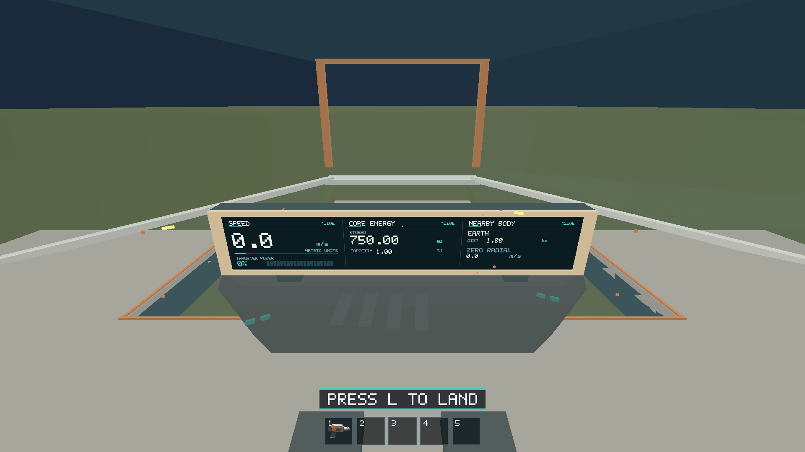

# Issue #171 — one wide cockpit monitor

Implemented for PR review on 2026-10-13. One physical `Monitor_Wide` replaces
all three old monitor meshes. The saved linked console Blender component,
GLB/glTF/bin, preservation/monitor contracts, manifests, runtime metadata,
validator, renderer/shader and guides agree on the new contract. No legacy
monitor roles remain in runtime loading.

The 1.98 × 0.3332 m screen has a continuous rim, rear enclosure and two mounts.
Flight/shared thrust, Core stored/capacity and nearby-body distance/radial state
are visible simultaneously. Speed, energy and radial precision, rounding,
metric promotion, unavailable/out-of-range states and source DTOs are retained.
Body names are now legible uppercase labels, and distance uses distance units
(m/km/Mm), correcting the previous speed-unit suffix on that reading. Shared
thrust appears once. No energy/fuel gameplay is introduced.

A 1536 × 256 texture replaces the three stacked tiles with three dashboard
regions. Fine rules divide content within one continuous physical surface.
The existing rounded display key skips all unchanged rasterization/uploads;
changed fields redraw only their region and trigger one upload. CPU/GPU pixel
storage remains 1.5 MiB each; screen geometry drops from six to two triangles.
Ship submission stays one opaque plus one glass draw. The export contains
6,100 triangles, 115 primitives, 13 materials and 512,096 GLB bytes, all within
the original hard caps. Generated character/spatial layouts were regenerated
and remained byte-identical: console bounds, chair and both walking lanes did
not change. Exported-triangle rays confirm screen visibility and clear forward/
lower glazing. Native traversal independently exercises both side routes.

## Validation

Ubuntu 24.04 x86_64, Rust/Cargo 1.89.0, Blender 4.5.3 LTS, Python 3.12.14,
wgpu Vulkan on Mesa lavapipe. Native dashboard screenshots use a resized
1920×1080 drawable. This environment cannot establish Apple M1 performance.
All commands run from repository root; `$BLENDER` below was
`/tmp/blender-4.5.3-linux-x64/blender`.

| Check | Result |
| --- | --- |
| `cargo +1.89.0 fmt --all -- --check` | Passed |
| `CARGO_TARGET_DIR=/tmp/salimon171-target CARGO_INCREMENTAL=0 CARGO_BUILD_JOBS=2 cargo +1.89.0 test --workspace --locked` | Passed: 376 tests; optional probes remain ignored; [log](rust-tests.log) |
| Same environment, `cargo +1.89.0 test -p salimon-renderer --locked` after final type-size/status edits | Passed: 54 tests, 5 ignored; [log](renderer-tests.log) |
| Same environment, `cargo +1.89.0 clippy --workspace --all-targets --locked -- -D warnings` | Passed; [log](clippy.log) |
| Same environment, `cargo +1.89.0 build --release --locked -p salimon-client` | Passed; optimized binary used for final native captures |
| `python models/assets/ships/salimon-scout/export.py --blender "$BLENDER"` | Passed |
| `"$BLENDER" --background --python-exit-code 1 --python models/assets/ships/salimon-scout/verify_source.py` | Passed: source/interchange geometry, names, UVs, metadata and material parity |
| Same Blender invocation, `verify_modular.py` | Passed: nine linked components and independent edit propagation |
| `python models/assets/ships/salimon-scout/validate.py` | Passed: budgets, source hashes, frozen corners, normals/UVs, proxy bounds, real-triangle sightlines |
| `BLENDER="$BLENDER" python -m unittest discover -s models/tests -v` | Passed: 55 tests; [log](model-tests.log) |
| `python -m unittest discover -s scripts -p 'test_*.py'` | Passed: 55 tests |
| Dashboard / open-space dashboard / lower-window evidence scenarios | Passed: 38 / 4 / 24 steps; [dashboard state](dashboard-result.json), [out-of-range state](out-of-range-result.json), [lower-window state](lower-glazing-result.json) |
| `scripts/salimon-test suite --group ship-eva` | Passed: cockpit-nose, space-airlock, moving-eva, nearby-eva; [summary](traversal-summary.log) |
| `scripts/salimon-test run scenarios/cockpit-nose-starboard.json` | Passed: 30 steps through the other route and back; [summary](starboard-summary.log) |
| `scripts/packaged_smoke.py --binary /tmp/salimon171-target/release/salimon-client --timeout 90` | Passed: native launch/presentation, OS F2 and continued gameplay; [summary](smoke-summary.log) |
| Apple M1 / Metal 1920×1080 performance, Windows graphical checks, manual minimize/relaunch | Not run: corresponding hardware/desktops unavailable |

Native commands used [run_native.py](run_native.py), which starts an isolated
TCP Xvfb display and selects lavapipe, because this execution environment cannot
create ordinary X11 Unix listening sockets. [capture_native.py](capture_native.py)
resizes the actual game window before using the existing settled capture helper.
The first ordinary `xvfb-run` launch failed at X-server connection; it was
resolved by this test-only harness. Initial workspace-target Rust compilation
produced missing object/symbol errors; a fresh `/tmp` target, disabled incremental
compilation and the project's minimum supported toolchain passed the full gates.
Neither workaround changes shipped code or CI settings.

Example reproduction (the actual temporary helper paths were `/tmp/run171.py`
and `/tmp/capture171.py`, whose saved contents are linked above):

```sh
python reports/issue-171/run_native.py run scenarios/evidence/cockpit-wide-monitor.json \
  --binary /tmp/salimon171-target/release/salimon-client --summary \
  --artifacts artifacts/issue-171-final \
  --screenshot-command '["python", "reports/issue-171/capture_native.py", "{path}"]'
```

Repeat with `cockpit-wide-monitor-space.json` and `lower-cockpit-windows.json`;
use `suite --group ship-eva` for traversal, `run` for the starboard scenario,
and `smoke --binary ... --timeout 90` for native smoke. On an ordinary Linux
desktop the documented Xvfb workflow in `docs/validation.md` remains valid.
Stored JSON results retain all step outcomes and ship/player state, with
unrelated resource/equipment payloads trimmed. They retain their original
disposable artifact paths; the
selected images are preserved below.

## Native visual evidence



- [Unobstructed forward view](forward.png)
- [25% thrust and changing speed](dashboard-thrust.png)
- [Approaching Earth](dashboard-approaching.png)
- [Landed zero speed/radial state](dashboard-landed.png)
- [Out-of-range navigation](dashboard-out-of-range.png)
- [Lower port glazing](lower-port.png)
- [Lower starboard glazing](lower-starboard.png)

These are native game captures from the final release build, not Blender or
synthetic previews. Linux software Vulkan proves rendering/interaction/capture
coverage only; no FPS floor or reference-machine performance claim is made.
