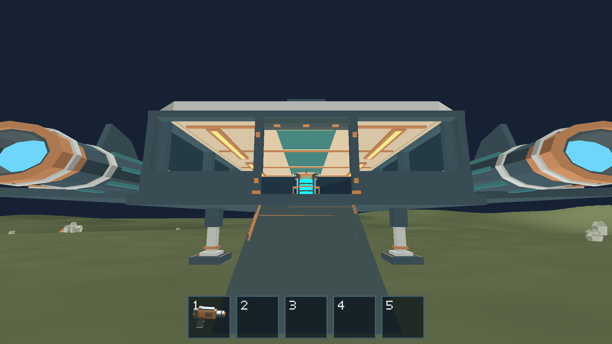
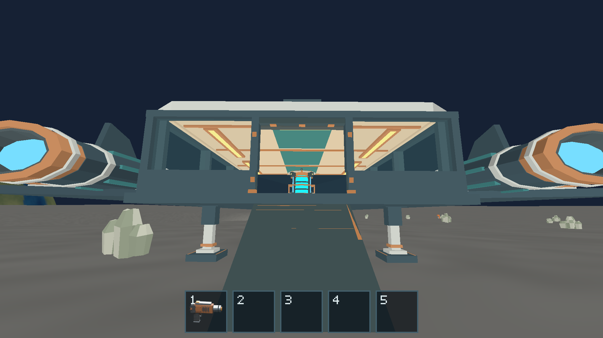
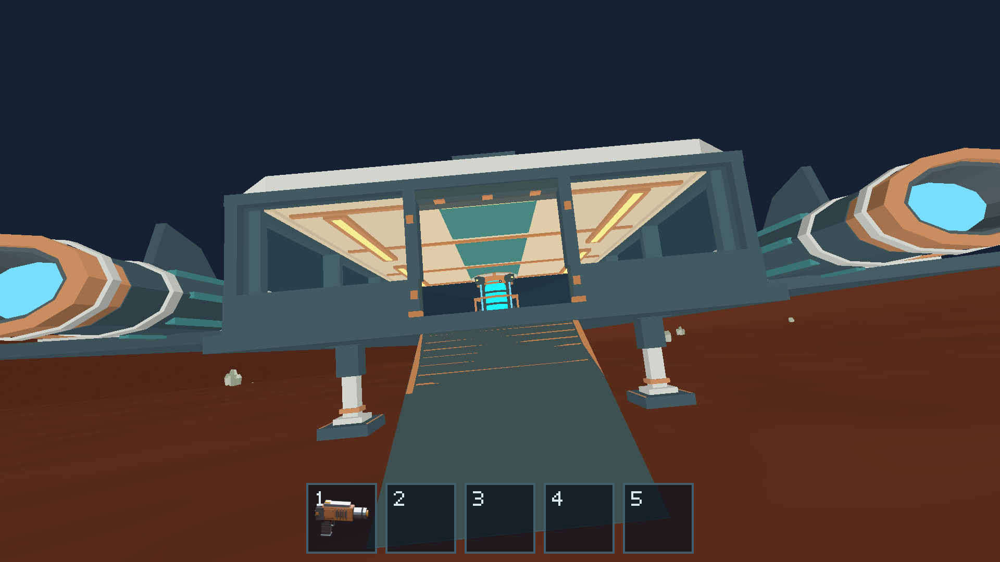

# #179 — Bounded terrain patches

Completed with #180/#181 in the same PR, after the stage-1 contract merged in
PR #182. Evidence date: 2026-10-14; base revision: `4a96bd9`.

Runtime now selects balanced cube-sphere quadtree leaves and generates immutable
renderer-neutral patch DTOs from the authoritative version-1 query. Keys include
body, full encoded definition, face, level, u/v and edge refinement. Separate f64
body centers and local anchors preserve subtract-before-f32 precision. Renderer
owns indexed GPU buffers, shared material bindings and reverse-Z draws; it has no
world dependency. No generated model geometry or dependency versions changed.

A local cap, lower-envelope far sphere, stitched coarse/fine edges and a bounded
cold fade handle negative craters without the nominal sphere hiding them. The
Sun and distant spheres remain active. Camera movement reselects only at stable
local anchors; active geometry remains available during CPU generation. Old flat
fixtures/F2 precision presentation remain available. Normal gameplay enables
terrain only with all #180 consumers in this same change.

## Selection decision and bounds

A quadtree directly reuses the definition's global cube coordinates, gives stable
cache identities and explicit face/pole coverage, and limits geometry to the
nearby cap. Its implementation cost is balancing, face-neighbor lookup and edge
fans; regressions check each of those. Tangent clipmaps offer simpler regular
rings but would additionally require moving tangent-frame projection, polar/
face transitions and cache identity/stitching policy. For the current global
radial heightfield and three small local caps, the quadtree keeps those rules in
one coordinate system. Neither choice implies allocating a planet mesh.

[Canonical budgets and presentation rules](../../docs/terrain-validation.md)
are maintained outside this dated report: 512 active patches, 393,216 triangles,
1,024 cached CPU patches, 32 MiB GPU buffers, 2 MiB uploads/frame, at most eight
patches generated/frame with a 2 ms admission target. The last admitted patch may
finish over that time target. CPU geometry/metadata is measured below 48 MiB in
regressions, rather than claimed as total process allocation.

## Verification

- `cargo fmt --all -- --check` — passed.
- `cargo clippy --workspace --all-targets --locked -- -D warnings` — passed.
- `cargo test --workspace --locked` — 391 passed, seven existing opt-in tests ignored.
- `cargo build --workspace --locked` and `cargo build --release -p salimon-client --locked` — passed.
- `cargo test -p salimon-client terrain_patches --locked -- --nocapture` — patch,
  shared-border, mixed-LOD topology, pole/face/corner, budget/revisit and mesh-query
  regressions passed in the workspace run; [focused measurements](../issue-181/terrain-patch-tests-final.log)
  and [topology check](../issue-181/terrain-topology-tests.log) retain the numerical evidence.
- Native Metal terrain evidence — all 13 routes passed; commands and
  [structured checkpoint state](../issue-181/native-results.json) are in [#181](../issue-181/README.md).

Across 13,101 shared nodes, maximum query/vertex error was 0.07195 mm, below the
0.2 mm gate. Mixed-LOD edge segments pair inside the cap, including cube-face
transitions. Plain/crater triangle-center error within 150 m of the six fixtures
was at most 37.88 mm, below the explicit 0.25 m gate. This is a fixture measurement,
not a universal interpolation guarantee. See #181 for cold costs, cache/upload
measurements and the M1 comparison; there is no software-Vulkan FPS claim.

## Native images and limits

Actual completed GPU color surfaces, 1920×1080, captured on Apple M1/Metal:

Outer-cap geometry deliberately blends to the far lower envelope; it is a visual
approximation outside the full-detail radius, not a contact query. The geometry
limits and tests apply to the immutable built-in version-1 profiles. New sharper
profiles require renewed interpolation/contact validation. See the integrated
[#180 report](../issue-180/README.md) and [#181 report](../issue-181/README.md) for
shared ground and final acceptance. No networking, disk persistence, full-planet
mesh, caves, tunnels or overhangs were added.
