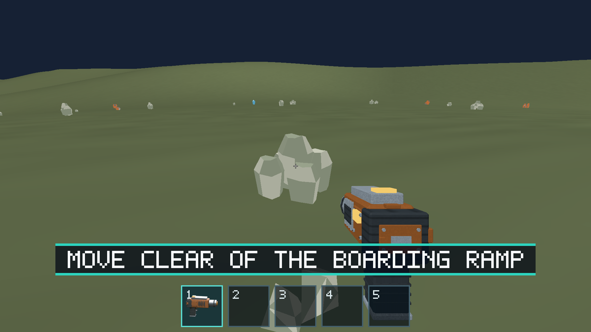
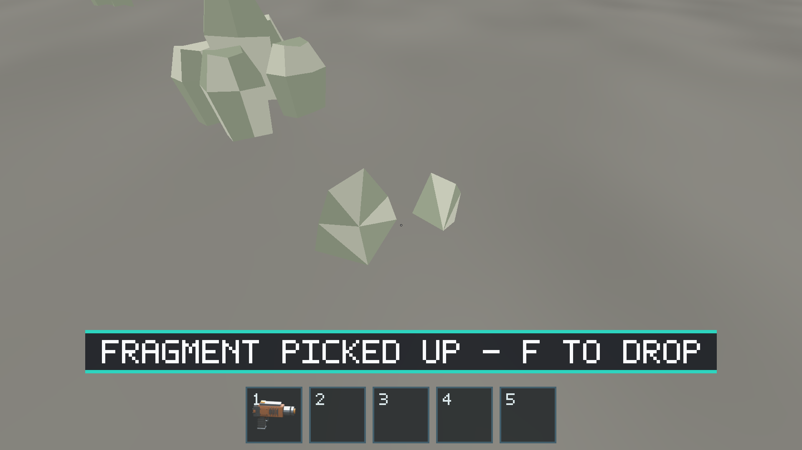
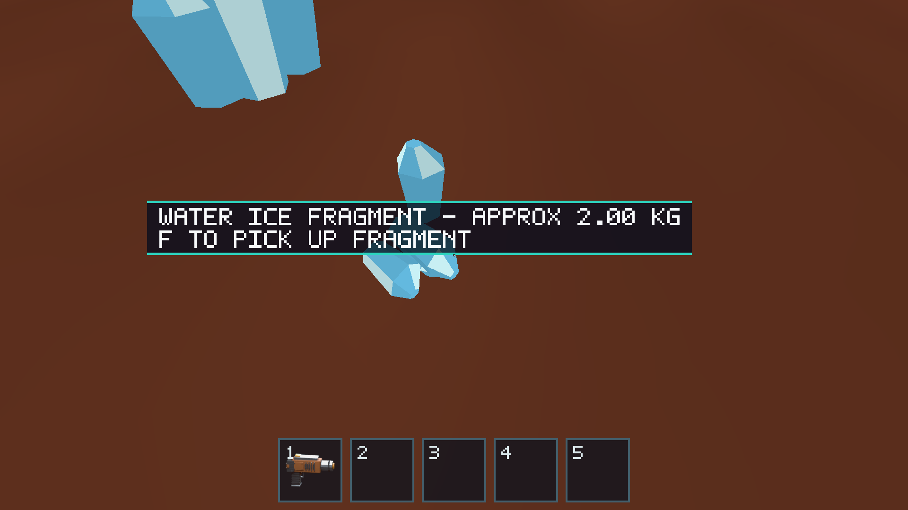
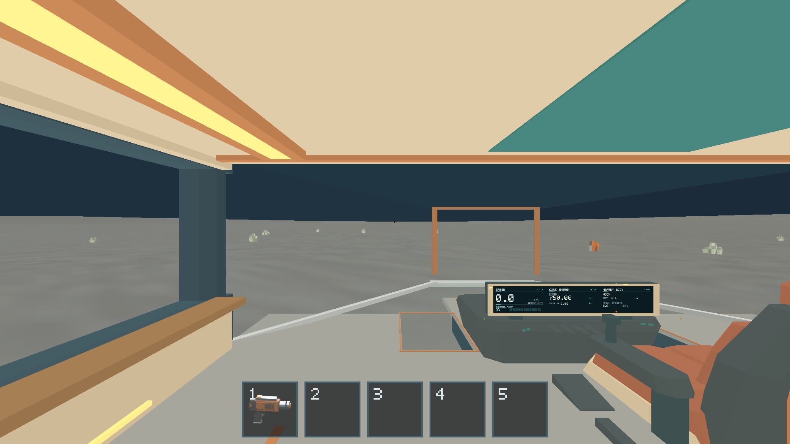

# #180 — Shared gameplay ground

Completed with #179/#181 in one PR. Evidence date: 2026-10-14; base `4a96bd9`.
The stage-1 definition and the merged feet/ramp geometry were inspected before
integration. Generated scout geometry remains unchanged.

Runtime now composes the same immutable representative definition for patches,
character ground, ship telemetry/contact/landing, deposits and fragment physics.
World owns selection/query and obstruction bounds. Character owns radial walking,
40° traversal, 0.30 m steps and ballistic jumps; ship owns 20° landing rejection
and footprint policy. Physics accepts renderer/world-independent sampled-ground
callbacks and uses the same vertex support for contact and sleeping. Normal
native startup enables the integrated profiles after a bounded safe-site search;
legacy flat scenarios retain their original arithmetic and policy.

Runtime supplies sampled authored soles, ramp tip and conservative hull/appendage
envelopes. Landing preserves the 2 m non-gear hull intent, permits at most 0.10 m
fixed support gap and reports unsafe sites before assist entry. Eight-second
landing and six-second takeoff remain uncancellable and partition-independent.
Direct flight resolves its conservative sphere against local terrain, including
negative elevations, rather than stopping at global maximum elevation.

Deposits retain the original generation lattice, seed, ID, mass and variant;
placements align to the sampled normal and target 5 mm vertex clearance. Bounded
placement caching precedes application of the authoritative session journal.
Depletion survives eviction/revisit. Emission reserves a complete growing fragment
envelope and rejects terrain intersection; carrying also checks actual vertices.
An extraction regression found roundoff-only microscopic fragments: a successful
fill now leaves a residual ≤1e-12 kg unextracted instead of allocating another
body. Accounting returns the actual emitted mass; initial tiny requests remain
supported. The rule is documented and tested in world.

## Verification and tolerances

The full workspace gates and native suites passed as recorded in
[#181](../issue-181/README.md). Focused regressions cover slope/step rejection,
ballistic/held jump, safe plain/crater spawn on all three bodies, exact footprint
support, unsafe landing, uncancellable partition-independent touchdown, negative
terrain flight contact, convex ridge contact/sleep, immutable query-cache eviction,
deposit anchoring, stable IDs and depleted tombstones after streaming.

[Support measurements](../issue-181/terrain-contact-tests.log) found maximum fixed
sole/ramp gaps of 30.03/39.42 mm on Earth plain/crater, 13.55/8.37 mm on Moon,
and 13.68/16.23 mm on Mars. All sampled hull points retained at least 1.999 m
clearance (1 mm numerical tolerance on the 2 m policy).
[Deposit measurements](../issue-181/terrain-domain-tests.log) examined 57/38,
48/56 and 32/27 placements on those six profiles; minimum sampled vertex gaps
were 4.990–5.000 mm. Mesh interpolation measured in #179 can add up to 37.88 mm
at tested near triangle centers; it is distinct from the shared analytic ground.

The 13 native routes include actual ramp exit/re-entry, plain/crater walking,
touchdown from 1 km, steep-site rejection, jumping, extracting 4 kg, settling,
pick/drop, walking about 219 m out of the resource window and returning to the
same partially mined ID/mass on each body. CPU regressions additionally cover
fully depleted sources after cache eviction. Seven existing resource and four
ship/EVA evidence routes passed. [Checkpoint state and assertions](../issue-181/native-results.json)
record the terrain routes; [canonical commands/policies](../../docs/terrain-validation.md)
remain maintained with the code.

## Native evidence

## Limits

Ground is a radial heightfield. Convex environmental support samples vertices;
fixed landing envelopes use bounded grids. These are explicit approximations,
not arbitrary-mesh CCD or a proof for sharper future definitions. Query cache
keys preserve every input bit and definitions remain immutable for the process;
no live terrain migration or persistence is implemented. FPS evidence belongs to
[#181](../issue-181/README.md), not these state checks. No remaining issue blocker
was observed for the current profiles.
