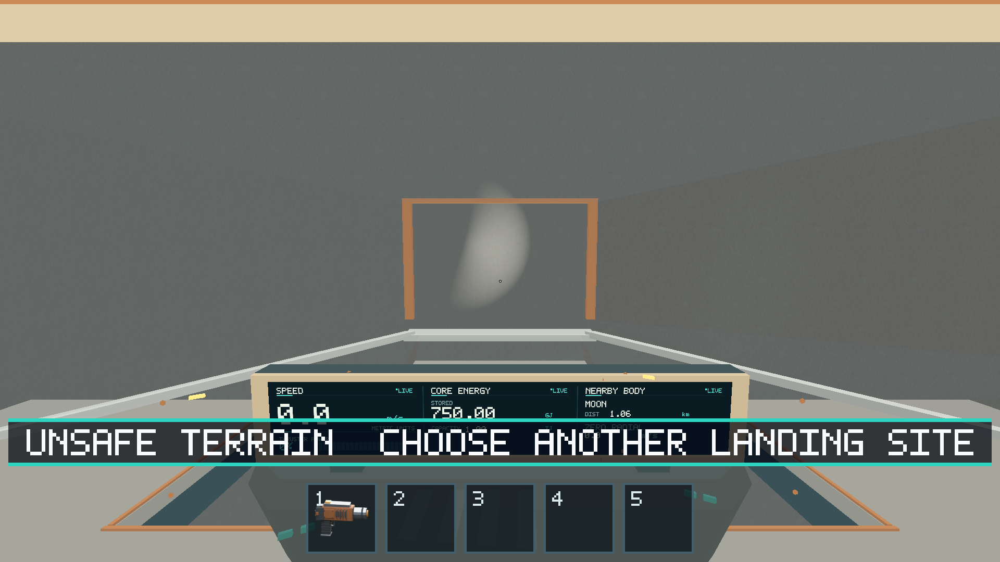
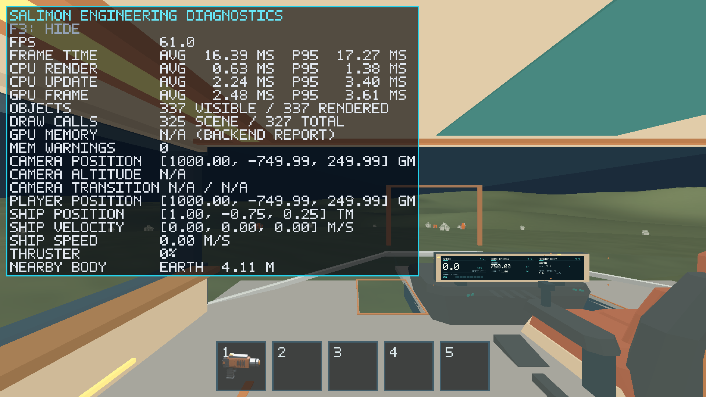

# #181 — Native acceptance and reference comparison

Completed with #179/#180 in one PR. Evidence date: 2026-10-14; base `4a96bd9`.
The stage-1 contract merged in PR #182 before this work. The integrated renderer,
contact consumers and normal safe startup are active together. Parent #170 was
already closed remotely when inspected; this change does not reopen or manually
close issues. The PR links #179–#181 for closure on merge.

## Acceptance coverage

Earth/Moon/Mars native routes exercise gentle terrain, slopes/ridges around the
plain sites, negative crater sites, actual ramp walking/boarding, touchdown,
jumping, mining, loose/carrying fragments and resource stream-out/revisit. A Moon
steep-rim route rejects unsafe landing. CPU tests independently cover excessive
walking slopes/steps, vertex support/sleep, safe authored feet/ramp/hull samples,
negative-height flight contact, cube poles/face edges/corners, mixed LOD topology,
large-world precision, cache bounds and stable/depleted state after eviction.
Existing version-1 golden samples, codec/compatibility rejection, reload/order/
thread reproducibility regressions pass unchanged; no format or algorithm version
was changed. The analytic query has one definition shared across consumers.

[Native results](native-results.json) retain each route's assertions and compact
checkpoint state. [#179](../issue-179/README.md) and [#180](../issue-180/README.md)
record geometric/support measurements and native images. The canonical
[terrain guide](../../docs/terrain-validation.md) owns current policies, budgets,
far-envelope transitions, cold fade and approximation limits.

## Apple M1 reference hardware

Native Apple M1 iMac21,1, 8 CPU/8 GPU cores, 16 GB unified memory; macOS 26.2,
Rust 1.89.0, Python 3.14.2, wgpu Metal, optimized release, actual physical
1920×1080 drawable. Desktop unlocked, one visible game at a time, no parallel
builds/tests during measurements. These are idle landed-cabin E2E scenes, with no
advancing simulation ticks; they measure presentation/update work, not sustained
walking or loaded mining throughput. Terrain profiles use seed 181. Warmup was
three seconds; 100 inspect polls spaced at least 100 ms produced about 11.7 s of
samples per case. Latest asynchronous GPU durations can repeat between frames.

The flat baseline is revision `4a96bd9`; only E2E viewport and timing log cadence
were instrumented, with the exact [patch](baseline-instrumentation.patch). The
same implementation's flat fixture is an additional control. Baseline logs every
frame; implementation uses bounded in-memory observations. That instrumentation
difference and slightly different terrain camera poses limit causal comparisons.
[Structured measurements](reference-measurements.json) retain distributions,
scene/pose, requested buffers, RSS, cold costs and release binary SHA-256 values.
The final rebuilt implementation exactly matched the measured binary hash.

All timing columns below are milliseconds. Intervals show mean / p95 / maximum;
CPU and GPU show mean / p95.

| Scene | Frames | Presented interval | CPU update | CPU render | GPU pass |
| --- | ---: | ---: | ---: | ---: | ---: |
| baseline | 701 | 16.665 / 17.237 / 17.852 | 0.142 / 0.278 | 0.680 / 1.151 | 1.147 / 1.230 |
| flat-control | 704 | 16.668 / 17.227 / 17.617 | 0.155 / 0.284 | 0.728 / 1.167 | 1.249 / 1.410 |
| earth | 700 | 16.669 / 17.417 / 18.048 | 0.656 / 0.878 | 2.059 / 3.084 | 2.436 / 2.641 |
| moon | 700 | 16.668 / 17.417 / 18.615 | 0.598 / 0.814 | 2.012 / 3.035 | 2.410 / 2.587 |
| mars | 701 | 16.668 / 17.382 / 18.240 | 0.565 / 0.726 | 2.194 / 3.035 | 2.433 / 2.638 |

Terrain increases the measured GPU pass from about 1.15 ms at baseline to
2.41–2.44 ms, and CPU render from 0.68 ms to 2.01–2.19 ms. Mean presented intervals
remain around 16.67 ms in these idle scenes, with terrain p95 around 17.4 ms.
These finite samples do **not** establish a per-frame 60 FPS floor or performance
under continuous traversal/mining. The on-screen F3 values in automated stepping
screenshots are not these isolated reference measurements.

| Scene | RSS MiB | Patches | Triangles | Requested CPU / GPU MiB | Peak upload bytes/frame | Peak / total generation ms |
| --- | ---: | ---: | ---: | ---: | ---: | ---: |
| baseline | 101.84 | — | — | 0.00 / 0.00 | — | 0.000 / 0.000 |
| flat-control | 103.02 | 0 | 0 | 0.00 / 0.12 | 0 | 0.000 / 0.000 |
| earth | 111.88 | 316 | 166572 | 6.95 / 5.28 | 2092504 | 2.916 / 152.898 |
| moon | 111.28 | 305 | 160940 | 6.71 / 5.10 | 2097080 | 2.906 / 144.714 |
| mars | 112.50 | 305 | 160940 | 6.71 / 5.10 | 2097080 | 2.643 / 147.542 |

RSS is one process sample, not peak memory. Metal did not expose wgpu allocator
totals (`null`), so requested application buffers and RSS are reported separately;
they must not be added together as independent physical memory. Generation peaks
are complete admitted batches: 2 ms is an admission target, not a hard deadline.
Each measured terrain case admitted at most seven patches/frame (hard cap eight).
Upload peaks remain below 2,097,152 bytes. These are bounded local caps, never
full-planet geometry. CPU tests additionally exercise movement, cache eviction and
revisits; exact query memoization is capped at 4,096 entries per native thread.

## Reproducing the reference comparison

Run from repository root on the reference desktop. [measure.py](measure.py) is the
dated driver snapshot; its output/raw logs go under ignored `artifacts/`. Stage
current and baseline binaries at its explicit paths. Use a separate baseline
target directory to avoid Cargo fingerprint collisions between worktrees:

```sh
cargo build --release -p salimon-client --locked
mkdir -p artifacts/terrain-implementation
cp target/release/salimon-client artifacts/terrain-implementation/salimon-client
git worktree add --detach artifacts/terrain-baseline 4a96bd9
git -C artifacts/terrain-baseline apply --unidiff-zero ../../reports/issue-181/baseline-instrumentation.patch
cargo build --manifest-path artifacts/terrain-baseline/Cargo.toml --target-dir artifacts/terrain-baseline-target --release -p salimon-client --locked
cp artifacts/terrain-baseline-target/release/salimon-client artifacts/terrain-baseline/salimon-baseline
python3 reports/issue-181/measure.py
```

The apply path above is relative to the baseline working directory; use an
absolute patch path if running Git with a different directory arrangement.

## Validation results

The [validation summary](validation-results.json) records native route outcomes.
[Workspace test log](terrain-tests-final.log), [Clippy](terrain-clippy-final.log),
[script contracts](terrain-scripts-final.log) and [model contracts](terrain-models-final.log)
retain the final gate output. Exact root gates, all passed:

```sh
cargo fmt --all -- --check
cargo clippy --workspace --all-targets --locked -- -D warnings
cargo test --workspace --locked
cargo build --workspace --locked
cargo build --release -p salimon-client --locked
python3 -m unittest discover -s scripts -p 'test_*.py'
artifacts/terrain-model-venv/bin/python -m unittest discover -s models/tests -v
```

Rust: 391 passed, seven existing opt-in GPU/profiling tests ignored. Script
contracts: 55 passed. Model contracts: 55 run, two skipped for missing Blender;
53 passed after installing pinned `models/tools/requirements.txt` in an isolated
venv. No authored model/generated geometry changed; Blender source regeneration
and export verification were not run. Initial model invocation without jsonschema
failed and was rerun successfully with those declared requirements. The first
post-baseline release build encountered stale shared-target worktree artifacts;
cleaning the eight local release crates and rebuilding passed, with identical
final/measured binary SHA-256. No source workaround was needed.

Native Metal commands (same measured binary at `artifacts/terrain-implementation/salimon-client`):

```sh
python3 scripts/salimon-test suite --binary artifacts/terrain-implementation/salimon-client
python3 scripts/salimon-test suite --group terrain --evidence --binary artifacts/terrain-implementation/salimon-client --screenshot-command '["native"]'
python3 scripts/salimon-test suite --group resource-collection --evidence --binary artifacts/terrain-implementation/salimon-client --screenshot-command '["native"]'
python3 scripts/salimon-test suite --group ship-eva --evidence --binary artifacts/terrain-implementation/salimon-client --screenshot-command '["native"]'
python3 scripts/salimon-test run scenarios/reference/terrain-render-smoke.json --binary artifacts/terrain-implementation/salimon-client --screenshot-command '["native"]'
python3 scripts/packaged_smoke.py --binary artifacts/terrain-implementation/salimon-client
```

Default suite: 32 passed. Terrain evidence: 13 passed. Resource evidence: seven
passed. Ship/EVA evidence: four passed. Window smoke: passed resize to 1280×800,
minimize/restore, F3, F2 flat precision, return to gameplay and 1920×1080 resize.
Packaged smoke: passed from an empty working directory with real OS F2 input in
both directions, captured startup/gameplay and a live process after input. Its
SIGTERM exit is deliberate runner cleanup, not normal-close validation. Full
disposable logs/captures remain in ignored `artifacts/terrain-native/`; useful
summaries and native-only PNGs are promoted here. Desktop screenshots containing
unrelated application content are not committed.






## Limitations

No Linux software-Vulkan, Windows hardware or additional ARM/x86 native run was
performed in this session. Existing portable/versioned golden regressions and
local macOS builds passed; CI provides the other-platform build gates. Driver
allocator totals are unavailable on this Metal backend. Native screenshots prove
completed GPU surfaces, not every possible camera/time/profile. Mesh tolerance
is measured at the stated six near-site fixtures, not arbitrary future terrain.
Ground support remains a sampled radial-heightfield approximation; sharper
profiles need renewed validation. No remaining blocker was observed for these
built-in profiles. Networking, disk/backend persistence, caves/tunnels/overhangs
and full-planet meshes remain excluded.
