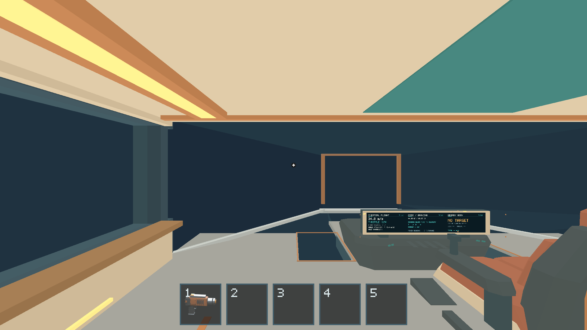
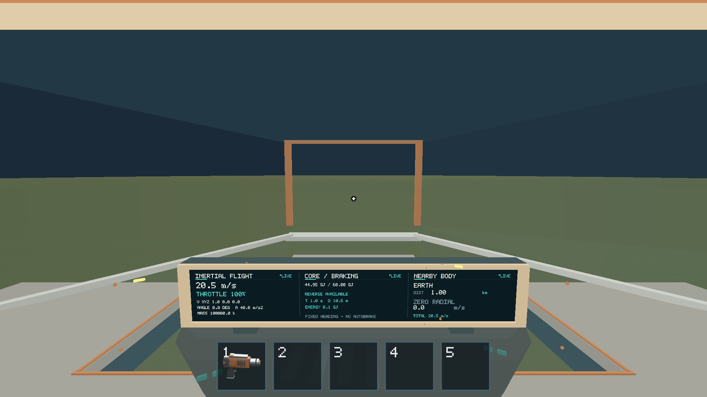
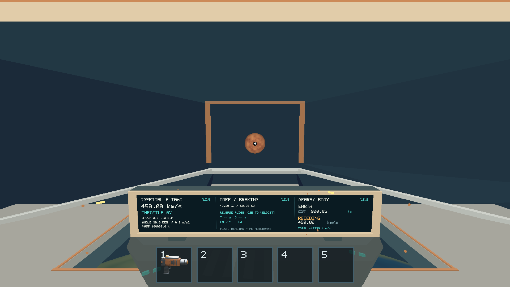

# Apple M1 flight verification — 2026-10-16

The current merged candidate `875f65ca2eadc65b93a4769822b84b02608044aa`
passes the native scripted flight checks on the owner's physical Apple M1 iMac.
This refreshes the 2026-10-15 evidence after the asset/mining merges. It does
**not** complete #198: sustained OS steering and relative mouse-look remain
unverified. The available desktop API exposes key taps and absolute drags, not
held key edges/relative motion. No native gameplay failure is inferred from
that tooling limit, and scripted input is not reported as manual coverage.

All four prerequisite implementation issues (#202, #190, #192, #193) were
closed when checked on GitHub. Their code is present in the tested merged main.
#200 remains dependent on #198/#199. #229 remains blocked by open #228, and
#236 by open #234/#235; those dependent native issues were not started.

## Environment and build

[Environment](environment.json), [staged build metadata and SHA-256](build-info.json).
Apple M1, iMac21,1, 8 CPU/8 GPU cores, 16 GiB; macOS 26.2 (25C56),
Rust 1.89.0, Python 3.14.2, optimized locked aarch64 build. Metal selected the
actual Apple M1 integrated GPU with timestamp queries. Every retained capture
is the game's 1920×1080 GPU color surface, Retina scale 2; no desktop content
is included. Fixed 16 ms E2E updates provide correctness evidence, not native
wall-clock FPS or an OS-input/performance certification.

## Results

| Path | Result | Scope |
| --- | --- | --- |
| Signed thrust, coasting, reverse stop/reversal, steering/inertial vector telemetry | PASS | Current `inertial-flight` evidence route, 426 steps. |
| Swept impact, bounded crash settle, recovery and takeoff | PASS | Current `crash-recovery` evidence route, 19 steps; takeoff preserves analytic outward velocity at zero throttle. |
| Full-vector landing speed cutoff | PASS | Current `landing-speed-cutoff` evidence route, 319 steps: 19.84 m/s accepted, 20.48 m/s rejected, then completed landing. |
| Native sustained OS steering / relative mouse-look | NOT VERIFIED | Requires an input API supporting holds/relative motion or a physical walkthrough. |

[Exact assertions, pass/fail and counts](results.json) and
[per-step authoritative observations](observations.json.gz) preserve the native
results. Observations retain ship/player/input presentation, resource counts,
window/performance snapshots and each assertion's response. They omit unrelated
deposit lists and repeated fragment meshes; full raw runner output remains in
ignored `artifacts/native-198-current/`.







## Reproduction

Run from the repository root on the local graphical M1 desktop:

```sh
python3 scripts/build_game.py --profile release --output artifacts/build/release
SALIMON_REFERENCE_SIZE=1 RUST_LOG=info python3 scripts/salimon-test suite --group realistic-flight --evidence --summary --binary artifacts/build/release/salimon-client --screenshot-command '["native"]' --artifacts artifacts/native-198-current
SALIMON_REFERENCE_SIZE=1 RUST_LOG=info python3 scripts/salimon-test suite --summary --binary artifacts/build/release/salimon-client --artifacts artifacts/native-198-baseline
```

Release staging PASS; [all 38 baseline routes](baseline-results.json) PASS;
all seven flight evidence routes PASS (the Core/cargo
routes are recorded separately for #199). No gameplay code, assets or contracts
changed. Rust test/lint/format and model regeneration were not rerun for this
evidence-only update; release staging compiled the current locked source.
No strict 60 FPS floor, temporal-flicker or completed spherical-contact signoff
is claimed. The #233/#234 physics/carry integration remains open and is outside
this flight verification change.
