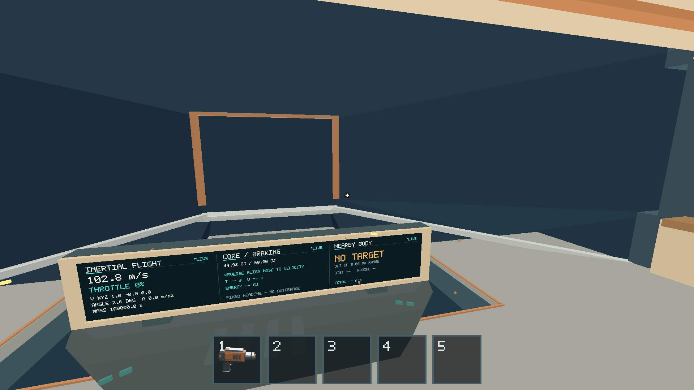
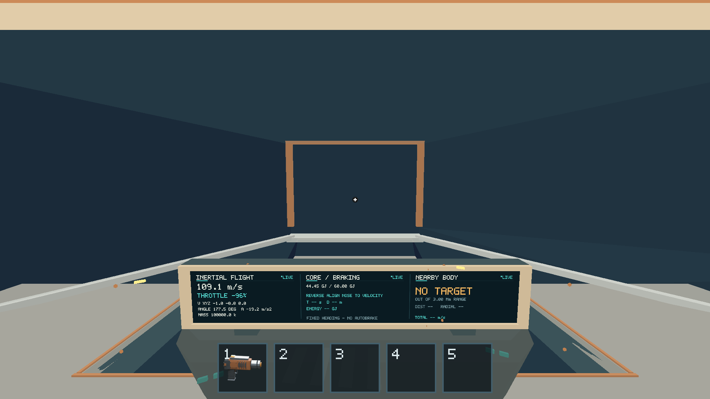
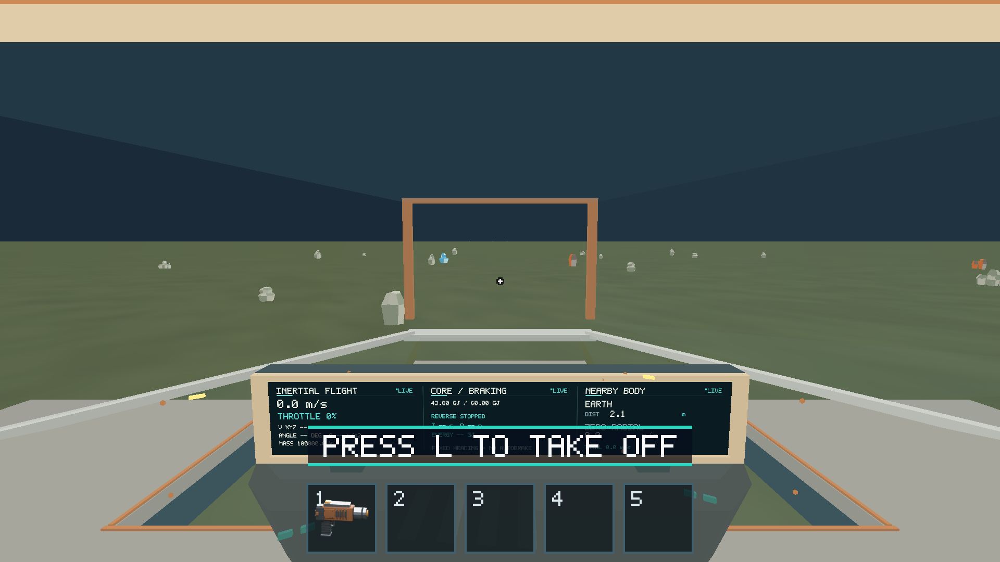

# Apple M1 flight verification — 2026-10-16

The current merged candidate `875f65ca2eadc65b93a4769822b84b02608044aa`
passes the native scripted flight checks on the owner's physical Apple M1 iMac.
This refreshes the 2026-10-15 evidence after the asset/mining merges and
completes the previously outstanding held OS-input verification. The approved
local CoreGraphics helper delivered real OS key edges and relative dragged
mouse events through macOS/winit. This is automated OS input on genuine local
hardware, not human hand play. No game-native action selected these controls.

All four prerequisite implementation issues (#202, #190, #192, #193) were
closed when checked on GitHub. Their code is present in the tested merged main.
#200 remains dependent on #198/#199. #229 remains blocked by open #228, and
#236 by open #234/#235; those dependent native issues were not started.

## Environment and build

[Environment](environment.json), [staged build metadata and SHA-256](build-info.json).
Apple M1, iMac21,1, 8 CPU/8 GPU cores, 16 GiB; macOS 26.2 (25C56),
Rust 1.89.0, Python 3.14.2, optimized locked aarch64 build. Metal selected the
actual Apple M1 integrated GPU with timestamp queries. Every retained capture
is the game's 1920×1080 GPU color surface, Retina scale 2; no desktop content
is included. Fixed 16 ms E2E updates provide correctness evidence, not native
wall-clock FPS or an OS-input/performance certification.

## Results

| Path | Result | Scope |
| --- | --- | --- |
| Signed thrust, coasting, reverse stop/reversal, steering/inertial vector telemetry | PASS | Current `inertial-flight` evidence route, 426 steps. |
| Swept impact, bounded crash settle, recovery and takeoff | PASS | Current `crash-recovery` evidence route, 19 steps; takeoff preserves analytic outward velocity at zero throttle. |
| Full-vector landing speed cutoff | PASS | Current `landing-speed-cutoff` evidence route, 319 steps: 19.84 m/s accepted, 20.48 m/s rejected, then completed landing. |
| Native held throttle, reverse thrust and reversal | PASS | Up hold selected +6%; native Down holds later selected −96%; forward motion decelerated and became negative world-X motion. Release preserved selection. |
| Native held yaw, pitch and roll / release / inertial coast | PASS | Heading changes for A/D/W/Right; A release leaves orientation stable; all coasting world-velocity components remain identical. |
| Native relative mouse-look | PASS | Session-level dragged delta (120,35) changes the view; inverse motion restores it within 1e-6 per direction component. |
| Native L crash recovery and takeoff | PASS | Real OS key edges progress grounded → recovery → landed → takeoff → inertial flight, with zero final throttle. |

[Exact assertions, pass/fail and counts](results.json) and
[per-step authoritative observations](observations.json.gz) preserve the native
results. Observations retain ship/player/input presentation, resource counts,
window/performance snapshots and each assertion's response. They omit unrelated
deposit lists and repeated fragment meshes; full raw runner output remains in
ignored `artifacts/native-198-current/`.


## Reproduction

Run from the repository root on the local graphical M1 desktop:

```sh
python3 scripts/build_game.py --profile release --output artifacts/build/release
SALIMON_REFERENCE_SIZE=1 RUST_LOG=info python3 scripts/salimon-test suite --group realistic-flight --evidence --summary --binary artifacts/build/release/salimon-client --screenshot-command '["native"]' --artifacts artifacts/native-198-current
SALIMON_REFERENCE_SIZE=1 RUST_LOG=info python3 scripts/salimon-test suite --summary --binary artifacts/build/release/salimon-client --artifacts artifacts/native-198-baseline
```

Release staging PASS; [all 38 baseline routes](baseline-results.json) PASS;
all seven flight evidence routes PASS (the Core/cargo
routes are recorded separately for #199). No gameplay code, assets or contracts
changed. Rust test/lint/format and model regeneration were not rerun for this
evidence-only update; release staging compiled the current locked source.
No strict 60 FPS floor, temporal-flicker or completed spherical-contact signoff
is claimed. The #233/#234 physics/carry integration remains open and is outside
this flight verification change.

## Native OS input completion

[Flight checks](native-input-flight-checks.json) and
[flight input/state observations](native-input-flight.json.gz) record every
posted input and named authoritative snapshot. [Crash observations](native-input-crash.json.gz)
and [native log](native-input-crash.log) record the actual L transitions.
The test uses ordinary OS events plus only `step`, `inspect` and `capture` E2E
requests. Simulation is paced with 16 ms fixed updates; these probes cannot
establish wall-clock FPS. The tested app executable has the exact staged SHA-256.

Compile [the bounded input helper](input.swift) and run [the probe](input_probe.py)
from the repository root. Place the staged executable in an app bundle with
`CFBundleExecutable=salimon-client`, `CFBundlePackageType=APPL`, a unique bundle
identifier and `NSHighResolutionCapable=true`:

```sh
swiftc reports/issue-198/2026-10-16/input.swift -o artifacts/native-input
SALIMON_REFERENCE_SIZE=1 RUST_LOG=info python3 reports/issue-198/2026-10-16/input_probe.py --binary artifacts/SalimonNative.app/Contents/MacOS/salimon-client --helper artifacts/native-input --output artifacts/native-os-flight --scenario flight-regression
SALIMON_REFERENCE_SIZE=1 RUST_LOG=info python3 reports/issue-198/2026-10-16/input_probe.py --binary artifacts/SalimonNative.app/Contents/MacOS/salimon-client --helper artifacts/native-input --output artifacts/native-os-crash --scenario crash-recovery
```

The helper requires the existing local macOS event-posting permission; it fails
if unavailable. It focuses/clicks only the target PID's window and bounds key
holds to five seconds. Every key release is paired. It does not change OS settings.
MouseMoved events posted by the initial helper attempts were not delivered as
relative winit motion; a temporary logging-only build isolated that delivery
limit. Session-level dragged events reached the same production relative-motion
handler. The final successful flight evidence uses the unmodified release binary,
not the diagnostic build. The diagnostic source change was reverted; no runtime
or gameplay source is part of this PR.







Limitations: direct GPU captures establish rendered checkpoints, not temporal
flicker across all assets. Native mouse coverage uses OS-generated dragged events;
conventional physical no-button mouse motion and unstructured human play are
not claimed. These are scope limits of the retained smoke evidence, not an
inferred gameplay failure. All requested flight/control/collision/landing paths
have native coverage; #200 still requires #198/#199 to merge/close first.
