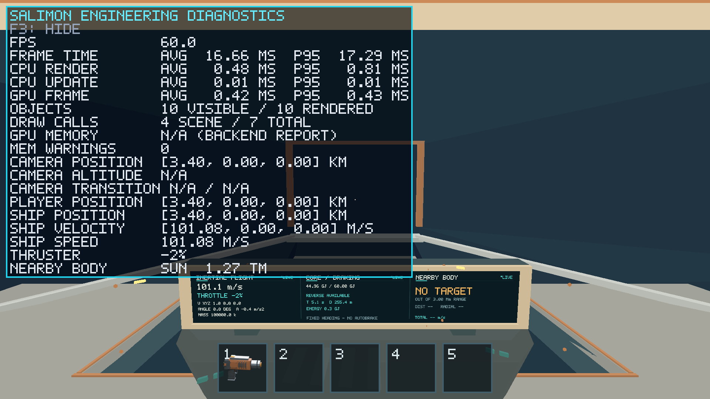
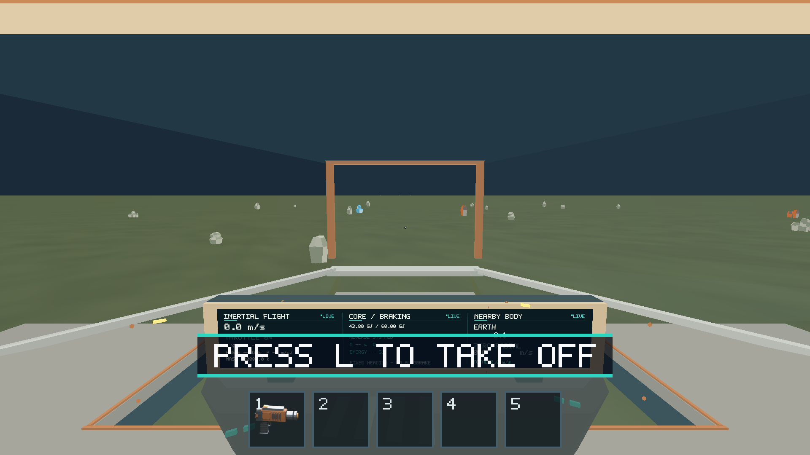
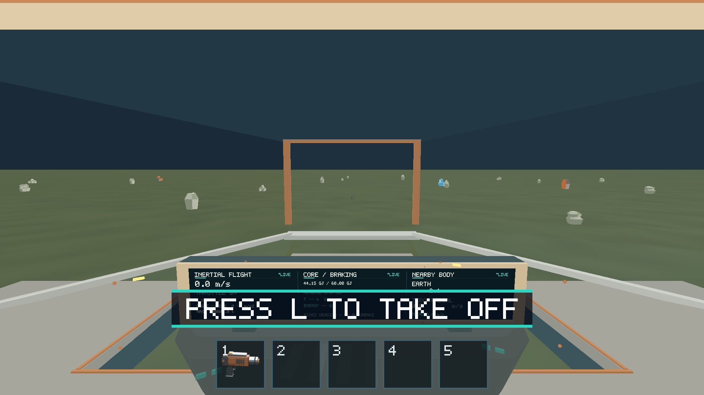

# Issue 198 — Apple M1 flight, collision and landing verification

Latest: [2026-10-16 native completion](2026-10-16/README.md) adds successful
held OS throttle/steering, native reverse motion, relative mouse-look and L
recovery/takeoff evidence. The dated 2026-10-15 account below retains its original
limitations and is superseded for these input checks.

Native execution on the owner's iMac21,1 / Apple M1 (8 CPU and 8 GPU cores,
16 GB RAM), macOS 26.2, on 2026-10-15 (Asia/Nicosia). Metal selected the real
Apple M1 integrated GPU with timestamp queries. Drawable: 1920×1080 physical
pixels, Retina scale 2. Rust 1.89.0, locked optimized aarch64 build.
[Shared environment](../issue-200/environment.json) and
[executable digest/build configuration](../issue-200/build-info.json).

Outcome: the covered native flight/collision/landing paths passed. **Full manual
signoff is still incomplete:** sustained native mouse-look and held steering
were not successfully exercised by the available desktop input automation.
This report does not turn scripted steering coverage into manual coverage.
Keep the issue open for that remaining owner walkthrough.

## Current follow-up

See the [2026-10-16 current-revision rerun](2026-10-16/README.md) for refreshed
M1 flight evidence and completed OS-input checks. The original results
below remain the dated 2026-10-15 evidence at their recorded revision.

## Implementation and prerequisites

All prerequisite implementation issues #202, #190, #192 and #193 were closed and
their implementations were present in merged main `ee66e96` before execution.
The user requested a single integration PR for #198–#200.

Commit `76016f9` adds baseline/evidence `landing-speed-cutoff` routes and an
owning runtime regression. It uses ordinary signed throttle to reach tangential
Earth-relative speeds of 19.84 and 20.48 m/s on opposite sides of the 20 m/s
cutoff. No runtime landing rule or tuning changed. Commit `738402b` adds a
contained benchmark fixture, without changing gameplay physics. The native
release code tested here is that revision; shared checks are in
[issue 200](../issue-200/README.md).

## Pass/fail matrix

| Check | Result | Evidence and scope |
| --- | --- | --- |
| Signed throttle, forward acceleration, coast, reverse stop/reversal | PASS | `inertial-flight` native route; real Up/Down input additionally selected +2%, −2%, then 0%. |
| Turning retains inertial velocity; direction/braking instruments | PASS, scripted | `inertial-flight` asserts unchanged world velocity and heading/velocity angle >170°. GPU capture shows signed throttle/navigation. |
| Landing full-vector cutoff | PASS | 20.48 m/s tangential flight rejects L; 19.84 m/s accepts it. This brackets the boundary; it is not an exact-equality hardware measurement. |
| Swept impact, bounce/settle, grounded recovery | PASS | `crash-recovery` starts 100 m above the flat Earth reference with −1000 m/s vertical velocity; reaches `GroundedAfterCrash`, zero throttle/speed, then uncancellable recovery. Detailed extreme-speed sweep edge cases remain CPU domain regressions. |
| Real native L recovery and repeated-L rejection | PASS | Grounded prompt, assisted landing, completed `Landed` state observed with desktop L events. |
| Takeoff final velocity / zero throttle | PASS | Native L takeoff completed `Flying`, speed 449999.446 m/s, throttle 0; scripted route also asserts nonzero handoff. This is the existing compressed-world assist trajectory, not an orbital model. |
| Blackout/restart control composition | PASS, scripted | Core routes in [issue 199](../issue-199/README.md); portable tests cover rejected unpowered controls. |
| Sustained OS mouse-look and held steering | NOT VERIFIED | CUA drag/pulsed letter keys did not establish a held turn. No gameplay defect is inferred from this automation limitation. |

## Reproduction and evidence

From the repository root, use the staged release binary:

```sh
SALIMON_REFERENCE_SIZE=1 RUST_LOG=info python3 scripts/salimon-test suite --group realistic-flight --evidence --binary artifacts/build/release/salimon-client --screenshot-command '["native"]'
```

Three final runs of the expanded seven-route group and the full baseline are
recorded in [native-results.json](../issue-200/native-results.json). Screenshots
are direct completed Metal color-surface captures; they exclude desktop content.
The local runner retained full process/protocol/state artifacts under ignored
`artifacts/native-m1/`; promoted compact results retain assertions and named
checkpoint states.

Real OS key probes used the same executable inside a local app bundle, opt-in
initial fixtures and continuously issued 16 ms E2E steps. CUA delivered the
actual Up/Down/L/F3 keys; the protocol did not select those controls. These are
native-input checks with a paced fixed clock, **not ordinary wall-clock gameplay
or performance samples**. See [probe helper/instructions](../issue-200/README.md#desktop-input-probes),
[flight observations](native-input-flight-regression.json.gz) and
[crash observations](native-input-crash-recovery.json.gz).







Limitations: no damage/orbital behavior was added; manual sustained controls and
long exploratory play remain for the owner. Performance is reported separately,
including missed provisional frame-p95 guidance, in [issue 199](../issue-199/README.md).
