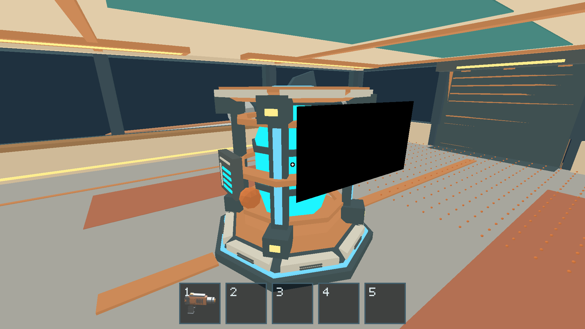
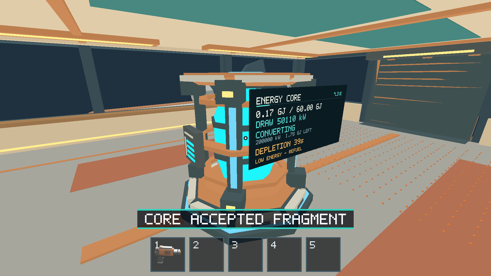
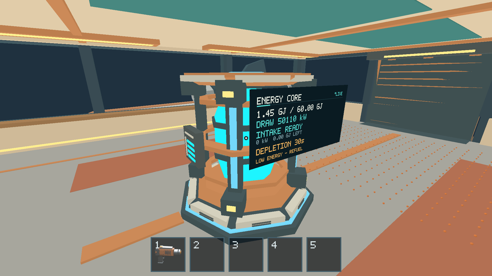
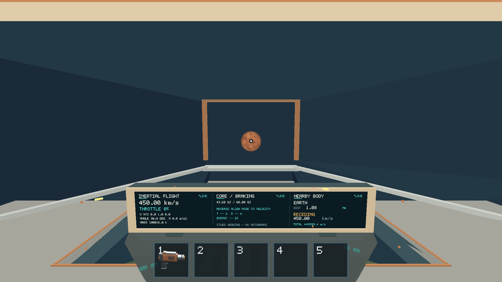

# Apple M1 Core, zero-G and 500-fragment smoke — 2026-10-16

The covered native Core/cargo smoke passes on merged main `875f65c`: dead-Core
physical intake, gradual recharge, display restart, subsequent blackout, zero-G
player movement, cargo identities/mass, resource transfer and loaded assist paths.
Real OS Space/E events additionally verify zero-G drift and mechanical feeding
with 500 physical identities. This completes the recorded smoke with explicit
performance follow-ups [#254](https://github.com/mr-exception/salimon/issues/254)
and [#255](https://github.com/mr-exception/salimon/issues/255); it does **not**
certify a strict 60 FPS floor or active-only 500-piece tail budget.

Prerequisite issues #189/#191/#194/#196 were checked closed on GitHub before
execution and their implementations are merged in the tested source. No gameplay,
energy, movement, physics, renderer, authoring or asset contracts changed.
#200 remains blocked until #198/#199 signoffs merge/close. #236 remains blocked
by #234/#235; these small legacy onboard fragments do not certify its new 10 kg
sphere contact/drop workload.

## Build and environment

[Environment](environment.json), [current release metadata](build-info.json),
[both binary digests and source provenance](binary-provenance.json).
Physical iMac21,1 / Apple M1 (8 CPU and 8 GPU cores), 16 GiB RAM, macOS 26.2
(25C56), Rust 1.89.0, Python 3.14.2. Actual Apple M1 integrated GPU, Metal,
timestamp queries, 1920×1080 physical drawable, Retina scale 2, AutoVsync, F3 off.
Captures below are completed GPU color surfaces, without unrelated desktop data.

The previous executable exactly matches the SHA-256 retained in the 2026-10-15
report and comes from production-code revision `738402b`. Both executables were
measured today on this same machine with matched seed, layout/count, camera,
settling and sampling settings. The benchmark runner's `revision` field describes
its current working directory, **not** the older executable's source. The
separate provenance file makes that distinction explicit. The current app-bundle
copy matches the current staged executable byte for byte.

## Gameplay results

| Check | Result and evidence |
| --- | --- |
| Powered cargo flight, physical mass ledger | PASS: 500 IDs, 16 kg cargo, 100016 kg total ship mass. |
| Dead-Core mechanical feed | PASS scripted and native OS E: one held 2 kg ID is consumed exactly once, 500→499 fragments; total mass 100017.968→100015.968 kg. |
| Gradual recharge and independent conversion | PASS: native conversion remains active after power returns, then finishes; selected 50% thrust accelerates the autonomous ship. |
| Zero-G movement/coasting and gravity restoration | PASS scripted and native OS Space: local Y increases while held and after release; after recharge, the player returns to the walking deck. |
| Remaining loose cargo / power transitions | PASS: exact initial ID set minus the consumed ID remains, 499 ship-frame fragments and 15.968 kg. Scripted route reaches later blackout without losing them. |
| Core screen off/converting/recharged | PASS in inspected Metal checkpoints, including native OS E probe. |
| Resource mining, pickup, carrying, cabin delivery, streaming | PASS: all seven resource evidence routes; partial/depleted source state and physical output survive local session streaming. |
| 500-piece assisted landing/takeoff | PASS: loaded fixture retains 500 IDs and 100016 kg ship mass through landed and inertial takeoff states, zero final throttle. |
| Human exploratory full play / 500 individual manual mining trips | NOT CLAIMED: the 500 population is initialized by production extraction; native OS controls and deterministic routes exercise subsequent behavior. |

[Four flight/Core route summaries](flight/results.json),
[their authoritative observations](flight/observations.json.gz),
[seven resource routes](resources/results.json),
[resource observations](resources/observations.json.gz),
[loaded assist summary](loaded/results.json),
[loaded observations](loaded/observations.json.gz).
The observations retain explicit fragment ID/mass/frame ledgers rather than
inferring retention from a screenshot. Native OS [checks](native-input-core-checks.json),
[input/state observations](native-input-core.json.gz) and [log](native-input-core.log)
record the separate genuine desktop-input path.

The OS probe is paced with explicit 16 ms production updates and issues only
`step`, `inspect` and `capture` requests. Controls come from macOS key events;
no E2E key/interact action selects them. This clock is correctness evidence,
not wall-clock performance. GPU benchmark windows below use ordinary monotonic
native updates instead.









## Same-device performance comparison

No builds, CPU tests or other game instances ran during retained benchmark
windows. Unrelated existing desktop apps remained running; thermal sensors and
power draw were not sampled. Each retained window has 10 s warmup + 30 s
measurement; three repeats, seed 155, onboard layout, facing camera, natural
preparation limit 2400 steps. Both 500 populations settled after 46 production
steps (0.736 simulated s); measured preparation wall time was 0.727 s for the
old executable and 0.714 s for the final current run.

The final current bundle was verified foreground during warmup using its PID;
[focus records](loaded-focus.json) include the early window-not-ready retry and
successful foreground confirmation. [Empty focus records](empty-focus.json)
show its corresponding successful activation. The earlier bundle's foreground
PID was not separately logged, but its cadence is retained in raw samples;
comparison is observational and does not attribute changes to one particular merge.

| Settled 500 window | Retained intervals | Effective FPS | Frame p95 ms | Physics p95 ms | CPU render p95 ms | Latest GPU p95 ms |
| --- | ---: | ---: | ---: | ---: | ---: | ---: |
| previous / 1 | 1800 | 59.967 | 17.103 | 1.466 | 0.989 | 1.684 |
| previous / 2 | 1801 | 60.001 | 17.070 | 1.467 | 0.989 | 1.673 |
| previous / 3 | 1801 | 60.000 | 17.089 | 1.446 | 0.979 | 1.689 |
| current / 1 | 1800 | 59.965 | 17.120 | 1.375 | 0.959 | 1.580 |
| current / 2 | 1801 | 59.999 | 17.069 | 1.376 | 0.971 | 1.579 |
| current / 3 | 1801 | 59.999 | 17.121 | 1.367 | 0.994 | 1.578 |

All retained loaded samples report all 500 asleep and zero moving objects.
The valid current/previous comparison passes the runner's existing 20% relative
frame/physics/CPU-render gates. [Accepted current summary](benchmarks/accepted-summary.json),
[previous summary](benchmarks/previous/summary.json),
[computed comparison](comparison.json). This is a settled-load result only.
The asynchronous GPU numbers are latest completed passes, potentially stale or
repeated; they are not synchronous per-frame latency. Resource-buffer counters
are not resident GPU memory measurements; GPU allocator residency was unavailable.

The absolute provisional 16.67 ms frame-p95 guidance remains missed. Current
empty p95 is 17.204/17.270/17.291 ms, versus previous 17.283/17.233/17.283 ms.
Current settled 500 p95 is 17.120/17.069/17.121 ms. Thus the tail-budget gap exists
without cargo and was not introduced by this update. Neither roughly 60 FPS
mean throughput nor the relative gate proves a per-frame floor.

Current 500 raw windows: [gzip JSON](benchmarks/current/native-500-onboard-settled-facing.stdout.json.gz).
Previous 500: [gzip JSON](benchmarks/previous/native-500-onboard-settled-facing.stdout.json.gz).
Current empty: [gzip JSON](benchmarks/current-empty/native-0-onboard-settled-facing.stdout.json.gz).
Previous empty: [gzip JSON](benchmarks/previous/native-0-onboard-settled-facing.stdout.json.gz).
These preserve raw spikes and accounting, not just percentiles.

### Rejected diagnostic context

The first bare-executable current run did not verify foreground presentation.
Its 500-case submitted 38,202/11,200/7,243 updates in 30 s windows despite recording
AutoVsync; decimation strides were 16/4/2. Frame p95 was 1.38/6.39/6.60 ms.
The runner accepted the data and reported four relative CPU regressions, but
this cadence is unsuitable for a visible-display comparison. It is **not**
reported as an enormous FPS improvement or a confirmed gameplay regression.
[Rejected-context summary](benchmarks/unfocused/summary.json) and
[raw intervals](benchmarks/unfocused/native-500-onboard-settled-facing.stdout.json.gz)
preserve the failure in measurement context. [#254](https://github.com/mr-exception/salimon/issues/254)
tracks proper admission/visibility checks.

The first foreground helper then tried focusing the loaded process before its
window existed. That case was deliberately terminated and rerun with readiness
retry; it is not a crash or passed measurement. The empty case had completed;
[its original summary](benchmarks/current-empty/summary.json) preserves the later
cancelled-case failure instead of hiding it. Only the three successful empty
windows and three successful loaded-retry windows enter the accepted summary.

[#255](https://github.com/mr-exception/salimon/issues/255) tracks the remaining
frame-tail guidance, sufficient active-only samples and interrupted larger-piece
stress preparation. Those older active/stress limits remain in the dated
2026-10-15 report; they were not rerun or reclassified as passing here.

## Reproduction and checks

Run from the repository root on the logged-in M1 desktop. First merge/retrieve
PR #253's [shared native helper/probe sources](https://github.com/mr-exception/salimon/tree/native/198-flight-input/reports/issue-198/2026-10-16).
Create the local app bundle as described there and copy the staged executable
into it; verify the same SHA-256 before comparing results.

```sh
python3 scripts/build_game.py --profile release --output artifacts/build/release
swiftc reports/issue-198/2026-10-16/input.swift -o artifacts/native-input
SALIMON_REFERENCE_SIZE=1 RUST_LOG=info python3 reports/issue-198/2026-10-16/input_probe.py --binary artifacts/SalimonNative.app/Contents/MacOS/salimon-client --helper artifacts/native-input --output artifacts/native-os-core --scenario cargo-blackout
SALIMON_REFERENCE_SIZE=1 RUST_LOG=info python3 scripts/salimon-test suite --group resource-collection --evidence --summary --binary artifacts/build/release/salimon-client --screenshot-command '["native"]' --artifacts artifacts/native-199-resources
SALIMON_REFERENCE_SIZE=1 RUST_LOG=info python3 scripts/salimon-test run reports/issue-199/2026-10-16/loaded-500.json --summary --binary artifacts/build/release/salimon-client --screenshot-command '["native"]' --artifacts artifacts/native-199-loaded
SALIMON_REFERENCE_SIZE=1 RUST_LOG=info python3 scripts/benchmark_fragments.py --binary artifacts/SalimonAcceptance.app/Contents/MacOS/salimon-client --machine-label apple-m1-imac-16gb-macos26.2 --counts 0 500 --layouts onboard --states settled --cameras facing --repeats 3 --minimum-samples 100 --settle-steps 2400 --timeout 300 --output artifacts/native-199-previous
SALIMON_REFERENCE_SIZE=1 RUST_LOG=info python3 reports/issue-199/2026-10-16/foreground_benchmark.py
```

The retained [foreground wrapper](foreground_benchmark.py) runs only the final
500 retry, focuses the actual target PID after its window exists and retains
focus diagnostics. For the empty run the same matrix used `--counts 0 500` and
`--output artifacts/native-199-visible`; only completed empty windows were
retained, as explained above. The rejected bare-executable command used the
same matrix against `artifacts/build/release/salimon-client`, with baseline
`artifacts/native-199-previous/summary.json` and output `artifacts/native-199-current`.
The 0/500 fixture still uses legacy authored contact dimensions; #235/#236 own
new sphere benchmarking/signoff.

Release staging, seven flight/Core evidence routes, all 38 baseline routes,
all seven resource evidence routes, loaded assist route, native Core input checks,
relative comparison, report links and compressed evidence integrity PASS.
The rejected-context relative comparison exited 1; the cancelled foreground
attempt exited 1; the valid loaded retry exited 0. Absolute frame-p95 guidance
FAILS, and active-only/stress signoff remains unestablished in #255.
No Rust/model production code changed, so Rust test/lint/format and model
regeneration were not rerun for this evidence-only PR. Python source compilation
checks apply to the retained local harness. Full logs remain in ignored artifacts;
compact authoritative state, raw benchmark samples and relevant logs are promoted here.
