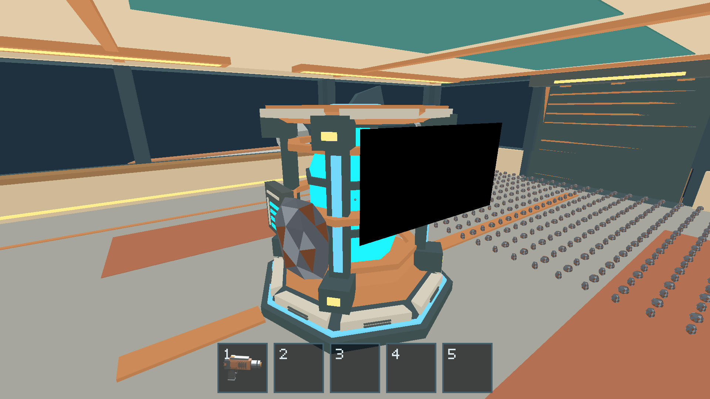
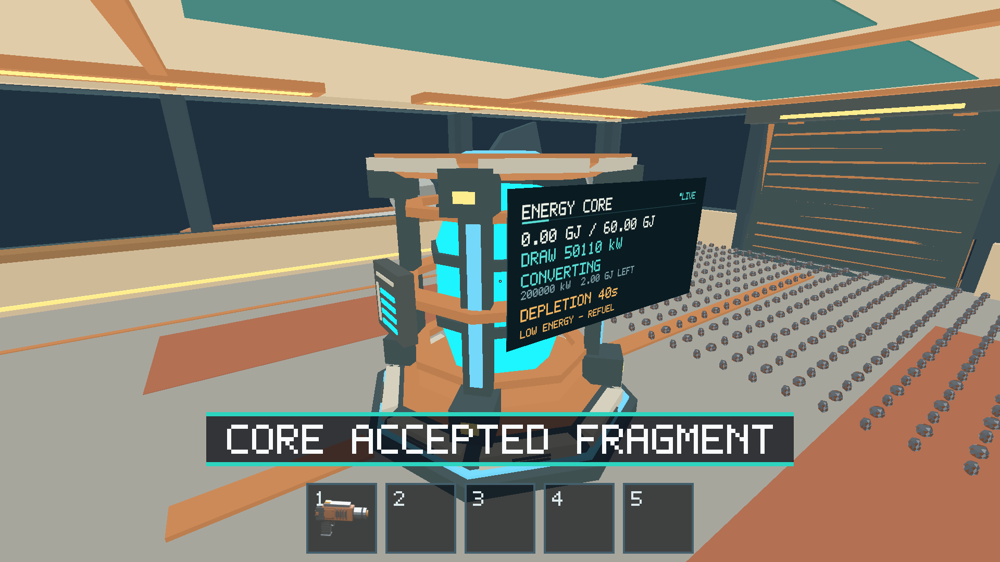
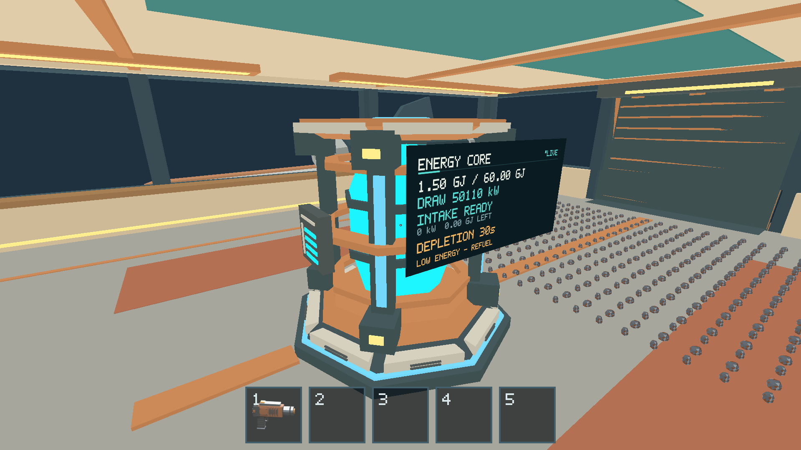
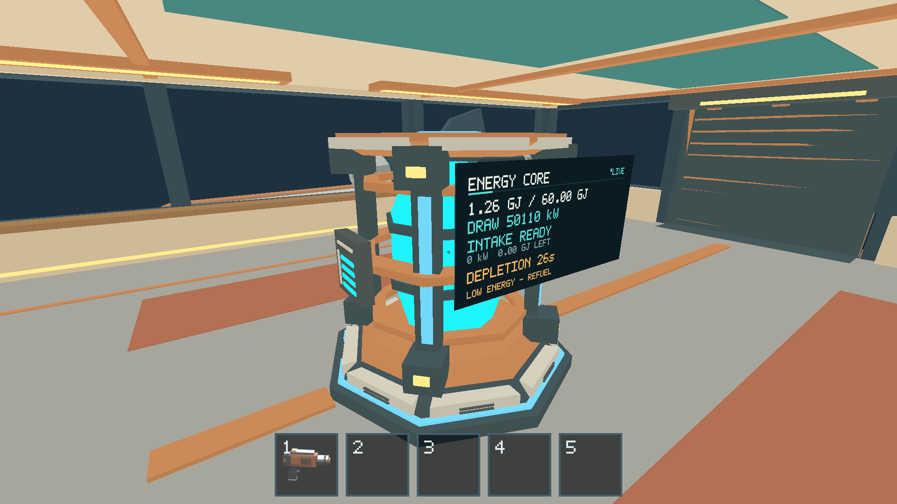

# Issue 199 — native Apple M1 Core, zero-G and 500-fragment smoke

Executed locally on the owner's Apple M1 iMac, 16 GB RAM, macOS 26.2,
2026-10-15 (Asia/Nicosia). Real Metal / Apple M1 integrated GPU, timestamp
queries enabled, 1920×1080 physical drawable at Retina scale 2, AutoVsync,
F3 off for benchmarks. [Shared environment](../issue-200/environment.json),
[release metadata / executable SHA-256](../issue-200/build-info.json).

Outcome: covered native correctness and visuals passed; settled 500-piece
throughput is approximately 60 FPS. **The provisional frame p95 ≤16.67 ms target
was missed**, including in the empty-load baseline. Active collision spikes and
an incomplete larger-piece stress probe remain limitations. Full exploratory
manual gameplay/held controls are not signed off. Keep this issue open pending
owner review of these limits; this report does not claim a strict 60 FPS floor.

## Changes and prerequisites

Prerequisites #189, #191, #194 and #196 were closed and merged in main `ee66e96`
before local work. Runtime/character/ship/renderer contracts were inspected.

`cargo-blackout` initializes one held 2 kg iron fragment and 499 loose 0.032 kg
iron pieces contained in the aft cabin (500 physical identities total). After
initialization all movement, E intake, conversion, gravity and physics use
production controllers. Its baseline/evidence routes are in the realistic-flight
group and replayed by an owning Rust regression. No energy setter or teleport
command was added to the protocol. Signed throttle is initially 50%, power zero.

Native benchmark `--layouts onboard` reuses the contained flight-wave load:
500 loose 0.032 kg pieces / 16 kg cargo. It preserves the existing measurement,
raw-frame, renderer, accounting and sleep checks. An owning test verifies count,
containment, mass, active motion and rejection above 500. The pre-existing
scattered/dense stress layouts keep larger mixed pieces and multilayer geometry;
their results are deliberately separate workloads. See commits `76016f9` and
`738402b`, [runtime ownership](../../client/runtime/architecture.md) and
[benchmark guide](../../scripts/FRAGMENT_BENCHMARKS.md#contained-flight-wave-load-199).

## Gameplay and visual matrix

| Check | Result | Observation |
| --- | --- | --- |
| Powered 500-fragment mass/flight | PASS | 100016 kg ship, all 500 IDs retained; loaded landing/takeoff also passes. |
| Held fragment and zero-G character drift | PASS native scripted | Upward position continues changing after release; held ID remains until E intake. The EVA-only velocity inspection field is not used to infer interior drift. |
| Dead-Core physical intake | PASS scripted and real desktop E | Held fragment removed once, 500→499 total identities, total mass 100017.968→100015.968 kg. |
| Gradual recharge / independent conversion | PASS | After first restored tick, 2.39824 MJ stored and conversion still active; after completion, 1.4989 GJ stored. |
| Selected thrust restoration | PASS | 50% selection persists; power return accelerates ship while pilot remains outside cockpit. |
| Later depletion / blackout | PASS | Stored energy reaches zero again; selected 50% persists while thrust ceases. |
| Loose cargo retention / power transitions | PASS native scripted | The 499 remaining IDs exactly match original IDs minus consumed ID 1. All retain ship-frame membership and 15.968 kg onboard mass. |
| Core display off/converting/recharged | PASS visual | Direct Metal captures and real native E-key probe show black display, active conversion, and readable status/low-energy warning. |
| Surface mining, pickup, carrying, transfer, streaming | PASS native scripted | Seven resource evidence routes. The 500 load is generated through production extraction at initialization; no claim of manually mining/carrying 500 pieces one by one. |
| Full manual containment/zero-G exploration | NOT VERIFIED | Deterministic native routes and CPU regressions cover transitions; sustained manual control remains owner work. |

[Native result/checkpoint evidence](../issue-200/native-results.json),
[real E-key observations](native-input-core-restart.json).









## Native performance

No builds, CPU tests or other game instances ran during retained performance
windows. Existing unrelated desktop applications remained running; thermal
sensors were not sampled. The 60 Hz cadence came from the built-in Retina
presentation surface; the attached 75 Hz external monitor was not the tested
drawable. Each settled window uses 10 s warmup + 30 s sampling, ≥100 samples,
three repeats. Mean/effective FPS below is computed from retained raw intervals;
median interval FPS remains separately available in the summaries.

| 500 onboard settled repeat | Retained frames | Mean frame ms / effective FPS | Frame p95 ms | Physics p95 ms | CPU update p95 ms | CPU render p95 ms | Latest GPU pass p95 ms |
| --- | ---: | ---: | ---: | ---: | ---: | ---: | ---: |
| 1 | 1802 | 16.6663 / 60.001 | 17.122 | 1.358 | 3.284 | 0.862 | 1.890 |
| 2 | 1802 | 16.6663 / 60.001 | 17.179 | 1.353 | 3.293 | 0.859 | 1.862 |
| 3 | 1802 | 16.6650 / 60.006 | 17.144 | 1.377 | 3.310 | 0.861 | 1.871 |

Every retained 500-load sample reported all 500 asleep and zero moving objects.
Natural preparation took 46 production steps (0.736 simulated s / 0.788 wall s).
The provisional physics/CPU-render/GPU partitions are met in settled windows;
frame-tail guidance is not. GPU values are asynchronous **latest completed pass**
observations, not synchronized per-frame durations or full presentation latency.

Empty-load median interval FPS was 60.012–60.033, with frame p95
17.092–17.111 ms across three 1801/1801/1802-frame windows. This shows the frame
p95 miss already exists without cargo; it does not establish the cause of jitter.
The empty/stress probe used the earlier fixture-patch executable; its separate
SHA-256 and dirty source base are preserved in its summary. The final 500
onboard runs use the committed-source digest linked above.
No same-machine prior revision baseline was available for a performance-regression
comparison. Do not interpret this as a before/after speedup.

Three fresh active windows used 0 s warmup + 5 s sampling. They retained
295/295/296 samples, but only 20/20/16 moving-object samples; the rest had
naturally settled. Frame p95 was 17.710/18.198/17.401 ms, max
49.168/48.094/42.805 ms. Physics max was 41.790/41.775/41.957 ms.
These are **mixed active/resting windows**; there are fewer than 100 active
samples, so active-only p95/tail acceptance is not established. They expose
transient interaction/frame spikes, not sustained active-load throughput.

The larger scattered mixed-material 500-piece preparation was manually stopped
(exit −15), not a crash or passed benchmark: after 150 production steps it
reported 174/500 asleep and 224 moving. Its last preparation progress was
119.975 wall seconds for 2.4 simulated seconds. Preparation overlapped a short
release rebuild, so wall time is diagnostic only, not an isolated CPU baseline.
There is **no settled FPS result** for that workload. The runner's failed case
and log are preserved rather than silently discarded.

Native CPU-only flight profiling retained 100 samples for each 0/500 workload;
all portable absolute guardrails passed. Selected 500-piece update p95 values:
mass-idle 0.000125 ms, boundary mass crossing 0.000500 ms, moving powered
17.868 ms, moving zero-G 6.517 ms, alternating power 19.317 ms, dense contacts
108.167 ms (max 189.700 ms). These are fixed-step CPU work costs, **not FPS**;
the permissive guardrails do not prove a 16.67 ms gameplay budget.

### Reproduction

From the repository root, after release staging:

```sh
SALIMON_REFERENCE_SIZE=1 RUST_LOG=info python3 scripts/benchmark_fragments.py --binary artifacts/build/release/salimon-client --machine-label apple-m1-imac-16gb-macos26.2 --counts 500 --layouts onboard --states settled --cameras facing --repeats 3 --minimum-samples 100 --settle-steps 2400 --timeout 300 --output artifacts/native-m1/benchmark-onboard
SALIMON_REFERENCE_SIZE=1 RUST_LOG=info python3 scripts/benchmark_fragments.py --binary artifacts/build/release/salimon-client --machine-label apple-m1-imac-16gb-macos26.2 --counts 500 --layouts onboard --states active --cameras facing --repeats 3 --minimum-samples 100 --warmup-seconds 0 --sample-seconds 5 --timeout 90 --output artifacts/native-m1/benchmark-active
python3 scripts/profile_flight.py --binary artifacts/build/release/salimon-client --samples 100 --output artifacts/native-m1/flight-cpu-profile.json
```

The empty/stress command used `--counts 0 500 --layouts scattered --states settled
--cameras facing --repeats 3 --minimum-samples 100 --settle-steps 2400 --timeout 600`;
only the empty case completed. Other options matched the settled command.

[Settled summary](onboard-settled-summary.json), [raw settled windows (gzip JSON)](native-500-onboard-settled-facing.json.gz),
[active summary](onboard-active-summary.json), [active raw repeat 1](native-500-onboard-active-facing-repeat-1.json.gz),
[repeat 2](native-500-onboard-active-facing-repeat-2.json.gz), [repeat 3](native-500-onboard-active-facing-repeat-3.json.gz),
[empty/incomplete-stress summary](empty-and-stress-summary.json), [empty raw windows](native-0-scattered-settled-facing.json.gz),
[incomplete stress log](native-500-scattered-settled-facing.log), [CPU profile/raw samples](flight-cpu-profile.json).

Follow-up work: owner's sustained manual walkthrough; investigate active/dense
contact spikes and practical stress preparation; assess/calibrate the provisional
frame-p95 target against empty-load cadence before claiming a hard 60 FPS floor.
These findings do not imply changing physics, sleep, collision or energy policy
inside this validation PR.
