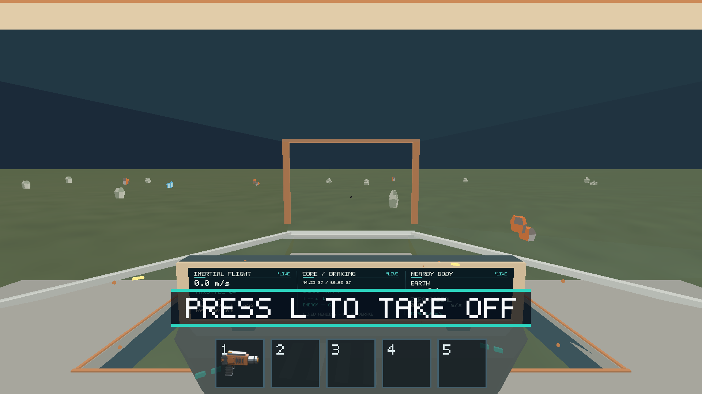
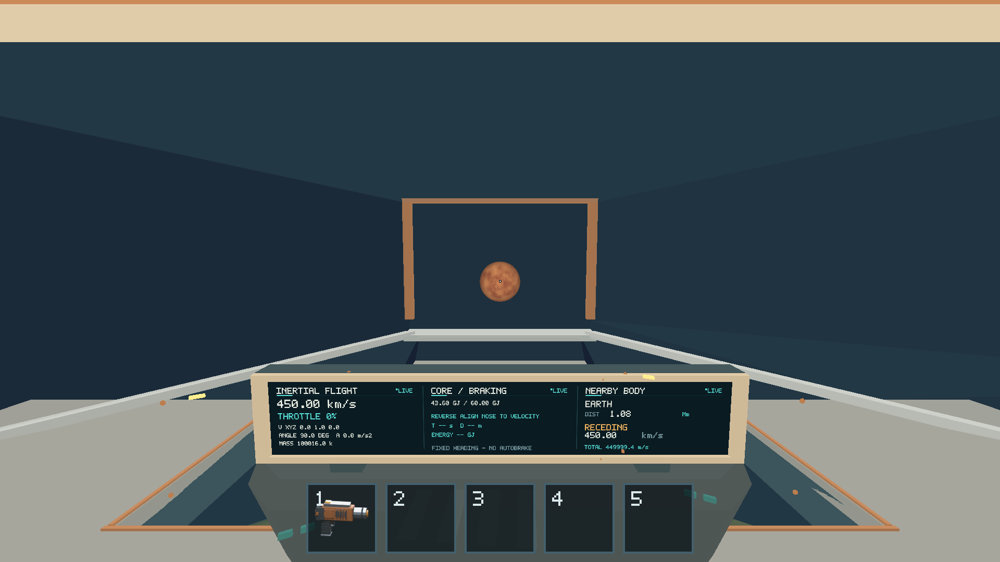

# Issue 200 — integrated native Apple M1 propulsion regression

Latest local verification: [2026-10-17 follow-up](2026-10-17/README.md).
The evidence below is the historical 2026-10-15 run and retains its original
coverage limits; the dated follow-up records what was verified subsequently.

Executed locally on 2026-10-15 (Asia/Nicosia) on the owner's physical Apple M1
macOS iMac; no cloud, CI, software Vulkan or emulated GPU results are presented
as hardware verification. [Environment](environment.json),
[release build metadata / SHA-256](build-info.json).

Outcome: the covered integrated native scenarios pass, including loaded ship,
Core depletion/refueling/restart, EVA, crash recovery, assisted landing and
inertial takeoff. **Final unrestricted manual signoff remains open** because
sustained native mouse-look/held steering and exploratory gameplay were not
completed through the desktop automation. The provisional 16.67 ms frame-p95
target was missed even on the empty-load baseline; there is no strict 60 FPS
floor certification. This PR supplies evidence and regressions for review and
does not automatically close #198, #199 or #200.

## Changes and dependency order

Merged main `ee66e96` already contained #195 and all implementation dependencies.
The user explicitly requested #198, #199 and #200 together in one integration
branch/PR. Flight and Core native work is recorded in [#198](../issue-198/README.md)
and [#199](../issue-199/README.md), before this aggregate assessment.

- `76016f9`: opt-in 500-fragment blackout fixture, baseline/evidence power cycle
  and tangential landing-cutoff routes, owning deterministic Rust regressions.
- `738402b`: native benchmark access to the same contained 0.032 kg iron cargo
  used by the flight/Core fixture; active motion remains explicit and settling
  uses production physics. Existing larger stress layouts remain unchanged.
- Runtime and runner/benchmark guides document fixture ownership and commands.
  No gameplay force, landing, energy, collision, renderer or asset rules changed.

The release production code corresponds to `738402b`. Early exploratory runs
used merged main or the first fixture patch; final retained suites use the
expanded production fixture code and the staged binary digest above. Reports
are later evidence-only changes.

## Integrated matrix

| Path | Result | Evidence |
| --- | --- | --- |
| Forward/reverse thrust, coast, steering/vector telemetry | PASS native scripted; OS throttle additionally verified | Realistic-flight routes; [#198](../issue-198/README.md). Held OS steering remains unverified. |
| Crash settle/recovery, assist reservation/uncancellability, takeoff | PASS | Scripted crash route and real native L probe. |
| 500 pieces, mass/identity accounting | PASS | Cargo and blackout routes; loaded landing/takeoff retains all 500 IDs and 16 kg cargo. |
| Dead Core, gradual conversion, power restoration and subsequent depletion | PASS | 500→499 identity transition consumes exactly the held ID, with 499 ship-frame pieces retained. |
| Zero-G drift, gravity restoration, containment | PASS native scripted | Powered/unpowered snapshots retain mass and identity; CPU transition/collision tests supplement the native route. |
| Moving-ship and nearby-body EVA; airlock/mining/carrying/streaming | PASS native scripted | Full baseline and resource evidence routes. No 500 individual manual mining operations are claimed. |
| Metal visual checkpoints | PASS for inspected captures | Core display off/converting/recharged; signed navigation; recovery/takeoff; cargo. |
| 1920×1080 performance | MEASURED, provisional p95 target missed | Three empty and three settled 500-load windows; mixed active windows; [#199](../issue-199/README.md). |
| Sustained manual mouse-look/held steering and exploratory full play | NOT VERIFIED | Requires owner walkthrough before unrestricted signoff. |

## Checks and commands

All commands ran from the repository root. Exact summarized native results,
assertion counts are in [native-results.json](native-results.json);
[compressed details](native-details.json.gz) retain per-step outcomes and selected
checkpoint state fields. All ship/player/carrying/equipment/mining/interaction/world
inspection fields matched exactly across the three repeated flight runs, with
zero per-step differences (observational performance/capture fields excluded).

```sh
python3 scripts/build_game.py --profile release --output artifacts/build/release
cargo test --workspace --locked
cargo clippy --workspace --all-targets --locked -- -D warnings
cargo fmt --all -- --check
python3 -m unittest discover -s scripts -p 'test_*.py'
SALIMON_REFERENCE_SIZE=1 RUST_LOG=info python3 scripts/salimon-test suite --binary artifacts/build/release/salimon-client --artifacts artifacts/native-m1/baseline --summary
SALIMON_REFERENCE_SIZE=1 RUST_LOG=info python3 scripts/salimon-test suite --group realistic-flight --evidence --binary artifacts/build/release/salimon-client --screenshot-command '["native"]' --artifacts artifacts/native-m1/flight-final-1 --summary
SALIMON_REFERENCE_SIZE=1 RUST_LOG=info python3 scripts/salimon-test suite --group resource-collection --evidence --binary artifacts/build/release/salimon-client --screenshot-command '["native"]' --artifacts artifacts/native-m1/resources-final --summary
SALIMON_REFERENCE_SIZE=1 RUST_LOG=info python3 scripts/salimon-test run reports/issue-200/loaded-assist.json --binary artifacts/build/release/salimon-client --screenshot-command '["native"]'
```

The expanded realistic-flight evidence group was repeated three times, using
`flight-final-1`, `flight-final-2` and `flight-final-3`. No new pose/state mutation
command is available after initialization. The loaded-assist route uses the
ordinary orbit fixture plus 500 contained pieces, completes landing and takeoff,
and asserts retained count/mass and final nonzero velocity with zero throttle.

462 Rust tests passed, 7 existing opt-in tests ignored; 58 Python contracts passed.
Formatting and workspace Clippy passed. The committed-source release rebuild
matched the measured executable byte-for-byte (`e648c0c4473cc74bb2d1ef176325a8367c5301d71cb0ef2e8531535142b87d3a`).

[Rust log](workspace-tests-release-code.log), [Clippy](clippy-release-code.log),
[Python contracts](script-tests-release-code.log), [release staging](build-committed.log).
The Python contract log includes deliberately mocked build/profile failures;
its final `OK`/process exit is the test outcome. Initial local probe assertions
were corrected to observe position drift rather than the EVA-only velocity
inspection field, and to account for 16 ms tick admission. Final owning Rust
and native routes pass; those exploratory failures are not reported as game bugs.

Normal desktop launch additionally accepted F2 → precision tour, F3 → diagnostics,
body 1 selection, F2 → gameplay and F3 → hidden, then closed cleanly and relaunched.
See [native event log](manual-stderr.log). Minimize/resize were not independently
certified by that manual check. The broader packaged smoke script was not run:
it uses a separate OS-input helper; real input here used CUA and the probes below.
Blender/model regeneration was not run because no authored/exported asset changed.

## Desktop input probes

[The local helper](input_probe.py) uses the repository's existing `Game` protocol
client and logs half-second authoritative observations. From the repository root,
place the staged binary in the existing ignored `artifacts/SalimonAcceptance.app`
(bundle ID `game.salimon.acceptance`), then run, for example:

```sh
SALIMON_REFERENCE_SIZE=1 RUST_LOG=info python3 reports/issue-200/input_probe.py crash-recovery
```

It advances 16 ms fixed ticks at an approximate 16 ms wall cadence, accepts no
protocol control actions, and runs at most five minutes. Native CUA app input
sent Up twice (+2%), Down four times (−2%), Up twice (0%); real L twice started
uncancellable crash recovery, then L initiated takeoff after the landed prompt.
The Core probe sent E at the aimed powerless Core. Touch
`artifacts/native-m1/input-<scenario>/capture` for a direct GPU checkpoint and
`.../stop` for cleanup. The probe's fixed clock is explicitly unsuitable for
performance claims. [Native key observations](../issue-198/native-input-flight-regression.json.gz)
and [Core observations](../issue-199/native-input-core-restart.json.gz) preserve the
actual transitions. No screenshot outside the game was promoted.





Remaining work: owner's sustained control/exploratory walkthrough; assess the
provisional frame-tail target and active/dense collision costs; repeat interrupted
large-piece stress preparation if that workload is required for signoff. These
limitations are explicit in the PR and linked issue updates.
