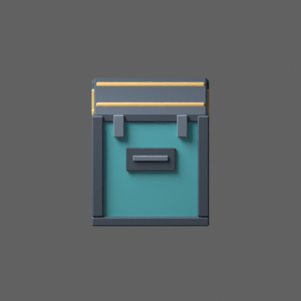
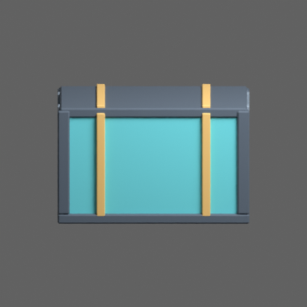
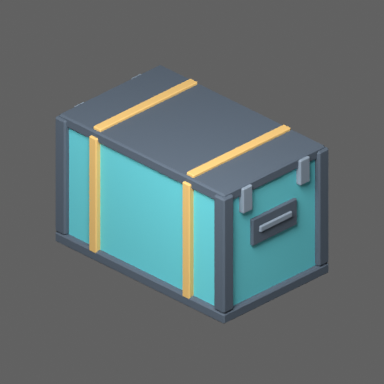

# #225 — reversible code-first local authoring

Implemented repository-owned stdio MCP 1.0.0 and equivalent headless CLI, pinned
to Blender 4.5.3 LTS. Three fixed operations inspect source, render three angles,
or generate an isolated material-only Option A cargo-container candidate.
No socket, external asset service, arbitrary code tool or production save.
Authoring guide records provider evaluation, setup/teardown, approval boundaries,
linked-library preservation, Option A palette/facets/budgets and Option B interface
compatibility. Root agent guidance links to it.

## Evidence

Linux CPU Blender 4.5.3 LTS, Python 3.12. No Apple M1 verification claimed.

- `python -m unittest discover -s models/tests -v`: 67 passed, 2 Blender skips
  (before the fifth bridge integration test was added).
- `BLENDER=/tmp/blender-4.5.3-linux-x64/blender python -m unittest discover -s models/tests -p test_authoring_bridge.py -v`: five tests pass including real read-only source inspection.
- `python models/tools/authoring_bridge.py --blender /tmp/blender-4.5.3-linux-x64/blender --operation sample_palette --asset item.cargo-container`: passed; named geometry/interface inspection identical before/after, only scratch candidate saved.

[Source inspection](inspection.json) and actual CPU Cycles sample renders:

The first render attempt exposed an absent source World; fixed by creating a
preview-only world. Production source/runtime exports remain unchanged. These
are DCC references, not Salimon shader or native performance evidence. Interactive
local Codex configuration is documented but not exercised in this cloud session;
protocol dispatch and actual headless operations are tested independently.
