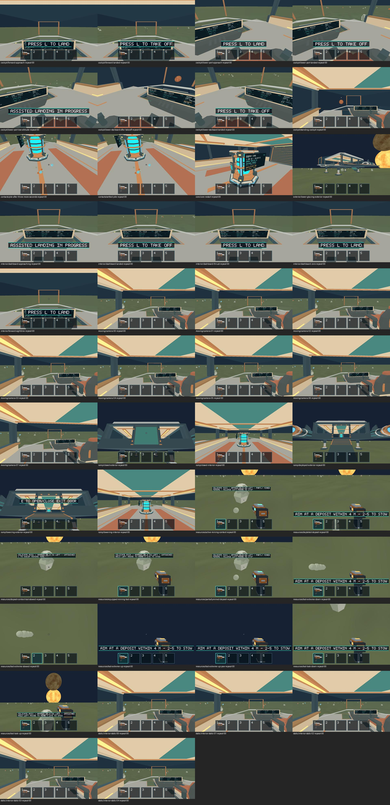

# Issue 229 — Apple M1 model and temporal verification

Local verification, 2026-10-17. Apple M1 iMac21,1 / 16 GiB / macOS 26.2
(25C56) / Metal; Rust 1.89.0, Python 3.14.2, Pillow 12.2.0. Source `220eb84`
plus #254 admission instrumentation, built with locked release dependencies.
[Build provenance/digest](build-info.json). This PR stacks after #266; no asset
or gameplay code changes are included here.

## Visual results

All nine production fixtures passed their gameplay assertions and exact capture
completeness checks. 128 direct GPU images, 86 frozen-repeat comparisons, **zero
changed pixels**, default channel tolerance 8 / changed fraction 0.001 / no masks.
1280×800 capture size. The moving sequence checks each of eight poses against
its two repeats; it does not compare deliberately different camera poses.
[Structured results, performance and image hashes](visual-results.json).

| Fixture | Native result | Evidence |
| --- | --- | --- |
| Cockpit/glass, approach/landed/landing/takeoff views | Pass; no evident overlapping glazing or scale discontinuity | [Frames/state](captures/cockpit/) |
| Monitor, forward sightline and nose views | Pass; readable live physical monitor | [Frames/state](captures/interior/) |
| Tool, deposits, spherical fragments and depleted source | Pass; faceted style, distinct tool/status and expected visibility | [Frames/state](captures/resources/) |
| Contact pile and deck | Pass; six bodies / 12 kg retained, normal settling | [Frames/state](captures/contacts/) |
| Exterior lower glazing | Pass; glazing/ship silhouette remains coherent | [Frames/state](captures/exterior/) |
| Core restart/lights | Pass; actual refuel/power assertion and cyan emissive appearance | [Frames/state](captures/core/) |
| Door/ramp, exterior/interior and lowering views | Pass; routes and geometry remain aligned | [Frames/state](captures/ramp/) |
| Static interior, five successive captures | Pass; no temporal differences | [Frames/state](captures/static/) |
| Eight successive camera poses, three captures per pose | Pass; no per-pose temporal differences | [Frames/state](captures/moving/) |



The full PNG sequences are retained beside compressed production result/state
logs and each fixture's temporal metrics. Visual inspection found no evident
faceting, proportions, emissive, transparency or competing-surface regression in
these views. This bounded evidence is not proof against flicker in every camera
position. Images remain **candidates for owner review**; none were promoted to
human-approved Option A baselines.

## Foreground performance

See [benchmark results](benchmarks/summary.json), raw sample archives and
[OS focus records](benchmark-focus.json). Three windows each for empty and 500
contained 0.032 kg iron pieces (16 kg total), 1920×1080, 2× scale, AutoVsync,
2 s foreground warmup + 8 s measurement, minimum 100 intervals. Naturally sleeping
500-piece preparation, IDs and mass were verified. These legacy small-piece
fixtures do not establish the new 10 kg mining workload's acceptance (#236).

Detailed metrics/deltas are in [performance comparison](performance.md).
All intervals are submitted present calls, not independently measured physical
scanout or proof of a strict 60 FPS floor. GPU timestamps are available;
Metal's allocator observation is unavailable (`gpu_allocator: null`), so total
GPU resident memory is **unmeasured**, not zero. Encoded upload/scratch counters
are not total device memory. No thermal/performance warning was reported by
`pmset -g therm`; AC-powered built-in iMac display, secondary 1080p/75 Hz display
also attached. No other validation/build job ran during the matrix.

## Reproduce and limitations

```sh
python3 scripts/model_visual_tests.py capture --binary artifacts/build/native-254/salimon-client --captures artifacts/native-229/candidates --output artifacts/native-229/capture-results
python3 scripts/model_visual_tests.py compare --temporal-only --captures artifacts/native-229/candidates --output artifacts/native-229/temporal
SALIMON_REFERENCE_SIZE=1 RUST_LOG=info python3 reports/issue-229/foreground_matrix.py --helper artifacts/native-input --records artifacts/native-229/benchmark-focus.json -- python3 scripts/benchmark_fragments.py --binary artifacts/SalimonAcceptance.app/Contents/MacOS/salimon-client --machine-label apple-m1-imac-16gb-macos26.2 --counts 0 500 --layouts onboard --states settled --cameras facing --repeats 3 --minimum-samples 100 --warmup-seconds 2 --sample-seconds 8 --settle-steps 2400 --timeout 300 --output artifacts/native-229/benchmarks
```

The wrapper explicitly opts into the reviewed #198 PID focus helper; compile it
as described in [#254's report](../issue-254/README.md). Direct GPU image capture
excludes other desktop content but does not prove real OS input. #198's merged
native input evidence remains separate; #200 tracks integrated propulsion.
Active-only tails and larger-piece stress remain #255; no performance signoff is
inferred from settled samples. Ordinary approved-baseline comparison was not
run because no human-approved native baseline exists; temporal checks passed.
CPU/build gates passed for the identical runtime in [#254](../issue-254/README.md)
and were not repeated for this evidence-only change. `git diff --check` passed.
