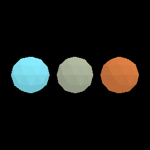

# Issue 232 — shared sphere and tool growth presentation

One original Blender/code-first icosphere replaces all six fragment visual
variants for live rendering. Source, generator, manifest and checked-in GLB are
included: 80 flat-shaded triangles, one neutral material/primitive, 9,540 bytes,
zero textures. All resources share one resident mesh/draw and receive established
resource colors in 48-byte pose/tint records. Mass/density produce radius through
the existing spherical-mining contract; visual scale is radius / 0.48. Stable
fragment/source/resource IDs are unchanged; no saved-data migration in Phase 0.

The attached reserved ID renders exactly once, outside the loose draw list, at
this frame's camera/tool front-left position and orientation. Stow/location gates
hide it; release clears it and uses the same ID for world presentation. It adds
no rigid body or duplicate resource object. Tests cover current-camera transforms,
equip/location/release cleanup, no duplicate mass, aim/near-plane clearance at
the default cap, radius/pose/identity mapping, opaque tint validation and batching.

This is a deterministic offscreen **software Vulkan** GPU render of ice,
silicate and iron at a common inspection scale, not a Blender beauty render or
native M1 evidence. Three colors use one draw. Repeated frames are byte-identical;
indexed-vs-expanded raster comparison reports 0 differing pixels / 65,536.
Adapter: llvmpipe, Mesa 25.2.8, LLVM 20.1.2. See [GLB compliance/cost report](glb-report.json).

## Reproducible validation

- `python models/tools/export_asset.py resource.spherical-fragment --blender /path/to/blender`
  — passed using Blender 4.0.2 (original deterministic parametric authoring).
- `python models/tools/process_glb.py resource.spherical-fragment --profile exact-v1 --output artifacts/glb`
  — passed Khronos compliance, semantic equality and Option A budgets.
- `python -m unittest discover -s models/tests -v` — 83 tests, 3 optional
  Blender/linked-source integrations skipped; no failures. New sphere schema,
  80-triangle budget, neutral material, equal vertex radius and normals pass.
- `python -m unittest discover -s scripts -p 'test_*.py'` — 61 passed.
- `cargo fmt --all -- --check` — passed.
- `cargo clippy --workspace --all-targets --locked -- -D warnings` — passed
  with Rust 1.99.1.
- `cargo +1.89.0 test --workspace --locked` — 473 passed, 11 opt-in tests
  ignored, zero failures; includes the carrying/transfer regressions.
- `cargo +1.89.0 build --workspace --locked` — passed, no Blender dependency.
- `cargo +1.89.0 test -p salimon-renderer headless_resource --locked -- --ignored --nocapture`
  — all 3 GPU tests passed on software Vulkan, including palette, repeat
  stability and instanced raster parity. Evidence uses
  `SALIMON_RESOURCE_EVIDENCE_DIR=artifacts/sphere-gpu`.

## Scope and limitations

Spherical physics, rolling, final release/carry/contact geometry belong to #233
and #234. Legacy physical contact hulls, their orientation and gameplay size are
preserved explicitly in physics/carrying/emission/checkpoint consumers, so this
visual change cannot silently alter contact or target-selection fixtures. Preview
rotation is presentation only. Until those issues merge, visual and physical
bounds/resting heights differ; this PR does not claim complete sphere physics.

Windowed capture could not run locally: Xvfb cannot open listening sockets in
this environment. #250 runs multi-angle production-window captures in Linux CI.
No native/M1 manual verification was performed or required by #232; #229 retains
hardware/style approval. Initial local Rust 1.99 test linking hit an unrelated
hidden-symbol linker error; workspace tests use the declared Rust 1.89 minimum.
