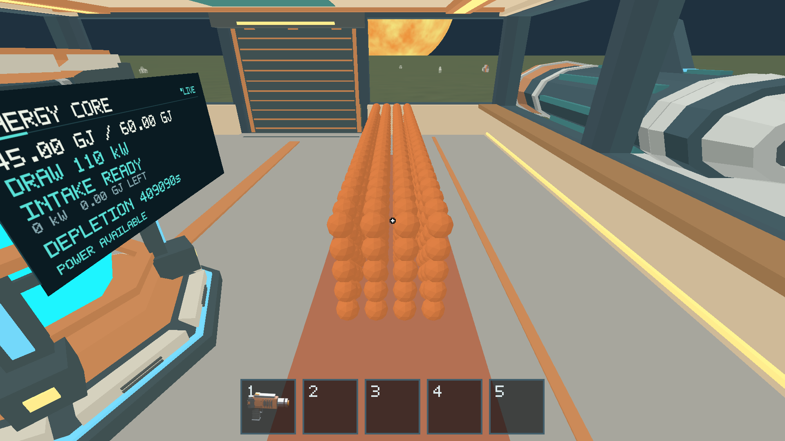

# Issue 236 — spherical mining on the physical Apple M1

Local run, 2026-10-17. Apple M1 iMac21,1, 16 GiB, macOS 26.2 (25C56),
Metal, AutoVsync, 1920×1080 / 2× scale. Rust 1.89.0, Python 3.14.2,
Pillow 12.2.0. Base `011ab0e` plus this PR's opt-in fixture changes.
[Release build provenance and binary digest](build-info.json). Review after #267.

## Outcome and coverage

All 13 native graphical routes passed: seven maintained resource evidence routes,
four ship/EVA routes, and two new actual 500×10 kg sphere workloads.
[Pass/step matrix](results.json); each linked evidence directory retains production
state/result logs (gzip) and direct GPU captures. No physics, extraction, sleep,
carrying, power or persistence rule was changed to obtain a pass.

| Behavior | Result and evidence |
| --- | --- |
| Continuous hold, cap/repeated automatic 10 kg releases, aim loss, depletion | Pass: [mining-emission](evidence/mining-emission/) retains 111 checked steps; attached/released identities and total extracted mass are asserted |
| Front-left growth preview and low-poly appearance | Pass: [next attached sphere](evidence/mining-emission/step-089-continuous-cap-next-attached.png) shows the preview to the tool's front-left; [tool/partial source](evidence/mining/) |
| Pickup/carry/drop and toolbar lockout | Pass: [carrying](evidence/carrying/), [transfer](evidence/fragment-transfer/), [complete collection loop](evidence/resource-loop/) |
| Planetary gravity and EVA | Pass: [space airlock](evidence/space-airlock/), [moving EVA](evidence/moving-eva/), [nearby-body EVA](evidence/nearby-eva/) |
| Ramp/door and physical Core | Door/boarding transfer passes; native ramp and Core conversion captures passed in [#229](../issue-229/README.md). The local Rust suite also passes all-material 10 kg/0.25 kg release→pickup→carry→Core integration |
| Partial/depleted state across local streaming unload/reload | Pass: [resource streaming](evidence/resource-streaming/) and resource loop |
| Disk save/relaunch restoration | **Not implemented**, not certified. Existing #234 and canonical resource contracts explicitly defer disk persistence; scope decision tracked in [#268](https://github.com/mr-exception/salimon/issues/268) and Project Q&A |
| 500 full-size spheres on one deck / five-layer pile | Pass: 500 IDs and 5,000 kg retained; ordinary contact/sleep settles both layouts after 33 updates. Three frozen GPU captures per layout are byte-equivalent in RGB; no flicker observed |



## Reproducible workload addition

`benchmark_fixture` adds opt-in `sphere-deck` / `sphere-pile` layouts, also accepted
by E2E setup and the Python matrix CLI. Each sphere is emitted through repeated
production `tick_spherical` updates at the normal 10 kg cap. The #235 supported
21 cm deck grid and 100-column/five-layer pile are preserved. Population is
capped at 500; active starts are ordinary drops, not externally forced motion.
A regression checks 500-piece mass/IDs, contained ship mass, natural sleep for
both layouts, active initial motion and rejection above 500. Ledger summation
allows only 50 micrograms of f64 accumulation error across five tonnes; individual
sphere mass remains exactly 10 kg. No sleep flags or rest poses are installed.

The canonical [benchmark guide](../../scripts/FRAGMENT_BENCHMARKS.md#native-10-kg-workloads-236)
records the new layouts. Stale runtime wording that treated #233–#234 spherical
contact integration as pending is corrected.

## Performance and limits

[Foreground native benchmark results](benchmarks/summary.json), raw intervals,
[focus records](benchmark-focus.json) and [performance notes](performance.md)
retain three windows per 500-piece layout. All measurements require #254 admission;
all bodies remain naturally asleep, with original mass/IDs preserved. No other
build/test job ran during these performance windows. `pmset -g therm` reported
no thermal/performance warning. GPU timestamps are real Metal observations;
total GPU allocator residency is unavailable, not zero.

Pre-refactor #199 used 0.032 kg legacy iron pieces, not 10 kg spheres; it is not
a matched native physics baseline for this workload. #235's matched old/new
renderer comparison is CPU-only. Do not infer a native GPU speedup from it.
Active-only tails and larger mixed-piece stress remain #255. Capture/state routes
use fixed simulation ticks and do not establish native FPS; foreground wall-clock
benchmarks supply the separate cadence measurements. No strict 60 FPS floor,
unbounded exploratory play, cross-process save or unsupported memory metric is
claimed. The unresolved save/reload wording is explicitly filed as required by
#236's acceptance criteria; this report does not invent a persistence feature.

## Validation and exact commands

- `cargo test --workspace --locked`: **483 passed**, 13 existing opt-in ignores.
  [Log](rust-tests.log).
- `cargo clippy --workspace --all-targets --locked -- -D warnings`: passed.
  [Log](clippy.log).
- `cargo fmt --all -- --check`, `git diff --check`: passed.
- `python3 -m unittest discover -s scripts -p 'test_*.py'`: **80 passed**.
  [Log](python-tests.log). Python 3.12 unavailable; used 3.14.2.
- `python3 scripts/build_game.py --profile release --output artifacts/build/native-236`:
  passed. [Log](build.log).
- `cargo test -p salimon-client --locked ten_kg_native_spheres -- --nocapture`:
  passed. [Natural-sleep log](sphere-fixture.log).

```sh
SALIMON_REFERENCE_SIZE=1 RUST_LOG=info python3 scripts/salimon-test suite --group resource-collection --evidence --summary --binary artifacts/build/native-236/salimon-client --screenshot-command '["native"]' --artifacts artifacts/native-236/resources
SALIMON_REFERENCE_SIZE=1 RUST_LOG=info python3 scripts/salimon-test suite --group ship-eva --evidence --summary --binary artifacts/build/native-236/salimon-client --screenshot-command '["native"]' --artifacts artifacts/native-236/eva
SALIMON_REFERENCE_SIZE=1 RUST_LOG=info python3 scripts/salimon-test run reports/issue-236/sphere-deck.json --summary --binary artifacts/build/native-236/salimon-client --screenshot-command '["native"]' --artifacts artifacts/native-236/deck
SALIMON_REFERENCE_SIZE=1 RUST_LOG=info python3 scripts/salimon-test run reports/issue-236/sphere-pile.json --summary --binary artifacts/build/native-236/salimon-client --screenshot-command '["native"]' --artifacts artifacts/native-236/pile
SALIMON_REFERENCE_SIZE=1 RUST_LOG=info python3 reports/issue-229/foreground_matrix.py --helper artifacts/native-input --records artifacts/native-236/benchmark-focus.json -- python3 scripts/benchmark_fragments.py --binary artifacts/SalimonAcceptance.app/Contents/MacOS/salimon-client --machine-label apple-m1-imac-16gb-macos26.2 --counts 500 --layouts sphere-deck sphere-pile --states settled --cameras facing --repeats 3 --minimum-samples 100 --warmup-seconds 2 --sample-seconds 8 --settle-steps 1200 --timeout 300 --output artifacts/native-236/benchmarks
```

For the last command copy this build into the local app bundle and compile/use
the reviewed #198 PID helper as documented in [#254](../issue-254/README.md).
No Blender regeneration was needed; production assets are unchanged.
