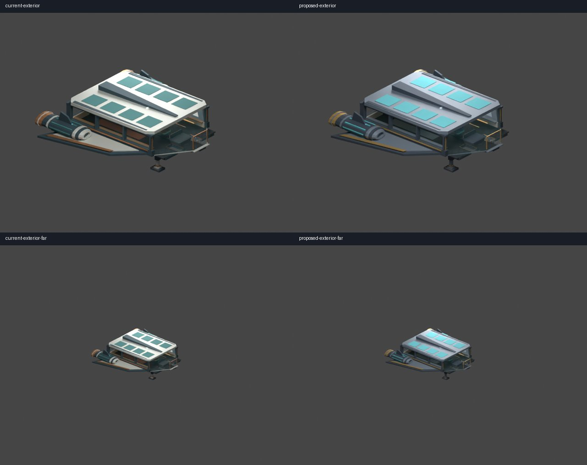
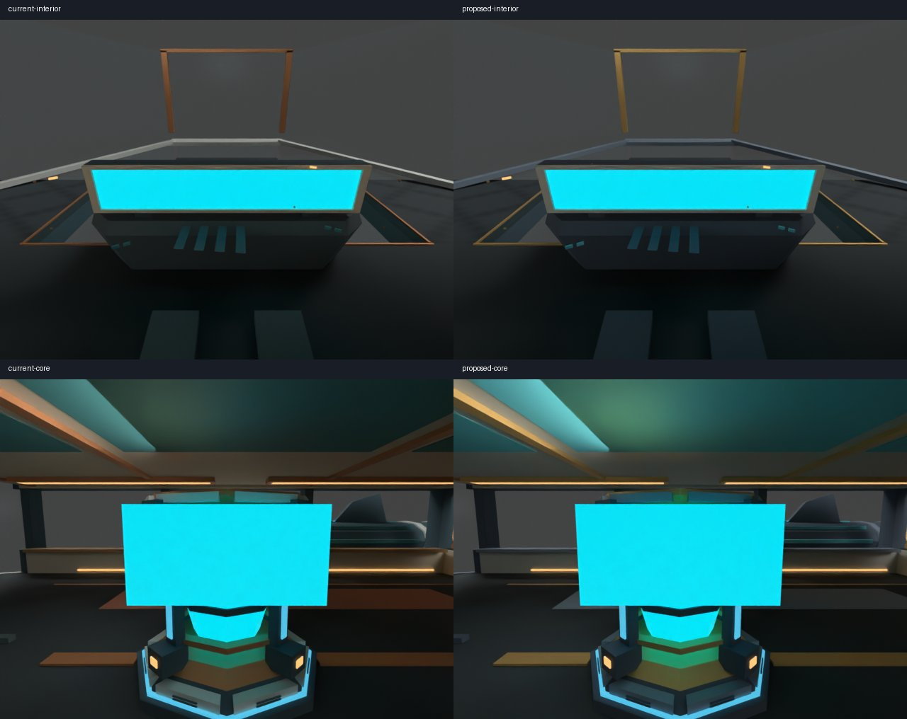
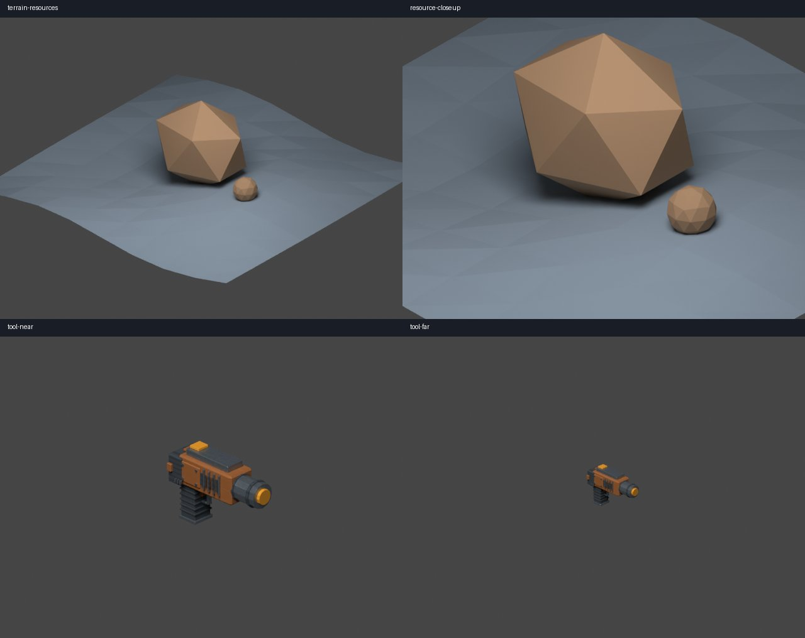

# Issue 274 — Option A visual reference

Built original reproducible Blender references from the existing modular Scout,
held mining tool and original parametric geological studies. Sources remain
editable through the tracked [recipe](../../models/references/option-a/build_reference.py)
and its generated disposable `.blend` snapshots. No runtime files were replaced.

Current is on the left, proposed on the right; near/far exterior and cockpit/Core
views use identical geometry, cameras and light. Resources/tool show near/far
silhouettes and intentional geological facets. Monitor cyan represents source
material, **not live runtime artwork**. CPU previews are not game screenshots.

[Measured source geometry/material counts and cameras](reference-costs.json).
Ship 6,281 unique triangles / 13 materials in both variants; proposed changes are
palette only at this stage. Counts refer to evaluated source mesh triangles, not
runtime draws. Existing GLB budget/draw reports remain authoritative for runtime.
Terrain sample uses 128 triangles plus original faceted deposit/sphere studies.

Validation: Blender 4.5.3 LTS headless command in the reference README completed;
inspected exterior, corrected seated view, Core and resource images. Eight CPU
samples, seed 273, 640×480 per frame, fixed exposure/Standard view. Contact sheets
use `python models/references/option-a/collect_previews.py artifacts/option-a reports/issue-274`
(Pillow). Existing production sources remain unchanged (`git diff`). No native
launch or M1 verification performed.

**Owner sign-off pending**: review the palette, relative panel contrast, broad
silhouette at far scale, geological facets and retained detail at console/tool,
then approve this PR before the dependent Scout migration. Do not treat PR
creation as approval. Proposed precise thresholds are advisory in #275.
GPU regression fixtures and approval remain in `scenarios/visual/README.md`;
native appearance/performance remain separate (#229).
