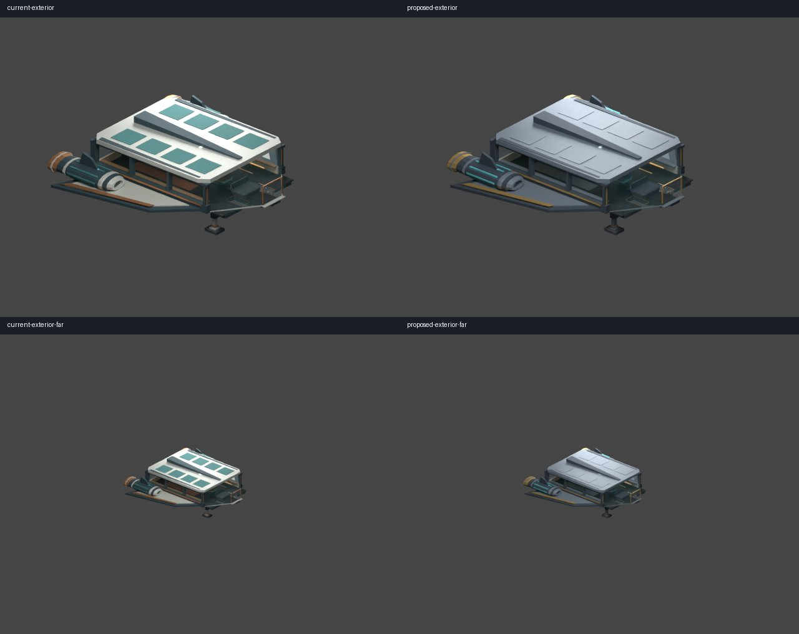
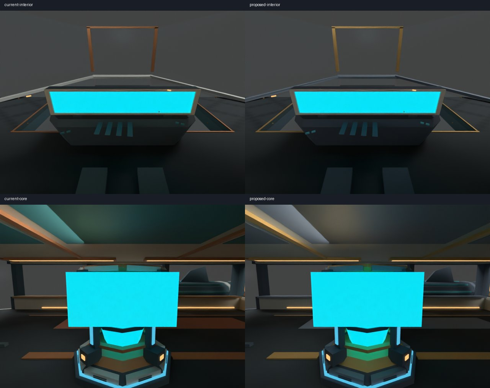

# Issue 276 — Scout Option A migration candidate

Applied the proposed graphite/slate palette, ochre mechanics and warm interior
hierarchy to the shared material library and eight owning components. Broad roof
and ceiling cyan panels now reuse slate; cyan status/display and engine lights,
transparent glazing, packed floor texture and soft seat shading are preserved.
Made opaque panel flat-shading policy explicit in owning sources. Existing broad
silhouettes already match Option A; retained measured geometry rather than adding
unnecessary bevels or micro details. The [reviewed recipe](../../models/assets/ships/salimon-scout/author_option_a.py)
reapplies the pass with Blender 4.5.3; normal category export generates runtime GLB.

Left: pre-migration source; right: production candidate, matched camera/light.
CPU Blender previews show source material roles, not live monitor artwork.

[Cost comparison](cost-comparison.json) / [reference camera measurements](reference-costs.json):

| Metric | Before | After |
| --- | ---: | ---: |
| Triangles | 6,281 | 6,281 |
| Primitives | 116 | 116 |
| Materials | 13 | 13 |
| Nodes | 140 | 140 |
| Renderer draws (opaque + glass) | 2 | 2 |
| Encoded texture bytes | 116 | 116 |
| RGBA8 mip memory estimate | 1,364 | 1,364 |
| GLB bytes | 525,356 | 526,536 |

Geometry is unchanged; normal/material encoding grows the GLB by 1,180 bytes,
within existing 544 KiB cap. Both measurements have 6,273 face-aligned triangles
and eight interpolated triangles under the advisory threshold: much of the
existing source was already effectively flat. New style profile yields no
warnings; it does not certify aesthetics. No budgets or overlap exemptions relaxed.
Spatial JSON and generated Rust layouts are byte-identical to the prior revision.
Monitor UVs, door/ramp travel, marker/collider names, bounds and meter axes remain
unchanged. Preservation colors were deliberately updated, with functional roles
and emission/alpha unchanged. Assembly links remain external and portable.

Validation (Linux; Python 3.12; Blender 4.5.3 LTS):

- Scout `export.py --blender /tmp/blender-4.5.3-linux-x64/blender`: passed.
- Blender `verify_source.py`: 140 objects, 13 materials, 6,281 triangles preserved.
- Blender `verify_modular.py`: nine components and independent edit propagation passed.
- `python models/assets/ships/salimon-scout/validate.py`: passed, including geometry,
  monitor/glass, cockpit rays, ramp and preservation contracts.
- `python models/tools/style_review.py ship.salimon-scout --before artifacts/low-poly/scout-before.glb --output artifacts/low-poly/scout-comparison.json`: passed.
- `cargo test -p salimon-renderer -p salimon-character -p salimon-ship -p salimon-physics --locked`:
  248 tests passed; 11 preexisting opt-in GPU/benchmark tests ignored. Includes
  cockpit/door/ramp and physics-facing regression coverage.
- Blender `build_reference.py -- --output artifacts/scout-option-a --production`:
  four matched CPU renders completed and inspected.

No native game launch/GPU pixel baseline approval or Apple M1 execution was
performed. Reference style approval is pending review of #281 before this PR.
GPU candidates must still follow `scenarios/visual/README.md`; no automatic baseline
promotion. Native visual/performance sign-off is already separately tracked by
**#279**, coordinated with #229; this PR does not close those issues.

Final full suite: `BLENDER=/tmp/blender-4.5.3-linux-x64/blender python -m unittest discover -s models/tests -v`
(with rustfmt on PATH): **92 tests passed**, no skips. Includes real Blender
exports, Khronos processing and authored surface-remediation regressions.
`cargo fmt --all -- --check` and `git diff --check`: passed.
