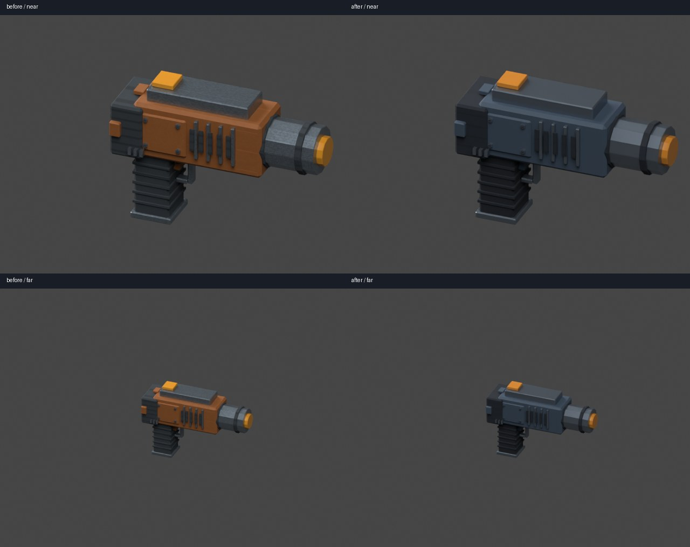
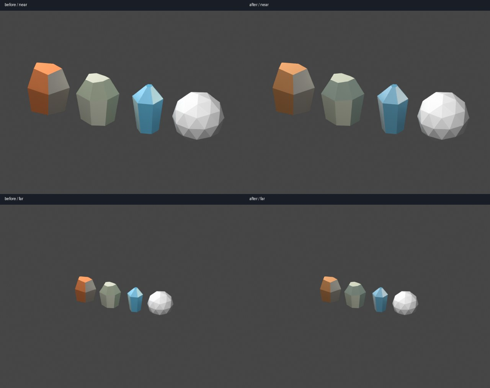

# Issue 277 — tool and resource Option A migration

Updated the saved Blender sources and normal exports for the mining tool and
all twelve deposits. The tool uses broad slate/graphite surfaces and steel,
with quiet manufactured seams/ribs rather than procedural grain/scuffs.
Iron oxide, silicate and opaque ice palettes share restrained contrast while
retaining their distinct mineral silhouettes. Status amber/teal remains unchanged.
The reviewed, idempotent recipe is `models/tools/author_resources_option_a.py`;
reconstruction of historical geometry must be followed by this pass.

Left: before; right: candidate, identical GLB camera/light, near and far.
These are CPU Blender previews, not native renderer screenshots or owner sign-off.

[All fourteen asset cost comparisons](cost-comparison.json) record exact equality
of positions, indices, UVs and exported nodes before/after. No collision geometry,
mining hitboxes, mass/radius calculation, resource IDs, selection, grip placement,
or interactions changed. Nonplanar authored polygons retain their polygon normal
and original triangulation; all triangles have equal corner normals, with no
interpolated geology shading. Sphere source/export is byte-identical: one neutral
80-triangle mesh, instance tint and radius scaling, no resurrected shard variants.
Style profiles are advisory; no hard budget or geometry exception was relaxed.

| Mining tool metric | Before | After |
| --- | ---: | ---: |
| Triangles / primitives / materials | 2,064 / 15 / 4 | 2,064 / 15 / 4 |
| Draws | 1 | 1 |
| Encoded PNG bytes | 68,079 | 2,080 |
| RGBA8 atlas bytes including mips | 349,524 | 349,524 |
| GLB bytes | 225,176 | 159,160 |

[500-sphere measurements](500-spheres.json): debug CPU preparation median
0.939 ms, p95 1.052 ms (100 fixed-pose samples; no hardware performance claim).
A real offscreen Vulkan test renders 500 spheres with one indexed draw / 40,000
triangles; initial upload 24,064 bytes, unchanged frame 64 bytes, retained CPU
instance storage 56,768 bytes. Repeated frames have identical pixels. Physics
remains unchanged, including full sphere contacts/sleep tests in the workspace.

Validation: Linux, Python 3.12, Blender 4.5.3 LTS, Rust 1.99.1, Mesa 25.2.8
llvmpipe LLVM 20.1.2 software Vulkan.

- Blender author recipe, generic export for all twelve deposits/tool, and tool
  icon regeneration: passed. No Blender needed by Cargo.
- `BLENDER=/tmp/blender-4.5.3-linux-x64/blender python -m unittest discover -s models/tests -v`:
  passed after making opt-out fixture independent of the newly opted-in tool.
- `cargo test --workspace --locked`: passed; 483 tests, 13 opt-in tests ignored
  before adding the additional explicitly executed 500-sphere GPU test.
- `cargo test -p salimon-renderer --locked headless_ -- --ignored --nocapture --test-threads=1`:
  software Vulkan resource pipeline/raster parity, sphere palette and 500-sphere
  batching checks passed. Set `VK_DRIVER_FILES` to the installed lavapipe ICD and
  `LD_LIBRARY_PATH` if its dependencies are extracted outside system paths.
- `SALIMON_SPHERE_RENDER_REPORT=<absolute-output.csv> cargo test -p salimon-renderer --locked sphere_renderer_cpu_benchmark -- --ignored --nocapture`: passed.
- `cargo fmt --all -- --check`, workspace Clippy with `-D warnings`, and
  `git diff --check`: passed.

Native game screenshots, owner visual approval and Apple M1 hardware performance
remain separate in #279/#229. Software Vulkan and debug CPU timings do not prove
native FPS. No render baseline was automatically promoted.
