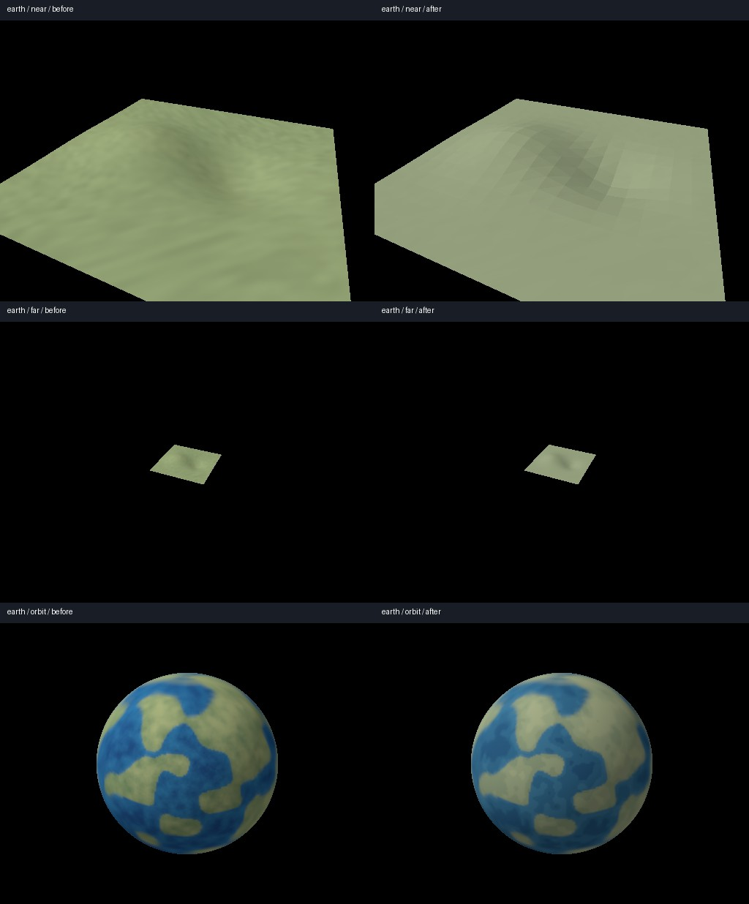
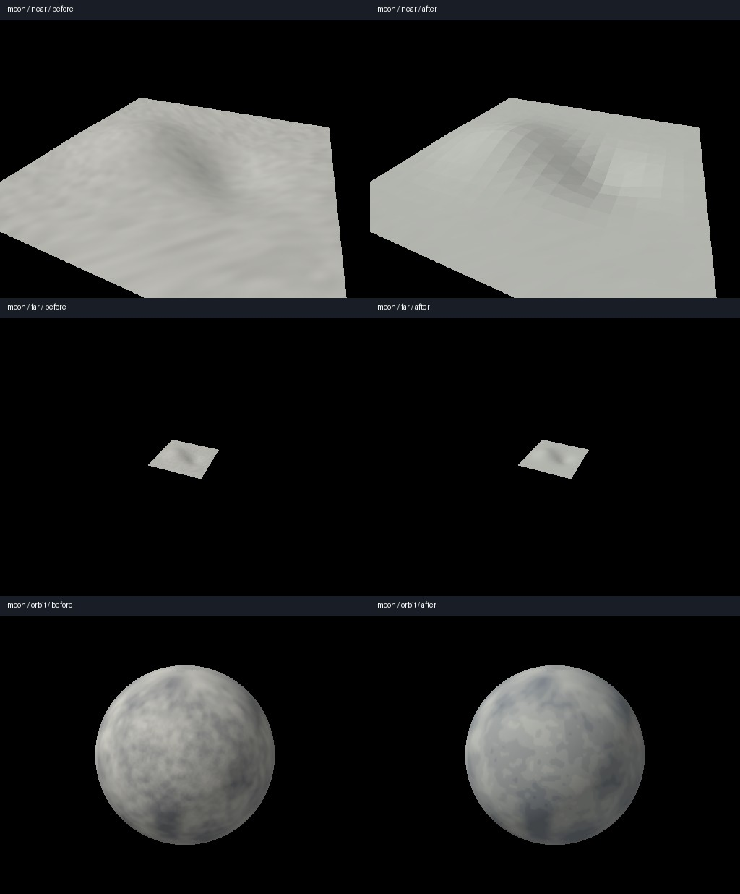
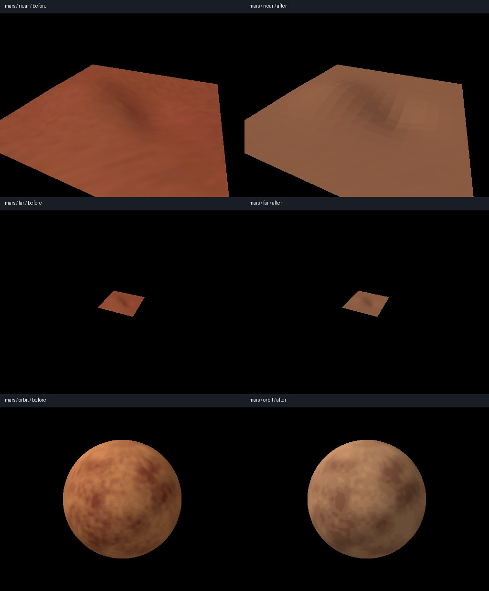

# Issue 278 — procedural Option A bodies and terrain

Added compact version-1 renderer style presets with explicit stable seeds and
linear palettes for the five solid-body materials. Five broad color swatches per
region replace noisy solid albedo; Earth retains its deterministic color-region
split, and Sun emission/recipe remains unchanged. Shared 128 m detail is restrained.
Runtime body/material mapping, physics definitions/seeds, resource generation and
all spatial contracts are unchanged. Presets remain presentation data, with no
network/backend or texture payload dependency.

Terrain now derives outward face normals from existing geometric triangles,
with continuous 80–240 m shading fade and suppression during the existing
startup/outer-cap morph. This adds no vertices, mesh copies, textures, draws or
buffer fields. Distant analytic bodies keep continuous silhouettes and the same
rationalized depth. This is deliberate shading plus existing geometric relief,
not added physical displacement or lower-resolution walking/landing geometry.
See [the art bible](../../docs/visual-style.md#procedural-body-and-terrain-recipes-278)
for seeds, palette table, LOD policy and future custom-recipe extension constraints.

Matched actual offscreen GPU captures, before left / candidate right:





The [structured comparison](comparison.json) contains 21 matched scenes: each
body's near/far/orbit views plus 2 cm crossings around both normal-fade boundaries.
All have **zero changed silhouette/background coverage pixels**. Each scene's
repeated frozen frames are pixel-identical; fade-boundary pairs pass a <2/255
mean channel-difference limit (includes perspective movement). Source positions,
indices, normal query and geometry morph are untouched. Existing world golden,
patch shared-border/mixed-LOD/cube-face topology, landing, walking and contact
regressions pass; the renderer fixture does not independently certify gameplay.

## Cost comparison

Linux, Rust 1.99.1 debug test harness, wgpu Vulkan, Mesa 25.2.8 llvmpipe LLVM
20.1.2 CPU adapter. 512×384 offscreen color/depth; 30 GPU timestamp samples per
scene after two warmup/capture frames, sequential before then after runs. These
are measured software GPU pass costs, not hardware FPS or an optimization claim.
Host scheduling/timing variability remains visible in p95 values in the JSON.

| Scene | Before median GPU ms | After median GPU ms |
| --- | ---: | ---: |
| earth-near | 1.752 | 1.921 |
| earth-far | 0.761 | 0.649 |
| earth-orbit | 1.005 | 1.111 |
| moon-near | 1.563 | 1.683 |
| moon-far | 0.765 | 0.851 |
| moon-orbit | 1.049 | 1.217 |
| mars-near | 1.540 | 2.130 |
| mars-far | 0.599 | 0.630 |
| mars-orbit | 1.630 | 1.081 |

All fixture geometry/costs are identical: terrain 512 triangles / one draw,
16,548 bytes of immutable vertex/index data + 131,072-byte uniform arena,
256 uniform-upload bytes per unchanged frame. Analytic body: one two-triangle
screen rectangle; no terrain upload. Shared texture dimensions, seven layers,
ten mips, 112-byte sphere records, 36-byte terrain vertices and 160-byte uniforms
are unchanged. No full-planet mesh or additional resident texture is allocated.
Derivative shading adds fragment ALU work; native cost remains to be measured.

## Validation and reproduction

- `cargo test --workspace --locked`: **485 passed**, no failures. Includes world
  determinism, terrain stitching and physics/gameplay regressions.
- `cargo test -p salimon-renderer --locked`: passed after final source restoration.
- `cargo clippy --workspace --all-targets --locked -- -D warnings`,
  `cargo fmt --all -- --check`, `git diff --check`: passed.
- `python -m unittest discover -s scripts -p test_compare_terrain_style.py -v`:
  two tests passed, including deliberate gap and geometry-cost rejection.
- `terrain_style_reference` GPU test: passed before and after. Checks real WGSL
  pipeline creation, stable repeated pixels, unchanged retained patch bytes,
  bounded uniform-only uploads, and fade-boundary continuity.

Run with the same adapter/driver and an absolute output directory:

```sh
SALIMON_TERRAIN_STYLE_DIR=/absolute/path/to/artifacts/terrain-style cargo test -p salimon-renderer --locked terrain_style_reference -- --ignored --nocapture
python scripts/compare_terrain_style.py --before artifacts/terrain-before --after artifacts/terrain-style --output artifacts/terrain-comparison
```

On Linux select the installed lavapipe ICD via `VK_DRIVER_FILES`; an extracted
installation may require its `LD_LIBRARY_PATH`. Set `WGPU_BACKEND=vulkan` and a
writable `XDG_RUNTIME_DIR`. The adapter and supported timestamp status are logged.
To reproduce before: keep the new harness but restore `terrain.wgsl`,
`spheres.wgsl` and `surface_textures.rs` from the parent PR #285; capture to a
separate directory, restore candidate sources, then capture after. No baseline
approval is implied by generating comparisons.

These are synthetic deterministic hill/crater patches and analytic planets,
not native gameplay screenshots or a claim of all-world LOD/horizon coverage.
No server-defined custom recipe API is shipped: future bodies can select the
existing presets; extending them must validate version/colors and cache by the
complete recipe. Physical terrain wire definitions stay separate. Native Apple
M1 window/gameplay smoke, visual approval and hardware performance remain
**#279/#229**. This PR intentionally leaves those issues open.
