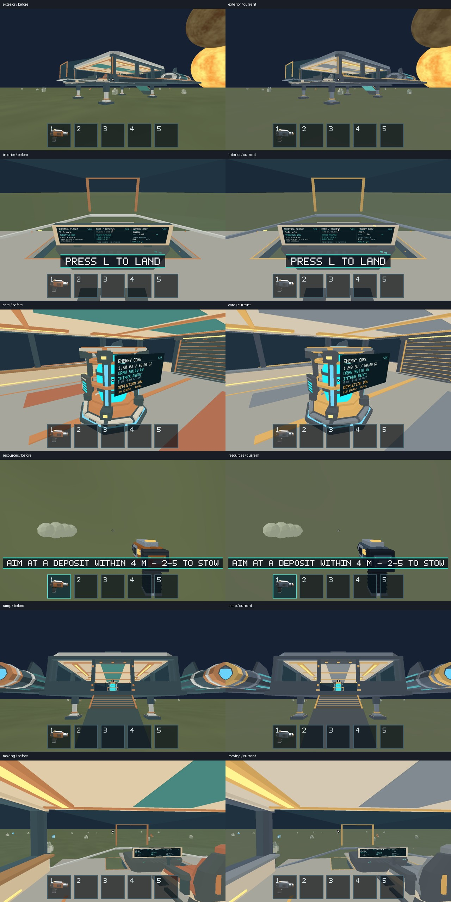
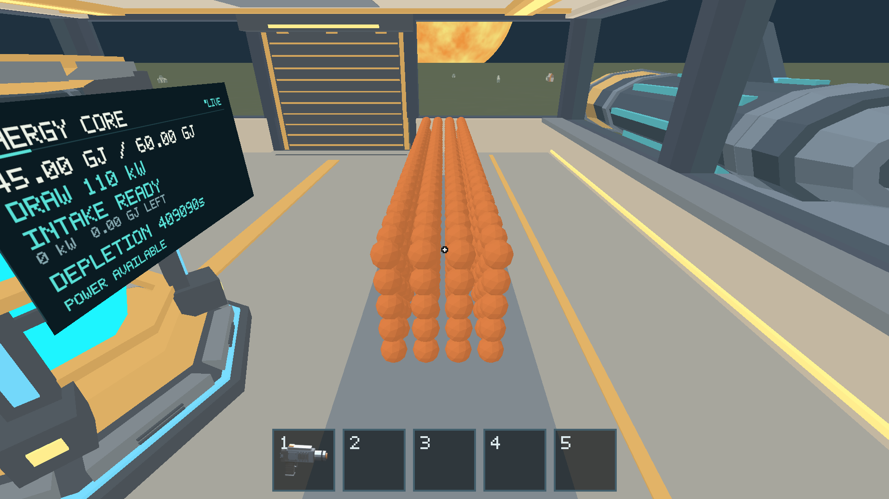
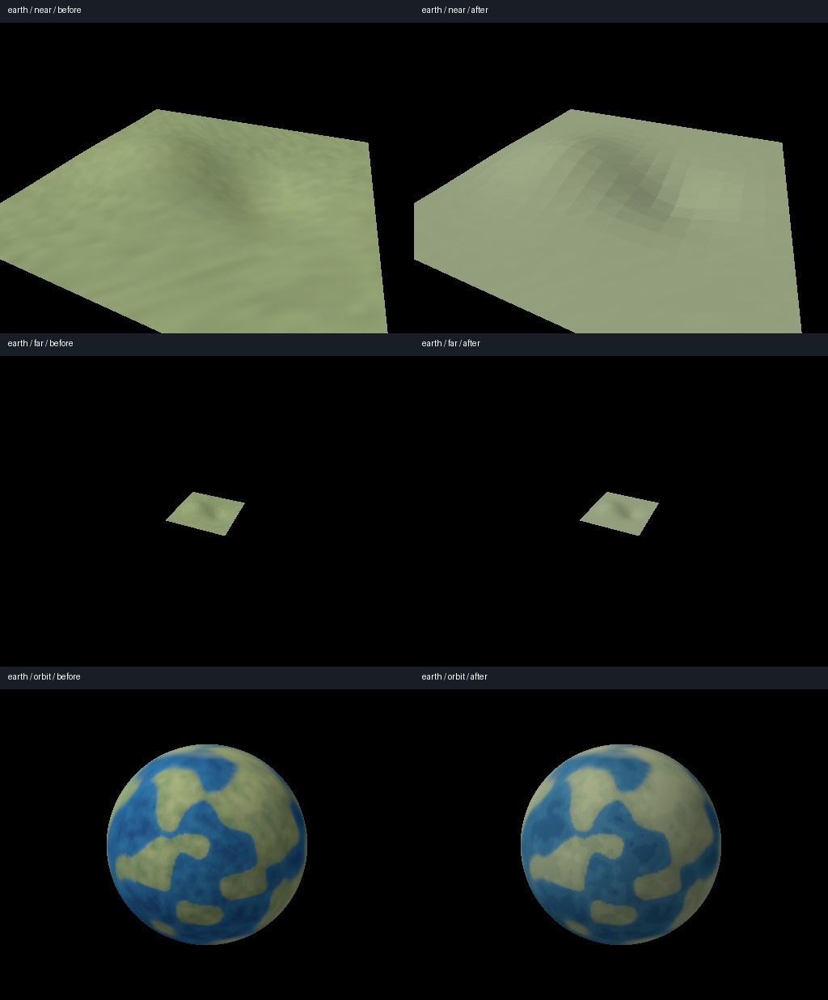

# Issue 279 — integrated Option A art on Apple M1

Local verification on 2026-10-17, Apple M1 iMac21,1, 8 CPU / 8 GPU cores,
16 GiB, macOS 26.2 (25C56), Metal. Current native release runtime/assets:
`1da0d9507eb720fc66c10475a25652e39d80555b`,
[build metadata/digest](build-info.json), SHA-256
`a7e2bdbec8d32dff611e870daebf2b42465c507c7c1277c737203164f83dae4b`.
Rust 1.89.0, Python 3.14.2, Pillow 12.2.0. Python 3.12 unavailable.
This PR follows #289; no runtime, shader, asset or gameplay changes are included.
The terrain comparison tool's scope text now describes offscreen timings without
incorrectly labeling this Metal run as software Vulkan.

## Visual and gameplay result

All nine production model fixtures passed their gameplay assertions: **128 direct
GPU captures, 86 frozen-repeat comparisons, zero changed pixels**, unchanged
channel tolerance 8 / changed fraction 0.001 / no masks. Eight moving-camera
poses are compared with their own repeated frames; intentional camera motion is
not counted as flicker. Viewport 1280×800, matching the immutable native #229
reference images. [Results and image hashes](visual-results.json).

| Coverage | Result / evidence |
| --- | --- |
| Cockpit glazing, lower windows, low approach, landing/takeoff views | Pass; [cockpit](captures/cockpit/) |
| Wide monitor, interior sightlines and palette hierarchy | Pass; [interior](captures/interior/) |
| Core status/emissive, physical intake and restoration | Pass; [Core](captures/core/) |
| Exterior silhouette, glazing edges and landing legs | Pass; [exterior](captures/exterior/) |
| Door/ramp lowering and walkable transition | Pass; [ramp](captures/ramp/) |
| Tool grip/status, faceted deposits and released fragments | Pass; [resources](captures/resources/) |
| Small-piece contacts / cabin deck | Pass; [contacts](captures/contacts/) |
| Static interior / eight moving camera poses | Pass; [static](captures/static/), [moving](captures/moving/) |
| Continuous mining, front-left growing sphere, repeated automatic release | Pass; [111-step production route](evidence/mining-emission/) |
| 500 full-size 10 kg spheres / 5,000 kg pile | Pass; [pile](evidence/sphere-pile/), conserved mass/IDs and three repeated captures |
| Earth/Moon/Mars plain, crater, touchdown and mining, plus steep-site rejection | All 13 routes pass; [native terrain evidence](evidence/) |

Current style is visually coherent in these bounded views: broad hard-surface
planes, slate/grey/warm panels, restrained cyan/amber accents and distinct faceted
geology. Monitor text and the Core status remain readable at the captured near
views. No evident flicker, normal seam, glass ordering, visible contact mismatch
or LOD gap was found in the inspected fixtures. This is bounded camera/route
coverage, not an exhaustive guarantee for every position or an owner aesthetic
approval. Candidate images remain for PR review; **no human-approved image
baseline was created or overwritten**.

Immutable pre-art M1 images from [#229](../issue-229/README.md) are matched by exact
fixture/checkpoint name and 1280×800 size. Color changes are expected; the JSON
retains descriptive changed-pixel counts instead of pretending a style migration
must match its old pixels. Historical images remain in their owning report.





## Terrain before/after on actual Metal

21 matched 512×384 offscreen scenes cover Earth/Moon/Mars near/far/orbit and
2 cm crossings around both normal-fade boundaries. Both runs use the same test
harness and Apple M1 Metal adapter: before restores only `terrain.wgsl`,
`spheres.wgsl` and `surface_textures.rs` from `c72a8ea`; after restores current
source. All three files are restored automatically, with no committed shader edit.
Frozen repeats and fade-boundary tests pass; **zero silhouette/background coverage
pixels change**, and draw/triangle/buffer/upload costs are identical in all scenes.
[Full comparison](terrain-comparison/comparison.json), [before log](terrain-before.log),
[after log](terrain-after.log).



These are real **offscreen Metal GPU pass** measurements (30 timestamp samples
per scene after warmup), not native gameplay FPS or a whole-world LOD guarantee.
The 13 native terrain routes separately exercise actual streamed gameplay,
landing, mining, physical support and steep-site rejection at 1920×1080.
World/physics determinism and topology contracts are unchanged by this report.

## Performance, budgets and limits

[Performance comparison](performance.md) records matched same-device native
before/after windows, frame p95/p99/max, CPU/GPU timing, draw/triangle/upload
counters and binary provenance. Submitted-present intervals require #254
foreground/visibility admission and explicit target-PID OS focus. Both builds use
Metal / AutoVsync / 1920×1080 at 2× scale, F3 off, built-in Retina display,
AC power; a secondary 1080p/75 Hz display is attached. Build/test jobs finish
before benchmark collection. Successful present calls do not independently
measure physical scanout or prove a strict 60 FPS floor.

The pre-art performance binary is the preserved #236 release, digest
`7dd87ac17e3545e5365a27adb562176bf35974666684d9ff4b5c06e462ad5953`, source
`011ab0e` plus #236 fixture additions as documented in [its report](../issue-236/README.md).
Runner `revision` fields name the **runner checkout**, not that old binary's source;
these explicit digests/source records establish binary provenance. The earlier
#229 screenshot reference is separately source `220eb84` plus #254 instrumentation.

Authored asset budgets are preserved: Scout 6,281 triangles / 13 materials /
2 mesh draws; tool 2,064 triangles / 4 materials / 1 draw, atlas decoded mip
bytes 349,524; one shared sphere mesh, 80 triangles per sphere and 48 bytes per
instance. See the maintained migration measurements in [#276](../issue-276/cost-comparison.json)
and [#277](../issue-277/cost-comparison.json). Scout GLB grew 1,180 bytes;
tool encoded PNG shrank 68,079→2,080 bytes while decoded atlas memory stayed
constant. The terrain fixture adds no geometry, draw, texture or buffer payload.
Resource submission counters include visible deposits, not just the 500 spheres.

**Total GPU resident memory is unavailable on this Metal allocator interface**,
not zero. Encoded asset sizes, decoded texture estimates, requested patch bytes
and retained instance capacities are reported separately and cannot certify total
residency. GPU durations are asynchronous latest-completed pass observations.
The active 500 small-piece failure remains [#288](https://github.com/mr-exception/salimon/issues/288)
and [#255](../issue-255/README.md); settled art verification does not resolve it.
Disk persistence, unbounded stress and other platforms are outside this verification.

## Reproduction and checks

Build/copy the current release and use the reviewed local PID helper as described
in [#255](../issue-255/README.md). Exact collection commands:

```sh
python3 scripts/model_visual_tests.py capture --binary artifacts/build/native-255/salimon-client --captures artifacts/native-279/candidates --output artifacts/native-279/capture-results
python3 scripts/model_visual_tests.py compare --temporal-only --captures artifacts/native-279/candidates --output artifacts/native-279/temporal
SALIMON_REFERENCE_SIZE=1 RUST_LOG=info python3 scripts/salimon-test suite --group terrain --evidence --summary --binary artifacts/build/native-255/salimon-client --screenshot-command '["native"]' --artifacts artifacts/native-279/terrain
SALIMON_REFERENCE_SIZE=1 RUST_LOG=info python3 scripts/salimon-test run scenarios/evidence/mining-emission.json --summary --binary artifacts/build/native-255/salimon-client --screenshot-command '["native"]' --artifacts artifacts/native-279/mining-emission
SALIMON_REFERENCE_SIZE=1 RUST_LOG=info python3 scripts/salimon-test run reports/issue-236/sphere-pile.json --summary --binary artifacts/build/native-255/salimon-client --screenshot-command '["native"]' --artifacts artifacts/native-279/pile
python3 reports/issue-279/terrain_metal.py
python3 reports/issue-279/performance_matrix.py
```

The last scripts retain commands/logs and use the local before/current binaries
named above. The offscreen probe temporarily substitutes only prior visual source
and restores bytes even on failure. Keep the desktop unobscured and idle during
native wall-clock runs. [Archive script](archive_evidence.py) promotes evidence
only; it never modifies approved baselines.

CPU/workspace tests and Clippy were not repeated for an evidence/reporting-only
change; release staging and the 82 tooling contracts passed in #289 for this
identical game runtime. The terrain comparison scope-text change is checked by
its focused existing tests. Source/rendering regression suites for #276–#278
remain documented in those reports. No Blender regeneration was needed here.

Native resize/minimize/restore, diagnostics and the F2 flat-precision round trip
are additionally exercised by `scenarios/reference/terrain-render-smoke.json` at
1920×1080, with direct GPU checkpoints retained in
[evidence/terrain-render-smoke](evidence/terrain-render-smoke/). These are native
window/controller operations; independent physical keyboard/mouse smoke was not
repeated. The reviewed PID helper is used only for performance-window focus.

Final local checks: both Metal terrain test runs passed, the focused Python
comparison tests passed ([log](tooling-tests.log)), native graphical routes and
complete repeat checks passed, archive/link/JSON/hash checks and
`git diff --check` passed. The measured active-overload follow-up is #288; no new
art defect was demonstrated by these bounded views.
