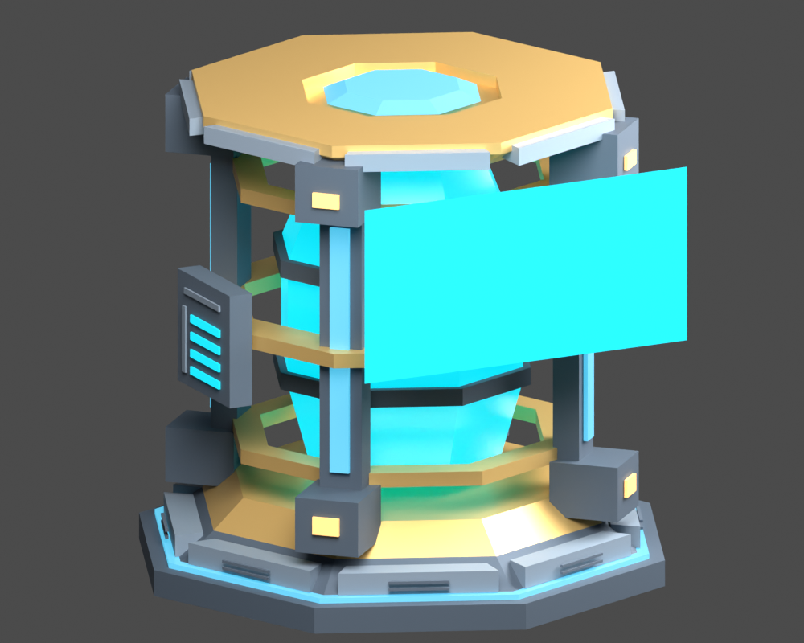
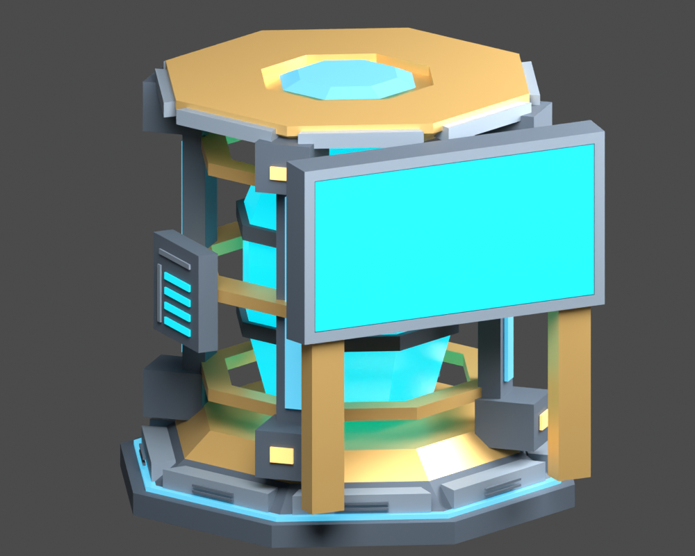
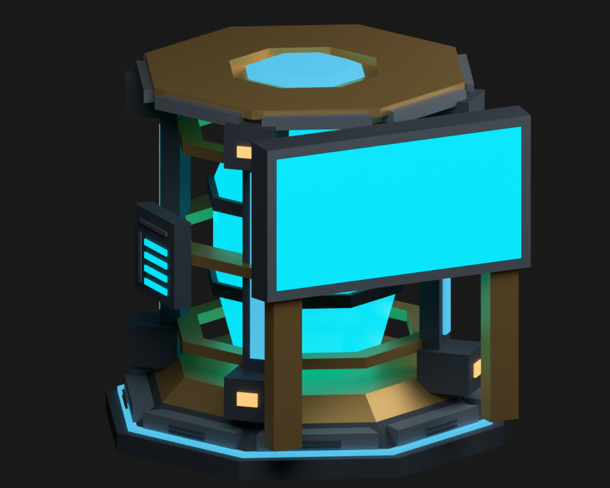

# #294 — Physical Energy Core monitor frame

Implemented a slate bezel, tapered graphite rear enclosure and two ochre
pedestal supports in the editable energy-core Blender component. The face is
still the original 1.30 × 0.65 m, two-triangle `Core_Monitor`, with unchanged
UVs, normal, role and position. The enclosure stays inside the existing Core
proxy and leaves the forward service/feeding panel exposed.

The recipe selects its additions through `Core_Monitor_Frame` vertex groups
on the existing pedestal, armor and cradle objects. Reusing these material
owners avoids new nodes or primitives. Reapplying the recipe replaces its
own vertices; repeated author/export retained 6,329 triangles. All other
component libraries and the assembly/shared sources are unchanged. Exported
collider/marker sidecars and generated Rust geometry remain byte-identical.

[Geometry comparison](geometry-delta.json) found 48 added oriented triangles,
zero removed original triangles and unchanged positions/normals/material roles
for every other visual mesh. Category validation now traces 15 near-corner/center
display samples from straight and oblique approaches and probes all four rim
edges, the backing and both supports. Mutation regressions reject a backing
moved through the face and a missing rim or supports. Existing quality checks
reject harmful coplanar surface competition; no new exemption was needed.

## Authored appearance evidence

Blender CPU previews, identical camera/light settings before/after; **not native
game captures**. The cyan face is the source material, not live atlas artwork.
Dark preview reduces key/fill power to 12%; it is an isolated authoring check,
not a simulated game outage. The frame remains distinct in both conditions.

| Before | After |
| --- | --- |
|  |  |

Reproduce with Blender 4.5.3: `blender -b --python-exit-code 1 --python
reports/issue-294/render_preview.py -- after` (or `after-dark`). For `before`,
run against the unmodified component from the parent revision.

## Cost and contracts

| Metric | Before | After | Hard limit |
| --- | ---: | ---: | ---: |
| Triangles | 6,281 | 6,329 | 6,500 |
| Nodes | 140 | 140 | 140 |
| Primitives | 116 | 116 | 124 |
| Materials | 13 | 13 | 13 |
| GLB bytes | 526,536 | 531,384 | 557,056 |
| Ship draws | 2 | 2 | 2 |

One opaque and one glass batch remain. No renderer, character or simulation
code changes; display live-update/blanking behavior retains its existing tests.
Preservation metadata does not need relaxing because names, hierarchy, material
roles, transforms and extras are unchanged.

## Validation

Ubuntu 24.04 x86_64; Python 3.12; jsonschema 4.26.0; Blender 4.5.3 LTS;
Rust 1.99.1. Commands below ran from the repository root, with
`/root/.cargo/bin` on `PATH`; `BLENDER` points to the installed 4.5.3 binary.

| Command | Result |
| --- | --- |
| `blender -b --python-exit-code 1 --python models/assets/ships/salimon-scout/author_core_monitor.py` | Passed; repeated without duplicate geometry |
| `python models/assets/ships/salimon-scout/export.py --blender "$BLENDER"` | Passed; GLB/glTF/bin and provenance regenerated |
| `blender -b --python-exit-code 1 --python models/assets/ships/salimon-scout/verify_source.py` | Passed; 140 objects, 6,329 triangles, 13 materials |
| `python models/assets/ships/salimon-scout/validate.py` | Passed; budgets, quality, spatial and display/frame sightlines |
| `BLENDER="$BLENDER" python -m unittest discover -s models/tests -v` | 95 tests, 2 optional npm/Khronos integration skips; Blender source and relocated-library edit propagation passed |
| `cargo test -p salimon-character --locked` | Passed: 64 tests |
| `cargo test -p salimon-renderer --locked -j 2` | Passed: 61 tests, 12 existing ignored optional GPU/performance/pipeline checks |
| `cargo build -p salimon-client --locked -j 2` | Passed |
| `cargo test -p salimon-client --locked -j 2 core` | Passed: 5 Core aiming/feeding/carrying/conservation tests |
| `cargo fmt --all -- --check` / `git diff --check` | Passed |

Initial renderer compilation hit an empty intermediate wgpu object archive;
`cargo clean -p wgpu-hal` followed by the listed renderer check passed.
The first asset export caught the hard node cap; the delivered geometry reuses
existing mesh owners and retains that cap unchanged.

## Remaining native verification

[Native follow-up #299](https://github.com/mr-exception/salimon/issues/299)
owns Apple M1/Metal appearance, moving-camera flicker, bright/dark live artwork,
outage/restoration and the native Core restart/feeding route. No graphical
scenario was run here: the cloud host has no display or Vulkan driver ICD.
Blender and CPU checks cannot establish native GPU fidelity, feeding gameplay
signoff or reference-machine performance. The native work is transferred to
#299, not marked passed or waived; #294 closes through the implementation PR.

Retained logs: [model](model-tests.log), [renderer](renderer-tests.log),
[character](character-tests.log), [Core composition](core-tests.log),
[source](source-verification.log), [asset validation](asset-validation.log).
