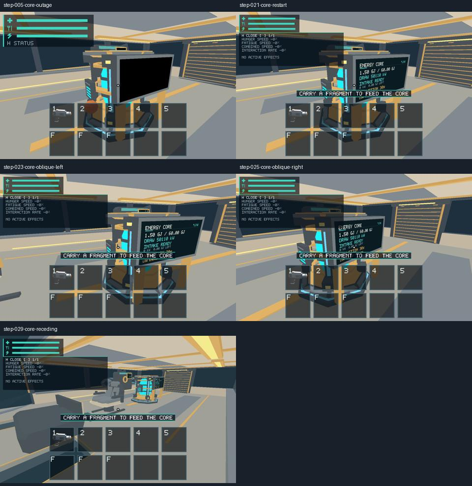

# #299 — Core monitor on reference Apple M1

Native verification on 2026-10-20 against `4d8faf8f108ebf046690b55f2e71d31bbc2e571b`, including the merged #294 implementation (PR #300, `025a9ab`). Apple M1 iMac21,1, 16 GiB, macOS 26.2 (25C56), Metal, 1280×800 physical drawable at 2× scale. [Environment](environment.json), [release build and SHA-256](build-info.json).

## Outcome

The physical slate bezel, rear enclosure and two ochre supports remain visibly attached in the inspected near, oblique and receding views. The display face is unobstructed and readable when powered, and black during outage. No competing face, z-fighting or floating mount was apparent in these bounded captures. The maintained Core baseline and evidence route passed all 19/20 steps. Both side aisles passed a new 22-step out-and-back traversal; the maintained cockpit/nose route also passed.

Actual macOS E input consumed the single held 2 kg bootstrap fragment once, debited onboard mass, and began gradual conversion. Power returned before conversion completed; the live screen redrew. All six [native-input checks](os-input/checks.json) pass. The fixture deliberately uses its documented legacy 2 kg refuel piece; it is not a 10 kg current-sphere performance workload. Fixed E2E stepping supplies state observations, not FPS.



[Native input captures and raw observations](os-input/) supplement the [29-step GPU view route](views/result.json.gz), [baseline](baseline/result.json.gz), [maintained evidence](evidence/result.json.gz) and [both-aisle traversal](both-aisles/result.json.gz). Repeated Core captures in the nine-fixture Metal run also compare identically; the complete candidate corpus and human baseline review belong to #314.

## Checks and reproduction

From repository root:

```sh
python3 scripts/build_game.py --profile release --output artifacts/native-20261020/build
python3 scripts/salimon-test run scenarios/core-restart.json --summary --binary artifacts/native-20261020/build/salimon-client --artifacts artifacts/native-20261020/299/baseline
python3 scripts/salimon-test run scenarios/evidence/core-restart.json --summary --binary artifacts/native-20261020/build/salimon-client --screenshot-command '["native"]' --artifacts artifacts/native-20261020/299/evidence
python3 scripts/salimon-test run reports/issue-299/core-views.json --summary --binary artifacts/native-20261020/build/salimon-client --screenshot-command '["native"]'
python3 scripts/salimon-test run reports/issue-299/aisles-both.json --summary --binary artifacts/native-20261020/build/salimon-client --screenshot-command '["native"]'
python3 reports/issue-299/native_input_probe.py --binary artifacts/native-20261020/SalimonReview.app/Contents/MacOS/salimon-client --helper artifacts/native-input --output artifacts/native-20261020/299/os-current --scenario core-restart
```

All listed commands passed. The local app bundle wraps the byte-identical staged binary with `NSHighResolutionCapable=true`. The explicitly user-authorized input helper is the reviewed Swift source retained at [#198](../issue-198/2026-10-16/input.swift); it posts real macOS events and records the target/frontmost PID. The adapted probe retains that input path and corrects stale fixture expectations. Python 3.14.2 was used; Python 3.12 tooling checks were not run. No Rust, asset, shader or gameplay behavior changed, so unrelated compilation/test suites were not rerun.

## Failed attempts and remaining scope

The initial historical #198 probe failed one assertion because it hard-coded 499 remaining fragments for both the 500-piece blackout and one-piece Core fixtures. [Original failed checks](historical-probe-failure/checks.json) and [failure log](historical-probe-failure.log) are retained. The current probe derives the expected count from its initial snapshot and passes. Computer-use clicks returned `noWindowsAvailable`; after explicit user authorization, the PID helper succeeded. An exploratory interactive session also paused after losing focus, causing rejected gameplay commands and capture timeouts; those attempts establish no appearance pass and were replaced by the complete maintained routes and logged native-input probe.

**Dark-cabin contrast remains unrun and is transferred to [#451](https://github.com/mr-exception/salimon/issues/451).** Production ship shading has fixed warm cabin illumination (`ship_mesh.wgsl` cabin_light); an outage blacks the monitor without dimming the cabin. These images verify powered/blank contrast under existing lighting, not a separate dim-light condition. The follow-up owns clarification and actual native evidence. Closure of #299 records the delivered evidence and transfer, not a pass of this missing condition.

Static repeats and finite camera poses cannot guarantee every continuous trajectory or constitute owner aesthetic approval. No hardware performance floor, other-platform acceptance or total GPU residency is claimed. Candidate approval remains part of PR review.
