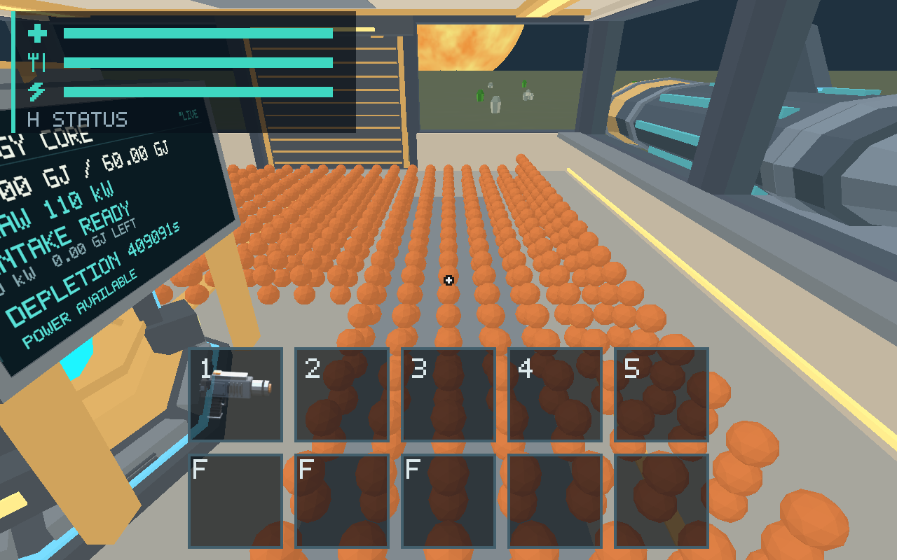

# #313 — sphere, cargo and streaming validation on Apple M1

2026-10-20, Apple M1 iMac21,1 / 16 GiB / macOS 26.2 (25C56), Metal,
1920×1080 physical benchmark drawable / 2× scale / AutoVsync, AC power.
No thermal/performance warning was reported by `pmset -g therm`. CPU builds and
the long CPU stress run finished before native sample collection. Functional GPU
captures use 1280×800. [Candidate build](build-info.json), source
`fc634bf265abb1c9a4a786bd855d84b994bc21c3` (preceding code commit `a8a6c34`).

## Outcome

Current spherical behavior, identity/mass and the scoped native routes pass;
**active performance is not signed off**. The native current-sphere populations
now share one initializer with the existing CPU matrix: `current-cap` and
`current-mixed`, each supporting 500/1,000 objects through production extraction.
Legacy `onboard` / `sphere-deck` / `sphere-pile` definitions and production
physics rules are unchanged. Raw accounting adds each object's actual contact
radius, preserving tiny physical mass even when contact radius clamps to 5 mm.

- A 36-step native route picks up a real 10 kg sphere, drops and repicks it,
  carries it to the Core, and removes the last cargo object by feeding it.
  Fragment count reaches zero, ship mass returns exactly to 100,000 kg, and
  conversion receives exactly 10 GJ. [Route and captures](evidence/cap-carry-feed/),
  [replay scenario](evidence/cap-carry-feed.json).
- All **seven resource** and **thirteen terrain** evidence routes pass, including
  extraction, carrying/transfers, local stream-out/return and cold Earth/Moon/Mars
  traversal/mining/touchdown. [Resources](evidence/resources/), [terrain](evidence/terrain/).
- Native 500/1,000 cap snapshots retain 5,000/10,000 kg and distinct IDs.
  Both populations naturally sleep; the dedicated 1,000 preparation reaches full
  sleep after 50 real 16 ms steps. [GPU views](evidence/visual/).
- Moving/rotating cargo, final removal, power loss/restoration and ship/EVA
  transitions also pass the [#312 native routes](../issue-312/README.md) and
  [#299 Core route](../issue-299/README.md). The original legacy small-piece
  blackout fixture remains distinct from these real 10 kg populations.



## Native timing result

[Analysis and selected raw-file hashes](evidence/analysis.json) pool only completed
intervals with `moving_objects > 0`; nonmoving frames are excluded from active
tails. Three fresh 500-cap launches retain **107 moving intervals**, and five
1,000-cap launches retain **140**. The mixed 500 case retains **100** completed
moving intervals. Naturally settling drops are not perpetual-motion or
independent-sample confidence claims. Nonmoving frames in an active window can
still be awake; only the dedicated prepared rows below establish full sleep.

| Population | Moving intervals | Active frame p95 / max, ms | Active physics+adapter p95, ms |
| --- | ---: | ---: | ---: |
| 500 × 10 kg iron | 107 | 21.706 / 66.912 | 5.826 |
| 1,000 × 10 kg iron | 140 | 139.384 / 141.760 | 137.787 |
| 500 mixed residuals/materials | 100 | 116.400 / 125.248 | 115.696 |
| 1,000 mixed residuals/materials | incomplete | timed out at 60 s | no accepted result |

Dedicated sleeping cap windows retain 601/601 completed intervals over ten
seconds for 500/1,000 objects; frame p95 is **17.214 / 16.979 ms**. This is
submitted-present cadence, not optical scanout or a strict visible-display FPS
floor. Each accepted raw result passes foreground/visibility admission,
accounting and minimum-frame validation. Renderer/CPU/GPU timings, substeps,
structural allocation counters and spikes remain in the raw results. Matrix
allocation/projection-storage counters are not total process/GPU memory;
Metal total resident GPU allocation is unavailable here.

[Follow-up #455](https://github.com/mr-exception/salimon/issues/455) owns profiling,
active budgets/remediation and incomplete mixed stress acceptance. The legacy
0.032 kg #255 proposal cannot be applied to these profiles. No damping, sleep,
contact, mass or time rule was loosened to obtain passing numbers.

## Damping comparison

[Controlled-source provenance](ablation-provenance.json) verifies all checked
client files match the candidate except **two retention expressions** restored
to pre-#304 constants in an isolated worktree. [Exact patch](damping-ablation.patch)
and [baseline binary metadata](damping-before-build-info.json) identify that
experiment; production physics was not reverted or promoted.

Both 50-object fixed-step native view routes pass, with stable identities and
ordinary settling. [Before/after images](evidence/visual/damping-before-after.jpg)
are bounded settling views, not a high-refresh interpolation or exact damping
coefficient proof. A matched 500-mixed active native baseline retains 100 completed
moving intervals: frame p95 **107.867 ms**, physics p95 **107.098 ms**, versus
**116.400 / 115.696 ms** in the current window. These single windows are
observations, not a causal performance confidence claim; both are expensive,
and incorrect per-substep damping is not a proposed optimization.

The M1 workspace physics regressions independently pass elapsed-time partition
and restart invariance and a distant fast 5 mm residual changing scheduling
without changing the subject's damping. They establish the numerical policy;
finite native images alone cannot do that.

## Checks and reproduction

| Check | Result |
| --- | --- |
| New 1,000-object actual population/mass/radius/containment regression | Passed |
| `cargo test --workspace --locked --target aarch64-apple-darwin` | 682 passed, 22 existing opt-in ignored |
| Strict workspace/all-target Clippy | Initial two existing range-loop lints failed; equivalent iterator loops fixed; final passed |
| Focused client tests after lint-only fixes | 260 passed, 5 ignored |
| `python3 -m unittest discover -s scripts -p 'test_*.py'` | 93 passed on Python 3.14.2; Python 3.12 unavailable |
| Release host staging, rustfmt, `git diff --check` | Passed |
| Resource / terrain / cap carry-feed routes | 7 / 13 / 1 passed |
| Complete original current-sphere CPU matrix | **Incomplete**, stopped at 903 s in 1,000 mixed |

Commands, focus records and raw native outputs are retained per lane under
[evidence](evidence/). [Collection wrapper](native_matrix.py) uses the existing
foreground runner with the explicitly authorized PID helper; [helper source](input.swift)
waits for a real window before activating it during expensive preparation.
Compile it with `swiftc reports/issue-313/input.swift -o artifacts/native-20261020/input-313`.
Build and run examples:

```sh
python3 scripts/build_game.py --profile release --output artifacts/native-20261020/build-current
python3 scripts/benchmark_fragments.py --binary artifacts/native-20261020/SalimonReview.app/Contents/MacOS/salimon-client --machine-label apple-m1-imac-16gb-macos26.2 --counts 500 1000 --layouts current-cap current-mixed --states active --cameras facing --minimum-samples 100 --warmup-seconds 0 --sample-seconds 3 --timeout 60 --output artifacts/native-313-replay
python3 scripts/salimon-test run reports/issue-313/evidence/cap-carry-feed.json --binary artifacts/native-20261020/build-current/salimon-client --screenshot-command '["native"]'
```

Use the per-lane `command.json` to reproduce exact focus wrapping and repeats;
collect enough fresh drops for at least 100 moving intervals, not merely 100
whole-window frames. Full runner results retain every state/action/assertion;
duplicate per-step/protocol/stdout copies remain only in ignored artifacts.
[Evidence integrity manifest](evidence-sha256.json) covers the promoted files.

## Failed/incomplete evidence and limits

The original CPU run at `4d8faf8` logged completion of 500 cap, 500 mixed and
1,000 cap, then remained in pair-contact work until the 903 s diagnostic bound.
It produced no complete matrix report. [Bound record](cpu-bound.json),
[stack sample](running-sample.txt) and [log](current-spheres.log) preserve that
incomplete result. A stack sample is not a function-level root-cause proof.

One repeat batch was mistakenly started before the prior settled matrix exited.
Both were stopped, all affected rows were explicitly rejected in
[the overlap record](overlap-rejection.json), and selected rows were recollected
serially. Subsequent native focus-loss failures remain retained and excluded.
Only the whitelisted successful files in `analysis.json` enter the table.
No failed, missing or overlapping row was relabeled as a pass.

Large inactive-history cost attribution and the full mixed stress matrix are not
native performance passes here; further owner profiling belongs to #455.
#255 retains its separate cadence/budget review. Source #313 closes through its
PR with failed/incomplete acceptance explicitly transferred, not waived.
