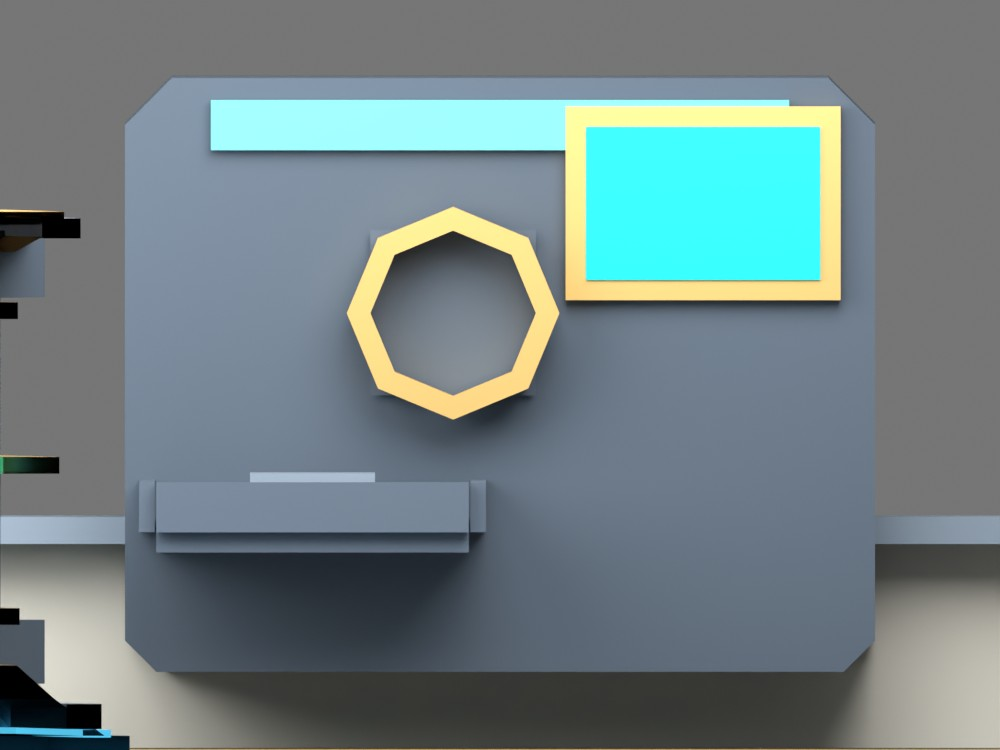
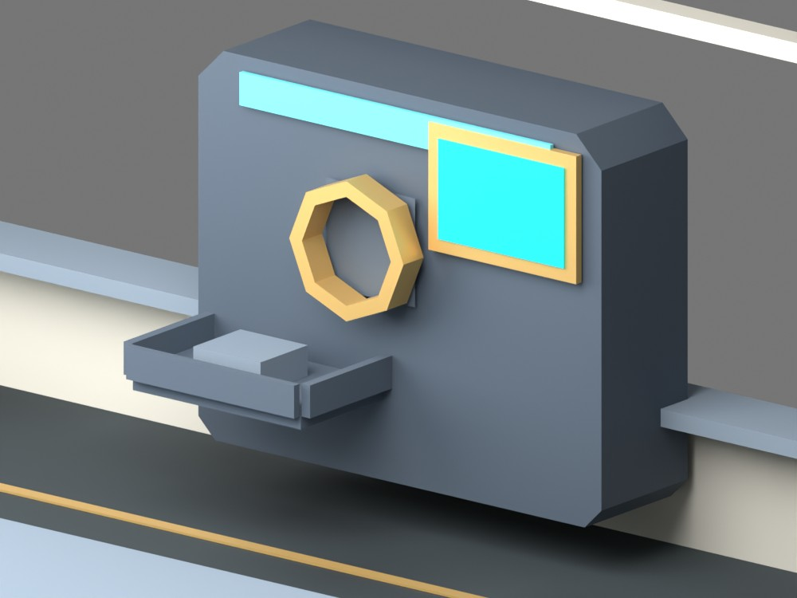

# Issue 342 — Authored wall Fabricator

The linked cabin-interior Blender source now owns a clipped low-poly chassis,
framed monitor, octagonal universal input throat, one-item tray and stationary
output package. Existing shared materials/assembly links are preserved. Three
named markers and one collision proxy generate runtime layout data. The module
keeps the Core aisles and rear door/cockpit routes clear. Its conservative
fixture box participates in walking, zero-G, sight and loose-object placement;
the recessed input query omits only its own box. The monitor UI remains #343.

Runtime maps tray occupancy to one spare ship-uniform component. The package
appears at completion, disappears on collection, follows the presented ship
pose and remains visible in blackout. No animation, new draw, inventory or loose
fragment identity is introduced. Final integration also covers partial funding
at a recipe boundary and refreshes Core demand immediately on machine commands.

## Preview evidence

Read-only CPU Blender previews of the saved linked source, with an occupied
tray. Roof/exterior geometry is hidden for inspection, not changed in source.
These are authored previews, not native game screenshots or owner signoff.

Reproduce with `blender -b --python-exit-code 1 --python
models/assets/ships/salimon-scout/preview_fabricator.py` from the repository root.
The companion `author_fabricator.py` reproduces the reviewed parametric source
edit; `export.py` remains the sole publication path for runtime assets.

## Checks and limits

Linux x86_64, Python 3.12, Rust 1.99.1, Blender 4.5.3 LTS.

- Scout export and `python models/assets/ships/salimon-scout/validate.py`: passed.
  6,493 triangles / 123 primitives / 13 materials / 549,060 GLB bytes. Existing
  limits remain 6,500 / 124 / 13 / 557,056 bytes. Node budget grows 140→151 for
  seven visuals, three markers and one proxy. No overlap exemption was added.
- Blender `verify_source.py` and `verify_modular.py`: passed, including saved
  source/interchange parity, all nine linked components and edit propagation.
- `BLENDER=/tmp/blender-4.5.3-linux-x64/blender python -m unittest discover
  -s models/tests -v`: 95 tests, passed with 2 optional Khronos/npm integrations
  skipped because the local npm validator is not installed.
- `python -m unittest discover -s scripts -p 'test_*.py'`: 93 tests passed.
- `cargo test --workspace --locked`: 554 passed, 22 existing opt-in tests ignored.
  Includes physical intake, blackout/restart, flight/takeoff, mass transitions,
  authored fixture clearance and WGSL parse/validation with conditional output.
- `cargo build --workspace --locked`, Clippy with `--all-targets -- -D warnings`,
  formatting and `git diff --check`: passed.

Native game smoke/capture was not run: this host lacks a display/Vulkan driver,
and installing those prerequisites failed because the host cannot switch to
APT's package user. Blender CPU rendering and Naga WGSL validation do not prove
native shader fidelity, OS input or performance. Native signoff remains #348;
crafting UI/inventory remain the existing #343/#345 tasks. No M1 claims are made.
