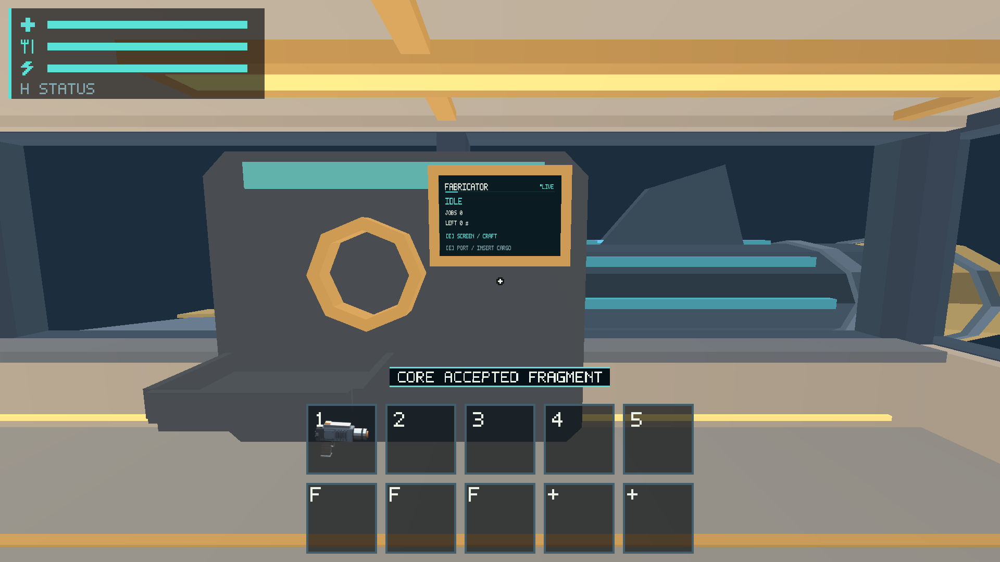
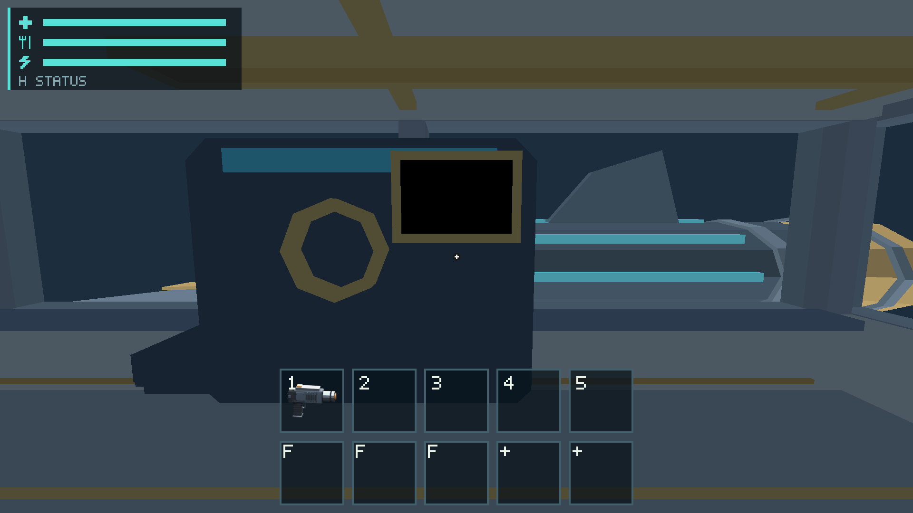
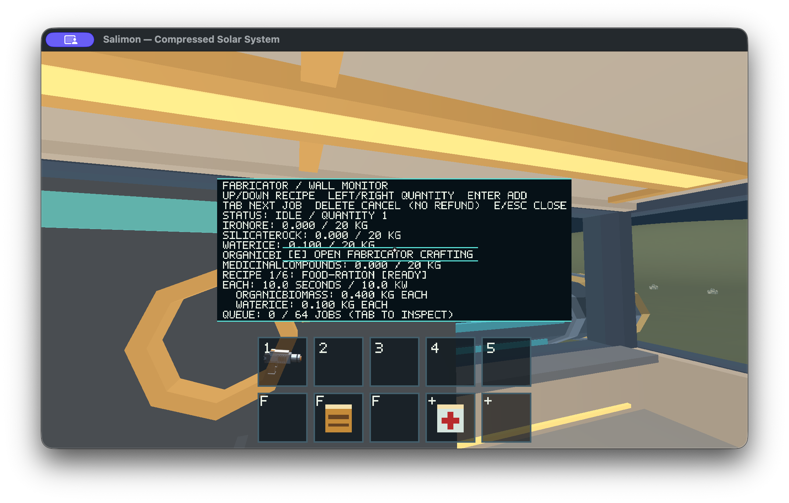
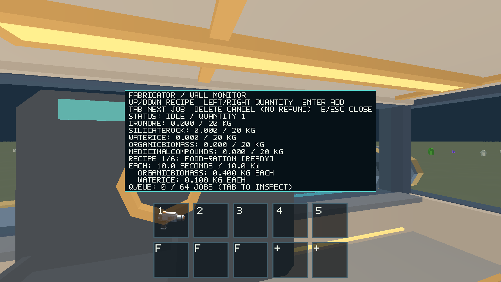
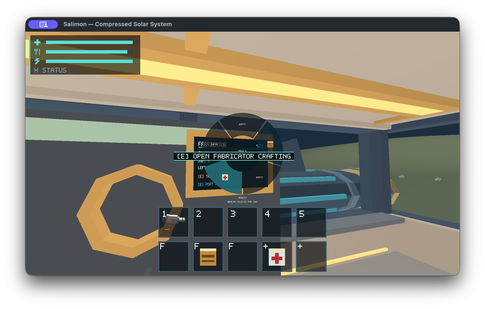

# #348 — Fabricator reference M1 verification (2026-10-22)

## Outcome

Native verification in progress, **not full signoff**. Current main `812a877` was rebuilt
from scratch in an isolated Cargo target on Apple M1 iMac21,1 / 16 GiB / macOS
26.2, using Metal at a 1920×1080 physical drawable. No gameplay, assets, recipes,
input rules, shader or baseline approvals changed. The initial native OS input attempt was blocked by event-posting permission.
After the owner enabled Accessibility, the retry passed five bounded checks. The source issue
must remain open until its remaining acceptance is exercised.

## Completed checks

- `CARGO_TARGET_DIR=artifacts/native-20261022/target python3 scripts/build_game.py --profile release --output artifacts/native-20261022/build`: passed.
- `SALIMON_REFERENCE_SIZE=1 python3 scripts/salimon-test run scenarios/visual/scout-lighting.json --binary artifacts/native-20261022/build/salimon-client --screenshot-command '["native"]' --artifacts artifacts/native-20261022/348/lighting`: all 21 steps passed, eight actual Metal color-surface captures. [Raw results](evidence/lighting/result.json).
- `SALIMON_REFERENCE_SIZE=1 python3 scripts/salimon-test run scenarios/fabricator-contract.json --binary artifacts/native-20261022/build/salimon-client --summary --artifacts artifacts/native-20261022/348/contract`: all 19 steps passed. This checks initially empty machine/inventory, rejected closed-modal enqueue and empty Q-wheel transaction/release through production protocol commands. It does not cover occupied food/medical slots or native pointer input. [Raw results](evidence/contract/result.json).
- `cargo test -p salimon-client --locked fabrication`: 14 passed, zero failed. Includes intake identity/mass, full-bin retention, power cutoff/restart, single-tray accounting, flight/takeoff and saved-midcraft continuation. [Log](evidence/348-fabrication-tests.log).
- `python3 scripts/check_docs.py`: zero failures. [Log](evidence/348-docs.log).

[Machine/source/binary identity](evidence/environment.json), [staged build metadata](evidence/build-info.json).
Timing samples inside fixed-step scenario logs are diagnostic, **not normal-play
frame pacing or a 60 FPS pass**. No concurrent-work timing comparison is claimed.

## Image inspection

The actual powered Fabricator face reads left-to-right: FABRICATOR, LIVE, IDLE,
JOBS 0, LEFT 0 s, E SCREEN / CRAFT and E PORT / INSERT CARGO. The wall housing,
input aperture and empty tray are visible without an obvious wall intersection
at this named reference camera. On blackout the screen is blank, the cabin is
cooler/dimmer and task emission extinguishes. These are observations of this
camera, not circulation/collision or all-DPI acceptance. Reference cameras alter
presentation only; the player remains at the Core in this fixture.

## OS-input attempt and remaining gates

`SALIMON_REFERENCE_SIZE=1 python3 reports/issue-348/native_probe.py --binary artifacts/native-20261022/SalimonReview.app/Contents/MacOS/salimon-client --helper artifacts/native-20261022/input --output artifacts/native-20261022/348/native`
failed before the native E/Q sequence because macOS denied event posting.
The helper was compiled with `swiftc reports/issue-312/input.swift -o artifacts/native-20261022/input`.
[Failure](evidence/348-native.log), [pre-input state/captures](evidence/native/).
This probe is an incomplete reproduction aid, not a passed acceptance harness;
its bounded protocol walking preparation is explicitly separate from OS input.
The empty checks object records no successful OS checks.

Still pending: native physical intake/screen/tray walkthrough; actual occupied
food/medical Q pointer and keyboard selection, repeat/focus/click-through checks;
room circulation and collisions; ship-motion/blackout interactions in the full
crafting loop; supported DPI/resolution coverage; matched normal-play CPU/GPU and
presented-frame measurements. Human art/playability approval remains explicit.
No acceptance is transferred or waived in this partial PR; no closing reference
is appropriate yet.

## Documentation impact

Evidence-only addition. Canonical behavior is unchanged; no architecture or
invariant edit is required. Owners remain [runtime](../../client/runtime/architecture.md),
[runtime invariants](../../client/runtime/invariants.md),
[fabrication](../../client/fabrication/architecture.md),
[fabrication invariants](../../client/fabrication/invariants.md) and the
[validation matrix](../../docs/validation.md). Historical reports are unchanged.

## Accessibility retry

After the owner enabled Accessibility, the same exact binary/probe passed:
actual native E opens/closes the aimed Fabricator screen; Q release leaves no
open wheel or stale hold; initially empty inventory remains unchanged.
[Checks](evidence/native-retry/checks.json), [full input/state records](evidence/native-retry/observations.json).
The [actual physical screen](evidence/native-retry/physical-screen.png) and
[crafting modal](evidence/native-retry/crafting-modal.png) are Metal captures.
These five checks do not establish that an occupied item was consumed or that
the wheel visibly opened while Q was held. Original permission failure remains.

## Live run and modal correction

The owner explicitly authorized the reviewed native input helper. An isolated
normal wall-clock run (`SALIMON_SAVE_DIR=artifacts/native-20261022/live-348/save`)
consumed exactly starter food job1/unit1 by Q+pointer click, retaining food
job1/unit2 in place. Actual E/Enter crafting committed the 0.4 kg biomass +
0.1 kg ice starter reserve once and produced one 0.3 kg ration job3/unit1 in the
tray. Native held Q + four Tab presses + Enter consumed medkit job2/unit1.
[Before medkit](evidence/live/after-collection.json),
[after medkit](evidence/live/after-medical-wheel.json),
[input log](evidence/live/actions.log). These are verified native checkpoint
payload observations, not edited saves. Starter reserves are not a measured
physical gathering route. The attempted native tray aim/collection did NOT
collect: the ration remains in the tray. Relative-mouse delivery remains
unreliable and must not be represented as a successful collection.

Actual inspection found the world E prompt covering crafting material rows
and the Q-wheel center. Native redraw now suppresses world action-bar/reticle
pixels while a modal owns the screen; input authority/retained prompts are
unchanged. Runtime architecture/invariants document this presentation rule.
The post-fix probe passes the same five native checks, with foreground PID
matching its child. [Fixed probe](evidence/fixed-probe/checks.json),
[fixed image](evidence/fixed-probe/crafting-modal.png),
[fixed binary identity](evidence/fixed-binary.json).

Final code validation: workspace tests **849 passed, 0 failed, 28 ignored**;
all-target workspace Clippy with `-D warnings` passed; isolated release build
passed; formatting and documentation/base-impact checks passed.
[Tests](evidence/348-workspace-tests.log), [Clippy](evidence/348-clippy.log).
Scout export validation initially failed because the host Python lacked
jsonschema, then passed in an isolated venv with the pinned model requirements:
549732 GLB bytes, 13 materials, 123 primitives, 6493 triangles.
[Initial failure](evidence/348-asset-validation.log),
[successful validation](evidence/348-asset-validation-installed.log).

A copied-in-place `.app` executable was rejected on launch (137), and re-signing
that copy stopped after native-window creation (132). The untouched standalone
staged executable and a fresh app directory both initialize Metal successfully.
No gameplay failure is inferred from this packaging attempt; production staging
is the standalone executable. The native helper now selects the largest target
window (avoiding tiny auxiliary windows) and refuses key/mouse input unless
the requested PID is foreground. Global input must not be trusted on a PID
mismatch. These source adaptations are included in `native_input.swift`.

This remains a draft: full physical intake/collection/circulation, representative
matched frame budgets, supported DPI and human appearance/playability approval
remain pending. Existing #453 owns unreliable long-sequence mouse delivery.
No complete native signoff or issue closure is claimed.
