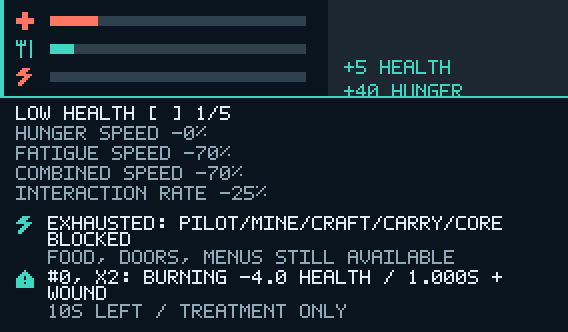

# Issue #373 — compact survival HUD and status details

Implemented 2026-10-20 from main `e9668602d80f336f6622de659ab37801e267b005`.
#372/#399 is merged. The #368 dependency's implementation is merged through #394,
despite the older source issue still appearing open; its typed pipeline is present
on this baseline. No dependency branch is required for this PR.

The upper-left gameplay HUD shows health/cross, hunger/cutlery and fatigue/bolt
with thin colored bars and **no permanent meter numbers**. It includes separate
status icons and persistent active hunger/fatigue speed penalty labels. H toggles
the read-only status panel; [ / ] pages through every effect, showing behavior,
source, amounts/stack severity, duration, exposure/persistence and treatment policy.
The panel includes exact component/combined speed and interaction-rate penalties
from the same authoritative basis points used by gameplay.

Critical colors/pulse and brief warnings are presentation-only. Actual observed
net healing/feeding produces a short bar tween and floating +N Health/Hunger;
full-meter waste produces no fake benefit. The panel does not pause simulation.
Focus/capture loss closes details; crafting, diagnostics, tour and terminal state
suppress this HUD. Existing inventory/equipment/cockpit presentation is preserved.

See the [canonical runtime contract](../../client/runtime/architecture.md#survival-hud-and-status-details-373)
for thresholds, visibility, timing, pagination and small-window behavior. HUD data,
cache and animations stay outside run saves. The renderer only receives generic
RGBA; its pure toolbar reservation is shared with layout to prevent overlap.
A small immutable `effect_snapshots` API avoids inspecting serialized internals.

## Visual evidence

These are **CPU raster previews**, composed over a neutral background from the
production raster's exact RGBA output, not native GPU/window screenshots. Input
fixtures are deterministic, including deliberately seeded synthetic burn entries.
The healthy frame has no numeric meter labels. The detail frame demonstrates
critical fatigue, two recovery amounts, exact penalties and a paginated effect list.




Reproduce raw raster output with:

```sh
SALIMON_HUD_EVIDENCE_DIR=/tmp/salimon-hud cargo test -p salimon-client raster_evidence_and_exact_rgba_layout --locked
```

The test exports JSON dimensions and RGBA bytes only when explicitly requested.
The committed PNGs alpha-composite those pixels over RGB `(28,39,50)` without
changing their scale, glyphs or layout. At native minimum size, details replace
the meter band while open; at larger sizes they remain below it. Unsupported
non-fitting surfaces hide safely instead of overlapping the bottom inventory.

## Validation

Linux cloud container, Rust 1.99.1, Python 3.12.14. Exact command/result summaries
are in [validation.txt](validation.txt).

- `cargo test --workspace --locked`: **656 passed**, 0 failed, 22 existing opt-in ignored.
- `cargo build --workspace --locked`: passed.
- `cargo clippy --workspace --all-targets --locked -- -D warnings`: passed.
- `cargo fmt --all -- --check`: passed.
- `python3 -m unittest discover -s scripts -p 'test_*.py'`: **93 passed**.
- `git diff --check` and changed-document local link checks: passed.

Eleven new regressions cover exact percentage mapping and observational purity;
actual ration/medkit transactions and full-meter waste; typed captured effect
amounts/stacks/timers/treatment; recovery tween/drain/expiry and new-run reset;
critical thresholds/warning hysteresis; crafting/tour/death/diagnostics suppression;
cache stability; punctuation and maximum typed description bounds; RGBA evidence;
viewport/DPI/aspect/pagination and reserved-band fitting; focused initial/native
input, repeats/synthetic replay, modal exclusion and non-pausing status access.
Existing cross-system protocol/session and renderer toolbar regressions remain green.

## Native limitation and existing follow-ups

Direct launch of the final built binary **failed before window creation**: this
cloud session has no DISPLAY/WAYLAND_DISPLAY/WAYLAND_SOCKET. See the
[launch result](native-launch-result.json) and [stderr](native-launch.log).
No OS-input, cockpit-scene overlay, GPU screenshot or reference Metal visual/FPS
pass is claimed. Those remain in existing [#376 native survival signoff](https://github.com/mr-exception/salimon/issues/376).
The deterministic presentation and portable validation above are delivered here.

[#381](https://github.com/mr-exception/salimon/issues/381) still owns actual pause
menus/freeze and must extend the documented visibility/input gate;
[#377](https://github.com/mr-exception/salimon/issues/377) owns Q-wheel interaction,
and [#383](https://github.com/mr-exception/salimon/issues/383) owns optional sensory
feedback. No duplicate pause, wheel, audio or accessibility system was introduced.
