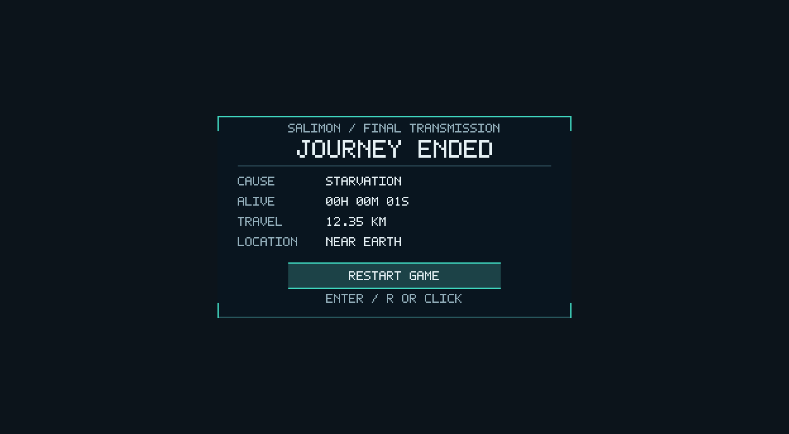
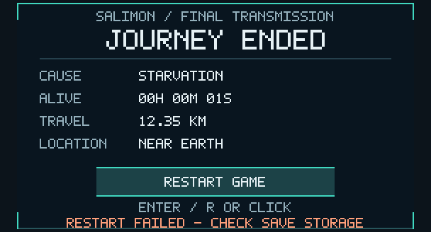

# Issue #374 — Journey Ended screen and verified Restart Game

Implemented 2026-10-20 from main `b59ded77aacc5ea126e2a2b52c63a7453387260d`.
Its prerequisites #371/#372/#373 are merged; no dependency branch is required.

The terminal screen shows a readable final-transmission card over the dimmed,
frozen world: typed cause, accumulated active survival duration, combined physical
travel distance and final named location. `GameplaySession::ended_run()` is now
the single typed builder used by both native UI and archive serialization. No save
schema, archive precision or death-cause policy changes.

One Restart Game action accepts an initial focused Enter/numpad Enter/R press or
left click on the visible button. Ordinary gameplay/view/status/diagnostic keys
remain blocked while terminal. The screen supersedes all normal overlays, reticle,
held tool and inventory/equipment. Focus regain explicitly restores the OS cursor
for terminal mouse access; stale pointer positions are cleared on focus/capture
loss, cursor leave, resize/DPI and lifecycle reset.

The action calls the existing verified terminal/archive/fresh-pair publication.
Failure leaves the run terminal and shows a persistent retry footer; unavailable
storage cannot grant a diskless restart. Success replaces both active slots before
exposing the fresh deterministic world, clears transient host/input/presentation
state and leaves capture off until fresh input. There is no revive/resume action.
This preserves the existing synchronous restart IO transaction and its crash/fallback
guarantees. Starter supplies remain #379's scope.

See the [canonical terminal contract](../../docs/save-contract.md#journey-ended-presentation-374)
and [runtime ownership](../../client/runtime/architecture.md#journey-ended-screen-374).
The renderer receives only generic RGBA; shared screen margins keep button pixels
and physical pointer coordinates aligned. Normal viewports get the dim backdrop;
very large surfaces use a bounded centered card (64 MiB maximum pixel allocation).

## Visual evidence

These are **production CPU raster previews**, alpha-composited over a neutral
RGB `(49,63,75)` background, not native GPU/window screenshots. Fixtures deliberately
seed cause/time/distance for presentation; the one-second starvation example is not
a claim about normal hunger depletion. Source images omit the renderer's 16 px
outer margin; layout/hit tests use the corresponding full physical viewport.

1280×720 viewport:



640×360 viewport with failed-restart retry feedback:



[2560×1440 at 2× DPI preview](journey-ended-hidpi.png).

Reproduce exact RGBA/dimensions using:

```sh
SALIMON_JOURNEY_EVIDENCE_DIR=/tmp/salimon-journey cargo test -p salimon-client journey_ended_raster_evidence --locked
```

PNG conversion preserves the production raster's dimensions and pixels, only
compositing alpha over the background stated above.

## Validation

Linux cloud container, Rust 1.99.1, Python 3.12.14.
[Exact commands/results](validation.txt):

- `cargo test --workspace --locked`: **663 passed**, 0 failed, 22 existing opt-in ignored.
- `cargo build --workspace --locked`: passed.
- `cargo clippy --workspace --all-targets --locked -- -D warnings`: passed.
- `cargo fmt --all -- --check`: passed.
- `python3 -m unittest discover -s scripts -p 'test_*.py'`: **93 passed** in the final isolated run.
- `git diff --check` and changed-document local link checks: passed.

Six new regressions plus the explicit raster-export fixture cover all typed causes
and archive/UI parity, read-only formatting, subsecond/very long durations and
large distances, pointer-versus-rendered-button parity at multiple DPI/aspects,
bounded allocation, hover/cache/failure/reset, initial keyboard/focus/occlusion/
repeat/synthetic guards, real archive-conflict failure/retry, verified fresh-run
relaunch, terminal relaunch and unavailable-storage rejection. Existing death
freeze, consumable denial, fresh reset and multi-stage checkpoint fault injection
remain green. Native automation exposes report text and the same guarded host
restart, without bypassing verified storage.

The first Python run, concurrent with compilation, **failed one existing 200 ms
process-readiness test**: it saw `preparation exceeded 0.2 second deadline` instead
of the fixture's expected early-exit message. The unchanged full suite passed after
compilation finished. This is consistent with scheduling-sensitive test timing;
no timeout or production behavior was relaxed. The actual first result is retained
in [tooling-initial-failure.log](tooling-initial-failure.log). Other timeout/failure
stdout in that log is intentional negative-path fixture output; unittest's summary
identifies the single real first-run failure.

## Native limitation and existing follow-up

Direct launch of the final built binary **failed before creating the native event
loop** because DISPLAY/WAYLAND_DISPLAY/WAYLAND_SOCKET are absent. See the
[launch result](native-launch-result.json) and [stderr](native-launch.log).
No real OS pointer delivery, scene/Metal screenshot, cursor recovery or reference
FPS pass is claimed. Existing [#376](https://github.com/mr-exception/salimon/issues/376)
retains native Journey Ended/restart and survival signoff. Portable functionality
and the deterministic evidence above are delivered here.

[#375](https://github.com/mr-exception/salimon/issues/375) still owns broader
cross-system/expansion scenario coverage, including features #377–#384 that are not
implemented by this PR. Its remaining expansion requirements were not treated as
completed tests here.
