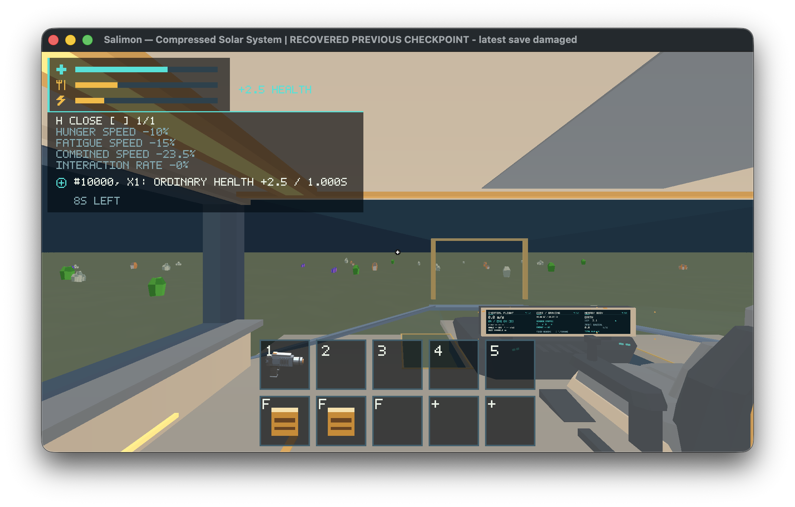
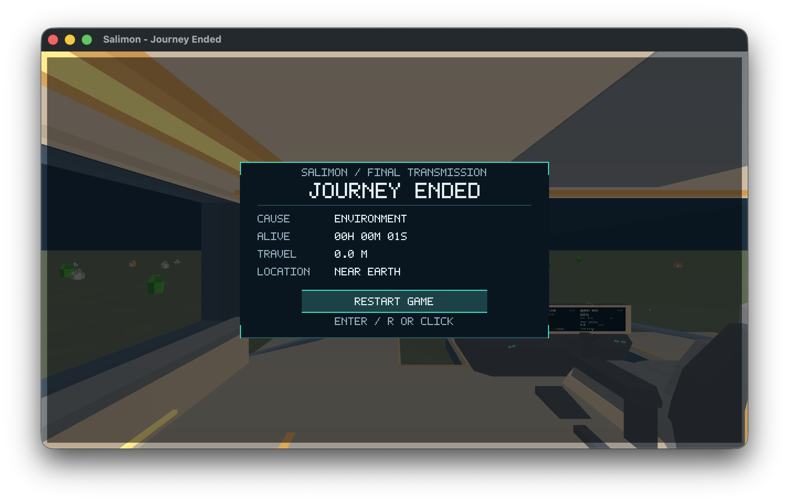
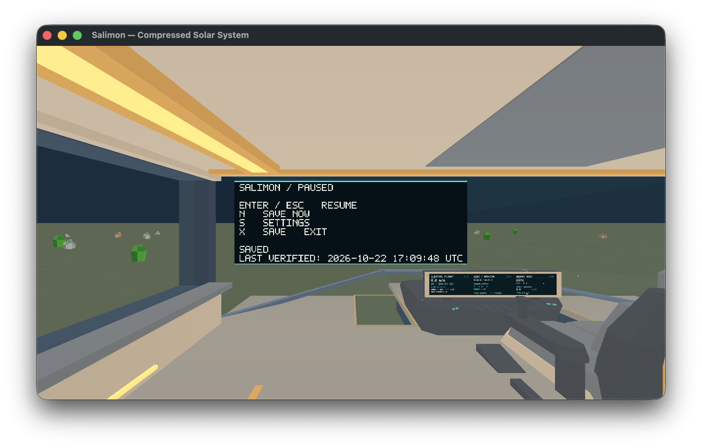

# #376 — Native save, survival HUD and terminal review

## Outcome and boundary

2026-10-22, reference Apple M1 iMac21,1 / 16 GiB / macOS 26.2, Metal,
1920×1080 drawable / 2× scale / AutoVsync. Built runtime includes the #348 modal
presentation fix; [binary identity](../issue-348/evidence/fixed-binary.json).
No production save/survival behavior changed. A new **ignored test-only fixture
exporter** provides validated normal-launch saves for native review without
modifying a player's active run or adding a production cheat/clock command.

Native launch, H/status, pause/manual save, clean exit, damaged-slot fallback,
SIGKILL recovery and terminal R/archive/restart were exercised. This is bounded
reference evidence, not full acceptance of physical travel, all DPI/sensory
conditions or active 500-fragment performance. Remaining acceptance is transferred to [#557](https://github.com/mr-exception/salimon/issues/557); source #376 closes through PR #554 on merge.

## Fixtures and reproduction

`SALIMON_NATIVE_REVIEW_DIR="$PWD/artifacts/native-20261022/376-fixtures" cargo test -p salimon-client --locked native_reference_checkpoints_376 -- --ignored`
passed. Output must be a **new** isolated directory. Existing #375 scenario
placement creates landed, cockpit, moving and EVA contexts. Reduced hunger/fatigue
are explicit fixture conditions; real damage/medkit/crafting methods supply
active healing and a partially worked ration. The terminal fixture applies a
production fatal Environment damage transaction. It is not a naturally elapsed
death, a physical travel route or measured gathering. Every emitted source
round-trips byte-exactly and is published through the real disk SaveManager.
[Fixture manifest](evidence/fixture-manifest.json), [generator result](evidence/376-fixture-generation.log).

`python3 reports/issue-376/native_restore.py --binary artifacts/native-20261022/Salimon348Fixed.app/Contents/MacOS/salimon-client --helper artifacts/native-20261022/input-review --fixtures artifacts/native-20261022/376-fixtures --output artifacts/native-20261022/376-native`
passed all five cases. `native_input.swift` from #348 was explicitly authorized
by the owner; input refuses a foreground PID mismatch and captures only the
selected game window. Actual renderer/backend/drawable metadata is in each log.
[Initial results](evidence/initial/results.json).

A second six-case run adds a deliberately corrupted newer slot over the original
valid landed checkpoint. All six passed, including **two real Save Now requests
separated by 1.2 s**: entire domain state, simulated time and pending time remain
identical while paused. [Replay results](evidence/replay/results.json),
[freeze assertion](evidence/replay/landed/pause-freeze.json).
Before/after checkpoint bytes and complete input/state records accompany each case.

## Native observations

- H shows the active healing icon/details, remaining duration, separate hunger/
  fatigue/combined speed penalties, and compact icon+bar meters without numeric
  meter labels. Screens are readable at this recorded context; this is not an
  all-resolution or sensory-comfort approval.
- Damaged-newer-slot launch displays **RECOVERED PREVIOUS CHECKPOINT — latest save
  damaged**. The valid source seed/run/inventory survive the fallback and save.
- Actual `SIGKILL` after native Save Now is retained with process exit -9.
  Relaunch restores the checkpoint and passes H, pause/freeze and clean exit.
  [Crash record](evidence/actual-crash.json), [recovery](evidence/crash-restore/results.json).
- Journey Ended presents Environment cause, 1-second fixture lifetime, travel and
  location with restart controls and without the ordinary HUD/toolbars. Native R
  increments run serial, archives the previous report and publishes a fresh run.
  [Archive](evidence/replay/terminal/archived-run.json),
  [terminal before/after](evidence/replay/terminal/summary.json).

## Actual offline freeze

A normal native startup after **443 seconds** from the frozen fixture writes its
verified launch checkpoint before exposing gameplay. Comparing the complete
source and this actual startup checkpoint finds **only three changed paths**:
save UTC, fatigue, and the offline watermark. World/ship/character, fabrication,
health/hunger, active effects and their partial ticks/lifetimes, inventory and
simulation/backlog clocks are identical. This is native launch evidence,
separate from the subsequent live-time HUD samples.
[Exact differences](evidence/offline/differences.json),
[startup checkpoint](evidence/offline/startup.sav),
[normal Metal startup](evidence/offline/stderr.log). `offline_probe.py` preserves
the dated experiment; it uses the initial harness's `before.sav`, never a user save.

## Bounded frame measurements

`native_benchmark.py` records three independent 5-second windows per count,
1-second warmup, seed155, facing camera, onboard layout, >=100 intervals,
120-step natural settle preparation. No compiler or other game ran during
measurement. Foreground target PID, visibility/admission, exact accounting and
renderer metadata remain in raw outputs. All loaded samples observe **500
sleeping objects**; these are not active piles, crafting activity or UI-open costs.

| Population | Completed intervals by repeat | Frame p95 by repeat (ms) |
| --- | --- | --- |
| Empty | 301 / 300 / 301 | 17.260 / 17.371 / 17.219 |
| 500 naturally sleeping onboard | 301 / 301 / 301 | 17.251 / 17.299 / 17.249 |

Loaded maxima: 19.728 / 18.102 / 19.149 ms. These are submitted-present intervals,
not physical scanout or a strict 60 FPS floor. They do not waive #455 active
stress failures or #479 budget review. [Summary](evidence/benchmark-summary.json),
[raw empty](evidence/benchmark/0/stdout.json), [raw loaded](evidence/benchmark/500/stdout.json).

## Checks, documentation impact and remaining acceptance

Fixture-generation test, affected all-target Clippy, formatting, Python syntax,
documentation/base-impact and whitespace checks pass. The inherited #348 runtime
passed 849 workspace tests with 28 ignored; after this test-only exporter the
additional ignored fixture test passes. No production binary change is needed
for the exporter. [Clippy](evidence/376-clippy.log).

[Runtime architecture](../../client/runtime/architecture.md#opt-in-native-save-review-fixtures-376)
and [validation](../../docs/validation.md#reference-savehud-fixtures-376) now map
this opt-in test/evidence boundary; [save policy](../../docs/save-contract.md) and
[persistence invariants](../../client/persistence/invariants.md) are unchanged.

Still pending: complete physical discovery/gather/craft/travel/save routes with
real fragment motion/contact, supported DPI/resolution matrix, long-lived-input
and actual sleep/wake (#453), full condition sensory/audio review, and matched
active-500 full-session frame/memory evidence. Balance decisions/physical routes
remain #537. Fixture native passes do not settle those gates or constitute human
art/balance signoff. PR is stacked after #553. At the owner’s request it is ready for review, with these native limits explicitly transferred to #557; existing #537 retains its ownership.

## Review readiness and transferred acceptance

The owner deferred further native desktop testing on 2026-10-22 and requested
all delivery PRs ready. [#557](https://github.com/mr-exception/salimon/issues/557)
owns the remaining physical travel/gather, DPI/sensory and active-load acceptance
listed above; #537 and broader performance/art issues retain their scopes.
PR #554 closes #376 on merge as delivered evidence/tooling and scope transfer,
not full human/native signoff. Fixture/production contracts and the recorded
checks are unchanged; documentation/path checks pass.
