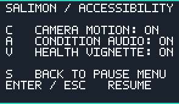

# Issue #383 — optional condition feedback and global accessibility

Delivered snapshot-only health vignette/finite heartbeat, hunger warning (existing
HUD pulse retained), fatigue breathing and tiny walking camera roll. Center aim,
physics, movement and saves remain authoritative and unchanged. Three-point
hysteresis, active-time fades and bounded audio prevent noisy repeated warnings.
Menus, pause, focus loss, tour and death suppress sensory output.

Pause -> S opens accessibility; C camera, A audio, V vignette independently toggle.
Versioned settings are outside run saves and survive new games/restarts. Save
failures stay visible. Original quiet PCM synthesis uses optional OS players with
explicit failures and no build dependency; see runtime architecture for paths,
licensing, volume bounds and platform requirements.

[Actual vignette raster, expanded for inspection](vignette.png) has a transparent
center and alpha capped at 30/255. These are portable raster previews, not in-game
or Metal captures.

Validation: Linux x86-64 / Rust 1.99.1.
- `cargo test --workspace --locked`: 675 passed, 22 opt-in ignored.
- Final focused `cargo test -p salimon-client --locked condition_feedback`: 5 passed.
- Workspace build, all-target Clippy with warnings denied, formatting and diff checks passed.
- Tests cover hysteresis/rearm, finite cues, all-disabled behavior, menu suppression,
  clear center, unchanged aim and serialized authority, PCM bounds, settings
  persistence and malformed/version rejection.

Actual OS audio, native layout/sensory comfort and hardware frame pacing are unrun:
this session has no display or sound output. Existing #376 owns reference M1
verification. Linux needs paplay/aplay; missing players do not imply successful
playback. This PR stacks on #444 (#381); #377 still owns the final Q wheel, whose
readability is protected by the unchanged center ray/transparent vignette center.
