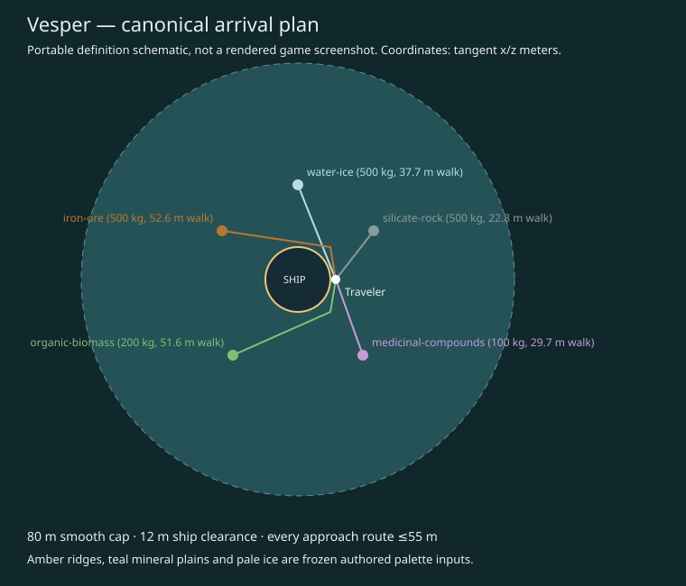

# U11 — permanent alien starting system (#412)

2026-10-22; based on merged U10 PR #530 (`63a2ba4`). Delivered as a reviewable
branch; no merge or source-issue closure performed by the agent.

## Outcome

**Nacre Reach / Nacre / Vesper** is the one permanent starting selection.
Scientific IDs are fixed independently of names; planet
`salimon-fiction:awakening.s000000.p00` is never reselected per installation or
new run. The immutable definition includes actual candidate/catalog/recipe
digests, physical inputs, full terrain/resource/visual parameters, retained U10
seed domains, arrival and baseline resource paths. The catalog's U10 recipe
reference and U11's full world hash remain distinct, without a schema change.

- Eight generated published candidate systems, 26 planets, five eligible under
  the documented narrow physical/distance screen. The first eligible stable ID
  is explicitly pinned, together with the whole candidate publication hash.
- System distance **37.55006266702156 ly**; phase-independent conservative
  Earth–Vesper lower bound **37.55002420841507 ly**, subtracting the 2 AU Earth
  envelope, planet apocenter and 1 km numerical margin. This is at the authored
  publication reference, not a dynamic ephemeris or empirical Solar astrometry.
- Radius 2985359 m, density 5060 kg/m³, gravity 4.223197713467944 m/s²;
  0.42-solar-mass host, age 4.4568593 Gyr. Mass/radius/Kepler/Roche/lifetime checks
  preserve and independently screen the U10 source recipe.
- Cold airless world: model equilibrium 162.63 K, zero pressure; authored teal
  mineral plains, amber ridges and pale ice. No measured climate, exposed-ice
  lifetime, biosphere, breathable atmosphere or pharmacological claim.
- Smooth 80 m arrival cap, traveler 14 m from ship center, 12 m ship-clearance
  disk. Five baseline sites cover existing iron/silicate/ice/organic/medicinal
  material keys, 100–500 kg each, with <=55 m paths analytically clearing the
  ship. Independent sampled-route regressions use the same surface query.

World SHA-256 (canonical JSON, without file newline):
`e2bfc551786763078fbe8f48dff0cd71813da7786eb39a6906ba19541fd87bef`.
Candidate publication SHA-256:
`294c3687e044dcd644937b0116b28694f9357be2c5489acc73bb14c58ff8c431`.
See [audit](audit.json) and [validation log](validation.txt).

## Validation

Final measured commands/results follow. Environment:
Linux x86_64 cloud, native Rust client workspace; offline dependency cache after
fetching the merged prerequisite's pinned dependencies. Network access used the
supported sandbox network permission and inherited proxy. Initial default-shell
network attempts failed before that permission was selected; no policy bypass.

- `cargo test --workspace --locked --offline`: **849 passed**, 0 failed,
  28 intentionally ignored opt-in checks; universe includes **69 passed**.
- `cargo build --workspace --locked --offline`: passed.
- `cargo clippy --workspace --all-targets --locked --offline -- -D warnings`:
  passed, no warnings.
- `cargo fmt --all --check` and `git diff --check`: passed.
- `cargo test -p salimon-universe --release --locked --offline starting_system`:
  **9 passed**; debug U11 tests pass in the workspace run.
- Debug/release/repeated `starting_system` outputs compare byte-for-byte with
  the committed 3283-byte manifest (including final newline).
- `python scripts/check_docs.py`: 0 findings; validator contracts: **5 passed**.
- `python scripts/check_docs.py --base origin/main`: 0 findings after the
  delivery commit; owning source/guide impact checks pass.
- Linux Rust **1.99.1**, Cargo **1.99.1**. macOS/Windows debug/release U11
  golden jobs are included in Source build CI; remote result is tracked on PR.

The initial test draft expected 25 planets/six eligible; the actual fixed request
produces 26/five. Assertions were corrected after examining the complete audit;
no candidate inputs, physical acceptance thresholds or selected ID were changed.
During implementation, a direct route to iron/organics was found to cross the
ship disk; authored intermediate waypoints and rejection regressions fix that.

## Documentation impact

Canonical [contract](../../docs/universe-starting-system.md), owning
[architecture](../../client/universe/architecture.md#permanent-starting-world--u11-412),
[invariants](../../client/universe/invariants.md), root/crate README/AI guides,
technical architecture, maintenance map, validation, approved-design status,
canonical-generation and U10 builder descriptions are updated in this PR.

| Behavior | Source/test | Canonical guide |
| --- | --- | --- |
| Fixed selection, IDs/digests, distance/physical proof | `starting_system.rs`, sibling tests, independent manifest fixture | universe-starting-system.md |
| One surface, authored outcrops, ship-clearing paths, visual separation | same module/tests, `arrival-plan.svg` | selected-world/arrival sections |
| Exact reproducible publication and platform goldens | example `starting_system.rs`, Source build CI | commands/validation section |

Local links/anchors, source/example paths and documentation source-impact gates
are checked at the final revision; no documentation is deferred to U36 #441.

## Limits and downstream ownership

This completes portable U11 selection/definition delivery. It is not a playable
startup migration or native signoff. Existing issues retain these exact scopes:

- [U12 #413](https://github.com/mr-exception/salimon/issues/413): merge the retained
  authored cohort with reviewed production observations, package both U10 and U11
  sidecars/checksums, batching and production budgets. The cohort's density/solar
  anchor are authoring assumptions, not an empirical census/astrometric fit.
- [U14 #415](https://github.com/mr-exception/salimon/issues/415): epoch/phase,
  velocity, rotation and complete evolving state. Distance proof is explicitly
  publication-reference only. No eternal minimum-separation claim.
- [U23 #424](https://github.com/mr-exception/salimon/issues/424) and
  [U24 #425](https://github.com/mr-exception/salimon/issues/425): real-scale LOD,
  common physical surface integration, actual hull/airlock/suit/survival checks,
  arrival and mining/carrying/fabricator/persisted depletion adapters. Other
  fictional worlds still require full surface definitions before evaluation.
- Native integration/signoff [#436](https://github.com/mr-exception/salimon/issues/436),
  [#437](https://github.com/mr-exception/salimon/issues/437),
  [#438](https://github.com/mr-exception/salimon/issues/438),
  [#439](https://github.com/mr-exception/salimon/issues/439): reference appearance,
  physical gameplay and M1/Metal performance. No native screenshot/FPS evidence
  was collected; the image above is an explicit data schematic.

Source reuse gates #513/#524/#526 remain intact. There is no gameplay chart/Earth
route disclosure, prototype save/terrain-v1 rekey, backend, source download,
asset promotion, oxygen or thermal-survival implementation. Existing tests guard
the current gameplay. Golden updates require explicit reviewed publication and
all-player-consistent migration; code never silently updates a visited world.
