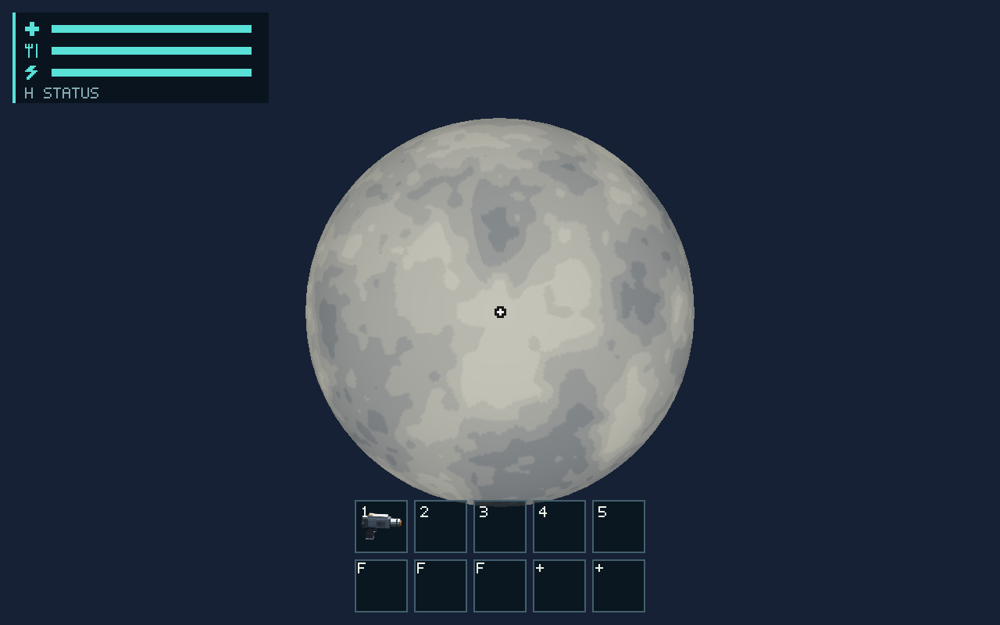
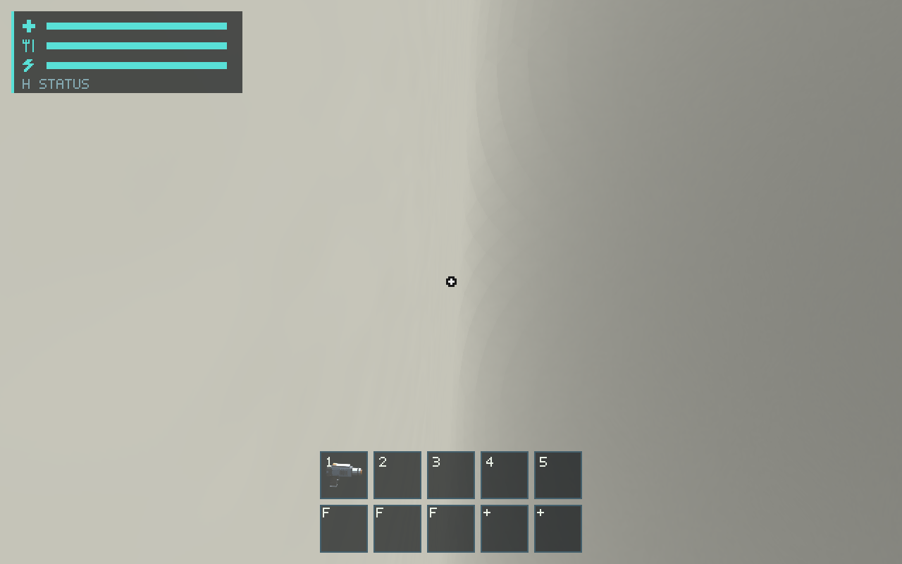
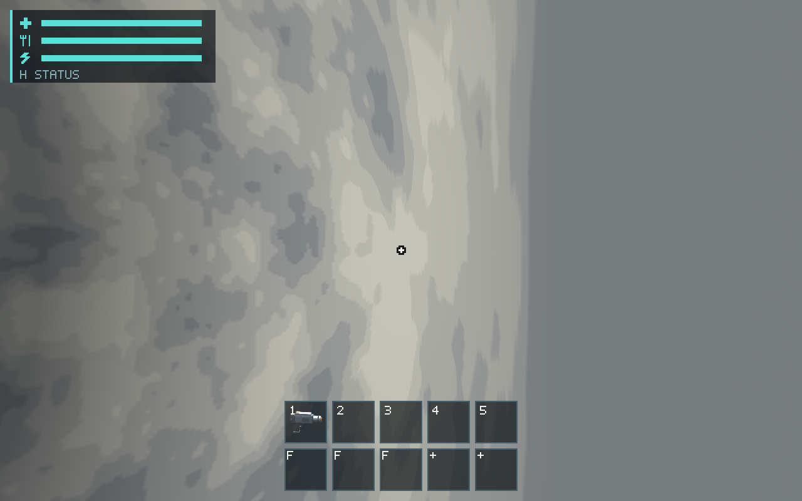

# #424 — Frozen canonical planet terrain and space-to-surface LOD

Parent: #674 / issue-422 branch at `8ef760a4`. Canonical Vesper uses the exact
U11 frozen evaluator and published 2,985,359 m radius; its existing digest,
terrain/resource/visual seeds and geography are unchanged. CPU selection now
covers all cube faces and refines from orbit to metre-scale surface grids.
Stitched 2:1 boundaries, stable full-definition keys, bounded caches and reverse-Z
renderer ownership are retained. Distances use the patch bounds, preventing
coarse root patches from hiding surface detail.

Renderer terrain uniforms now use the actual declared mask radius. The old
4,096 m fixture radius is unchanged; a full-planet mask keeps distant canonical
relief instead of flattening it to the base sphere. Patch and fallback sphere
both use Slate; no material-dependent color pop is introduced.

The [contract](../../docs/universe-terrain.md) maps source/tests and budgets.
World, runtime and renderer guides/routing are updated in the same PR. Ordinary
playable-world adoption and new-run startup are the next requested #425/#426
PRs, not secretly activated by the explicit `canonical-terrain` rendering fixture.
The fixture's absolute cameras and overhead light are declared render inputs;
this is not ephemeris light/astronomical sky qualification (#423).

## Validation

Linux x86_64, 2 CPUs / 8 GiB, Rust 1.99.1 in the established `salimon-dev`
container. PATH uses `/opt/rust/bin` and `RUSTUP_TOOLCHAIN=/opt/rust`.

- `cargo build --workspace --locked -j 2`: PASS.
- `cargo clippy --workspace --all-targets --locked -j 2 -- -D warnings`: PASS.
- `cargo test -p salimon-world --locked canonical`: PASS, 2 new tests. Exact
  U11 height equality, outward normals, cap, malformed digest/radius rejection,
  translated body equivalence and preserved six-body fixture membership.
- `cargo test -p salimon-client --locked canonical_ -- --nocapture`: PASS,
  3 tests (2 new plus existing benchmark adapter). All six face areas sum to one,
  seam/pole/corner selections balance, surface refinement is required, cache
  residency stays bounded and revisits preserve exact geometry.
- `cargo test -p salimon-client --locked terrain -j 2`: PASS, 17 tests,
  including prior ground/landing/resource/contact and topology regressions.
- `python3 -m unittest discover -s scripts -p test_salimon_test.py`: PASS, 22.
- `cargo fmt --all -- --check`, docs and whitespace checks: PASS.
- Production wgpu/Xvfb/Mesa llvmpipe Vulkan: 20/20 steps PASS across orbit,
  surface, cube-face boundary and orbit revisit, with original native PNGs.
  [Observed counts/timings](native-summary.json), [raw result](native-result.json.gz)
  and [image/binary hashes](SHA256SUMS).

```sh
WGPU_BACKEND=vulkan VK_DRIVER_FILES=/usr/share/vulkan/icd.d/lvp_icd.x86_64.json \
LP_NUM_THREADS=2 XDG_RUNTIME_DIR=/tmp/salimon-xdg \
xvfb-run -a -s '-screen 0 1280x800x24' python3 scripts/salimon-test \
run scenarios/evidence/universe-terrain.json --binary target/debug/salimon-client \
--screenshot-command '["native"]'
```

Actual rendered selections: 6 orbit / 300 surface / 162 face-edge patches.
Peak retained CPU patch buffers/metadata in these views ~10.55 MB; observed GPU
cache ~5.42 MB; peak upload remains below 2 MiB. Cooperative preparation has
recorded overruns; the 2 ms value is admission scheduling, not a claimed absolute
wall-time guarantee. Raw preparation peaks and counts are retained. Software
GPU timestamps and debug frame intervals do not establish hardware 60 FPS.
Hardware/Metal/device qualification remains #557/#563 and subjective appearance
#561, with no automatic approval or baseline promotion. Future geology/material
art direction remains the separately planned planetary-environment work.

## Original captures





Initial routes/inspection exposed and corrected the too-coarse center-distance
selector, missing runner scenario registration, Rust material fallback and
hard-coded shader morph radius. A compile error from validation being placed
before its local error closure was corrected before the final passing build.
The initial 20-step render run passed functional steps but its material/morph
output was superseded by the final captures above; it is not an approved baseline.
