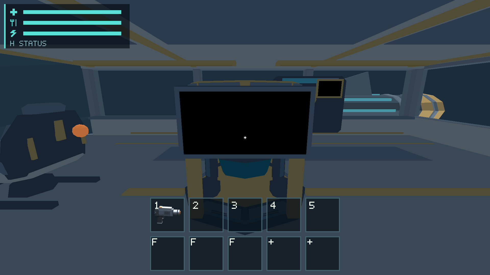
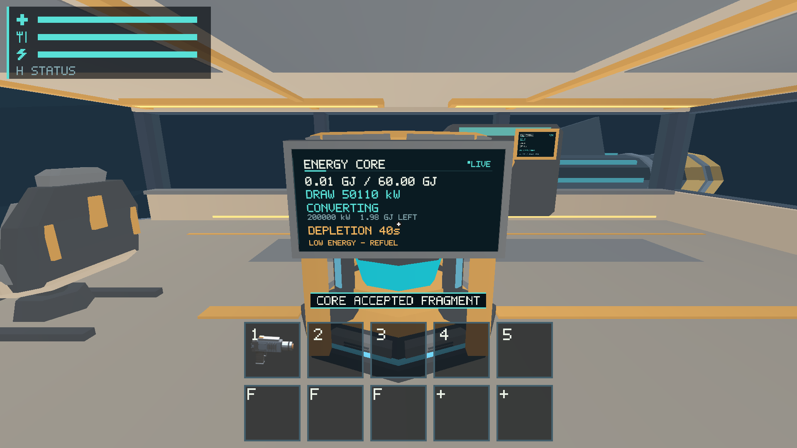
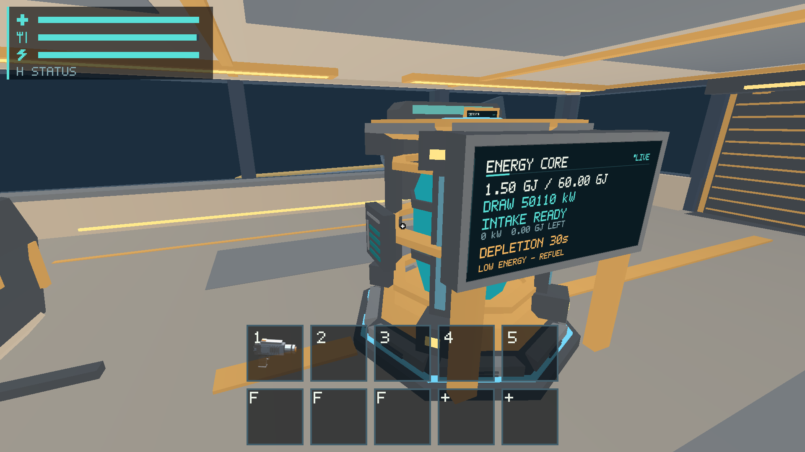
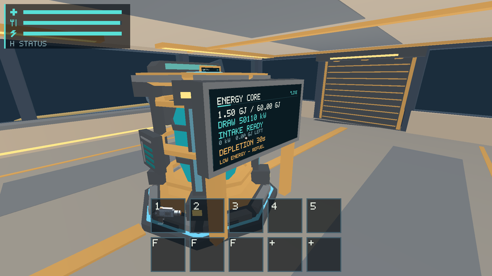
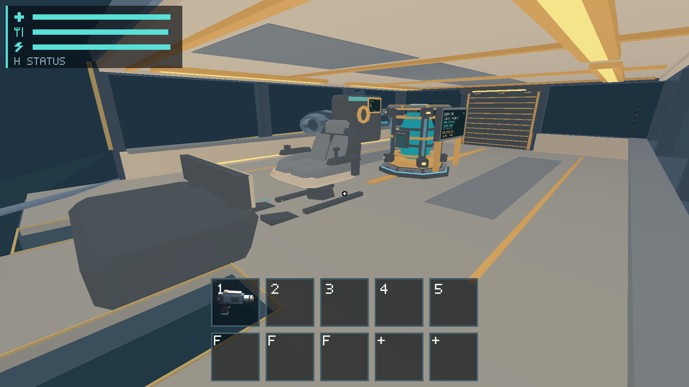

# #451 — Core contrast under current production blackout

## Outcome

The historical blocker is resolved: #463 already replaced fixed warm cabin
lighting with Core-bus-aware warm fill/emission and a cool blackout visibility
floor. The dark verification condition is therefore the **actual existing Core
bus-off state**, paired with bus-on from the identical camera. No new light
fixture, shader/material edit, brightness control or energy policy is needed.
The [canonical condition](../../docs/scout-presentation.md#core-contrast-verification-condition-451)
now records this rule and the stale unresolved question is removed from Project Q&A.
The [2026-10-20 #299 report](../issue-299/README.md) remains unchanged as historical
evidence of the older shader, rather than being relabeled as current acceptance.

## Actual native evidence

2026-10-22 on Apple M1 iMac21,1 / 16 GiB / macOS 26.2, Metal, physical1920×1080,
2× scale. [Binary](evidence/binary.json), [shader digest/context](evidence/shader.json).
This uses the isolated release build with the #348 modal fix; #376 added only
an ignored test/exporter and documentation, leaving the production binary identical.

- `SALIMON_REFERENCE_SIZE=1 python3 scripts/salimon-test run scenarios/visual/scout-lighting.json --binary artifacts/native-20261022/build-fixed/salimon-client --screenshot-command '["native"]' --summary --artifacts artifacts/native-20261022/451/lighting`: **21/21 steps passed**, eight actual Metal color-surface captures. Core power starts false; real intake and one production tick restore power. [Results](evidence/lighting/result.json).
- `SALIMON_REFERENCE_SIZE=1 python3 scripts/salimon-test run reports/issue-299/core-views.json --binary artifacts/native-20261022/build-fixed/salimon-client --screenshot-command '["native"]' --summary --artifacts artifacts/native-20261022/451/core-views`: **29/29 steps passed**, five actual player-camera captures. Intake removes exactly the original fragment, power/conversion restores, and close/oblique/receding views retain the authored Core. [Results](evidence/core-views/result.json).

The paired named Core camera is identical in bus-off/bus-on views. Blackout has a
blank black screen, darker cool chassis/bezel, visible mount posts and enclosure
silhouette, and extinguished Core/task emission. Restored power visibly returns
warm cabin fill, Core emission and readable white/cyan/amber instrument text.
Close oblique views retain a distinct bezel/enclosure, mounts and right-facing
text; the receding view shows the installation in the aisle context. The paired
blackout is not claimed to be pitch black or electrically powered emergency light.

## Checks and limits

Documentation and recorded evidence only: no runtime, GPU or asset modifications.
`python3 scripts/check_docs.py`, changed-base documentation checks and
`git diff --check` pass. Recorded source paths, commands, shader and image links
were checked. Unrelated compilation/model exports were not repeated; the
inherited #348 runtime already passed workspace tests/Clippy/release build.

These captures establish the requested current blackout condition and bounded
Core contrast inspection, not every continuous camera path, all DPI, optical
scanout, a performance floor, owner aesthetic approval or image baseline
promotion. Broader lighting/performance/baseline reviews remain separately owned
by #483/#477/#479. Native input and physical sleep/wake remain #453. No image
masks, tolerances, authored material contracts or prior failed evidence changed.
PR is third in the requested stack and closes #451 when reviewed and merged.
