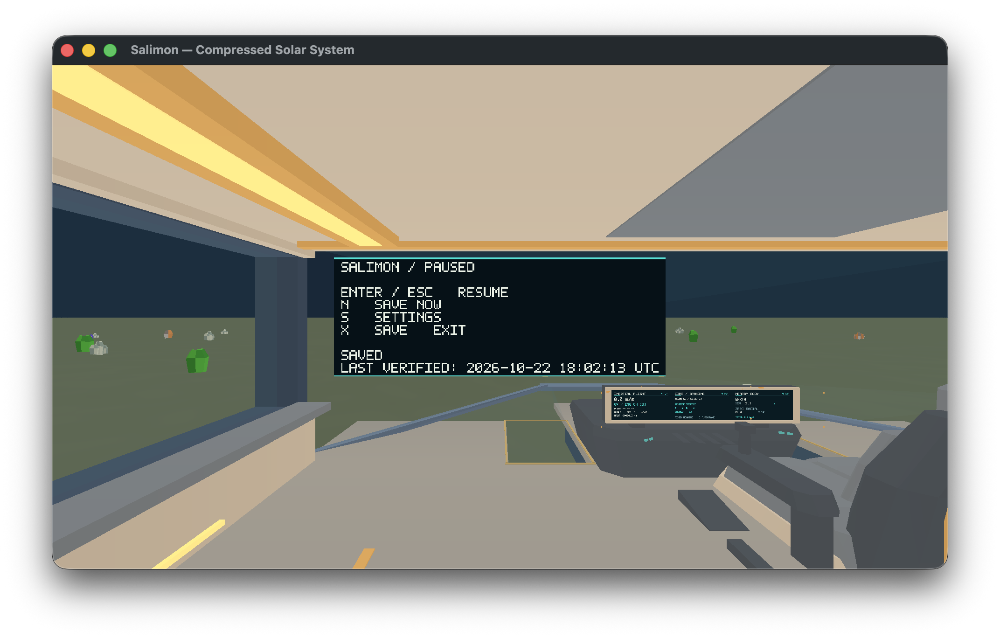
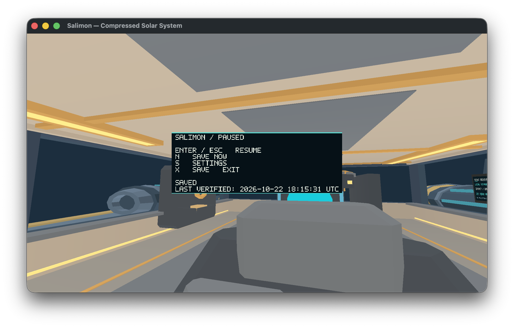

# #453 — Native lifecycle and relative-mouse verification

## Outcome

2026-10-22 on reference Apple M1 iMac21,1 /16 GiB /macOS26.2, Metal,
physical1920×1080 /2× scale. [Binary identity](evidence/binary.json); production
runtime is the #348 modal fix, with subsequent branches adding tests/docs only.
The final revision adds opt-in runtime trace logging; admission, controls and timing behavior are unchanged.

**14/14 bounded native lifecycle checks pass.** A longer flight sequence passes
all nine keyboard/throttle/coasting checks, but **relative-mouse motion fails**.
A dedicated mouse-only repeat also fails to move the look direction. Physical
system sleep/wake now passes a bounded normal-clock renderer/continuity probe.
These were the initial results. The retry below resolves bounded mouse delivery;
remaining native acceptance is transferred to [#557](https://github.com/mr-exception/salimon/issues/557) at the owner’s request. This PR closes #453 on merge as a delivery/scope transfer, not full native signoff.

## Actual executed checks

The owner explicitly authorized the reviewed native macOS input helper in this
session. Its #348 adaptation selects the largest target window and refuses key/
mouse input on a foreground-PID mismatch. These are real OS events with explicit
fixed-step E2E simulation: they do not establish normal wall-clock or physical
sleep/wake behavior. Exact commands:

```sh
SALIMON_REFERENCE_SIZE=1 python3 reports/issue-312/native_lifecycle.py --binary artifacts/native-20261022/build-fixed/salimon-client --helper artifacts/native-20261022/input-review --output artifacts/native-20261022/453/lifecycle --scenario flight-regression
SALIMON_REFERENCE_SIZE=1 python3 reports/issue-312/native_flight.py --binary artifacts/native-20261022/build-fixed/salimon-client --helper artifacts/native-20261022/input-review --output artifacts/native-20261022/453/long-flight --scenario flight-regression
SALIMON_REFERENCE_SIZE=1 python3 reports/issue-312/native_flight.py --binary artifacts/native-20261022/Salimon348Fixed.app/Contents/MacOS/salimon-client --helper artifacts/native-20261022/input-review --output artifacts/native-20261022/453/dedicated-mouse --scenario flight-regression --mouse-only
```

Lifecycle pass includes Escape/Enter, frozen paused authority/time, slots1/2,
F-not-mining, F2 gameplay/tour guards, held-W release across tour, actual native
minimize/restore and no replayed steering. [Checks](evidence/lifecycle/checks.json),
[observations](evidence/lifecycle/observations.json),
[log](evidence/453-lifecycle.log).

Long sequence passes held throttle repeats/release, yaw left/right, pitch, roll,
released steering stability, coasting velocity preservation and reverse motion.
**The mouse-positive observation does not change the look direction** after
subtracting the moving camera origin. The later inverse equals the original
because neither event moved the view; the legacy probe's `inverse=true` is
**vacuous, not a successful inverse-delivery pass**. Both commands exit1 with
explicit failed checks; their raw records are retained without reclassification.
[Long checks](evidence/long-flight/checks.json),
[long observations](evidence/long-flight/observations.json),
[dedicated checks](evidence/dedicated-mouse/checks.json),
[dedicated observations](evidence/dedicated-mouse/observations.json).

Helper event posting succeeded and focus metadata matches target PID, but this
alone does not prove winit received a raw mouse event. No app/capture defect or
root cause is asserted without that boundary evidence. This differs from the
[2026-10-20 dedicated pass](../issue-312/README.md); historical failures and passes
remain valid only at their recorded contexts. The current normal-play #348 tray
attempt also retained its original pose/item and is not a collection pass.

## Actual physical sleep/wake

After the owner reconfirmed the dedicated timing despite the active-call warning,
the authorized probe requested actual system sleep. No admin access or power
schedule/settings change was used; the owner manually woke the Mac.

The first attempt is **incomplete, not a sleep pass**. `pmset sleepnow` returned
success, but macOS was still waiting for another application's sleep notification
acknowledgement (30-second delay). The original probe tried to refocus too soon;
its foreground-PID guard refused input. OS sleep count was still0. The failed
attempt and early-focus error are retained in [first attempt](evidence/sleep-first-attempt/result.json)
and [log](evidence/sleep-first-attempt.log). No unrelated app was stopped or
sleep assertion overridden to work around that delay.

The probe now waits for a real Sleep/full-Wake pair (not merely command success
or a dark display), then waits for the owner to unlock the desktop before input.
The retry **passed** on the same isolated normal wall-clock game:

- macOS records software sleep at **21:01:50** and full Deep Idle wake by HID
  activity at **21:02:08 Asia/Nicosia**, **18 seconds asleep**. System counters:
  Sleep1, DarkWake0, UserWake2. [OS events](evidence/sleep-retry/power-events.json).
- The request-to-observation wall gap is50.423s and monotonic gap34.831s. The
  complete measured sequence (including native post-wake save/idle checks) spans
  59.708s of wall time; simulation advances40.928s, below its conservative
  awake-wall upper bound44.708s after excluding the18-second OS sleep and allowing
  integer-second event-timestamp rounding. No sleep interval is replayed into
  simulation under this bounded check. [Result](evidence/sleep-retry/result.json).
- Actual post-wake native window captures show the renderer presenting normally;
  verified native Save Now and clean exit succeed. The player position is exactly
  unchanged in the before, after-wake and subsequent fresh no-input snapshots.
  [Before](evidence/sleep-retry/before.sav),
  [after wake](evidence/sleep-retry/after-wake.sav),
  [after no-input interval](evidence/sleep-retry/after-idle.sav).
- Native logs include initial application resume and clean exit, with no renderer
  failure. They do **not** show an additional winit suspended/resumed callback;
  no GPU-resource rebuild or callback coverage is inferred from post-wake rendering.



Reproduction (requires an explicitly dedicated desktop and a person ready to wake
and unlock it; use a new output directory):

```sh
python3 reports/issue-453/sleep_probe.py --binary artifacts/native-20261022/Salimon348Fixed.app/Contents/MacOS/salimon-client --helper artifacts/native-20261022/input-review --source-checkpoint reports/issue-376/evidence/initial/landed/before.sav --output artifacts/native-20261022/453/sleep-retry --run-sleep
```

The native W injection is bounded to5 seconds across the **sleep request**. With
macOS's delayed sleep entry, release can occur before actual sleep. Also, the
checkpointed player did not move before/after this attempt, so the stable-position
result cannot independently establish that a movement hold was admitted and then
cleared across hardware sleep. Do not label that stronger gate passed. A future
controlled held-input delivery trace must establish positive admission, actual
sleep overlap and release/reset behavior; relative-mouse forward/inverse delivery
also remains failed. Physical sleep, renderer continuity and the bounded live-clock
check pass; complete #453 input signoff remains open.

## Retry here and explicit scope transfer — 2026-10-22

The owner requested completion of all four PRs and deferred further dedicated
sleep testing to [#557](https://github.com/mr-exception/salimon/issues/557).
The initial failed probes above remain historical evidence, not current passes.

- **Mouse-only and longer flight now pass**: 2/2 and 11/11 checks. Runtime trace
  receives `(120, 35)` and `(-120, -35)` with capture/focus true, occlusion and
  isolation false. Positive view change and inverse restoration both pass.
  [Mouse checks](evidence/retry-here/mouse/checks.json),
  [long checks](evidence/retry-here/long-flight/checks.json),
  [received events](evidence/retry-here/long-flight/stderr.log),
  [state/input](evidence/retry-here/long-flight/observations.json).
  The report-local helper uses an in-window position, a private CGEvent source
  with suppression interval zero, and a 300ms post-event dwell. Earlier attempts
  without that dwell received no motion; this is a successful delivery recipe,
  not an isolated proof of which OS implementation detail caused every failure.
- Runtime `app.rs` adds trace-only mouse admission metadata, key/control/orientation
  observations and capture-release/focus logging. No input gate, domain controller
  or clock rule changed. The trace boundary makes posted-vs-received evidence
  explicit. [Source/binary identities](evidence/retry-here/identity.json) distinguish
  the mouse/long trace build (two extra observational device/cursor messages) from
  the final sleep build; gameplay code is identical between them.
- The fresh normal-clock coasting run positively admits native W: orientation
  changes from identity to `[0, 0, 0.034201781836552744, 0.9994149479166323]`.
  Occlusion then releases an admitted `pitch_up: true`; focus-loss logs show
  cleared controls. Actual OS sleep is **242s, 21:15:30–21:19:32 Asia/Nicosia**.
  Renderer and clean exit recover. A fresh after-idle checkpoint (generation9)
  records 17.392s of simulation advance within a conservative awake-wall upper
  bound 23.267s; post-wake orientation
  remains exactly `[0, 0, 0.050058383995431804, 0.9987462932055197]` through fresh
  no-input observation. The trace records that same orientation at focus
  regain and before the first post-wake Escape, before pause can clear controls.
- **The stricter held-overlap result fails** and is retained as failed: the helper’s
  original 180s wall deadline expires during 242s of sleep, releasing on resume
  at Unix1792693171.792, about 0.208s before the coarse OS wake timestamp. This
  does not independently prove a hold spanning the full logged interval.
  Artifact audit also found `after-wake.sav` was stale generation8 from before
  sleep; the raw result’s 8.048s simulation delta is therefore not a valid
  post-wake clock measurement. The fresh generation9 after-idle save supports
  the 17.392s calculation above. Future harness runs now require generation
  advancement and current save UTC, and calculate the delta from the final
  snapshot. These new harness guards have syntax validation only; no further
  native run was performed after the owner deferred testing.
  [Result](evidence/retry-here/sleep-held/result.json),
  [OS events](evidence/retry-here/sleep-held/power-events.json),
  [input](evidence/retry-here/sleep-held/input.json),
  [runtime trace](evidence/retry-here/sleep-held/stderr.log).
- The helper now bounds a hold by 300s of uptime and always posts release during
  normal cleanup; `--manual-sleep` never issues a sleep command and prints a ready
  marker. The final manual attempt was stopped/deferred by the owner, with no
  actual sleep pair verified. It is **incomplete**, not a pass. An earlier cancelled
  request is likewise retained. No further sleep testing is authorized in this run.
  [Manual result](evidence/retry-here/manual-stopped/result.json),
  [cancelled request](evidence/retry-here/cancelled-request/result.json).



Reproduction for a future dedicated session (manual operation, new output path):

```sh
swiftc reports/issue-453/native_input.swift -o artifacts/input-453
python3 reports/issue-453/sleep_probe.py --binary /absolute/path/to/salimon-client --helper artifacts/input-453 --source-checkpoint reports/issue-376/evidence/initial/moving/before.sav --output artifacts/future-manual-sleep --manual-sleep
```

The source issues #348/#376/#453 close through their delivery PRs; #557 owns
unresolved held-input proof, tray/intake/travel, display/sensory and active-load
checks explicitly listed there. Broader art/performance ownership stays with
#483/#477/#479. No failed gate is waived or reclassified by marking PRs ready.

## Checks and ownership

Python syntax, documentation/base-impact and whitespace checks pass. Fresh release build, **849 workspace tests passed /0 failed /29 ignored**,
all-target Clippy and formatting pass. [Tests](evidence/retry-here/workspace-tests.log),
[Clippy](evidence/retry-here/clippy.log).
[Runtime lifecycle ownership](../../client/runtime/architecture.md),
[runtime invariants](../../client/runtime/invariants.md) and the existing
[runner input-isolation contract](../../scripts/README.md#deterministic-input-boundary-313)
are unchanged. Fourth PR is based on the #451 branch, preserving requested order.
