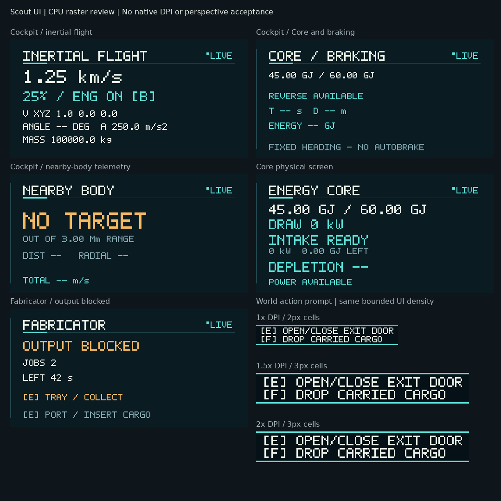
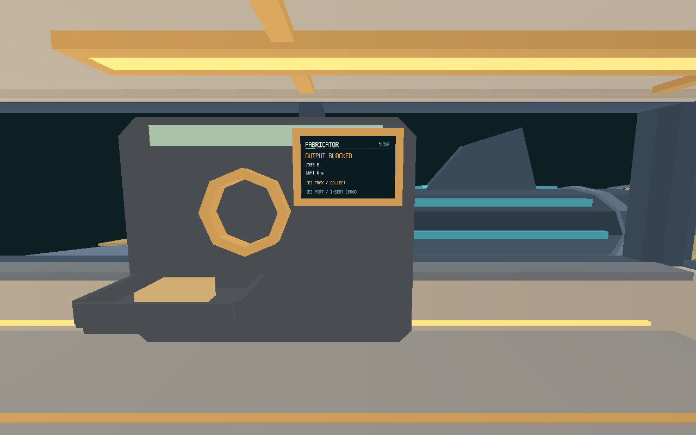

# Issue #466 — Unified Scout UI readability

Portable onboard delivery, 2026-10-21. Based on `f389d9d2a8518b52aedb08172cd214af190bbe15`.
The delivering PR closes #466 after transferring native acceptance to
[#502](https://github.com/mr-exception/salimon/issues/502) and future scanner UI to
[#503](https://github.com/mr-exception/salimon/issues/503), blocked by #430.
Closure does not grant native readability/performance or scanner completion.
[Canonical surface/owner matrix](../../docs/scout-presentation.md#scout-ui-readability-contract-466).

## Delivery

- One renderer-owned 5x7 face and functional ivory/cyan/muted/amber palette for
  instruments, action/crafting panels, toolbar, Q wheel and survival details.
  Visible brackets, plus, percent, queue chevrons and recipe punctuation;
  metric readings preserve SI case. No dependency is added.
- Compact authored-object E affordances; existing cargo/mining prompts share
  the face/palette. The prompt density stays 2/3/3 cells at 1x/1.5x/2x DPI.
  Reticle dot/cross dimensions and exact center retain their existing policy.
- Bounded physical instrument text uses integer density >=2, compact scientific
  numbers with units where necessary, and visible ellipsis for unfit prose.
  Fabricator has separate jobs/time rows, explicit warning words and next-action
  hints. Unknown status values are explicit; each atlas region retains its cache.
- The current Fabricator import flips U only on its named screen: original UVs
  run toward +X, viewer-left from the cabin-facing -Z side. All three physical
  screens are regression-checked against viewer-right/top-left. No generated
  GLB, source asset, normal, collision, shader, atlas dimension or draw is edited.
  Reconcile this deliberate mapping if authored Fabricator UVs change later.
- Existing exclusive modal/input, focus, power blank/restore, consumption,
  queue/cancel, exact mass/energy and simulation behavior retain their owners.
  No scanner, narrative/menu/spoiler feature or gameplay rule is added.

## Verification

Linux 6.18.55 x86_64; Rust/cargo 1.99.1; Python 3.12.14. Locked dependencies.

| Check | Result / evidence |
| --- | --- |
| `cargo test --workspace --locked` | 760 passed, 0 failed, 27 ignored; [raw log](workspace-tests.log), [summary](checks.json) |
| `cargo build --workspace --locked` | Passed; [log](workspace-build.log) |
| `cargo fmt --all -- --check` | Passed; [log](format.log) |
| `cargo clippy --workspace --all-targets --locked -- -D warnings` | Passed; [log](clippy.log) |
| Shared glyph/SI, palette contrast, bounded lines and Fabricator warning/cache tests | Passed in workspace tests. Opaque sRGB ink/background ratios >=4.5:1; this is not perspective/native acceptance |
| Three-screen orientation regression | Passed with correction. Removing only Fabricator U correction fails with `display 4 is mirrored`; [intentional regression log](orientation-regression.log) |
| Recipe-selection glyph regression | Passed with correction. Restoring the formerly blank `>` fails; [intentional regression log](selection-glyph-regression.log) |
| CPU raster exports | Explicit ignored tests run successfully; [log](raster-check.log), images below. Synthetic display DTOs/CPU UI densities, not native screenshots |
| Offscreen GPU | Existing `scout_feedback_gpu_evidence`: 14 cases x 16 samples, frozen first-pair equality and six changed-state visibility checks pass; [log](gpu-check.log), [adapter](adapter.txt), [raw timing CSV](timings.csv) |
| Native X11 setup | Failed before launch: Xvfb cannot establish listening sockets; [failure](xvfb-startup-failed.log). Live OS-input/gameplay GUI checks therefore not run |
| Apple M1/Metal appearance, DPI, live input and frame-tail budget | Not run in cloud; #502, coordinated with #348/#376/#489/#498 |
| Future scanner integration | Not run / scanner absent; #503 after #430, native hologram acceptance #438 |

The ordinary ignored checks retain their explicit GPU/benchmark/native prerequisites;
only the named CPU export and offscreen GPU checks were invoked separately.
[Source hashes](source-hashes.json) identify the reviewed source independently of
commit metadata. Full logs preserve the actual pass/ignore counts.

## Review images



This matrix shows the actual production CPU atlas pixels and prompt rasters.
The collage labels are report annotations. Full atlases: [idle](atlas-idle.png),
[working](atlas-working.png), [blocked](atlas-blocked.png),
[blackout](atlas-blackout.png). Individual prompt densities:
[1x](prompt-1x.png), [1.5x](prompt-1_5x.png), [2x](prompt-2x.png).



Text is now viewer-right from the cabin-facing side. This is the existing
ship-only offscreen reference camera with synthetic presentation DTOs, no OS
inputs, world terrain, HUD overlay composition or player controls. It does not
approve native interaction-distance readability. [Cockpit](cockpit-active.png),
[Core](core-idle.png) and [Fabricator blackout](fabricator-blackout.png) are also retained.
All 14 raw PNGs accompany the timing CSV. No candidate is promoted to a baseline.

## Reproduce evidence

From repository root, set absolute writable paths (tests run from crate roots):

```sh
SALIMON_SCOUT_UI_DIR="$PWD/artifacts/issue-466/raster" cargo test -p salimon-renderer --locked scout_ui_raster_evidence -- --ignored
SALIMON_SCOUT_UI_DIR="$PWD/artifacts/issue-466/raster" cargo test -p salimon-client --locked scout_prompt_raster_evidence -- --ignored
SALIMON_SCOUT_FEEDBACK_DIR="$PWD/artifacts/issue-466/gpu" cargo test -p salimon-renderer --locked scout_feedback_gpu_evidence -- --ignored
```

CPU prompt exports are `.rgba` plus `.size` (width height) sidecars; PNGs here are
lossless conversions. Atlas PNGs are written by the production renderer raster.
For headless GPU execution select the actual software Vulkan ICD with
`VK_DRIVER_FILES` and `WGPU_BACKEND=vulkan`. This run unpacked Mesa 25.2.8 under
`/tmp/salimon-gui` and used its `lvp_icd.json` with that local library directory;
no display was available. GPU timings are ship-only debug diagnostics on CPU
llvmpipe, not matched before/after whole-game timings or an M1 budget pass.
Native setup attempts are retained, not reported as successful coverage.
