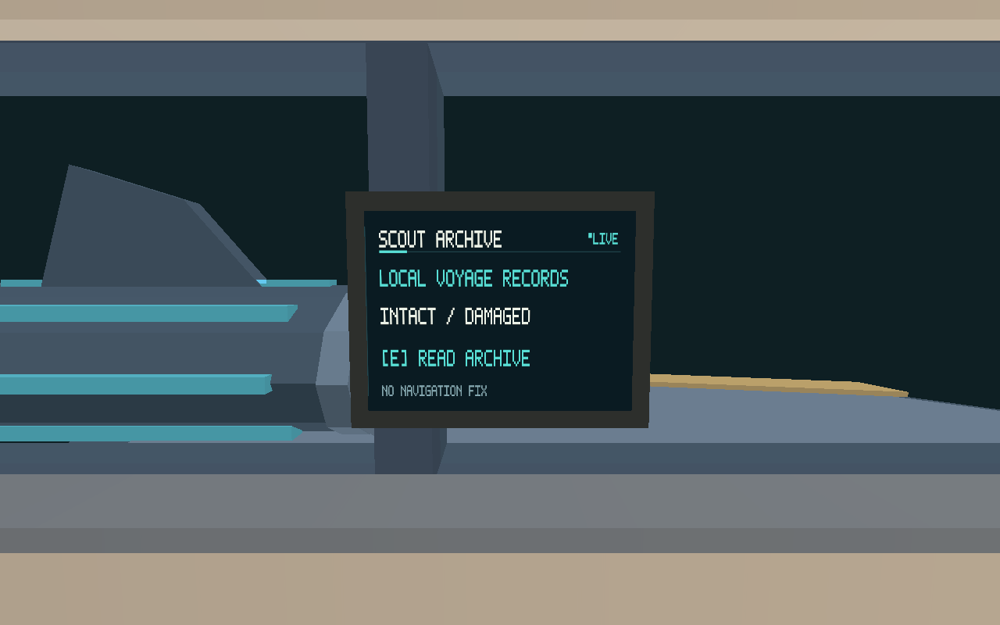

# Issue #467 — persistent physical Scout Archive

Portable implementation delivered on 2026-10-21. Adds a dedicated wall-mounted
terminal opposite Fabricator, seven stable intact/damaged voyage/routine/packet
records, source and explicit unknown timestamps, keyboard reader, durable per-run
selection/read progress and discrete checkpoint events. No coordinates, recovery
results, confirmed wormhole transit or Hall spoilers are exposed. Recovery work
remains #468; discovery/navigation remains #469.

Runtime owns records/input/source validation. Renderer adds twelve code-authored
vertices in the existing ship draw plus a sixth instrument atlas section, retaining
512x256 section dimensions and existing draw/pipeline count. Authored ship exports,
physical geometry and simulation funding remain unchanged. The clear-ray gate
accounts for the existing player-expanded final wall skin; other solids occlude.
Schema 6 requires inner Archive version 1; v1–v5 initialize unread records. Missing,
future, duplicate or unknown Archive data rejects before replacing a live session.
Actual disk checkpoint/normal-launch tests preserve read/selection and reset modal
input. Q/H/world input is exclusive, pause/focus/range/power/lifecycle clear reader,
and gameplay continues while reading. New runs reset it.

## Validation

Environment: Linux 6.18.55, Rust 1.99.1. Commands from repository root:

- `cargo test -p salimon-client --locked archive`: 12 passed, including six new
  Archive tests; no failures. Includes production E/native key translation, actual
  disk save/relaunch, legacy/invalid data, physical ray, text and modal contracts.
- `cargo test --workspace --locked`: 767 passed, 27 explicitly ignored; no failures. See `tests.log`.
- `cargo build --workspace --locked`: passed.
- `cargo clippy --workspace --all-targets --locked -- -D warnings`: passed.
- `cargo fmt --all -- --check` and `git diff --check`: passed.
- `LD_LIBRARY_PATH=/tmp/salimon-gui/usr/lib/x86_64-linux-gnu VK_DRIVER_FILES=/tmp/salimon-gui/usr/share/vulkan/icd.d/lvp_icd.json XDG_RUNTIME_DIR=/tmp/salimon-xdg SALIMON_SCOUT_FEEDBACK_DIR=$PWD/artifacts/issue-467-gpu cargo test -p salimon-renderer --locked scout_feedback_gpu_evidence -- --ignored`: passed, 16 synthetic ship-only cases including new Archive powered/blackout views. [Adapter](adapter.txt), [raw timings](timings.csv).

These are real offscreen software-Vulkan pixels with synthetic ship DTOs. They
establish shader/atlas integration, visible unmirrored text and blackout coverage;
they do not establish live OS-input, native gameplay appearance, reference DPI or
whole-frame M1 performance. Timings are diagnostic ship-only samples. Native
review remains [#505](https://github.com/mr-exception/salimon/issues/505), blocked by
merge of this delivery. No native approval/baseline is granted.

During iteration, a too-strict wall-proxy ray check and a stale future-version
expectation failed and were corrected; initial Clippy caught constant chunk use.
An attempt to reuse another checkout's target directory failed with colliding
StableCrateIds; final checks use this checkout's own target. Unsuccessful interim
runs are not claimed as passes.
