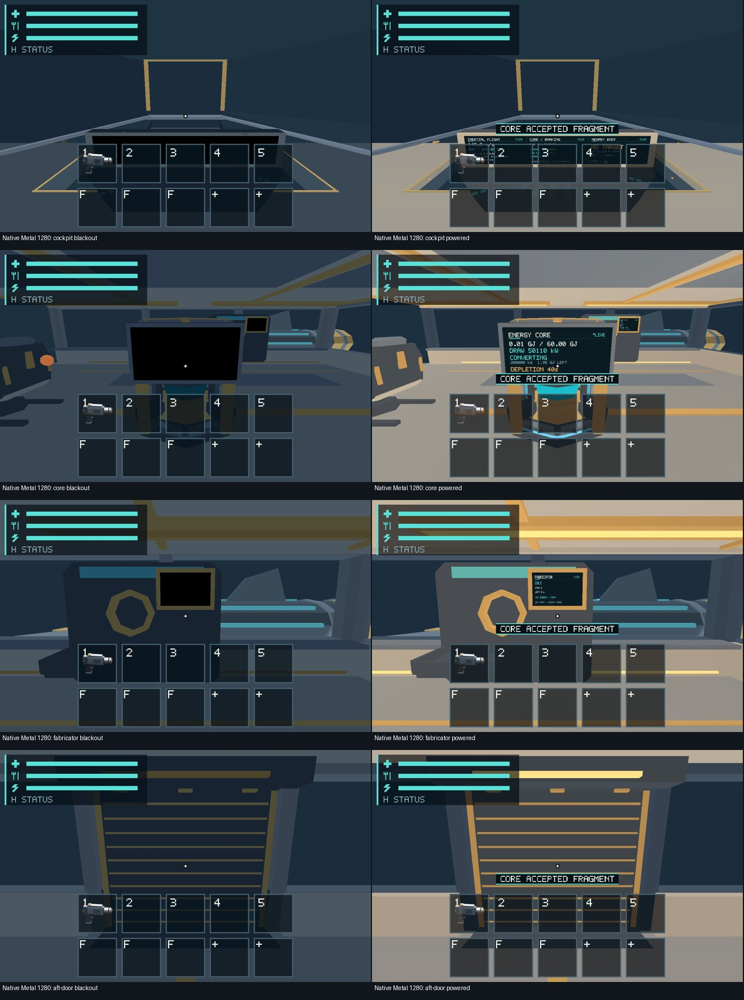
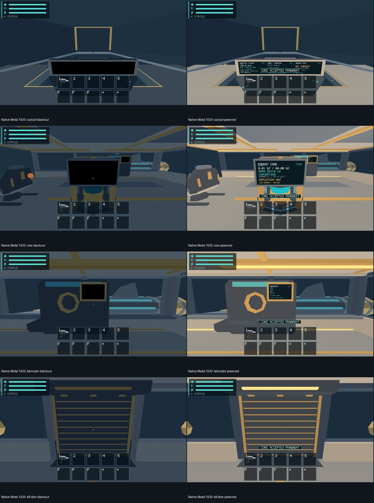
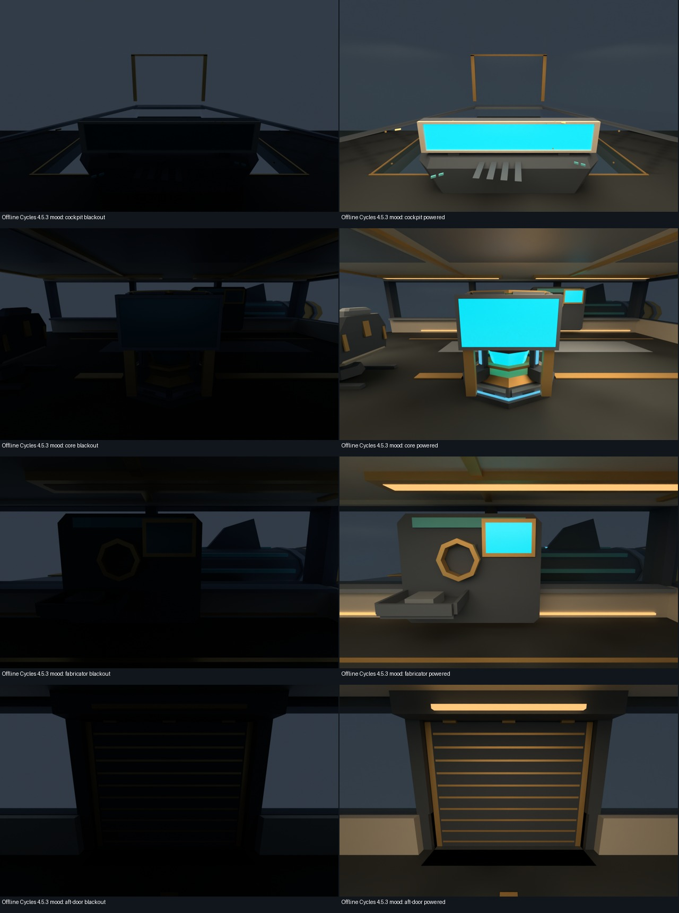

# #483 — Native Scout lighting evidence

Collected 2026-10-23 on Apple M1 iMac21,1, 16 GB, macOS 26.2. Native image
and offline mood-reference delivery is complete. Foreground timing is **pending**:
two attempts failed admission while the desktop was locked. No appearance,
mask/tolerance, baseline, full normal-play FPS or presentation-budget approval
is granted. Remaining acceptance is tracked in
[#566](https://github.com/mr-exception/salimon/issues/566), coordinated with
[#561](https://github.com/mr-exception/salimon/issues/561).

## Native power pairs

- [1280x800 candidates](native-1280/corpus.json) and
  [1920x1080 candidates](native-1920/corpus.json): actual Metal / Apple M1,
  scale factor 2, four shared cameras, blackout/powered, three repeats each
  (48 original PNGs). Each corpus records binary/revision/fixture/image hashes.
- Source `97f3b9fb0202cb5a01a30628237ff73c6586d246`, binary SHA256
  `0e137f65ed29127ee4c91bbc48c61082f418d10daca308bdb044bea4707ce16c`.
  Later `f7b592d` adds focus/occlusion fields to the diagnostic log only;
  production shader and physics hashes are in [provenance](evidence/provenance.json).
- Both expanded production routes passed **37/37 steps**. The fixture begins
  with genuinely depleted Core power, consumes the carried fragment through
  production intake and advances one 100 ms tick to restore the bus. Named
  cameras override presentation only. Raw step/protocol/result metadata is
  retained under [1280 evidence](evidence/native-1280-runs/) and
  [1920 evidence](evidence/native-1920-runs/); duplicate PNGs are omitted there.
- [1280 repeats](repeat-1280/scout-lighting/summary.json) and
  [1920 repeats](repeat-1920/scout-lighting/summary.json): **16 comparisons each,
  zero changed pixels**. This is temporal stability, not appearance approval.
- Direct GPU captures work with an unavailable desktop. They do not establish
  foreground presentation timing or physical display readability.

Review sheets are navigation aids; inspect original PNGs for final decisions.





Inspection: blackout retains the documented cool visibility floor, suppresses
warm fill/electrical emission and blanks physical displays; powered captures
restore warm zones and screen content. Colored housing albedo remains visible
in blackout. Core/Fabricator housing and aisle edges remain distinguishable;
cockpit glass/posts and aft-door frame/strip remain present. Large HUD bands can
obscure lower consoles, especially at 1280. This observation is not owner art,
readability or baseline acceptance. Original materials, geometry, budgets and
production shader remain unchanged by this PR.

## Read-only offline mood references

[Eight original Cycles PNGs](offline/) use the existing reviewed
`models/assets/ships/salimon-scout/preview_lighting.py`. No blend/GLB/asset was
changed. Supported official **Blender 4.5.3 arm64** was run from a read-only DMG;
the installed Blender 5.2.2 was not used or modified. Official DMG SHA256:
`73ea841053b55404bb3a71a9a22366f1f8821787fe5c899f8b55a7fff929d01b`.
[Render log](evidence/blender.log): all eight cameras/power images saved,
1280x800, Cycles CPU, 16 samples. The final tiny Blender cleanup allocation
warning is retained; this is not a process/GPU memory acceptance test.



Both paths read `scout-cameras.json`, use inverse ship-axis conversion,
70-degree vertical FOV and 0.05-metre near clip. Comparable named camera
framing was inspected. Offline shadows/indirect light/PBR and bright cyan
monitor surfaces differ deliberately from native vertex fill/screen atlas;
blackout is much darker offline. These are separate mood references, never
native PBR, light-transport or baseline certification.

## Matched timing preparation and rejected attempts

`client/runtime/src/app.rs` now permits complete existing frame records when
`RUST_LOG=info,salimon_client::frame=trace` is explicitly enabled. Default debug
sampling remains frame 1/every 300. Records include focus and occlusion.
No tick, contact, interpolation, renderer allocation or gameplay rule changed.
Logging overhead must be included identically in both variants.

[Control patch](evidence/control.patch) replaces only historical pre-#463
fill/emission expressions within current shader interfaces. It is an expression
ablation, **not an exact historical whole-game baseline**. Separate target
folders and [source hashes](evidence/provenance.json) establish identical runtime
and physics. [Current](evidence/build-current-final.json) and
[control](evidence/build-control-final.json) identify the final release binaries.
The control is diagnostic only and is not installed in the production branch.

[Collector](frame_reference.py) and [admission parser](frame_data.py) prepare
three repeated 3-second windows per camera/power state after 0.75-second warmup,
with a minimum 100 consecutive focused/non-occluded frame records, exact native
context and unchanged authoritative source state. This is frozen E2E rendering
(`ticks=0`), not normal-play simulation. CPU render, latest GPU and frame tails
would describe only that workload; all raw spikes and warmup logs are retained.
GPU duration parsing preserves units; CPU/frame text rounds to 0.001 ms.

Both attempts stopped **before any accepted window**:
[PID focus guard](evidence/frames-control.log) found frontmost PID 405
`loginwindow`, not target 87950; the
[AX helper retry](evidence/frames-control-ax.log) reported window geometry
unavailable. [Raw first attempt](evidence/frames-control/) and
[retry](evidence/frames-control-ax/) retain focus responses and logs (large text
losslessly gzip-compressed). Fast unfocused GPU records are rejected, not FPS
or budget evidence. The reference Mac must be unlocked to resume #566.

From the repository root, with diagnostic binaries and the native focus helper:

```sh
python3 reports/issue-483/frame_reference.py --binary /absolute/control.app/Contents/MacOS/salimon-client --helper /absolute/native-input-helper --output artifacts/483-control-new
python3 reports/issue-483/frame_reference.py --binary /absolute/current.app/Contents/MacOS/salimon-client --helper /absolute/native-input-helper --output artifacts/483-current-new
python3 -m unittest discover -s reports/issue-483 -p 'test_*.py' -v
```

Run lanes serially with no build/render work competing. Never admit locked,
background or software results, silently drop spikes, promote candidates or
substitute a structural zero-draw delta for measured performance.

## Checks and documentation impact

- Workspace tests: **850 passed, 30 opt-in ignored**, no failures
  ([log](evidence/workspace-tests.log.gz)). Workspace build, Clippy all targets
  with warnings denied and format check passed (logs beside this report).
- Isolated control release physics/renderer tests passed
  ([log](evidence/control-tests.log.gz)).
- Four parser/admission tests pass, including unknown GPU records, lost focus,
  occlusion, short/gapped windows, changed source state and wrong context.
- Python syntax, maintained documentation links/paths and parent-base impact,
  whitespace checks passed at final delivery.
- Updated runtime architecture and scripts usage for opt-in frame logging;
  canonical Scout presentation and #463 report now link actual native evidence
  and the remaining #566 gate. Owning runtime architecture/invariants and
  renderer architecture/invariants remain authoritative. Domain ownership,
  shader/material contracts and physics invariants are unchanged. Source/test
  mapping is `app.rs` frame logging → runtime architecture/scripts README;
  `scout-fixtures.json` + shared camera/preview → canonical Scout presentation;
  report collector → fail-closed admission tests above.

All preserved evidence files are hashed in [SHA256SUMS](SHA256SUMS).
