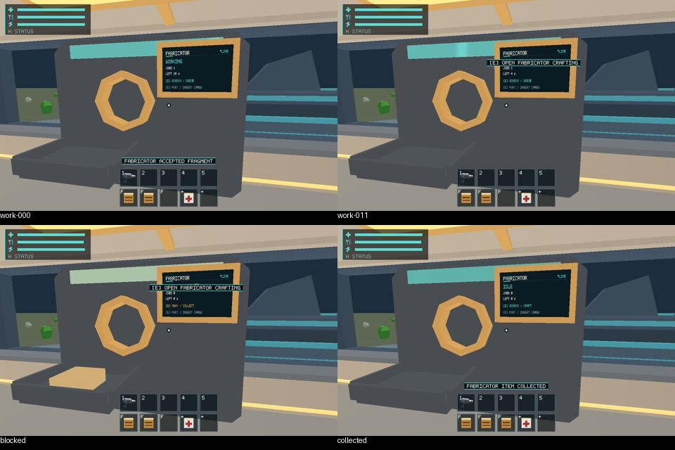
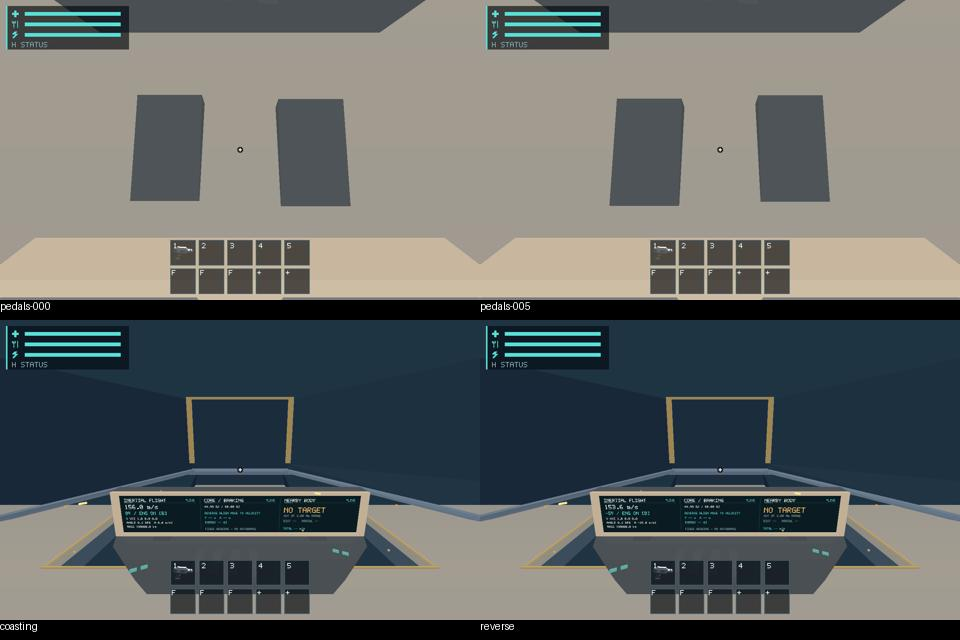

# #489 — Scout machinery cloud walkthrough

Delivered 2026-10-23, third in the review stack after #483 / PR #571 and #485 /
PR #572. Production session/window walkthroughs pass; original GPU frames and
stepped motion clips are retained. Human readability/motion and hardware budget
approval remain separate. No gameplay rule, shader, collider, mass policy, asset
or scanner authority changed.

## Evidence and initial conditions

[Environment/source/binary hashes](environment.json) identify the final clean
capture revision `4b64c15`, Linux x86_64 / AMD EPYC 9V74, Rust 1.99.1,
Python 3.12.14, Xvfb, Mesa 25.0.7 llvmpipe / LLVM 19.1.7 Vulkan, 1280x800,
scale 1. Actual per-frame context and full authoritative state are retained under
[walkthrough evidence](evidence/walkthrough/). Large JSON/protocol/log files are
losslessly gzip-compressed; original PNGs are unchanged. Metadata retains original
capture paths. [Manifest](evidence/walkthrough/manifest.json) records the binary,
revision, input method and simulation-time boundary.

Two opt-in E2E initializers use ordinary new-run starter supplies and the existing
Core-restart exact 2 kg held-fragment fixture. `scout-fabricator` starts landed
near the physical machine; `scout-work-blackout` starts with a queued unfunded
ration and the existing Core aim/blackout. Initial character state and full save
validate. These are explicit placement/energy fixtures, **not physical mining or
travel evidence**. After initialization, existing E/look/menu/tick commands retain
production range, sight, location, power, identity and transaction gates. No new
mutation protocol operations or synthetic renderer DTO commands were added.

## Production walkthrough results

| Route | Retained frames | Verified behavior |
| --- | ---: | --- |
| Fabricator | 15 | Physical input consumes exact carried ID, transfers mass without duplication; physical monitor opens the real recipe menu; enqueue/funded progress; paused state stays frozen; blocked tray and exact job/unit collection; repeat E cannot duplicate output |
| Work blackout/Core | 11 | Unfunded job stays at zero progress; real Core intake removes the held identity; production ticks restore power/conversion and resume funded work; physical screens/emission restore |
| Cockpit | 14 | Production left/right input reaches rudder -1/+1; powered forward thrust, zero-thrust coast and signed reverse; camera follows the presented ship pose |
| Ramp | 16 | Real doorway interaction opens the ramp, reverses at fraction 0.5714 while still moving, and closes to zero; no new animation controller |

Every GPU capture preserves ship/player/machinery/Fabricator/carrying/world/
survival state before versus after readback. Native pause plus stepped time keeps
machinery unchanged. Two portable regressions additionally prove full-save
byte/state stability while paused and identical immediate feedback after restore,
including a resumed conversion/job: no hidden animation time or replay.

The unchanged production shader maps normalized rudder to opposed **up to 1.5 cm**
pedal travel; captures reach both full input signs. Renderer tests preserve role
exclusion for hull/support/ramp collision surfaces and the three-screen physical
orientation contract. `all_physical_screens_read_left_to_right_from_the_cabin_side`
passes with the existing import-only Fabricator U correction. The screen reads
left-to-right in the retained close images; subjective readability is still #561.

Six existing native evidence routes passed **331/331 steps**: landed Earth,
boarding ramp, cockpit wide monitor, landing gear, cargo flight and cargo blackout.
Three full native baseline routes passed **466/466 steps**: inertial flight,
cargo flight and cargo blackout. These exercise existing landing/takeoff assists,
authored support/door geometry, coherent carried/loose cargo, mass/power/identity
and flight/collision assertions through the actual window adapter. Originals,
full result/state/protocol logs and summaries are in
[native evidence](evidence/native-evidence/summary.json) and
[native baselines](evidence/native-baselines/summary.json).

## Motion and close views for review

Clips concatenate actual frozen GPU captures at their **simulation** sample rate:
Fabricator 2 fps (500 ms steps), Core 5 fps (200 ms), pedals 10 fps (100 ms), ramp
12.5 fps (80 ms). They are not wall-clock recordings, real-time render rates,
normal-play interpolation acceptance or physical OS-input evidence. Original
frames and complete states are canonical; review sheets are navigation aids.

- [Fabricator work sweep](media/fabricator.mp4) / [work, blocked and collected sheet](media/fabricator-review.jpg).
- [Core conversion/restoration](media/blackout.mp4) / [power/work sheet](media/blackout-review.jpg).
- [Opposed pedal motion](media/cockpit.mp4) / [pedals, coast/reverse sheet](media/cockpit-review.jpg).
- [Ramp interruption/reversal](media/ramp.mp4) / [ramp sheet](media/ramp-review.jpg).





Inspection caught an initial evidence defect: the first pedal camera was inside
the pilot seat and showed an opaque surface. Its protocol assertions passed,
but it **failed the visible-pedal requirement**. The [rejected originals/state](rejected-pedal-camera/)
are retained explicitly, not approved. Moving the camera clear of the seat in
`4b64c15` exposes both pedals; the entire four-route capture was rerun from that
clean tracked revision. No production shader/geometry change was needed.

## Commands and validation

From repository root with native dependencies installed, an active X display and
lavapipe selected (cloud used `/workspace/.salimon-tools/env.sh` and the ICD
`/workspace/.salimon-tools/sysroot/usr/share/vulkan/icd.d/lvp_icd.json`):

```sh
cargo build --workspace --locked --offline
cargo test --workspace --locked --offline
cargo test -p salimon-client --locked --offline scout_walkthrough -- --nocapture
cargo test -p salimon-client --locked --offline scout_reference
cargo clippy --workspace --all-targets --locked --offline -- -D warnings
cargo fmt --all -- --check
python -m unittest discover -s scripts -p 'test_*.py'
python -m py_compile reports/issue-489/walkthrough.py
DISPLAY=:106 WGPU_BACKEND=vulkan python reports/issue-489/walkthrough.py --binary target/debug/salimon-client --output artifacts/489-clean
python scripts/check_docs.py
python scripts/check_docs.py --base cloud/485-audio-verification
```

For existing native routes, run each from the same graphical environment:

```sh
python scripts/salimon-test run scenarios/evidence/landed-earth.json --binary target/debug/salimon-client --artifacts artifacts/489-routes/landed-earth --screenshot-command '["native"]'
```

Repeat that command for evidence `boarding-ramp`, `cockpit-wide-monitor`,
`landing-gear`, `cargo-flight`, `cargo-blackout`; use ordinary `scenarios/`
paths for the three baseline routes above. [Exact run logs](logs/) retain each
path/result; [driver](walkthrough.py) reproduces the four detailed motion routes
and supports `--lane` for focused retries. Output roots must be fresh.

- Workspace: **866 passed, 31 ignored**, no failures.
- New portable walkthrough tests: **2 passed**; final camera regression: **1 passed**.
- Workspace/client build, all-target Clippy with warnings denied, format,
  118 Python runner contracts, Python syntax, offline docs/links/base-impact and
  whitespace checks passed. Raw output is in `logs/`.
- Graphical results: all four final routes / 56 frames pass; existing nine routes
  pass 797 total steps. The first pedal evidence defect remains rejected above.
- No new Blender/offscreen synthetic-DTO evidence, hardware GPU counters, Metal,
  physical DPI/OS input or hardware budget measurement was run or claimed.

## Remaining criteria and documentation impact

[#561](https://github.com/mr-exception/salimon/issues/561) receives subjective
pedal-travel visibility, slow work-sweep readability, steady blocked cue, Core
emission hierarchy, Fabricator text/orientation/readability, ramp motion and
cargo/aisle visual continuity review using the linked originals/clips. No baseline,
mask/tolerance or appearance approval is automatic. Physical normal-play input,
interpolation/display and platform experiments belong to
[#557](https://github.com/mr-exception/salimon/issues/557). Matched whole-frame
CPU/render/latest-GPU/frame-tail budgets on actual hardware belong to
[#563](https://github.com/mr-exception/salimon/issues/563); software Vulkan captures
establish none of those hardware thresholds. Missing actual GPU metrics remain
unavailable. Source rights/balance remain [#537](https://github.com/mr-exception/salimon/issues/537).
Scanner feedback remains [#503](https://github.com/mr-exception/salimon/issues/503)
after [#430](https://github.com/mr-exception/salimon/issues/430), without new scope.

Runtime architecture, maintenance map, Scout presentation, validation and runner
usage document the two initializers, existing adapters, new close cameras and
remaining owners. The #464 historical report links these new results without
rewriting its original failures. Source/test mapping: `e2e.rs` ->
`scout_walkthrough.rs` initialized/save-validated physical transactions and
pause/restore tests; `scout_reference.rs` -> existing finite/translated-camera
regression extended to both new views; `walkthrough.py` -> real-window captures,
state invariance and retained protocol; existing renderer/flight/ramp/cargo tests
remain the owners of shader/orientation, transform/collision and mass/power rules.
Runtime/renderer architecture and invariants were checked; ordinary startup,
controller ownership, physics, assets and save schema remain unchanged.
