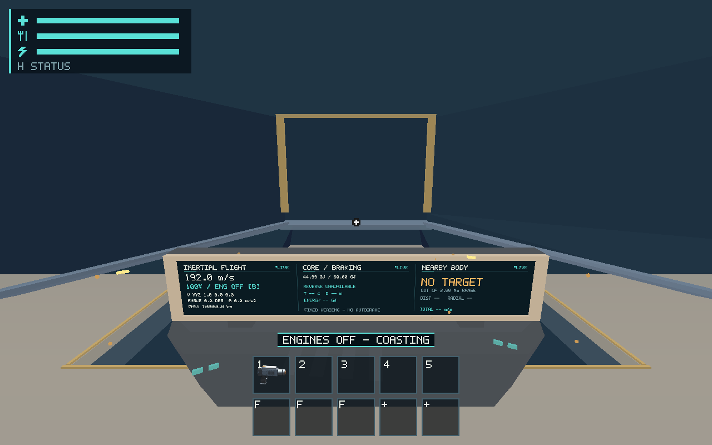

# #498 — Funded-impulse engine cloud verification

The production engine route and all seven realistic-flight scenarios pass on
Linux software Vulkan. The approved coefficient, power draws, acceleration,
momentum, mass, landing limit and assist paths are unchanged. A new regression
checks the real two-generation disk store and normal launch adapter with engines
off, signed throttle selected and nonzero momentum; refueling does not enable
engines, and a fresh explicit enable restores thrust.

## Evidence and reproduction

[Provenance](provenance.json) and [environment](environment.txt) identify the
source/binary, compiler, CPU and OS. Captures use the debug executable built from
`593c5ac`, Xvfb 1280x800, simulated scale 1, Mesa 25.0.7 llvmpipe / LLVM 19.1.7,
Vulkan. The later source change adds only the disk regression. Inputs are the
production E2E protocol with desktop input isolated; native key-admission tests
are separate from physical input evidence. Fixtures are explicit clear-space,
cargo and refuel initial conditions, not measured resource acquisition.

The [driver](verify.py) records ON/idle, full forward, OFF with selected throttle,
OFF/coast, full reverse, steering and cockpit exit through production adapters.
All six GPU captures assert unchanged authoritative state before/after readback.
Forward/reverse velocity deltas match 100/50 MW times funded duration divided by
100,000 kg; engine-off retains momentum and pays service loads without propulsion.
Pause blocks toggles, and leaving cockpit revokes switch authority.



[Originals and full state](evidence/engine/) include actual instruments, adapter,
viewport, scale and observed render diagnostics. [Native scenario evidence](evidence/flight/)
retains result/state/protocol and initial conditions for inertial flight, Core
restart, crash recovery, cargo flight, moving EVA, cargo blackout and landing
speed cutoff: **7 pass, 925 steps**. The same routes cover the <=20 m/s landing
gate, crash recovery, refuel, cockpit exit and landing/takeoff handoff.

Portable ship tests establish exact joules/mass, partial funding, service/assist
isolation and six-second/50 m rest-to-rest takeoff. Runtime tests cover repeat,
focus/lifecycle reset and modal admission. [Focused engine tests](engine-tests.log),
[flight regressions](flight-tests.log), [disk regression](propulsion-tests-final.log)
and [workspace output](workspace-tests-final.log) retain actual results.

From repository root, source `/workspace/.salimon-tools/env.sh` on this executor
(ordinary installed Rust/native dependencies suffice elsewhere). Graphical
commands require an active X display and the installed lavapipe ICD:

```sh
cargo build --workspace --locked
cargo test --workspace --locked
cargo test -p salimon-client --locked engine
cargo test -p salimon-client --locked flight_regression
cargo test -p salimon-client --locked propulsion_tests
cargo clippy --workspace --all-targets --locked -- -D warnings
cargo fmt --all -- --check
DISPLAY=:99 WGPU_BACKEND=vulkan VK_DRIVER_FILES=/workspace/.salimon-tools/sysroot/usr/share/vulkan/icd.d/lvp_icd.json python3 reports/issue-498/verify.py --binary target/debug/salimon-client --output artifacts/new-498-engine
DISPLAY=:99 WGPU_BACKEND=vulkan VK_DRIVER_FILES=/workspace/.salimon-tools/sysroot/usr/share/vulkan/icd.d/lvp_icd.json python3 scripts/salimon-test suite --group realistic-flight --binary target/debug/salimon-client --artifacts artifacts/new-498-flight
python3 scripts/check_docs.py
```

## Retained failed attempts and limits

The first sandbox invocation could not contact the proxy or bind X sockets;
enabling the execution tool's network permission repaired setup. The offline
cache initially lacked sha2. [Initial build/test log](workspace-tests.log) is
retained; it is not a test pass. The first driver incorrectly expected 100 ms of
completed simulation from a 100 ms request: the runtime completed 96 ms and
retained 4 ms backlog, correctly. [Rejected captures/state](evidence/rejected-100ms-assumption/)
and [failure](engine-route.log) remain; final requests use exactly six 16 ms ticks.
The first disk test used the grounded new-run pose with flying velocity and
collided with Earth on its next tick. [Failure](propulsion-tests-first.log) remains;
the corrected explicit clear-space fixture passes. No game rule was changed.

Human handling comfort, instrument readability and quiet engine-off audio remain
[#561](https://github.com/mr-exception/salimon/issues/561); physical B/Up/Down,
focus/repeat/device and OS lifecycle qualification remain
[#557](https://github.com/mr-exception/salimon/issues/557). Exact baseline tuning
is preserved; balance decisions stay [#537](https://github.com/mr-exception/salimon/issues/537).
Hardware GPU counters, matched release frame tails, hardware FPS and Metal are
**unavailable/unrun**, owned by [#563](https://github.com/mr-exception/salimon/issues/563).
Recorded software timings are diagnostics, not hardware budgets. No baseline,
mask/tolerance, numerical contract or Jump Drive implementation is approved here.

## Documentation impact

No production behavior/API/schema/ownership changes. The added regression is in
`client/runtime/src/session/propulsion_tests.rs`; it verifies the existing
[runtime architecture](../../client/runtime/architecture.md),
[runtime invariants](../../client/runtime/invariants.md),
[ship invariants](../../client/ship/invariants.md) and
[save contract](../../docs/save-contract.md). These owning guides remain accurate.
The validation guide links this cloud report and reproduction route. Documentation
and whitespace checks pass; original PNGs are retained without baseline promotion.

CI source-impact follow-up: the initial hosted Ubuntu documentation step failed
because the runtime source regression lacked an owning-guide change, even though
the ordinary local link check passed. The runtime AI guide now documents the
exact disk regression and unchanged engine/save contract. The initial failure is
retained in `ci-docs-first-failure.txt`; scoped source-impact validation passes
with the guide update. Later PRs already passed their hosted checks with the same
engine test; this correction also re-runs the first PR's hosted gate.
