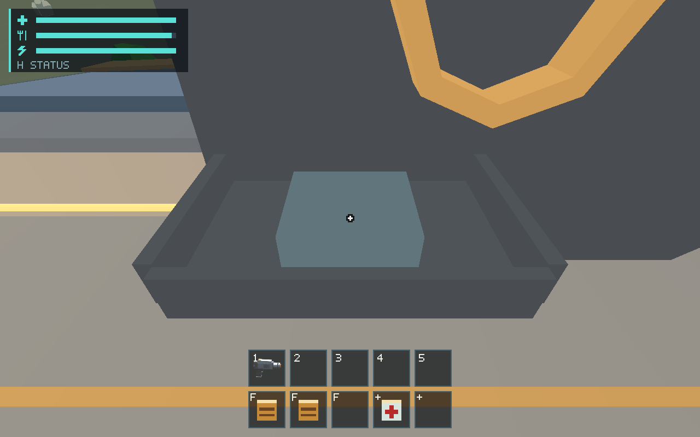
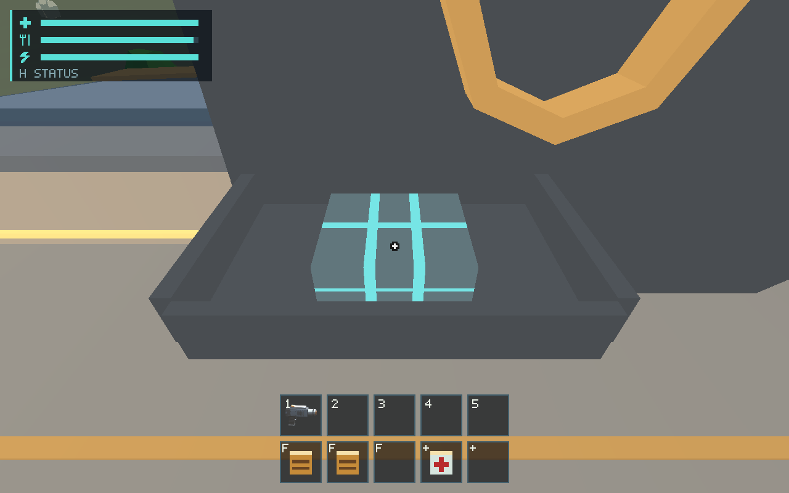

# #515 — Recovery installation, paid progress and cloud presentation

Fourth delivery in the requested stack, after [PR #586](https://github.com/mr-exception/salimon/pull/586).
The actual native protocol route passes from physical intake through crafting,
tray collection/auto-install, cabin walking, Archive R start/stop and both paid
records. Source tests verify exact concurrent joules, schema migration and
Save Now/relaunch/restart without offline work or duplicate installed mass.
A visible missing-circuit-trace defect was found and fixed in the package import.

## Transactions and persistence

The opt-in `scout-recovery` fixture explicitly starts near Fabricator with a held
2 kg iron identity and 0.5 kg silicate already in its bin; ordinary starter supplies
remain present. It grants no module, job or progress and is **not measured mining
or acquisition**. After setup, the [driver](verify.py) uses production controls:

- E intake removes the exact held identity while retaining total mass; physical
  screen E opens the normal menu. Enqueue uses the existing recipe, rejects a
  duplicate pending module, and finishes after 60 funded simulation seconds.
- The 0.75 kg component tray's exact job/unit becomes installed source on E
  collection with unchanged total mass. Repeated E cannot duplicate it.
- Real forward movement crosses the cabin, then aim/range/interior-gated E opens
  Archive. R starts/stops work; stopped work preserves paid joules without refund.
  Pause freezes source; fresh E reopens the transient reader after resume.
- Live 16 ms production ticks pay exactly 3 GJ and 5 GJ, then stop each record.
  Partial/unverified, recovered/unverified and irrecoverable/partial text preserve
  unknown source/time/location and NO NAVIGATION FIX. Both completed records are
  captured at 1280x800 and 1920x1080; no coordinates or narrative leads are granted.

[Final native route](evidence/515-route-final/) contains **nine original GPU frames**,
complete state/protocol, source/binary hashes and actual adapter/viewport metadata.
Large JSON is losslessly gzip compressed. Source revision is `057c69d`; Linux
x86_64, Mesa 25.0.7 llvmpipe/LLVM 19.1.7 Vulkan, Xvfb, debug profile, scale 1.
Desktop input is isolated; 96 ms requests advance six ordinary 16 ms ticks.
Cameras for the machine/package are explicit reference overrides; the Archive
images use the walked player's actual view. Captures cannot mutate source state.

[Eight recovery tests](recovery-tests-final.log) pass; one optional CPU raster
writer is ignored. A separate fixture/purity test passes. New regressions verify:

- Simultaneous 100 MW forward thrust, service loads, real crafting and 5 MW data
  work: exact aggregate Core debit, exact paid recovery/crafting duration and
  velocity from propulsion joules alone, including installed mass.
- Schema 6 with existing raw resources and a partially worked job migrates to no
  module/progress while preserving job/resources/Core exactly.
- Real asynchronous Save Now reaches a verified UTC receipt; normal disk launch
  after seven days preserves exact installed identity/mass/paid/active source
  without adding recovery work or joules. Verified restart clears module/progress.

Existing tests also cover real domain mining/carry/Fabricator/Core conversion,
emergency-floor-limited work, blackout, refueling, pause/focus/native R, abort
without refund, continuation, malformed/duplicate sources and no replayed energy.
These declared deposit/placement tests do not measure a physical gathering route.

## Missing package traces: matched correction

Inspection of the first successful transaction route found that its component
package was plain grey. The [close before-fix probe](evidence/515-tray-before/)
confirms it. Authored `Fabricator_Output` UVs contain world-X/Z coordinates,
while the existing component/food/medical shader expects a normalized face.
They missed all circuit/stripe/cross regions and collapsed vertical faces.

`ship_mesh.rs` now maps only that named package from transformed bounds and its
flat face normal into [0,1] coordinates. Geometry, authored GLB/Blender sources,
shader colors, draw/buffer count, mass, identity and physics are unchanged.
The shared output mapping also restores the existing food/medical artwork;
no category or recipe tuning changes. All triangle UVs must span a noncollapsed
full face in the loaded-geometry regression.

[Matched source comparison](tray-comparison.json) asserts identical ship,
recovery, Archive, Fabricator, player, carrying, world and survival state for
before/after tray frames. Only the imported artwork mapping changes. Originals
are retained; no baseline/mask/tolerance or human approval is promoted.




The initial full route is retained in `515-route`: its transactions passed,
its package presentation failed. The close probe is explicitly not final
acceptance. The final full route passes after the fix. The existing food
Fabricator route is rerun to cover the shared package path. Final renderer tests:
**75 passed, 14 opt-in ignored**, shader validation included. Full workspace tests
passed after runtime changes; final renderer suite, build and workspace Clippy
passed again after the UV correction. Python tooling/syntax, fmt, docs/source
impact and whitespace checks pass. Logs remain beside this report.

An initial observation implementation tried to read private recovery source
outside its owner and failed compilation; the final immutable owner method fixes
that boundary. Clippy rejected constant-size `chunks_exact` in the new regression;
the final test uses `as_chunks`. Both initial logs are retained as failures.

## Reproduction

Use the Xvfb/native dependency setup documented in [#498](../issue-498/README.md).
On this executor source `/workspace/.salimon-tools/env.sh` and set `DISPLAY=:99`,
`WGPU_BACKEND=vulkan` and
`VK_DRIVER_FILES=/workspace/.salimon-tools/sysroot/usr/share/vulkan/icd.d/lvp_icd.json`.

```sh
cargo test -p salimon-client --locked session::recovery
cargo test -p salimon-client --locked recovery_fixture
cargo test -p salimon-renderer --locked
cargo test --workspace --locked
cargo build --workspace --locked
cargo clippy --workspace --all-targets --locked -- -D warnings
cargo fmt --all -- --check
python3 reports/issue-515/verify.py --binary target/debug/salimon-client --output artifacts/new-515
python3 reports/issue-489/walkthrough.py --binary target/debug/salimon-client --output artifacts/new-515-food --lane fabricator
python3 -m unittest discover -s scripts -p 'test_*.py'
python3 scripts/check_docs.py
```

Power-restored physical Archive screens at both resolutions are captured in
[the preceding #505 report](../issue-505/README.md), with wider screen/scale
coverage in [#502](../issue-502/README.md). They are unchanged physical screen
presentation; the installed-work reserve/blackout/refuel assertions here are
source tests, not a new native installed-module blackout recording.

## Remaining review and documentation impact

[#561](https://github.com/mr-exception/salimon/issues/561) owns human per-image
review of the circuit package, installation presentation and partial/recovered/
unverified/irrecoverable screen readability; inspect before/after originals and
return exact hashes, reviewer/date and accept/reject. Physical R/input/focus/DPI
experiments remain [#557](https://github.com/mr-exception/salimon/issues/557).
Actual acquisition/route and provisional 1 kg/0.5 kg recipe, 0.75 kg mass,
60 s/1 MW craft, 5 MW/3–5 GJ work and 2 GJ reserve balance approval stay
[#537](https://github.com/mr-exception/salimon/issues/537). Automation changes none
of these values. Hardware GPU counters, release frame tails, Metal/hardware FPS
are unavailable/unrun under [#563](https://github.com/mr-exception/salimon/issues/563).
Future authored narrative/location leads remain #470 and its prerequisites.

Runtime/renderer README/AI/architecture/invariants, runner usage, maintenance map,
validation and [Recovery contract](../../docs/data-recovery-module.md) document the
fixture/observation/key alias, exact tests and import-only presentation correction.
Owning [runtime architecture](../../client/runtime/architecture.md),
[runtime invariants](../../client/runtime/invariants.md),
[renderer architecture](../../client/renderer/architecture.md) and
[renderer invariants](../../client/renderer/invariants.md) retain domain/GPU
separation. No new save/schema or simulation policy is introduced.
