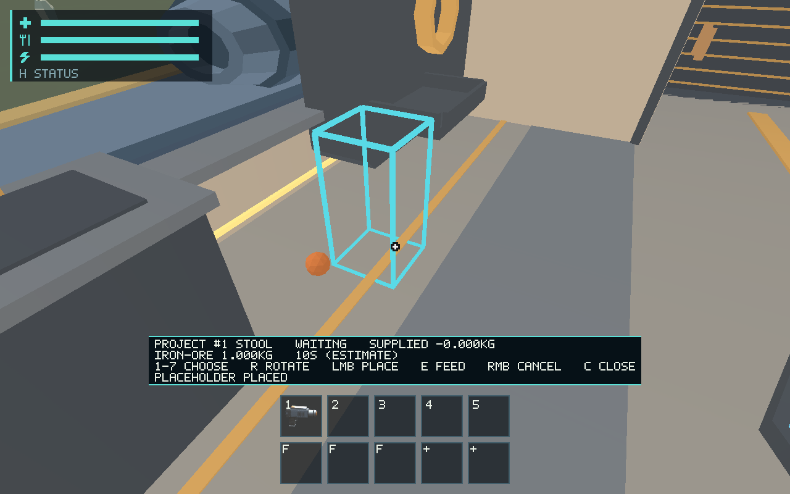
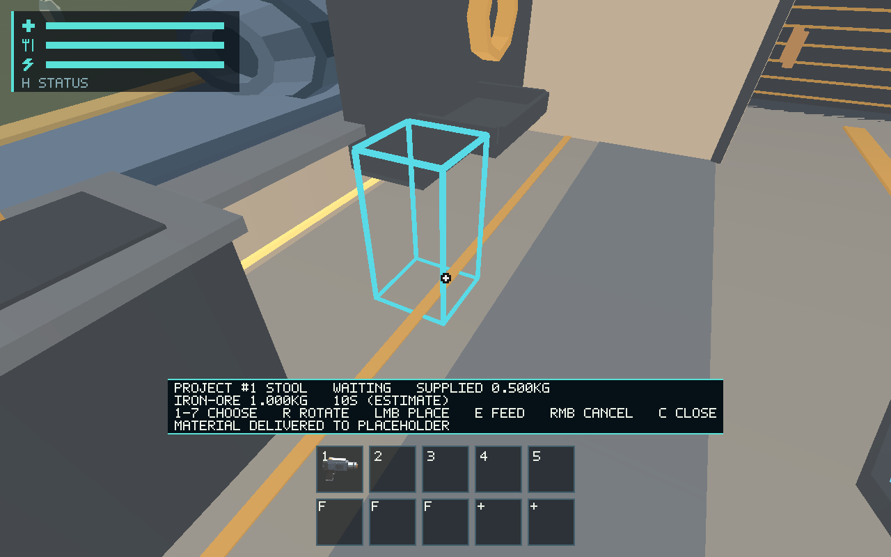
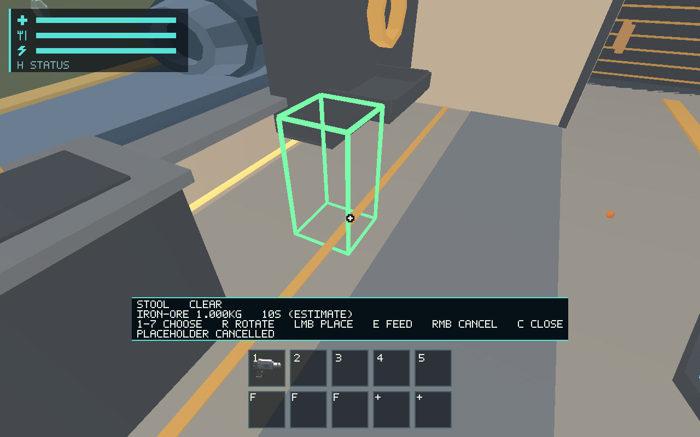

# #543 construction materials and physical refunds

Adds original material receipts to blueprint placeholders, one-carried-object
intake, exact resource/mass checks, oversized rejection, funded readiness and
monotone progress/refund contracts for #544. Cancellation preflights every nearby
physical return before removing the project. Schema 15 validates original IDs
across world, Core and projects and reconstructs the material mass ledger.
See [the maintained contract](../../docs/construction-materials.md).

The ordinary catalog remains `approved_economy:false`: #543's existing comment
requires explicit #537 owner approval. This PR delivers the mechanism behind that
gate. Native evidence explicitly enables only its isolated test catalog and seeds
a 0.5 kg carried sphere; this is not approval or a measured mining/acquisition
route. #544 retains timed energy/animation work; #545 geometry completion. A funded
project waits for those implementations; no free timer/solid object is invented.

## Validation

- `cargo test -p salimon-client --locked session::construction`: 8 passed.
- `cargo test -p salimon-ship --locked`: 100 passed, 1 existing ignored;
  includes 0/25/50/75/99/100%, multiple resources, integer rounding and invalid progress.
- `cargo clippy --workspace --all-targets --locked -- -D warnings`: passed.
- `cargo fmt --all -- --check`, `git diff --check`, `python3 scripts/check_docs.py`: passed.
- Runtime coverage includes wrong/oversized material, approval gate, intake mass,
  exact save/restore, corrupt allocator IDs, half-progress refunds and repeated cancel.
- `python3 scripts/salimon-test run scenarios/evidence/construction-materials.json --binary target/debug/salimon-client --artifacts artifacts/543/native --screenshot-command '["native"]' --summary`: 10/10 passed.

The native route uses production commands, actual wgpu 1280×800 screenshots,
Xvfb/Linux and Mesa software Vulkan. [Original state/protocol/logs](native/protocol.zip).
No physical device, Metal, hardware FPS, subjective art or balance approval is claimed.
Human presentation remains #561, device qualification #557 and budgets #563.
The missing ALSA development dependency was installed in the local tool sysroot.
Initial tests exposed a full-refund floating-point normalization; full receipts
now return their exact original material rather than a reconstructed equivalent.

The first broad workspace run included the pre-fix intake tests and failed those
two cases; the final focused rerun passes all eight. Broad suite results are not
reported as a pass for that earlier revision.
