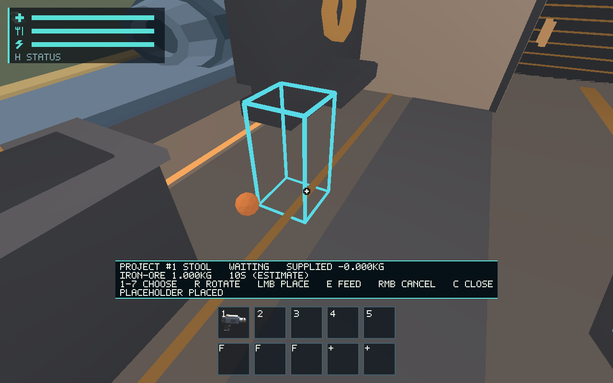
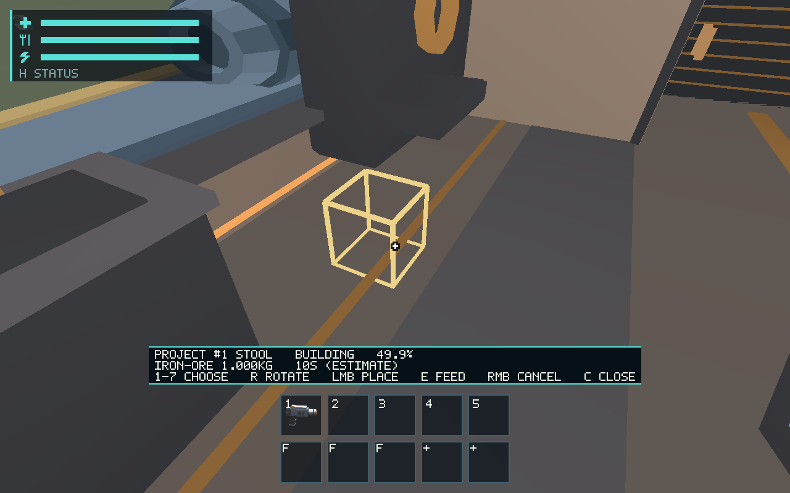
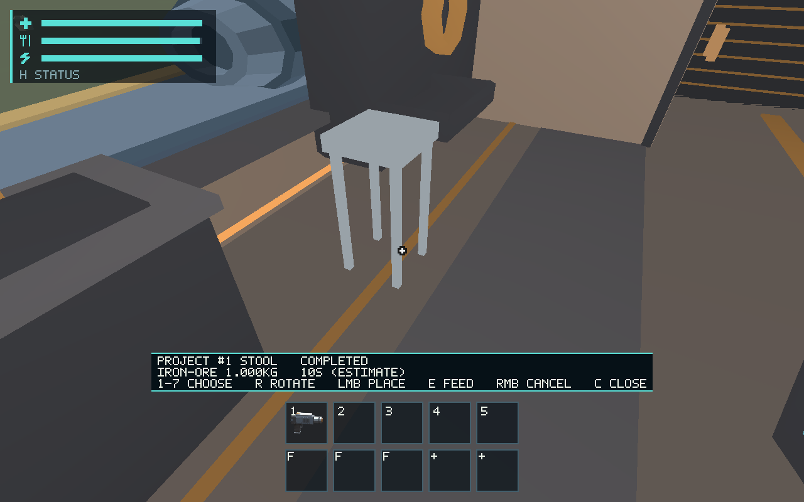

# #544 — Core-funded automatic construction

Implements automatic active-clock work, per-blueprint power tuning, integer-nanosecond
paid progress, reserve/safety/damage pauses, exact continuation, proportional physical
cancellation and schema-17 validation. Fully funded work needs no additional action
or nearby player. Stools and partitions commit real shared render/collision geometry
once, retaining original IDs and exactly one receipt-mass contribution. Completion
triggers a discrete checkpoint. A bounded spatial machine cue reuses existing synthesis.

The [maintained contract](../../docs/construction-progress.md) maps domain/runtime
ownership, power tuning and verification. It explicitly transfers complex physical
installation to existing [#545](https://github.com/mr-exception/salimon/issues/545)
and [#547](https://github.com/mr-exception/salimon/issues/547). Those projects stop
one microsecond before completion, remain cancellable and spend nothing further;
they never become fake solid rooms or operational modules. Exterior stop/takeoff
latches remain #546; damage producers/dismantling #549; chronological offline work
#550/#433. These downstream features are not claimed as implemented by this PR.

## Validation

Environment: Linux x86_64, Rust 1.99.1 (58cf8f9c3 2026-10-13), existing local Rust
and graphics sysroot. The missing ALSA development package/link was added locally;
initial build failures were setup failures, not passing checks.

- `cargo test --workspace --locked`: passed; [raw output](checks/workspace-tests.log).
  This broad run covers the implementation before the final additional cargo,
  complex-installation and sound tests; the final focused run below covers those.
- `cargo test -p salimon-client --locked construction`: 15 passed, including exact
  energy admission, player/cargo obstruction, damaged/pause handling, save rejection,
  frame partitioning, unattended completion, refunds, checkpoint and audio gates.
  [Raw output](checks/construction-tests.log).
- `cargo build --workspace --locked`: passed, [log](checks/build.log).
- `cargo clippy --workspace --all-targets --locked -- -D warnings`: passed,
  [log](checks/clippy.log).
- `cargo fmt --all -- --check`, `git diff --check`, `python3 scripts/check_docs.py`:
  passed. Source-impact validation is also run after staging/commit.

## Production graphical route

With Xvfb and lavapipe active:

```sh
python3 scripts/salimon-test run scenarios/evidence/construction-build.json --binary target/debug/salimon-client --artifacts artifacts/544/native-final --screenshot-command '["native"]' --summary
```

14/14 steps passed. The explicit fixture seeds one carried 1 kg iron sphere; E
feeds the real project, 312 ticks reach 49.92%, and 313 further ticks complete it.
RMB cannot cancel the completed object. Captures use actual production wgpu at
1280x800, not a CPU raster. [Protocol/state/logs](native/protocol.zip),
[binary/source/context hashes](native/context.json). The original 5-second capture
attempt timed out at halfway; a subsequent attempt encountered a stale X display.
Both remain in [failed attempts](native/failed-attempts.zip). The successful run
uses a fresh Xvfb display and explicit 60-second step deadlines.





Human appearance/listening remains [#561](https://github.com/mr-exception/salimon/issues/561):
review these original views and the restrained spatial machine cue, including the
1 m catalog stool height and reveal readability. The executor has no physical audio
device, so speaker listening is unrun. Physical device/OS checks remain #557 and
hardware/Metal FPS budgets #563; software Vulkan captures establish none of those.
No baseline promotion, source permission, playtest balance or hardware pass is claimed.

Additional checks: `cargo test -p salimon-ship --locked` passed (102 tests,
1 existing ignored); `python3 -m unittest discover -s scripts -p 'test_salimon_test.py'`
passed (21 tests). [Ship log](checks/ship-tests.log), [runner log](checks/runner-tests.log).
The final source replaces issue numbers in the unavailable-installation UI message
with plain product text; final focused tests/Clippy include that wording change.
The retained graphical binary and context predate only that wording/test change,
which does not affect the captured stool route.
