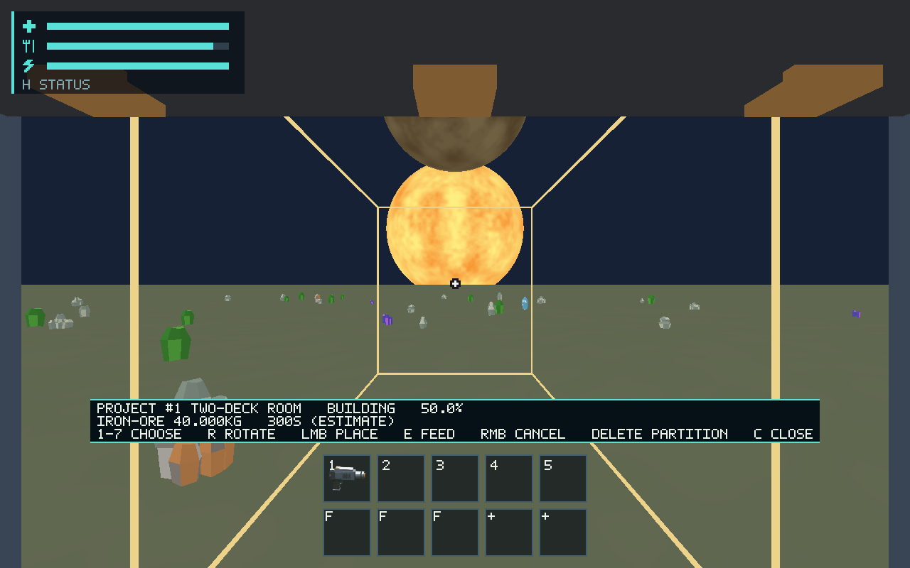
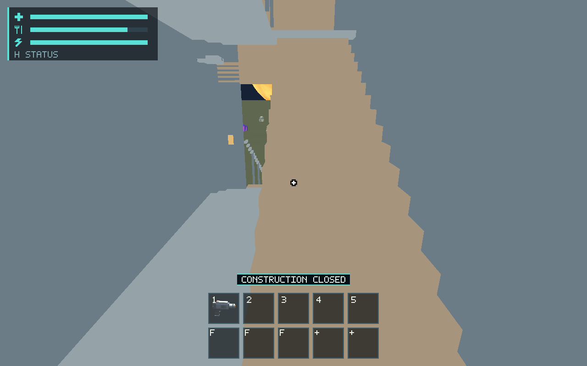
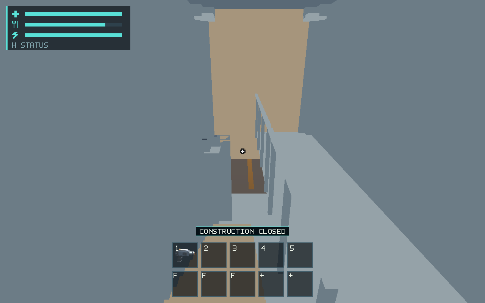
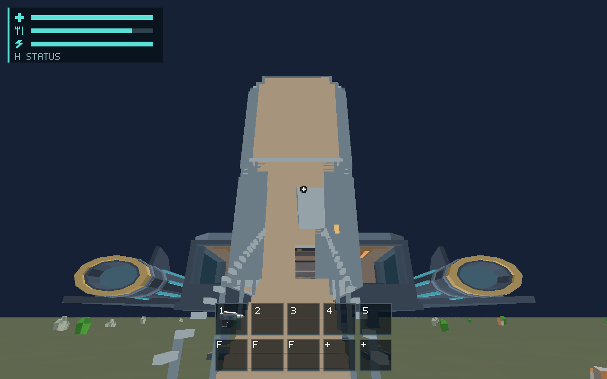

# #545 — completed modular ship construction

[PR #631](https://github.com/mr-exception/salimon/pull/631) delivers the live
construction adapter, replacing this PR's earlier draft-only assembly primitive.
The maintained [contract](../../docs/modular-construction.md) records source,
controls, migration, ownership and the boundaries of later Building issues.

## Delivered and verified

- One 40 kg iron supply and one 300-second project install four distinct 3 m
  cells across two decks. Final-tick preflight stages the whole graph, including
  connector/boarding geometry; failed clearance spends no final joule and creates
  no collider. Completed rooms, hull/deck cells and manual internal doors use the
  existing automatic-work owner rather than an extra Start action.
- Floors, ceilings, 1.4 m doorways, clipped/tapered exterior panels, internal stairs,
  hatch, landing and guard rails have shared production render/collision geometry.
  Both decks support body-clear movement, jumping and artificial-gravity/zero-G
  policy. Original authored hull/Core/fixtures retain their precision anchors.
- The original cargo gate connects the first room; the outermost room provides
  an exterior doorway, boarding stairs and visible E controls. Gate occupancy and
  terrain admission protect the route. A full native walkthrough leaves for the
  surface and boards again. New exterior panels block surface/EVA body sweeps.
- Completed cell IDs and face addresses remain independent, with atomic assembly,
  domain save/damage APIs and source-derived reconstruction. Delete removes only
  an eligible shared internal partition, preserving its frame and material mass.
  Real builder input, checkpoint changes, expansion around completed rooms and
  exact edited-source reload are covered by portable tests. Gameplay combat,
  damage producers, salvage and detached-wreck composition remain #549.
- Completed reservations allow supported furnishings inside rooms. Manual internal
  pocket doors retain saved open/closed state and reject occupied closure. Schema
  18 rebuilds topology and geometry without clock credit or duplicated identities.
  Legacy two-cell room reservations stay unchanged/cancellable, rather than being
  silently enlarged into the new staircase footprint.
- Structural receipts transfer once to per-cell installed mass. Cargo identity,
  ship-local support and mass survive upper-deck reload; boarding cargo uses its
  actual lower support rather than snapping up to the original cabin floor.

## Validation

Linux x86_64; rustc 1.99.1 (58cf8f9c3 2026-10-13), task-local Rust/native sysroot.
Source `/workspace/.salimon-tools/env.sh` before Cargo commands. Final source
revision, binary/input hashes and render environment are in
[native context](native/context.json).

| Command | Actual result |
| --- | --- |
| `cargo test --workspace --locked` | 981 passed, 38 ignored; [complete raw output](workspace-tests.log) |
| `cargo test -p salimon-client --locked construction` | 26 passed, [log](construction-tests.log) |
| `cargo build --workspace --locked` | Passed, [log](workspace-build.log) |
| `cargo clippy --workspace --all-targets --locked -- -D warnings` | Passed, [log](workspace-clippy.log) |
| `cargo fmt --all -- --check` | Passed |
| `python scripts/check_docs.py --base 58c62ebc945487fac90f5a731de287999b5080d0` | Passed, zero findings; [log](documentation.log) |
| `python -m unittest discover -s scripts -p 'test_salimon_test.py'` | 21 passed, [log](runner-tests.log) |
| `git diff --check` | Passed |

Workspace ignored tests remain opt-in, as listed in the log; they are not passes.
After the broad run and captures, the existing expansion regression gained an
explicit occupied-old-boarding-route assertion. All 26 construction tests and
workspace Clippy passed again. This test-only addition changes no captured code.
The earlier draft-phase ALSA discovery failure is preserved in
[its original log](workspace-initial-alsa-failure.log); extracting libasound2-dev
and libasound2t64 into the task sysroot resolved it before successful reruns.
Development failures found stair-body clearance/aisle problems and missing outer
access. The final tests and walkthrough cover the corrected paths.

## Production renderer walkthrough

```sh
python scripts/salimon-test run scenarios/evidence/construction-room.json \
  --binary target/debug/salimon-client --artifacts artifacts/545/native \
  --screenshot-command '["native"]' --summary
```

Run with a fresh Xvfb display and lavapipe/Vulkan. The scenario seeds only a
reservation, one carried 40 kg iron sphere, the open gate and review camera.
E feeds that same sphere through normal intake; 3,000 × 100 ms protocol frames
pay the full 300 seconds. Assertions verify halfway/completion, upper-deck eye
height, surface exit and boarding return. Controls exercise real session/native
adapters; they are not OS-injected physical keyboard evidence or a mining journey.

All **51 scenario steps passed**. Captures use production wgpu at 1280×800,
scale 1, Vulkan, llvmpipe (LLVM 19.1.7, 256 bits), Mesa 25.0.7. Original
[protocol/state/render logs](native/protocol.zip) and [context](native/context.json)
retain input, scene, source/binary and adapter provenance. The report driver does
not promote these images into an approved baseline.






[Failed native attempts](native/failed-attempts.zip) retain a rejected >600-frame
protocol request, stale X display, and a route blocked by the real boarding rail.
The final route splits bounded requests, uses a fresh display and walks through
the body-clear aisle; no collision tolerance was relaxed to pass the driver.
Early uniformly colored captures exposed poor legibility; final shared solids
use distinct deck/panel/tread colors and visible physical guard rails.

## Remaining owners and practical limits

There is no remaining deferred #545 implementation in this PR. Separate planned
features retain their owners: module commissioning #547, exterior stop/takeoff
interlocks #546, gameplay damage/salvage #549, offline construction #550, and
power/pressure/decompression networks in their existing future contracts.

Human visual approval remains [#561](https://github.com/mr-exception/salimon/issues/561):
review these originals for bare-room proportions, doorway/stair/hatch readability,
clipped exterior panels, gate controls and material contrast. They establish actual
software-Vulkan output, not approval of final art. Physical input/display/OS checks
remain [#557](https://github.com/mr-exception/salimon/issues/557); device speaker
output was unavailable. Hardware/Metal budgets remain
[#563](https://github.com/mr-exception/salimon/issues/563). Software render timings
in the retained states are diagnostics, with concurrent cloud workload possible;
they establish neither M1 60 FPS nor actual hardware GPU budgets. No native-device,
source-rights, baseline or hardware acceptance is inferred from this cloud run.
