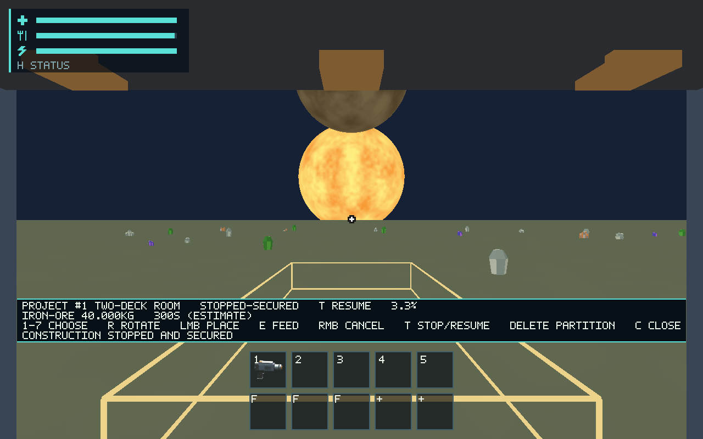
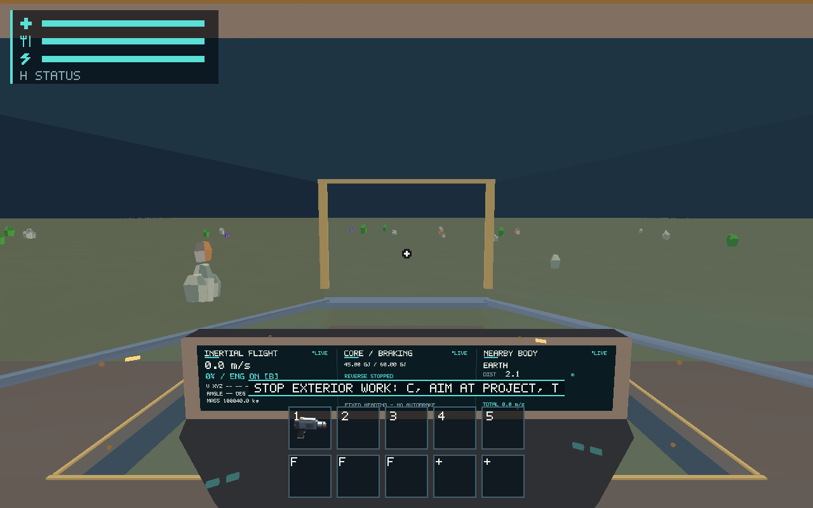

# Construction flight interlocks — #546

Branch: `codex/issue-546-construction-interlocks`, based on main
`95b5fc04076718c72b6ab7026cf4f440b3cd6679`. PR targets `main`.

## Outcome

Consequence-based exterior work blocks takeoff until explicitly stopped and
physically secured or cancelled. Native C/aim/T Stop/Resume preserves exact
receipts, progress and mass. Actual completed graph/faces/attachment condition,
not a category label or saved “safe” flag, governs readiness. Forced flight
latches exterior work without spending construction energy or changing inertial
momentum; landing never resumes it. Interior coasting construction retains its
existing paid-work path. Existing actual Core/engine/cockpit/ramp gates remain.

The current implementation publishes full sealed geometry atomically, so intact
unfinished work has no partial hull cut or temporary physical collider to undo.
A supported undamaged site can secure immediately; damaged sites and actual
missing hull faces/support remain blocked. General physical damage creation and
salvage retain #549; module commissioning/downtime retain #547. No fake module
state, damage control or new pressure/decompression simulation is introduced.

Schema 19 persists the validated stop latch and checkpoints its transitions.
Older records default to unstopped, while historical envelopes carrying an
active latch reject before replacing the live session. Restore grants no work.
See the [canonical contract](../../docs/construction-flight-safety.md).

## Source and verification mapping

- Runtime `session/construction/flight.rs`: explicit reachable Stop/Resume,
  dynamic securing/readiness, airborne latch and contextual cockpit guidance.
- Ship `structure/construction.rs`: validated durable `Work.stopped` and
  paid-work rejection while stopped. Runtime persistence accepts/migrates schema
  19; checkpoint events include stop transitions.
- Runtime `app/input.rs` and protocol alias `construction_stop_resume` route T
  through the same builder admission; `app.rs` maps readiness to existing
  bottom-center flight guidance/window title, without changing GPU pipelines.
- `session/construction/flight/tests.rs`: takeoff refused/allowed, exact
  stop/save/legacy rejection, damaged site, real missing support/face, forced
  flight momentum/landing continuation, interior coasting, proportional physical
  refunds, completed neighbor preservation, ramp/Core/engine gates.
- Production evidence scenarios exercise T and E/RMB transactions plus cockpit
  takeoff refusal through native protocol adapters, with actual wgpu readback.

## Environment and setup

Debian 13 x86-64, Rust/Cargo stable 1.99.1; exact compiler and host/CPU metadata
are in [toolchain](toolchain.txt) and [host](host.txt).
This fresh executor lacked Rust and graphical/development packages. Rustup
installed the documented stable toolchain. System apt installation was denied by
OS permissions. Official Debian packages were downloaded/extracted under
`/workspace/tooling546/root`, with task-local pkg-config/library/Xvfb/lavapipe
paths. Initial ALSA discovery/link failures were setup failures, corrected before
reruns; they do not constitute passing validation. No system files or tracked
build configuration changed. Runtime `env.sh` remains outside the repository.

## Checks

All checks passed on the final source, with 38 existing opt-in tests ignored:

| Check | Result |
| --- | --- |
| `cargo test --workspace --locked` | 989 passed, 38 existing opt-in ignored |
| `cargo test -p salimon-client --locked construction` | 34 passed; also included in final workspace run |
| `cargo build --workspace --locked` | Passed |
| `cargo clippy --workspace --all-targets --locked -- -D warnings` | Passed |
| `cargo fmt --all -- --check` | Passed |
| `python -m unittest discover -s scripts -p test_salimon_test.py -v` | 21 passed |
| `python scripts/check_docs.py` | Zero failures |
| `python scripts/check_docs.py --base origin/main` | Zero failures on committed changes |
| `python -m unittest discover -s scripts -p test_check_docs.py -v` | 5 passed |

Raw output is retained in [checks](checks/). Source/assets and the final binary
are recorded in [source inventory](source-sha256.txt) and [binary hash](binary-sha256.txt).
Initial missing-ALSA/link-path failures and the runner's missing new-fixture
allowlist failure are retained as development/setup failures, corrected before
successful final checks. No failed attempt is counted as a passing result.

## Production renderer evidence

Both routes use the actual application, protocol-to-native key dispatch and GPU
readback on Xvfb, llvmpipe LLVM 19.1.7 / Mesa 25.0.7 Vulkan, 1280×800, scale 1.
Fresh process/save/output directories isolate each run. These are protocol inputs,
not OS-injected or physical keyboard qualification.

```sh
. /workspace/tooling546/env.sh
DISPLAY=:89 python scripts/salimon-test run scenarios/evidence/construction-interlocks.json --binary target/debug/salimon-client --artifacts artifacts/546/final --screenshot-command '["native"]' --summary
DISPLAY=:89 python scripts/salimon-test run scenarios/evidence/construction-interlocks-cockpit.json --binary target/debug/salimon-client --artifacts artifacts/546/final --screenshot-command '["native"]' --summary
```

The first route seeds one room reservation, one carried 40 kg sphere, open gate
and review view; E supplies it through actual intake. T freezes paid progress at
3.3333%, remains frozen over the next ten seconds, explicitly resumes to 6.6666%,
then stops and cancels through the existing physical-refund transaction. The
cockpit route seeds that same funded exterior project, closes the actual ramp,
and seats/aims the review camera. L must retain landed state and show the remedy.
These explicit fixtures do not demonstrate a mining journey or physical travel.
Final runs passed **21/21** and **5/5** steps respectively.





Final original images, structured states, protocol/stdout/stderr, run context and
individual results are retained under [evidence](evidence/); compact summaries link the lossless full results. Full results/log/state files are
losslessly gzip-compressed; raw byte hashes and sizes are retained beside them.
The EGL probe warnings in stderr precede successful Vulkan selection/capture;
actual adapter/backend metadata is retained in the state records. The runner terminates the test process after all steps (recorded exit -15); this is not a normal-shutdown test. Audio is not
under test and E2E playback is isolated.

## Limitations

Software Vulkan evidence establishes the recorded Linux renderer/protocol path.
It does not establish physical keyboard/display input, Metal fidelity, actual
M1 frame budgets or subjective readability approval. Those existing criteria
remain #557, #563 and #561 respectively. This implementation makes no hardware
performance or pressure-simulation claim. Docked permission exists in the
portable placement model; playable docking is not implemented.
