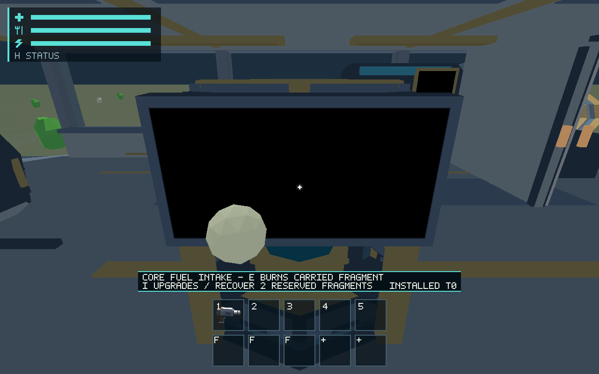
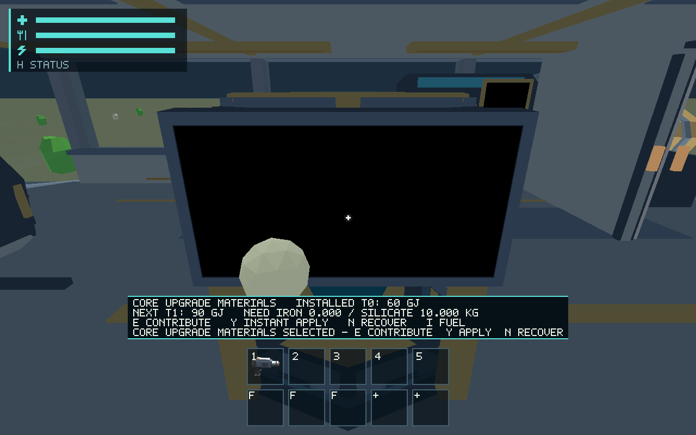
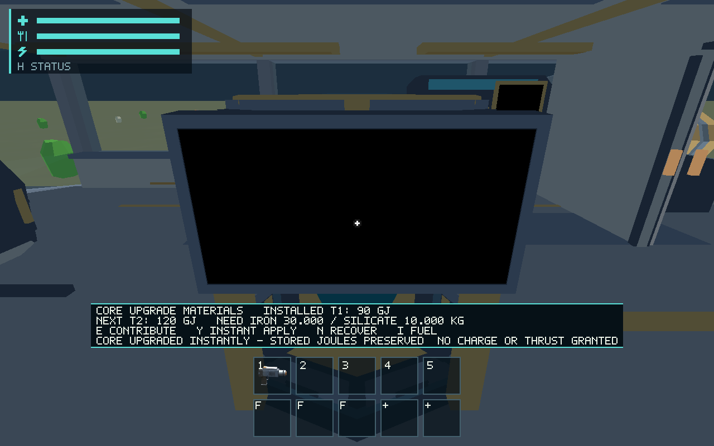
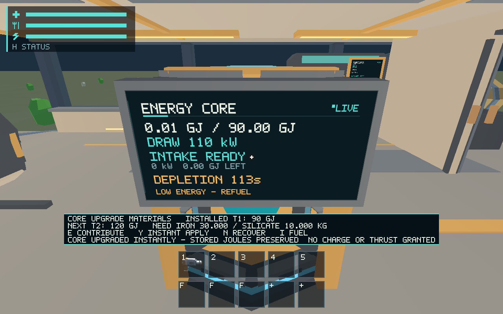

# #548 instant direct-material Core upgrades

Adds the explicit Core exception with separate persistent Fuel/Upgrade Materials
input modes, original fragment receipts, recoverable pending contributions and an
instant capacity-only transaction. The same Core preserves fractional charge,
fuel conversion, live assist reservations, motion, engine switch and throttle.
No construction site/timer, power cost, battery, shutdown or commissioning wait.
See [the maintained source/transaction contract](../../docs/core-upgrades.md).

## Owner-authorized balance

The owner explicitly asked Codex to choose balanced values on 2026-10-24. The
reviewable JSON catalog provides 90/120/180 GJ capacities, with incremental
iron/silicate costs of 20/10, 30/10 and 40/20 kg. This is 3/4/6 full 10 kg fragments;
all tiers require 130 kg. At 2 kg/s, extraction alone is approximately 15/20/30 s,
plus real travel and carrying. This rationale is not a measured acquisition test
or approval of the unrelated construction economy. No tier changes thrust or fuel
efficiency, and increased capacity never fills itself.

## Validation

Host/toolchain: [environment](environment.json). All checks use locked dependencies.

- `cargo test --workspace --locked`: pass (391 runtime, 98 ship, 73 character, 80 renderer; existing ignored lanes retained).
- Focused `cargo test -p salimon-client --locked session::core_upgrades`: 8/8 pass after final source safeguards. Covers sufficient/insufficient material, full progression, zero charge, idempotency, exact original-ID refunds, blocked/occupied return, oversize/wrong material/non-milligram rejection, corrupt source, exact save/restore, mass, fractional joules, active fuel conversion and a live takeoff reservation.
- `cargo clippy --workspace --all-targets --locked -- -D warnings`, `cargo fmt --all -- --check`, `git diff --check`, `python3 scripts/check_docs.py`: pass.
- `python3 -m unittest discover -s scripts -p test_salimon_test.py`: 21/21 pass.
- `python3 scripts/salimon-test run scenarios/evidence/core-upgrade-blackout.json --binary target/debug/salimon-client --artifacts artifacts/548/blackout-final --screenshot-command '["native"]' --summary`: 24/24 pass.
- Same runner with `core-upgrade-powered.json` and `artifacts/548/powered-final`: 24/24 pass. Powered route preserves 12,345,678 whole displayed joules; blackout route preserves zero while capacity rises to 90 GJ. Repeated activation preserves both values. Fractional precision is established by the source test, not rounded display telemetry.

Original [results](native/results.json), [state/resource observations](native/observations.json),
[protocol archive](native/protocol.zip) and [validation logs](validation.zip) are retained.

Native evidence explicitly seeds two 10 kg iron receipts and one physical 10 kg
silicate sphere in hand through the production sphere/intake lifecycle, then uses
normal I/E/Y commands. It does not establish mining/travel acquisition or physical
keyboard/device qualification. Images use actual production-wgpu 1280×800 readback;
background capture stalls are retained and are not hardware FPS acceptance. The
same shared buffers/rendering paths remain in use; no new model/texture is added.
Original CPU/GPU counters are retained; unavailable allocator/device counters are
not invented.

## Documentation impact and boundaries

Updated ship/world/runtime/persistence owning architecture/invariants and guides,
resource ownership, schema 14, root routing, user/native scenario controls, accepted
Core exception and Project Q&A balance decision. Behavior maps from
`ship/core_upgrades.rs`, world reserved-return and runtime session/tests to the
[Core upgrade contract](../../docs/core-upgrades.md). Local links and same-PR impact
are checked. Original pre-final logs remain dated evidence; Clippy's initial range
lint was corrected and the final lint passes.

Whole fragments exceeding the remaining cost are rejected unchanged; there is no
invented split remainder. Recover partial contributions with N when a full fragment
will not fit. Costs are integer milligrams with original f64 physical receipts;
non-milligram quantities are declined rather than losing material. Pending receipt
storage is explicitly bounded to 128 pieces. Applied receipts are a nonspendable
installed-matter audit and cannot be refunded or burned. Physical readability and
subjective balance remain reviewable in this PR; human appearance/audio #561,
physical platform #557 and hardware budgets #563 remain separate. Normal
construction economy/source-rights decisions in #537 are not implied by this
owner-authorized Core balance choice.
