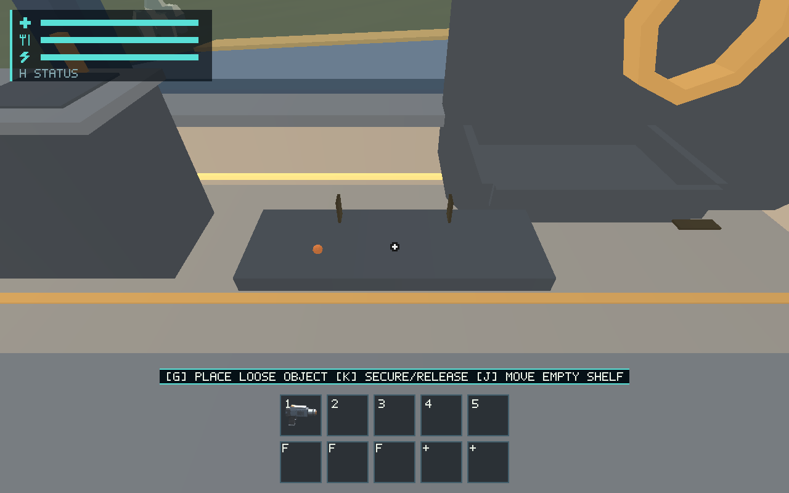
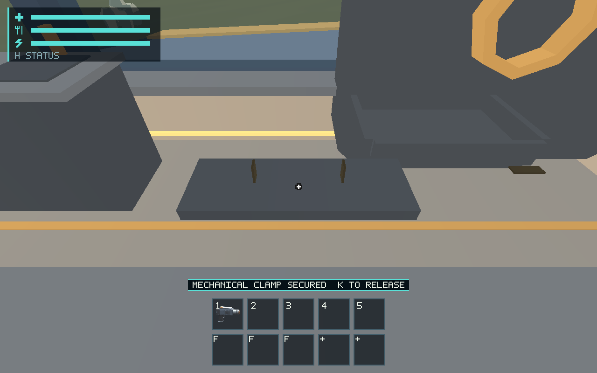

# #576 physical placement, explicit restraints and portable accessory

Implements G physical placement, K secure/release and J empty-shelf relocation
through the production command path. Original resource identities/material/mass
remain world-owned; a movable fixture shares the same carry slot. Ship attachments
and dry-equipment boundary accounting remain portable. Character/loose-object
collision and production fixture rendering consume the same physical source.
Schema 11 validates children/rails/carry state atomically and migrates old layouts
without adding colliding furnishings. See [the maintained contract](../../docs/physical-mounts.md).

## Validation

Host: macOS / Apple M1; exact toolchain and base in [environment](environment.json).

- `cargo test --workspace --locked`: pass, including 373 runtime tests (16 ignored), 94 ship tests (1 ignored), 73 character tests and 80 renderer tests (15 ignored). Final focused `session::mounts` (4/4) plus ship/character tests pass after the final restore/placement safeguards.
- `cargo clippy --workspace --all-targets --locked -- -D warnings`, `cargo fmt --all -- --check`, `git diff --check` and `python3 scripts/check_docs.py`: pass.
- `python3 -m unittest discover -s scripts -p test_salimon_test.py`: 21/21 pass.
- `python3 scripts/salimon-test run scenarios/evidence/physical-mounts.json --binary target/debug/salimon-client --artifacts artifacts/576/native --screenshot-command '["native"]' --summary`: all 17 steps pass. Compact [result](native/result.json), [protocol/state archive](native/protocol.zip) and [hash inventory](native/sha256.json) are retained.

These are direct production-wgpu 1280×800 images. The initial condition explicitly
seeds one 32 g iron sample through the production sphere lifecycle; it does not
prove mining, travel or measured acquisition. The sample lies under the center
reticle after placement; structured state establishes its exact identity. The
small template clamp bars show discrete released/secured positions; synchronized
acoustic presentation remains #583. Human appearance approval is not granted.

Initial verification exposed and fixed old-layout benchmark interference, old
schema test builders retaining new source fields, a too-restrictive propulsion
minimum for the removable 2 kg shelf, and continuous hand motion incorrectly
entering discrete autosave events. Two early native capture runs timed out;
the final route uses explicit window restoration and bounded 30 s step deadlines.
The failed capture attempts are retained in [validation archive](validation.zip),
not counted as passes. The final route verifies release by source assertion; it
does not claim a fourth release screenshot.

The 2 kg shelf mass is a reviewable source parameter, not an empirical density or
hardware measurement. New construction room populations and real damage/parent
removal integrations require their owning implementations; this PR validates the
explicit release API and current starter fixtures without claiming those future
features have shipped.

## Scope and remaining owners

New fixture fabrication/room geometry and actual structural damage remain with
#542–#545/#549; placeholders alone grant no physical fixture. Existing hollow bins
remain #539 and operable cabin containers/furniture #577. This PR introduces no
new construction costs/timers, age/damage authority or acoustic events (#583).
Human visual acceptance remains #561; device/performance gates #557/#563.
