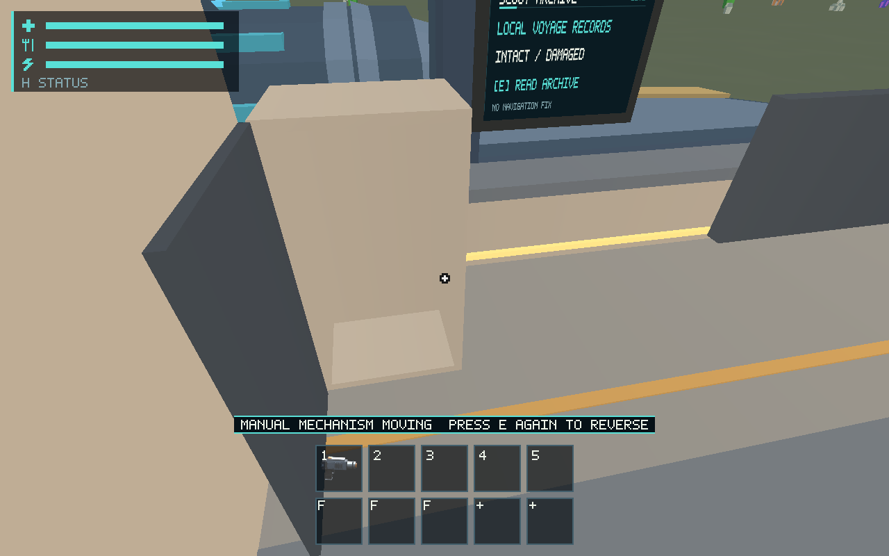
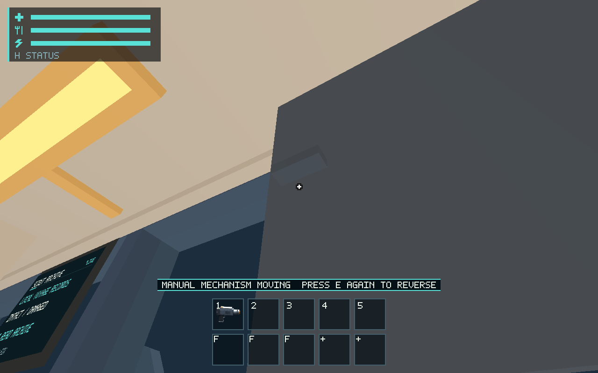
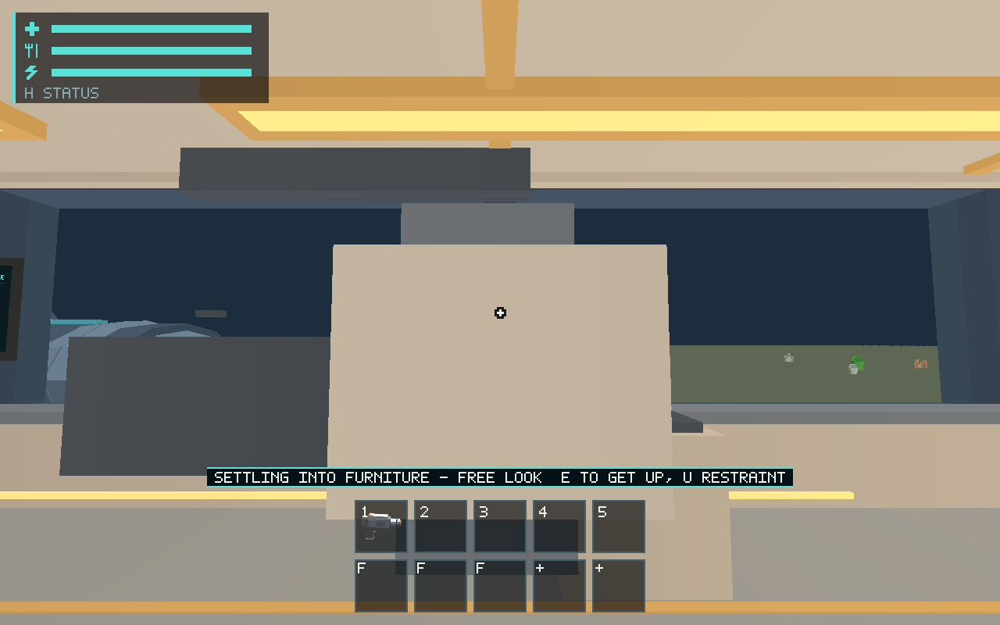

# #577 compact Scout habitation

Manual table, padded folding seat, segmented privacy screen, observation shutter,
hollow locker, supported sitting/lying and visible restraints now use production
session commands and independent fixture transforms. Short smooth transitions
retain free look and normal simulation time. Swept obstruction keeps player and
original resource identities intact; mechanisms reverse and operate during
blackout. Galley and hygiene retain their existing authoritative behavior.
See the [maintained contract](../../docs/cabin-mechanisms.md).

## Validation and evidence

Host: macOS 26.2 / Apple M1, Rust 1.89; authored/exported with Blender 4.5.3.
The library passes exact named-template generic geometry validation: 200 triangles,
10 primitives, three shared materials, 21,044-byte GLB, no textures. Runtime tests
compare actual imported mesh bounds with physical proxies and rotational extrema.

- `cargo test --workspace --locked`: pass (381 runtime tests, 95 ship, 73 character, 80 renderer; existing ignored lanes remain ignored).
- Focused `session::cabin`: 8/8 pass; disk persistence scenarios: 8 pass / 4 ignored.
- `cargo clippy --workspace --all-targets --locked -- -D warnings`, `cargo fmt --all -- --check`, `git diff --check`, `python3 scripts/check_docs.py`: pass.
- `python3 -m unittest discover -s scripts -p test_salimon_test.py`: 21/21 pass.
- Production-wgpu native routes: original seat/restraint sequence 24/24, final free-look sequence 25/25, locker 7/7, table 7/7, corrected bunk/shutter/restraint sequence 24/24. Exact commands use `python3 scripts/salimon-test run scenarios/evidence/<scenario>.json --binary target/debug/salimon-client --screenshot-command '["native"]' --summary` with the checked scenarios `habitation-use`, `cabin-locker`, `cabin-table`, `cabin-bunk`. Original images and structured protocol are in [native results](native/results.json) and [protocol archive](native/protocol.zip); command logs including failed attempts are in [validation](validation.zip).

The explicit evidence setups choose initial camera positions only; later E/X/U
commands, animation, collision, prompts and rendering use production paths. They
do not establish a continuous walked tour or subjective camera comfort. Captured
locker view reports 8 visible instances, 4 fixture draws, 18,128 resident geometry
bytes and 928 instance-capacity bytes; culling makes these view-dependent.
Original timing counters are retained, including background capture stalls. They
are not a performance acceptance run; allocator counters and audio output device
are unavailable. Blackout/restoration and privacy obstruction are covered by
portable source regressions, not claimed as physical-device native evidence.

Initial verification found and corrected legacy-save test builders retaining new
fields and restoration of derived collision caches clearing serialized sleep
history. The new locker regression also verifies that a player in the door swing
stops it, while a clear approach exposes the same contents. One capture attempt
used an old binary before build completion; another timed out after writing a
capture. Failed attempts remain in the validation archive and are not passes.

## Documentation impact and limits

Updated runtime/character/renderer/ship architecture and invariants, root ownership
routing, schema-12 save contract, input usage and asset regeneration instructions.
`session/cabin.rs`, its tests and the native evidence scenarios map to the canonical
[cabin contract](../../docs/cabin-mechanisms.md). Older saves receive no new colliders.
The checked library supplies independent moving fixtures; future constructed room
populations (#545) remain with their owner. Light preferences/switch logic (#580)
and synchronized mechanical audio (#583) are separate existing tickets. Native
captures establish production rendering, not human comfort/appearance approval
(#561), physical device qualification (#557) or hardware frame budgets (#563).
